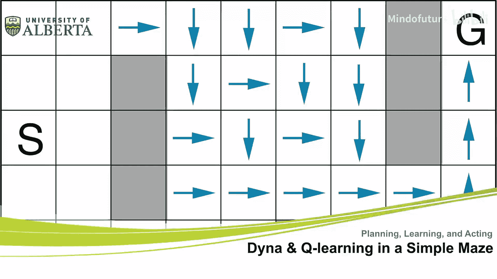
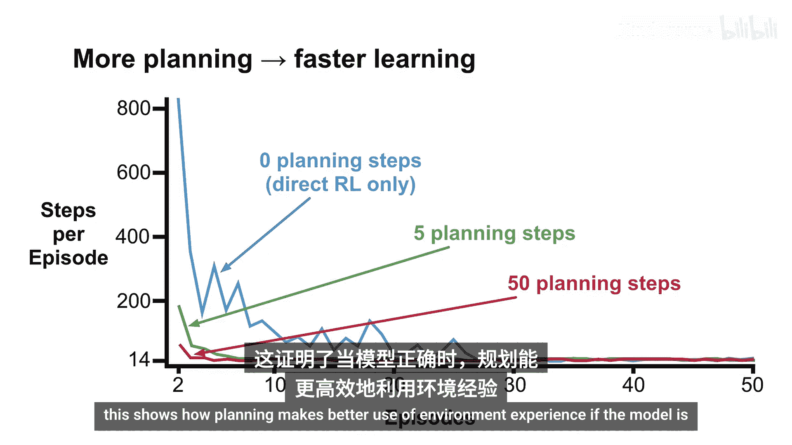
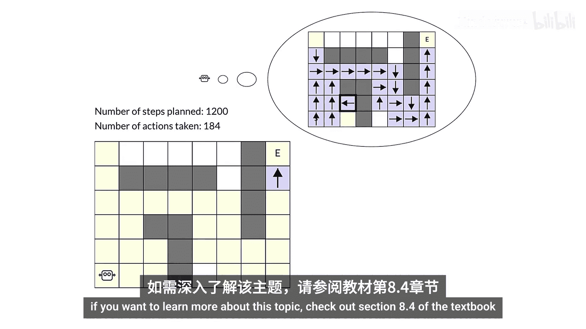

# 034：简单迷宫中的Dyna-Q学习

## 概述

在本节课中，我们将通过一个简单的迷宫环境，对比分析表格型Dyna-Q算法与无模型Q学习算法的性能。我们将重点关注规划步骤如何影响学习效率，并解释模型如何让智能体以更少的环境交互次数学习到有效策略。

---

## Dyna-Q架构回顾

上一节我们介绍了Dyna-Q的基本架构。Dyna-Q结合了规划、学习和行动三个过程。智能体在与真实环境交互获得经验的同时，也利用学到的模型进行模拟经验学习，从而更高效地更新价值函数。

## 实验设置

本节中我们来看看具体的实验配置。我们使用一个简单的网格世界迷宫环境进行测试。

以下是实验的关键参数：
*   智能体拥有上、下、左、右四个动作。
*   进入目标状态（G）获得+1奖励。
*   所有其他状态转移的奖励均为0。
*   这是一个分幕式任务，折扣因子γ设为0.95。

我们将对比三个智能体，它们都使用相同的学习率α=0.1和探索率ε=0.1，并且所有状态-动作对的初始价值估计都设为0。

## 性能对比：规划步骤的影响

我们运行实验50幕，重复30次后取平均结果。通过绘制智能体完成每幕所需平均步数随幕数增加的变化曲线，我们可以评估算法性能。曲线越低表示性能越好。

以下是三种配置的结果分析：
1.  **Dyna-Q（0步规划）**：这等价于标准的Q学习算法。其性能提升缓慢，最终稳定在每幕约14步的水平。
2.  **Dyna-Q（5步规划）**：该智能体达到与Q学习相同的最终性能，但学习速度显著加快。
3.  **Dyna-Q（50步规划）**：仅需大约3幕就能找到优秀策略，学习效率极高。

这个对比清晰地表明，在模型准确的前提下，规划能极大地提升对环境经验数据的利用效率。在相同次数的真实环境交互后，Dyna-Q能学到更多知识。

## 搜索控制与规划效率

让我们更细致地观察搜索控制如何影响规划过程。我们通过一个略有不同的迷宫环境来可视化价值函数的更新。

初始时，所有状态都没有箭头，表示策略下所有动作的概率均等。经过第一幕后，Q学习只更新了一个状态-动作对的价值——即目标旁边状态执行“向上”动作的价值。因为这是唯一观察到非零奖励转移的状态。需要更多幕的体验，价值信息才能“回溯”到附近的其他状态。

为了强调搜索控制的重要性，我们设计了一个实验：智能体每次连续调用规划循环10次，每次进行10步规划（总计100步规划）。结果显示，许多规划更新并未改变价值函数。事实上，经过100步规划，智能体只更新了两个状态-动作对的价值。

即使将每次规划的步数增加到100步，最初的几次规划调用也仅更新了少数几个动作价值。造成这种现象的原因是：**搜索控制随机采样状态-动作对**。如果采样的状态-动作对产生的时序差分误差（TD error）为零，那么这次规划更新就无效。在这个奖励稀疏（除目标外均为0）且初始价值为0的环境中，这种情况经常发生。

反之，如果我们能以更高效的方式排序状态-动作对，智能体可能仅用六分之一的规划更新就能学到优秀策略。在大规模环境中，随机搜索控制带来的效率问题会更加突出。

## 总结

本节课中，我们一起学习了在简单网格世界中对表格型Dyna-Q算法的测试。我们看到，规划能够戏剧性地加速学习过程。在我们的实验中，规划步骤越多，智能体的表现就越好。关键在于，一个准确的模型允许智能体从更少的真实环境交互中学习，通过模拟经验大幅提升数据利用效率。