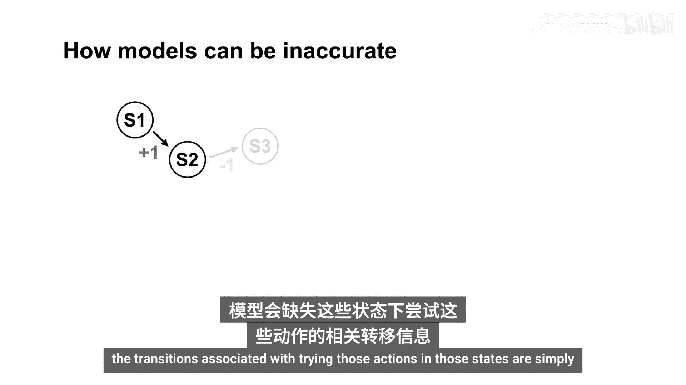
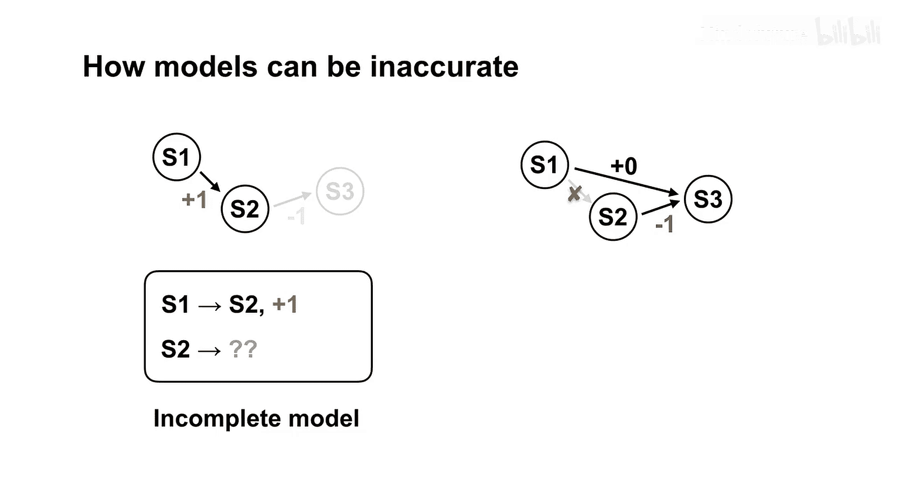
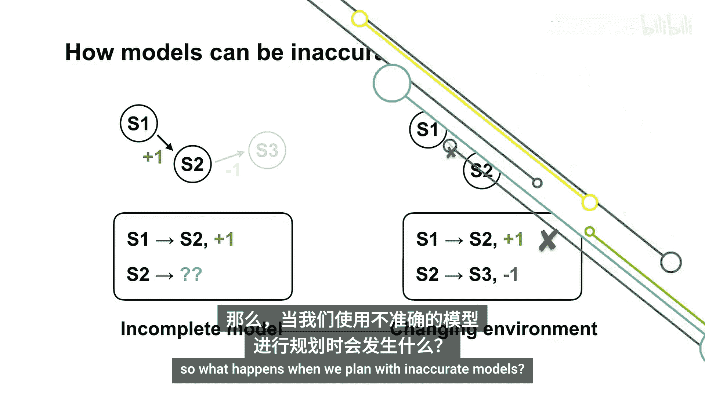
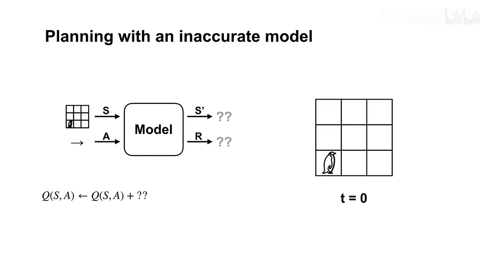
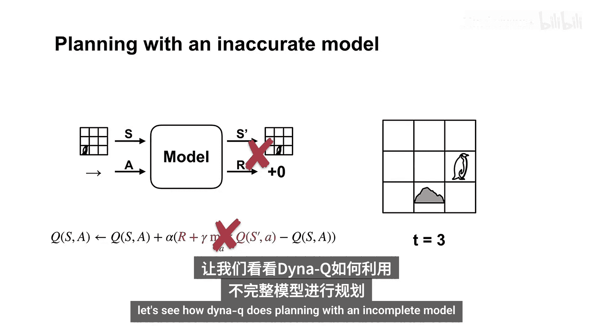
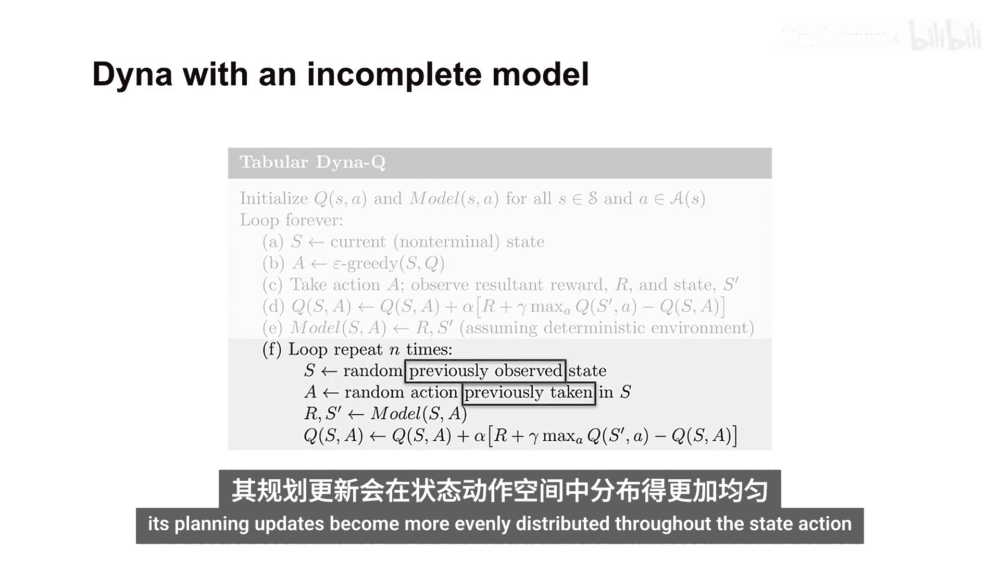

# 035：如果模型不准确怎么办

在本节课中，我们将要学习当智能体使用不准确的模型进行规划时会发生什么。我们将探讨模型不准确的两种主要形式，分析其对规划过程的影响，并介绍一种能够在不完整模型下成功规划的算法。

到目前为止，在课程中我们已经讨论了智能体如何利用模型生成的“经验”进行规划，从而改进其策略或价值函数。

但是，如果智能体使用来自不准确模型的经验进行规划，会发生什么情况呢？

## 模型不准确的含义

首先，我们来谈谈模型不准确意味着什么。当模型存储的状态转移与实际环境中发生的情况不同时，模型就是不准确的。

在学习初期，智能体尚未在几乎所有状态下尝试过大部分动作。与在这些状态下尝试这些动作相关的转移信息，在模型中完全是缺失的。

我们将这种缺失转移信息的模型称为**不完整模型**。

如果环境发生变化，模型也可能变得不准确。在某个状态下采取一个动作，可能导致的下一个状态和奖励，可能与智能体在环境变化前观察到的情况不同。

我们说模型不准确，是因为实际发生的情况与模型所描述的情况不同。

## 使用不准确模型进行规划的影响

那么，当我们使用不准确的模型进行规划时会发生什么？

使用不准确模型进行规划的效果，取决于模型不准确的具体方式。

在初期，模型是不完整的。由于模型无法产生下一个状态或奖励，因此无法用于规划。然而，随着智能体与环境交互，模型会存储越来越多的转移信息。

然后，智能体可以通过模拟它以前见过的转移来执行更新。这意味着，只要智能体见过一些转移，它就可以使用模型进行规划。

现在，让我们思考环境变化如何影响规划。

想象一下，智能体已经访问过每一个“状态-动作”对，并将其经验存储在模型中。然后环境发生了变化。模型中的一个转移不再反映环境中的真实转移。

当智能体试图使用其不准确的模型进行规划时，会发生什么？

如果智能体尝试使用模型中一个不正确的转移来执行规划更新，那么智能体更新的价值函数或策略可能会朝着错误的方向改变。

请记住，规划是根据模型认为会发生的情况来改进策略，而不是根据环境中实际会发生的情况。当环境变化时，模型就过时了。使用该模型进行规划，很可能会使智能体的策略相对于环境变得更差。

## 如何在不完整模型下成功规划

既然我们已经了解了模型不准确的两种主要方式，现在让我们思考智能体如何能够在不完整模型下成功规划。

实际上，我们已经介绍过一种这样的算法：**Dyna-Q**。

让我们看看Dyna-Q是如何在不完整模型下进行规划的。

在规划步骤中，我们必须确定使用哪些“状态-动作”对来查询模型。模型只知道它已经访问过的“状态-动作”对的下一个状态和奖励。

因此，Dyna-Q只能从先前访问过的“状态-动作”对进行规划更新。Dyna-Q只规划它已经见过的转移，所以在学习的最初几个时间步，Dyna-Q可能会对同一个转移进行相当多的规划更新。

然而，随着Dyna-Q在环境中访问更多的“状态-动作”对，其规划更新在整个“状态-动作”空间中的分布会变得更加均匀。

## 总结

本节课中我们一起学习了模型不准确的问题。我们了解到，模型可能因为不完整或环境变化而变得不准确。使用不准确的模型进行规划，是根据模型而非环境来改进策略或价值函数。而Dyna-Q算法通过仅采样先前访问过的“状态-动作”对，能够在不完整模型下进行规划。

下次见。