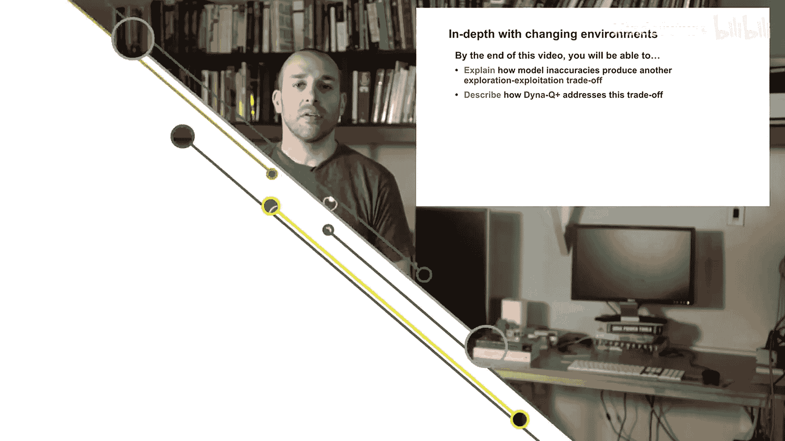
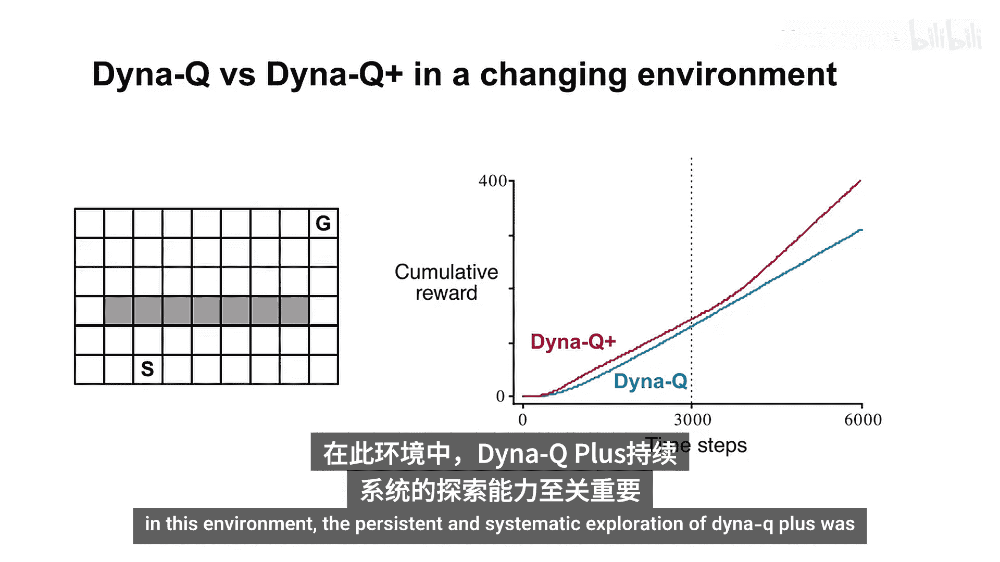

# 036：深入了解变化的环境

在本节课中，我们将要学习当智能体的环境模型因环境变化而变得不准确时，智能体应如何应对。我们将探讨模型不准确性如何引发新的探索与利用权衡，并介绍Dyna-Q+算法如何通过探索奖励来解决这一挑战。

## 模型不准确性的影响

上一节我们讨论了智能体如何在模型不完整的情况下进行规划。本节中，我们来看看当模型因环境变化而变得不准确时会发生什么。

当智能体的模型不准确时，基于此模型的规划很可能会使策略或价值函数相对于真实环境变得更差。这意味着智能体有强烈的动机去确保其模型保持准确。

## 模型更新与探索的必要性

以下是一个模型更新的例子：
*   一个兔子模型最初认为，在最左侧格子选择“向右移动”动作会直接到达胡萝卜。
*   然而，在实际执行“向右移动”后，兔子发现自己处于中间格子。
*   经历这次状态转移后，兔子可以更新它对世界的模型，以反映“在最左侧格子选择向右移动会到达中间格子”这一事实。

这个例子表明，智能体在环境中经历一次转移后可以修正其模型。然而，在变化的环境中，智能体的模型可能随时变得不准确。因此，智能体面临一个选择：是去探索以确保模型准确，还是假设模型正确并利用它来计算最优策略。

当环境发生变化时，模型会变得不正确，并且会一直保持不正确，直到智能体重新访问环境中发生变化的那个部分并更新模型。这表明，智能体应该探索它很久没有去过的地方。

## 引入探索奖励的Dyna-Q+算法

粗略地说，智能体很久没有访问过的状态，其模型更可能是错误的。为了鼓励智能体定期重新访问状态，我们可以在规划时使用的奖励上增加一个奖励加成。

这个加成公式是：`R + κ * √τ`。其中：
*   `R` 是模型给出的奖励。
*   `τ` 是自该状态-动作对上次在真实环境中被访问以来所经过的时间（注意：`τ` 不在规划循环中更新，规划循环中的访问不算“真实访问”）。
*   `κ` 是一个控制奖励加成对规划更新影响程度的小常数。如果 `κ` 为零，则完全忽略加成。

将这种探索奖励加成加入规划更新，就得到了 **Dyna-Q+** 算法。通过人为地增加规划中使用的奖励，我们提高了最近未被访问过的状态-动作对的价值。

## Dyna-Q+如何鼓励探索

想象一个很久未被访问的状态-动作对 `(S, A)`。这意味着 `τ` 值会很大。随着 `τ` 增长，奖励加成变得越来越大。最终，规划过程会因为巨大的加成而改变策略，引导智能体直接前往状态 `S`。当智能体最终访问状态 `S` 时，它可能看到很大的奖励，也可能感到失望。无论如何，模型都会被更新以反映环境的真实动态。

## Dyna-Q与Dyna-Q+的对比

让我们通过“捷径迷宫”的例子来理解Dyna-Q和Dyna-Q+的区别。在这个例子中，目标是从起始状态尽快到达目标状态。除到达目标的终止转移产生+1奖励外，其他转移奖励均为0。折扣因子小于1，以鼓励智能体快速到达目标。

以下是实验设置与结果分析：
*   **前半段实验**：Dyna-Q和Dyna-Q+行为非常相似。此时，Dyna-Q+增强的探索性有助于更快地找到好的策略，因此其性能曲线在Dyna-Q之上。
*   **环境变化后**：在迷宫右侧打开一个捷径后，Dyna-Q+在环境变化后很快找到了捷径。而Dyna-Q在给定的时间内没有找到捷径。最终，Dyna-Q通过ε-贪心策略重新探索整个状态-动作空间也能找到捷径，但这需要连续执行至少7次探索性动作，因此可能需要非常长的时间。在这个环境中，Dyna-Q+持续且系统性的探索是关键。

## 总结

本节课中，我们一起学习了模型不准确性如何产生一种新的探索与利用权衡变体——智能体必须进行探索以确保其模型准确。我们还探讨了Dyna-Q+算法如何利用探索奖励加成来系统地探索环境，从而在动态变化的环境中更有效地发现并适应最优策略。