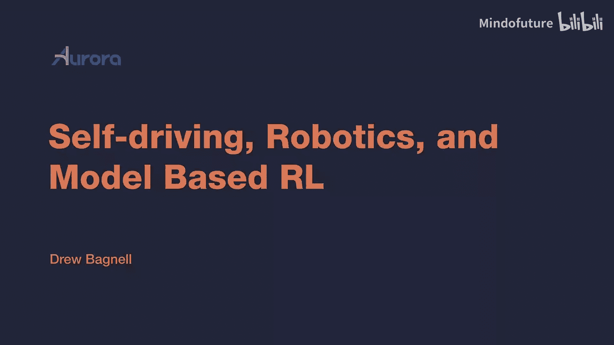
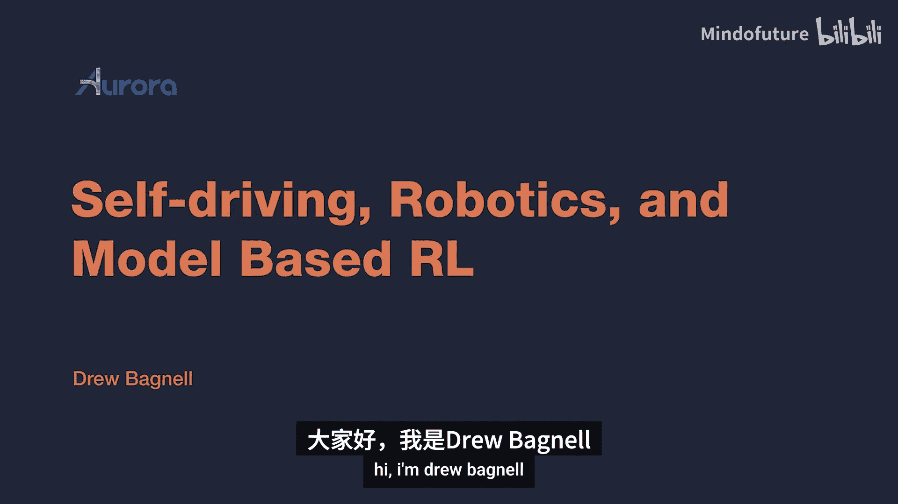

# 037：自动驾驶机器人与基于模型的强化学习 🚗🤖

在本节课中，我们将探讨自动驾驶机器人领域，并深入了解一种强大的技术——基于模型的强化学习。我们将看到，在处理连续状态和动作的复杂系统（如机器人）时，如何利用模型来高效地学习最优策略。

---

大家好，我是德鲁·巴格内尔，是 Aurora Innovation 公司的首席技术官。

今天我将与大家探讨自动驾驶、机器人技术以及基于模型的强化学习。

我们正处在一场机器人技术革命的起点，从机械臂到无人机，再到自动驾驶。这些技术通常深度依赖于机器学习。

例如，在感知领域，近二十年来，如果没有机器学习，我们几乎无法实现可靠的感知系统。

大家现在看到的视频中，是一辆自动驾驶汽车在城市环境的典型复杂场景中行驶。

蓝色部分显示的是基于机器学习的感知系统，它正在检测和理解静止与行驶车辆的运动。金色部分标识的是共享道路的骑行者，红色部分则是密集的行人群。

对于这类应用，在所有天气和遮挡条件下实现极高的准确性至关重要。

过去十年中，一个有趣的趋势是机器学习在决策过程中的重要性日益增加。

在城市环境中，决策非常复杂。例如，这里展示的是一辆自动驾驶汽车在密集的人流中寻找穿行间隙。

这项任务的难点在于场景中上下文信息和其他参与者的重要性。事实证明，为类似此处演示的问题，甚至是像停车标志或并线这样简单的情况，手工制定规则都非常困难。

大家会注意到，我讨论的这些机器人应用示例都依赖于连续的状态和动作。

这里展示的是一个将基于模型的强化学习应用于特技自主直升机控制的精彩案例。

在彼得·阿比尔及其同事的这项工作中，他们证明了可以在连续状态和动作（即模型直升机的位置、速度和控制指令）上使用基于模型的强化学习技术，并使其完成卓越的特技飞行动作。

使此类技术变得实用的关键，在于使用直升机动力学的连续状态和动作模型。

那么，模型指的是什么？

我所说的模型，指的是一个转移函数或动力学模型。这是一个将当前状态和动作映射到下一个状态的函数。同时，还有一个可以评估在特定状态和动作下成本的函数。

这个领域一个不为人知的秘密是，实际上所有涉及决策的机器人学习问题，在某种程度上都是基于模型的。

你可能会问，为什么会这样？从根本上说，机器人与世界的交互是昂贵且耗时的。常言道，宁可在仿真中“死”去，也不要在现实世界中犯错。

将这种直觉形式化的方法是讨论样本复杂度——即需要与世界进行多少次交互才能达到高性能。

我们从实践和近期的理论研究中了解到，使用模型进行学习所需的交互次数，可能比不使用模型要少几个数量级。

接下来，我将带大家了解如何利用连续状态和动作模型。

我们使用二次价值函数近似。二次价值函数近似是一种用于基于模型的强化学习的强大技术，其根源可追溯到20世纪60年代的最优控制理论。

这类技术正是上面看到的精彩直升机特技表演中所使用的，并且被广泛用于从无人机到医疗机器人，从机械臂到自动驾驶汽车的轨迹生成。

这种对价值函数的二次形式近似（同样是针对连续状态和动作）之所以特别优雅，有几个原因。

首先，对于一类简单的系统（特别是那些动力学是线性且成本是二次的系统），这种二次价值函数近似是精确的，而非近似。

对于其他问题，当动作价值函数在连续状态或动作上是凸的或局部凸的时，它被证明是对真实动作价值函数的优秀局部近似。

这里的关键在于，给定这种近似，即使面对连续动作，我们也能以闭式解的形式快速计算出最优策略。

因此，尝试实际计算最优策略是什么，是一个有趣的练习。

值得亲自动手计算一下，针对单个标量状态变量 `X` 和单个标量控制或动作变量 `A`。如果你熟悉矩阵微积分，这会是一个非常快速的计算；但如果不熟悉，花些时间理解其工作原理是值得的。

美妙之处在于，一旦计算出这个最优策略，你可以将其代回动作价值函数，并提取出最优价值函数 `V`，而它也将是二次形式。

利用这一点的通用技术家族被称为微分动态规划。

一旦完成了上述练习，你可以将其与在动态规划或使用贝尔曼方程中学到的技术结合起来，计算所有时间步的最优策略。

其思想是，我们以标准的动态规划形式向后回溯时间。在每个时间步，我们计算模型和已知成本函数的一阶或二阶泰勒级数近似。

然后，我们使用贝尔曼方程，在给定未来价值的二次近似以及我们刚刚计算的模型和成本的二次近似的情况下，回溯出动作价值函数的二次近似。

接着，你使用上面所做的练习来计算最优策略，从而得到时间步 `t-1` 的最优价值，这个过程在时间上向后迭代。

现在，利用我们上面描述的方法，然后返回并利用我们得到的新策略来改进泰勒级数近似，是非常常见的做法。可以将其视为为我们提供了一个新的点来对模型进行线性化。

当然，无论是代数运算还是让这个方法实际工作，都有很多细节。幸运的是，网上有大量优秀的资源可以帮助你了解更多关于这些技术的知识。你可以找到我关于上述讨论技术的笔记，以及卡琳娜·弗达基关于同一主题的讲座。我还要指出，尤沃萨关于在线轨迹优化的论文对于我刚描述的方法阐述得特别清晰易懂，便于学习。

---

现在，我们已经掌握了一种能够利用连续状态和动作模型并学习最优或接近最优策略的技术。

下一节中，我们将讨论如何构建模型，以便解决强化学习问题。

感谢大家的关注。

---

**本节课总结**

在本节课中，我们一起学习了：
1.  **自动驾驶与机器人**：了解了机器学习，特别是强化学习，在机器人感知与决策中的核心作用。
2.  **基于模型的重要性**：认识到在连续状态和动作空间中，使用模型可以显著降低学习所需的样本复杂度（交互次数），提高效率和安全性。
3.  **二次价值函数近似**：学习了这是一种用于基于模型的强化学习的强大技术，特别适用于动力学线性、成本二次的系统，并能高效计算闭式解的最优策略。
4.  **微分动态规划**：了解了如何结合动态规划（贝尔曼方程）与二次近似，通过时间回溯迭代地求解最优策略和价值函数。
5.  **实践与资源**：知道了该领域有丰富的在线资源（如课程笔记、讲座和论文）可供深入学习和实践。