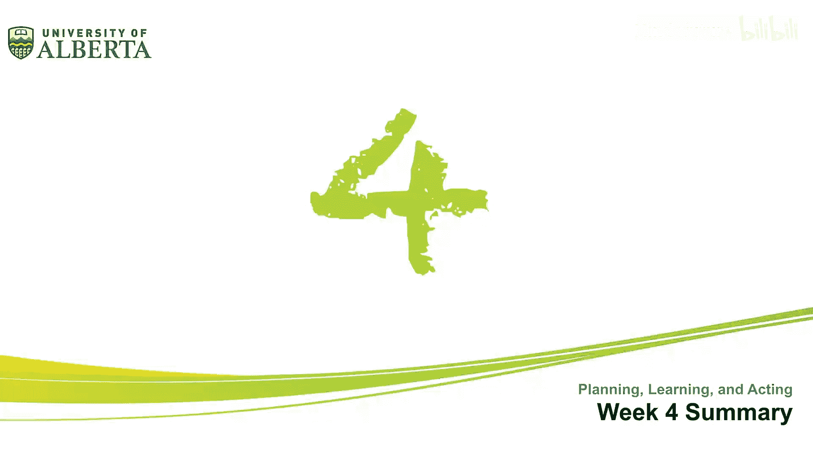
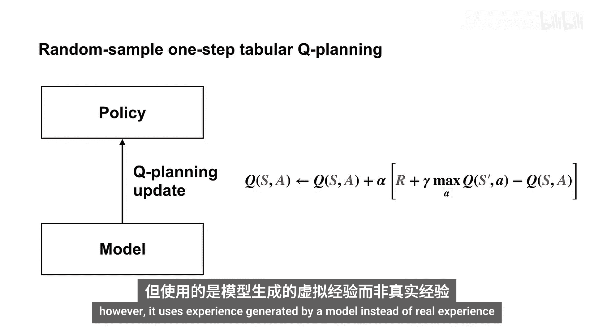
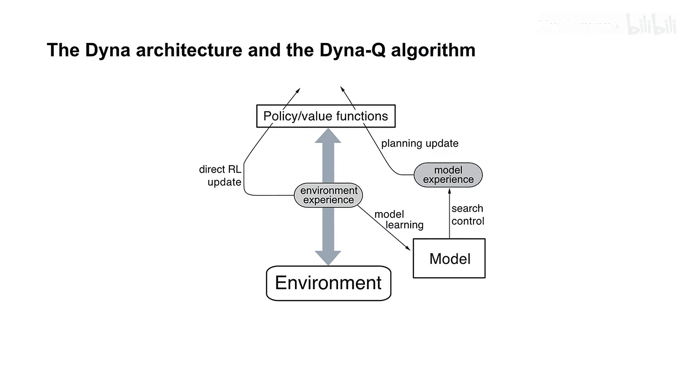
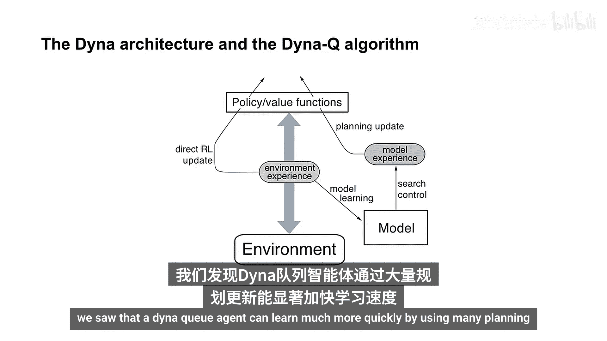
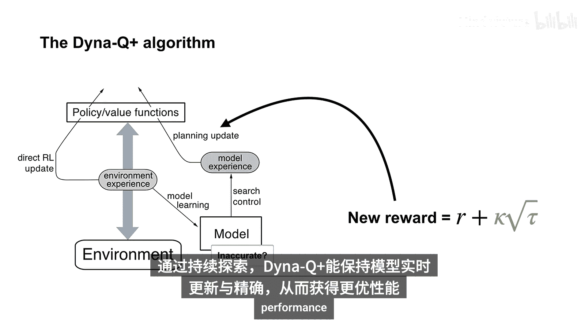

# 038：模块四总结 🎯

在本模块中，我们学习了规划、学习与行动的结合。我们探讨了模型的概念，比较了分布模型与样本模型，并介绍了几种将规划与学习整合的算法架构。接下来，我们将回顾本模块涵盖的核心概念与算法。

## 第一课：模型介绍 📊

上一节我们介绍了模块的整体目标，本节中我们来看看模型的基本概念。我们讨论了分布模型与样本模型之间的区别。

*   **分布模型**：存储**每个可能结果**的发生概率。这可能需要大量的内存。
*   **样本模型**：通常比分布模型**紧凑得多**，因为它们不显式存储每个结果的概率。

## 第二课：单步Q规划 🔄

在理解了模型之后，本节我们来看看如何利用模型进行规划。我们介绍了单步Q规划。

*   Ce-Plan使用与Q学习**相同的更新公式**，但其经验来源于**模型生成**的模拟经验，而非真实环境经验。
*   更新公式可表示为：`Q(S, A) ← Q(S, A) + α [R + γ maxₐ Q(S‘, a) - Q(S, A)]`，其中`(S, A, R, S')`来自模型。

## 第三课：Dyna架构 🏗️

单纯规划或学习各有局限，本节我们将两者结合。我们介绍了Dyna架构。

*   Dyna在一个智能体中**整合了规划与学习**。
*   其核心思想是：智能体从**真实经验**中学习，同时利用这些经验构建一个模型，并基于此模型进行**模拟规划**来更新价值函数。

## 第四课：不准确模型的影响与Dyna-Q+ 🚀

模型并不总是准确的，本节我们探讨模型不准确对规划的影响及其解决方案。

首先，我们讨论了不准确模型如何影响规划。

*   我们指出，Dyna-Q可以利用**不完整**的模型进行有效规划，但如果模型是**错误**的，则规划效果会变差。

接着，我们引入了Dyna-Q+算法来解决模型过时的问题。

*   该算法在其规划更新中使用**奖励加成**，以鼓励对长期未访问的状态-动作对进行探索。
*   通过探索，Dyna-Q+能使其模型**保持更新和准确**，从而获得更好的性能。

---

**总结**：本节课中我们一起学习了模块四的核心内容。我们从模型的基本类型（分布模型 vs. 样本模型）出发，介绍了利用模型进行规划的单步Q规划方法。进而，我们深入探讨了整合规划与学习的Dyna架构，并最终解决了模型不准确这一实际问题，引入了通过探索奖励来维持模型准确性的Dyna-Q+算法。本模块涵盖了丰富的材料，恭喜你跟上了学习进度！