# 039：课程总结与回顾 🎉

在本节课中，我们将对整个基于样本的学习方法课程进行回顾与总结。我们将梳理已学过的核心概念与算法，并展望后续课程的内容。

## 概述

我们已经完成了整个基于样本的学习方法课程。现在，让我们快速回顾一下所涵盖的内容。我们讨论了两种从采样经验中学习的方法。

## 核心方法回顾

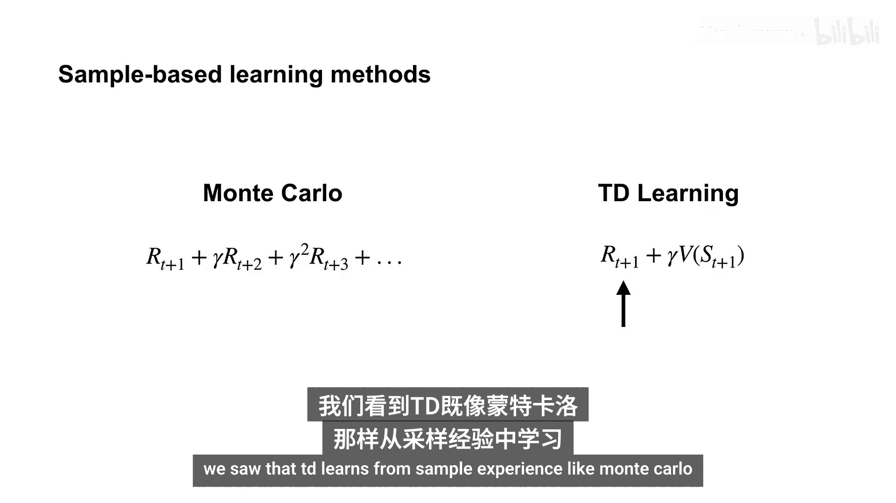

上一节我们介绍了课程的整体框架，本节中我们来看看两种核心的学习方法。

我们探讨了两种从采样经验中学习的方法。第一种是蒙特卡洛方法，它通过平均回报来估计价值函数。第二种是时序差分学习，它在更新目标中使用了对下一状态的估计值。

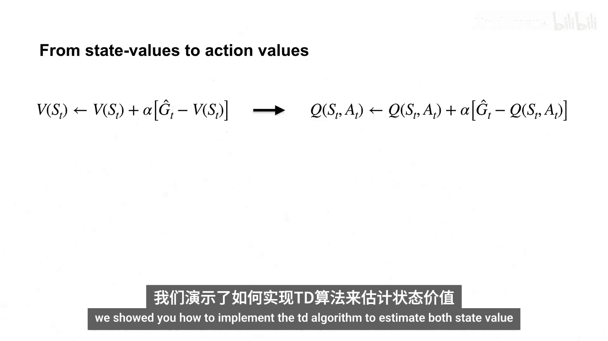

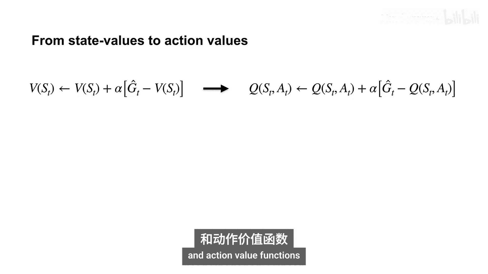

我们看到，TD学习像蒙特卡洛方法一样从样本经验中学习，但也像动态规划一样进行自举更新。

`V(S_t) ← V(S_t) + α [R_{t+1} + γV(S_{t+1}) - V(S_t)]`

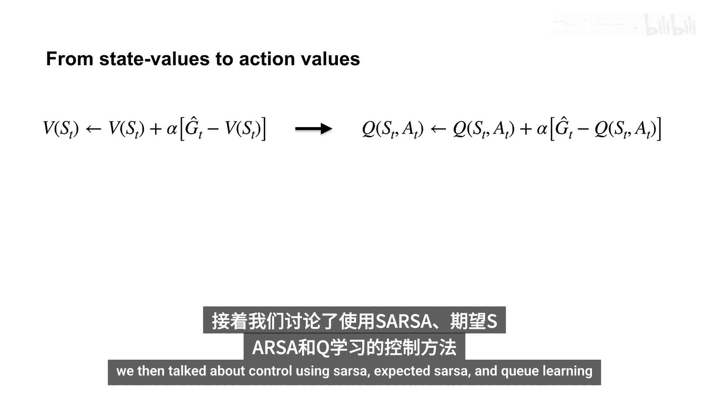

我们展示了如何实现TD算法来估计状态价值函数和动作价值函数。

`Q(S_t, A_t) ← Q(S_t, A_t) + α [R_{t+1} + γQ(S_{t+1}, A_{t+1}) - Q(S_t, A_t)]`

## 控制算法

在学习了预测方法后，我们转向了控制问题，即如何找到最优策略。

我们随后讨论了使用SARSA、期望SARSA和Q学习进行控制的方法。

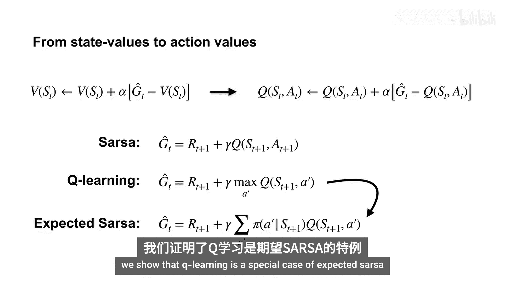

以下是这三种算法的关键区别：
*   **SARSA**是一种同策略算法，它估计其正在遵循的策略的价值。
*   **Q学习**是异策略算法，它估计最优策略的价值函数。
*   **期望SARSA**可以用于同策略或异策略。它在更新目标中显式计算了下一状态的期望价值。这个期望可以基于任何策略计算，因此期望SARSA可以用于异策略。

我们证明了Q学习是期望SARSA的一个特例。

当目标策略是贪婪策略时，期望SARSA的更新公式退化为Q学习的更新公式。

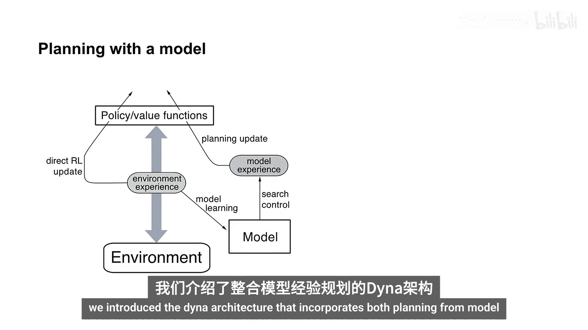

## 基于模型的规划

在最后一个模块中，我们讨论了使用模型经验进行规划。

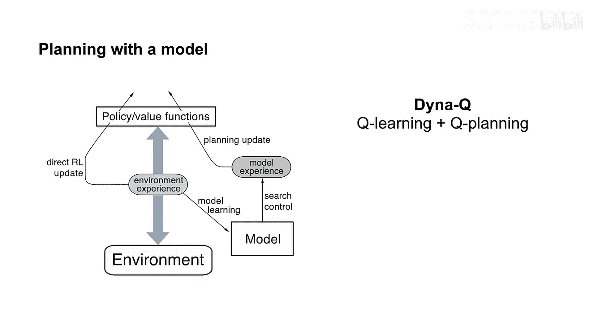

我们介绍了Dyna架构，它结合了从模型经验中进行规划和从环境经验中进行学习。

我们讨论了Dyna-Q，它结合了Q学习和Q规划。在一个实验中，我们看到Dyna-Q的规划更新使其比单纯的Q学习具有更高的样本效率。

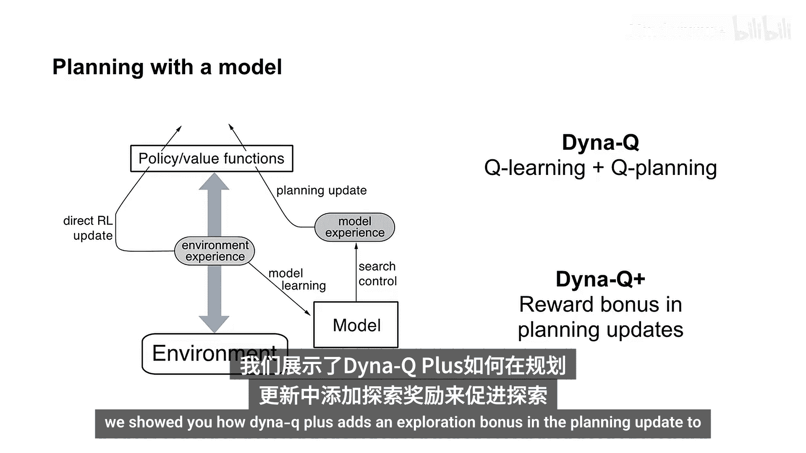

## 处理不准确模型

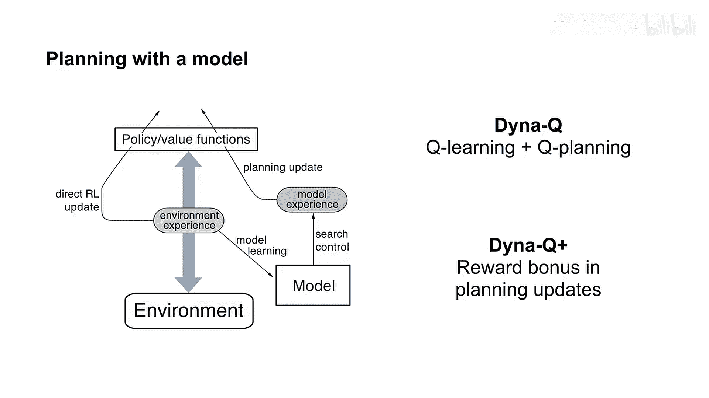

最后，我们考虑了当模型不准确时会发生什么。

我们展示了Dyna-Q+如何在规划更新中添加探索奖励，以鼓励智能体进行探索。

这个奖励帮助Dyna-Q+注意到Dyna-Q可能无法察觉的环境变化。

## 总结与展望

本节课中，我们一起回顾了整个基于样本的学习方法课程的核心内容。

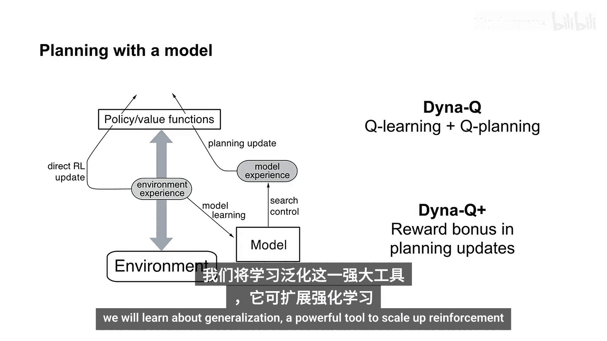

我们希望你喜欢学习基于样本的学习方法。在下一门课程中，我们将看到如何将基于样本的学习与函数近似相结合。

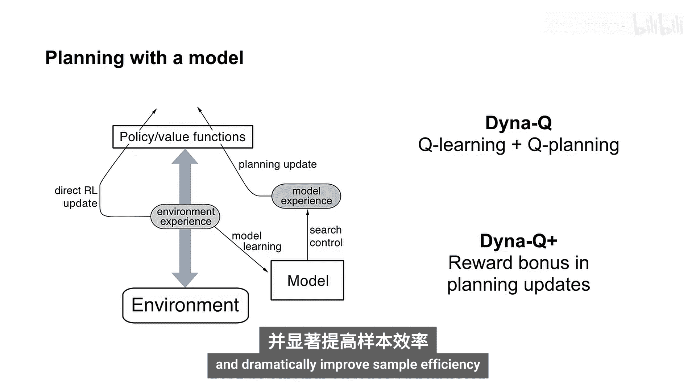

我们将学习泛化，这是一种强大的工具，可以扩展强化学习的规模并显著提高样本效率。你学到的许多概念将会迁移过去，但也将面临一些新的挑战。请继续关注，我们将一起探索如何解决它们。