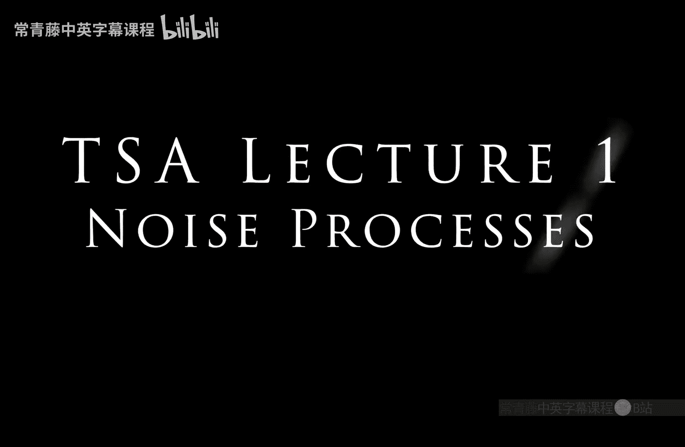
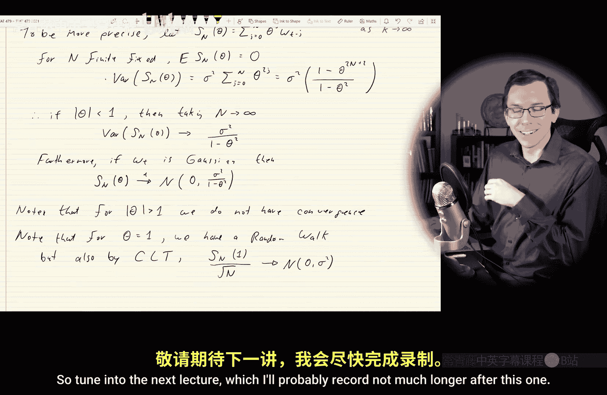

# 001：噪声过程



在本节课中，我们将要学习时间序列分析的基础，特别是不同类型的噪声过程。这些过程是构成所有时间序列数据的基石。我们将从最简单的白噪声开始，逐步介绍自回归过程和移动平均过程，并探讨它们的基本性质。

---

## 概述：什么是时间序列分析？

我们的世界在不断变化，作为统计学家，我们的工作是理解这些变化。统计学479课程——时间序列分析，就是为此而生。与线性回归不同，时间序列分析处理的是具有**时间依赖性**的数据。例如，预测明天的气温，最好的依据可能是今天、昨天甚至更早的气温。这引出了核心挑战：在时间序列中，观测值之间通常**不独立**，而是存在**时间上的依赖关系**（或称**时间因果性**），即过去会影响未来。

在深入分析真实数据之前，我们需要先理解一些数学模型。这引出了本讲的第一部分：**噪声的类型**。时间序列的核心就是噪声，即随机波动过程。

---

## 白噪声：时间序列的基石

我们首先讨论**白噪声**。这是所有时间序列模型的基础构建模块。

定义：令 **`W_t`** 为一个以时间 **`t`** 为索引的随机过程，其中 **`t`** 在区间 **[0, T]** 内。白噪声满足以下假设：
1.  **零均值**：`E[W_t] = 0`。
2.  **恒定方差**：`Var(W_t) = σ²`。
3.  **零协方差**：对于任意 **`t ≠ s`**，`Cov(W_t, W_s) = 0`。这意味着不同时间点的观测值**不相关**。

> **注意**：不相关仅意味着没有线性关系，但仍可能存在非线性依赖。

以上定义被称为**弱白噪声**。我们可以在此基础上加强条件，得到更严格的白噪声：

*   **独立同分布白噪声**：在弱白噪声的基础上，将“不相关”替换为“**独立**”。这为模型提供了更强的基础。
*   **高斯白噪声**：在独立同分布白噪声的基础上，增加条件：**`W_t`** 服从正态分布，即 **`W_t ~ N(0, σ²)`**。正态分布因其数学上的便利性和在实践中的普遍性而备受青睐。

**为什么叫“白”噪声？**
这个术语源于信号处理。白光包含了所有频率的光。类似地，白噪声在信号意义上包含了**所有频率**，其图形看起来是完全混乱的波动，这与只包含单一频率的平滑正弦波形成对比。

---

## 自回归过程：用过去预测现在

上一节我们介绍了作为基础的白噪声，本节中我们来看看如何用它构建更复杂的过程。第一个是**自回归过程**。

“回归”一词提示我们，这与线性回归有相似之处。在线性回归中，我们用自变量的线性组合来预测因变量。在时间序列中，我们用**变量自身的过去值**来预测其当前值。

其一般公式如下：
**`X_t = θ_1 * X_{t-1} + θ_2 * X_{t-2} + ... + θ_p * X_{t-p} + W_t`**
其中 **`θ_i`** 是固定系数，**`W_t`** 是白噪声。

这个公式表明，当前值 **`X_t`** 是过去 **`p`** 个值的**线性组合**，再加上当前时刻的噪声。

以下是两个重要的特例：

1.  **随机游走**：这是自回归过程的一个特例。
    **`X_t = X_{t-1} + W_t`**
    这意味着当前值完全是前一个值加上一个随机扰动。它没有特定的趋势，只是上下随机波动。

2.  **带漂移的随机游走**：
    **`X_t = A + X_{t-1} + W_t`**
    其中 **`A`** 是一个固定常数。如果 **`A > 0`**，过程在随机波动的基础上有一个向上的趋势；如果 **`A < 0`**，则趋势向下。这可以用来建模具有长期趋势的现象，如全球气温上升或股票价格的整体走势。

通过模拟，我们可以观察这些过程。例如，白噪声图看起来完全随机；随机游走图则显示出相邻时间点值相近，但长期可能变化很大的特点；高阶自回归过程（如AR2、AR3）的图形可能更复杂。**仅通过看图，通常难以直接判断时间序列属于哪种自回归过程**，这就需要我们后续使用统计方法进行识别。

---

## 移动平均过程：平滑噪声

自回归过程构成了本课程的一大基石，另一大基石是**移动平均过程**。

这是一种平滑过程，在现实世界中很常见。例如，在报告COVID-19病例时，常使用“7日移动平均”来平滑每日波动较大的数据，以更好地观察趋势。

从数学上讲，移动平均过程是**对白噪声的平滑**。其公式如下：
**`X_t = φ_1 * W_{t-1} + φ_2 * W_{t-2} + ... + φ_q * W_{t-q} + W_t`**
这被称为 **`q`** 阶移动平均过程。

这个公式表明，当前值 **`X_t`** 是过去 **`q`** 个**噪声项**的加权和，再加上当前时刻的噪声。

一个直观的理解是：将 **`X_t`** 视为股票价格，**`W_t`** 视为市场在时刻 **`t`** 受到的随机冲击。那么，移动平均模型意味着过去的市场冲击（“震荡”）会以衰减的方式影响当前价格。如果 **`φ`** 为正，一个正向冲击会在未来一段时间内产生持续的正面影响；如果为负，则会产生类似“回弹”的相反效果。

移动平均过程还有另一种表示形式，即对以当前时刻为中心的一个时间窗口内的噪声进行加权平均：
**`X_t = Σ_{j=-Q/2}^{Q/2} φ_j * W_{t+j}`**
通常，权重 **`φ_j`** 之和为1。当窗口长度（Q值）增大时，得到的图形会越来越平滑。例如，一个MA(21)过程可能看起来与某些自回归过程或随机游走非常相似。**这再次说明，仅凭图形难以区分不同类型的时间序列过程**。

---

## 重要概念与定义

在继续之前，我们需要明确一些贯穿课程的重要概念和定义。

**时间索引**：
*   理论上，时间可以是连续的（**`t ∈ [0, T]`**）。
*   在本课程中，我们主要处理**离散且等间隔**的时间序列数据，即 **`t = 0, 1, 2, ..., T`**。这简化了分析，避免了不规则采样带来的复杂性。

以下是两个关键的概率概念：

**马尔可夫过程**：
一个过程 **`X_t`** 是马尔可夫过程，如果给定全部历史信息时，其当前时刻的期望值只依赖于最近一期的观测值。即：
**`E[X_t | X_1, ..., X_{t-1}] = E[X_t | X_{t-1}]`**
例如，AR(1)过程就是马尔可夫的，因为 **`X_t`** 只直接依赖于 **`X_{t-1}`**。

**鞅**：
鞅可以看作广义的随机游走，有时被称为“公平游戏”。其定义为：
**`E[X_t | X_1, ..., X_{t-1}] = X_{t-1}`**
这意味着，基于过去信息，对下一期值的最佳预测就是当前观测值。股票价格等金融数据常被假设具有鞅性质。

**高斯过程**：
高斯过程是多元正态分布在连续时间上的推广。对于任意有限个时间点 **`t_1, t_2, ..., t_k`**，向量 **`(X_{t_1}, ..., X_{t_k})`** 服从多元正态分布。
*   一个高斯过程完全由其**均值函数**和**协方差函数**刻画。
*   正态分布的性质非常良好：**多元正态分布的任意线性组合仍是正态分布**。
*   因此，如果基础白噪声 **`W_t`** 是高斯白噪声，那么由它构建出的任何AR或MA过程也都是**高斯过程**。我们只需要关注这些过程的均值和协方差结构即可。

---

## 线性过程：一个统一的框架

最后，我们介绍一个更一般化的概念——**线性过程**，它涵盖了本课程将讨论的大多数时间序列模型。

定义：如果 **`W_t`** 是白噪声（索引 **`t`** 从负无穷到正无穷），那么由下式定义的过程 **`X_t`** 称为线性过程：
**`X_t = μ + Σ_{j=-∞}^{∞} θ_j * W_{t-j}`**
其中 **`μ`** 是常数均值项。

这个定义看起来像是移动平均过程的无限阶版本。但首先需要回答一个数学问题：这个无穷和有意义吗？
**答案是肯定的，只要系数平方和收敛**：**`Σ_{j=-∞}^{∞} θ_j² < ∞`**。
这是因为我们需要确保 **`X_t`** 的方差是有限的（计算过程涉及方差公式与无穷级数）。

> **注意**：上述定义是**非因果**的，因为 **`X_t`** 依赖于未来（**`j < 0`** 时）的噪声。在时间序列中，我们通常关注因果性，即过去影响未来。

因此，我们通常使用**因果线性过程**的定义：
**`X_t = μ + Σ_{j=0}^{∞} θ_j * W_{t-j}`**
这里 **`j`** 从0到无穷，**`W_{t-j}`** 随着 **`j`** 增大而不断回溯到更早的过去，不涉及未来。

---

## 示例：将AR(1)过程表示为线性过程

让我们以AR(1)过程为例，看看它如何纳入线性过程的框架。
AR(1)过程定义为：**`X_t = θ * X_{t-1} + W_t`**。

我们可以递归地展开这个等式：
```
X_t = θ * X_{t-1} + W_t
     = θ * (θ * X_{t-2} + W_{t-1}) + W_t
     = θ² * X_{t-2} + θ * W_{t-1} + W_t
     = ...
```
假设 **`|θ| < 1`**，当递归进行到无限过去时，包含初始项 **`X_{t-k}`** 的部分会趋于零（因为 **`θ^k`** 趋于零）。最终，我们得到：
**`X_t = Σ_{j=0}^{∞} θ^j * W_{t-j}`**
这正是因果线性过程的形式，其中 **`θ_j = θ^j`**。

现在，我们严谨地考虑这个无穷和。定义部分和：
**`S_N(θ) = Σ_{j=0}^{N} θ^j * W_{t-j}`**
*   其期望为：**`E[S_N(θ)] = 0`**。
*   其方差为：**`Var(S_N(θ)) = σ² * Σ_{j=0}^{N} θ^{2j} = σ² * (1 - θ^{2(N+1)}) / (1 - θ²)`**。

当 **`|θ| < 1`** 且 **`N → ∞`** 时，方差收敛到：
**`lim_{N→∞} Var(S_N(θ)) = σ² / (1 - θ²)`**
此外，如果 **`W_t`** 是高斯白噪声，那么 **`S_N(θ)`** 的极限分布就是正态分布 **`N(0, σ²/(1-θ²))`**。

**边界情况**：
*   如果 **`|θ| > 1`**，方差级数发散，过程不稳定。
*   如果 **`θ = 1`**，我们就得到了随机游走：**`X_t = X_{t-1} + W_t`**。此时，线性过程的表示不收敛，但根据中心极限定理，适当标准化后的部分和会收敛到正态分布。随机游走正好处于平稳与非平稳过程的边界上。

这种对参数 **`θ`** 取值的依赖性和边界行为，在时间序列分析中非常重要。

---

## 总结

本节课中我们一起学习了时间序列分析的入门知识：
1.  **白噪声**：介绍了弱白噪声、独立同分布白噪声和高斯白噪声，它们是构建更复杂模型的基础。
2.  **自回归过程**：学习了如何用变量自身的过去值来建模当前值，包括随机游走和带漂移的随机游走等特例。
3.  **移动平均过程**：学习了如何通过对过去的噪声项进行加权平均来获得平滑的序列。
4.  **重要概念**：明确了离散时间索引、马尔可夫性、鞅、高斯过程等关键思想。
5.  **线性过程**：介绍了一个统一框架，并展示了AR(1)过程如何表示为线性过程，同时讨论了其收敛条件。



这些基本的噪声过程和概念是我们理解、建模和分析真实世界时间序列数据的工具箱。在接下来的课程中，我们将深入探讨时间序列的更多性质，如自协方差、平稳性等。