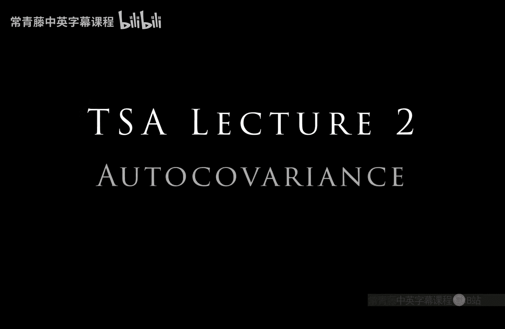
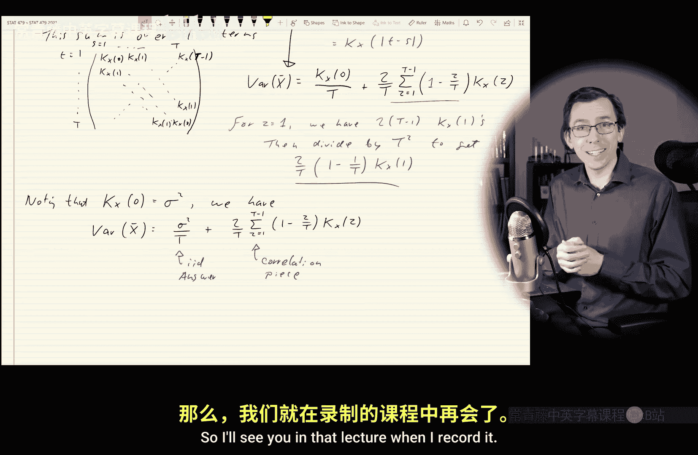

# 002：自协方差与平稳性

在本节课中，我们将深入学习时间序列的核心属性：自协方差、自相关和平稳性。理解这些概念是分析任何时间序列数据的基础。

上一讲我们介绍了不同类型的随机过程，如自回归、移动平均和白噪声过程。本节中，我们将进一步探讨时间序列的统计特性，并学习如何在实际数据中估计这些特性。

## 自协方差与自相关

首先，我们需要回顾协方差的概念。在概率论中，对于两个随机变量 **X** 和 **Y**，其协方差定义为：
`Cov(X, Y) = E[(X - E[X])(Y - E[Y])]`
协方差衡量了两个变量之间的线性关系。一个常见的误解是协方差为零意味着独立，但事实并非如此。协方差为零**不**意味着独立，但独立一定意味着协方差为零。只有在**联合正态分布**的情况下，协方差为零才意味着独立。

那么，什么是自协方差呢？对于一个时间序列过程 **{X_t}**，其在时间点 **s** 和 **t** 的自协方差定义为该过程在**两个不同时间点**的协方差：
`K_X(s, t) = Cov(X_s, X_t)`
自协方差函数具有两个重要性质：
1.  **对称性**：`K_X(s, t) = K_X(t, s)`。
2.  **正定性**：对于任意有限个时间点集合 **{t_1, ..., t_k}**，由 `K_X(t_i, t_j)` 构成的矩阵是**正定**（或半正定）的。

自相关函数是自协方差的标准化版本，它消除了量纲的影响，其值在 -1 到 1 之间。自相关函数定义为：
`ρ_X(s, t) = K_X(s, t) / sqrt(K_X(s, s) * K_X(t, t))`
在实际分析中，我们经常使用自相关函数（或其估计值）来判断时间序列中是否存在依赖关系，并初步识别过程的类型。

## 示例：带漂移项的 AR(1) 过程

为了加深理解，让我们计算一个具体例子：带常数项（漂移项）的 AR(1) 过程。
`X_t = a + θ * X_{t-1} + W_t`
其中，**{W_t}** 是方差为 **σ²** 的弱白噪声。通过递归展开，我们可以将其写成线性过程的形式，进而计算其均值和自协方差。

首先，其均值为常数：
`E[X_t] = a / (1 - θ)`
其次，其自协方差函数仅依赖于时间差 **|s-t|**，具体形式为：
`K_X(s, t) = (σ² / (1 - θ²)) * θ^{|s-t|}`
特别地，其方差（即 **s = t** 时的自协方差）为：
`Var(X_t) = σ² / (1 - θ²)`
**请注意**，这个方差**不依赖于时间 t**。这是一个非常重要的性质，它将我们引向下一个核心概念。

## 平稳性

平稳性是时间序列分析中一个至关重要的概念。粗略地说，它意味着时间序列的统计特性不随时间平移而改变。

我们主要关注两种平稳性：
1.  **弱平稳性**：要求均值恒定，且自协方差仅依赖于时间差，即：
    *   `E[X_t] = μ` （对所有 t 成立）
    *   `Cov(X_t, X_{t+τ}) = K_X(τ)` （仅依赖于时滞 τ，而非具体时间 t）
2.  **严平稳性**：要求时间序列任意有限维联合分布都不随时间平移而改变。这比弱平稳性的条件更强。

为什么平稳性如此重要？在统计学中，我们经常需要估计参数（如均值）。如果均值随时间变化，那么用整个时间序列的样本均值去估计就会得到错误的结果。平稳性保证了我们估计的目标是一个恒定值。对于非平稳序列，我们通常需要先通过差分、去趋势等方法将其转化为平稳序列，然后再进行分析。

对于弱平稳过程，其自协方差函数还有两个有用性质：
*   **对称性**：`K_X(τ) = K_X(-τ)`
*   **有界性**：`|K_X(τ)| ≤ K_X(0)` （由柯西-施瓦茨不等式可得）

## 联合平稳性与样本均值的方差

对于两个时间序列 **{X_t}** 和 **{Y_t}**，如果它们各自弱平稳，且其互协方差 `Cov(X_s, Y_t)` 也仅依赖于时间差 **s-t**，则称它们是**联合平稳**的。

现在，让我们看看在时间序列背景下，一个最简单的统计量——样本均值——的估计有何不同。假设我们有一个弱平稳时间序列 **{X_t}, t=1,...,T**，其真实均值为 **μ**。我们使用样本均值进行估计：
`μ̂ = (1/T) * Σ_{t=1}^{T} X_t`
这个估计量是无偏的，即 `E[μ̂] = μ`。但其方差不再像独立同分布数据那样简单。

在经典统计（IID数据）中，样本均值的方差为：
`Var(μ̂_IID) = σ² / T`
然而，在时间序列数据存在自相关的情况下，样本均值的方差为：
`Var(μ̂) = (1/T) * Σ_{τ=-(T-1)}^{T-1} (1 - |τ|/T) * K_X(τ)`
这个公式可以展开为：
`Var(μ̂) = (1/T) * K_X(0) + (2/T) * Σ_{τ=1}^{T-1} (1 - τ/T) * K_X(τ)`
其中第一项 `K_X(0)/T` 就是 IID 情况下的方差。第二项是**由自相关引起的附加项**。如果自协方差 `K_X(τ)` 多为正，那么样本均值的实际方差将大于 IID 情况下的方差，这意味着我们的估计不如在独立数据中那么精确。理解这一点对于正确评估估计量的不确定性至关重要。

## 总结

本节课中我们一起学习了时间序列分析的核心基础概念：
1.  **自协方差**和**自相关**函数，它们量化了时间序列内部不同时间点之间的线性依赖关系。
2.  **平稳性**，特别是弱平稳性，它要求均值恒定且自协方差仅依赖于时间差。平稳性是进行许多统计推断的前提。
3.  在平稳 AR(1) 过程示例中，我们看到了理论均值和自协方差的计算方法。
4.  我们探讨了时间序列数据中**样本均值估计量的方差**会如何受到自相关性的影响，这与独立数据的情形有显著不同。

下一讲，我们将学习如何从实际数据中**估计**自协方差和自相关函数，并利用这些工具来初步判断一个时间序列是否类似于白噪声过程，这将是正式进行时间序列建模的第一步。