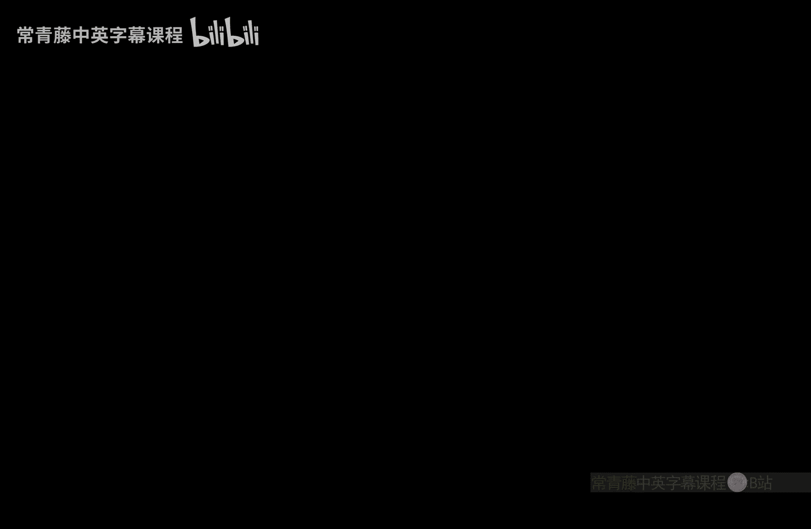
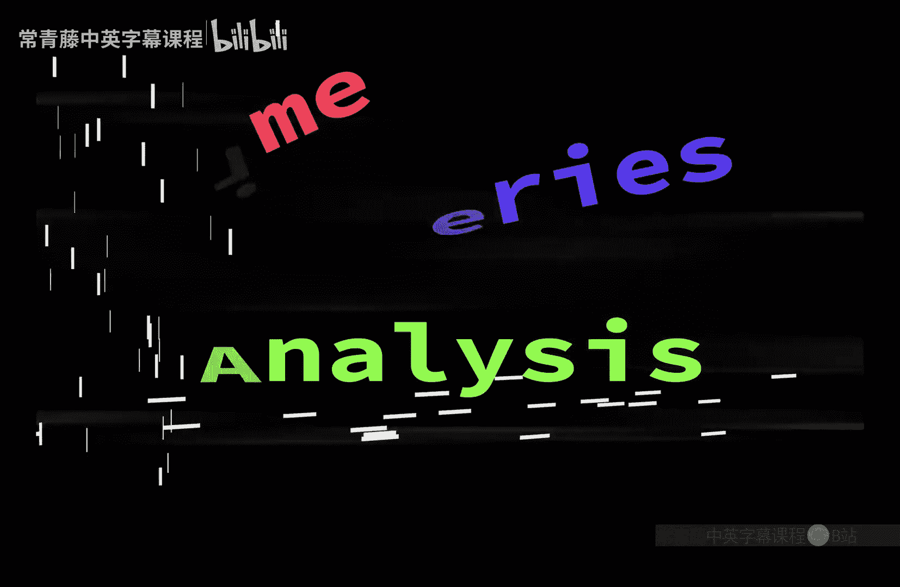
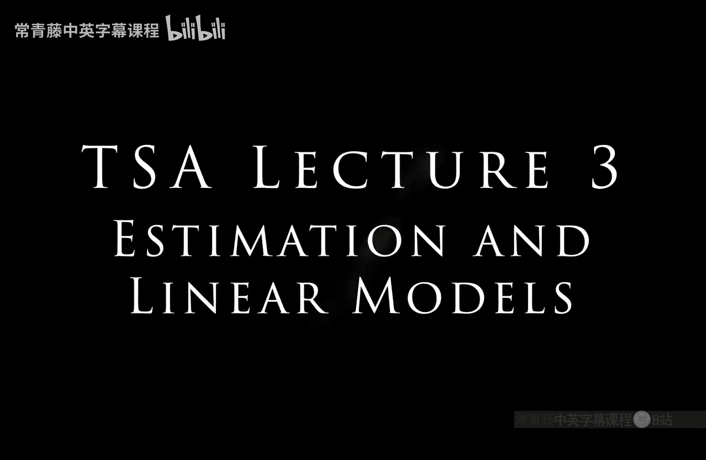
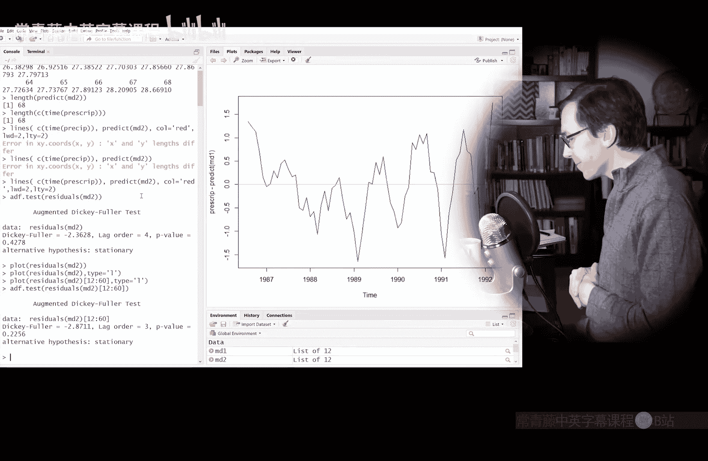

# 003：估计与线性模型







在本节课中，我们将学习自协方差和自相关函数，如何估计它们，以及它们能告诉我们关于时间序列数据的哪些信息。课程最后，我们将使用R语言分析一个关于20世纪80年代至90年代美国处方药价格的真实数据集。

## 回顾平稳过程

上一节我们介绍了平稳过程的概念，本节中我们来看看如何估计其参数。对于一个弱平稳过程，其均值不随时间变化，且自协方差函数仅依赖于时间点之间的间隔，而非具体位置。这意味着我们可以使用所有数据点来估计一个全局均值。

对于平稳过程，总体均值的估计量就是通常的样本均值，记作 $\bar{x}$：
$$\bar{x} = \frac{1}{T} \sum_{t=1}^{T} X_t$$
然而，由于时间序列数据点之间存在依赖性，该估计量的方差与独立数据的情况有所不同。

## 估计自协方差与自相关函数

在时间序列分析中，我们真正感兴趣的是估计自协方差和自相关函数，它们是探索性分析的关键工具。

对于一个平稳过程 $X_t$，其自协方差函数可以简化为单参数形式 $K_X(h)$，其中 $h$ 是滞后阶数。当 $h=0$ 时，两个时间点重合；$h=1, 2, 3...$ 时，它们逐渐远离。

对于滞后阶数 $h$（从0到 $T-1$），自协方差函数的估计量 $\hat{K}(h)$ 定义如下：
$$\hat{K}(h) = \frac{1}{T} \sum_{t=1}^{T-h} (X_{t+h} - \bar{x})(X_t - \bar{x})$$

以下是关于此估计量的几点说明：
*   求和项的数量为 $T-h$ 项。这意味着随着 $h$ 增大，用于估计自协方差的项数减少，估计的准确性会下降。
*   在实际分析中，我们通常只关注较小的 $h$ 值（如前10或15阶），因此这个问题通常不构成严重障碍。

接下来，我们可以估计自相关函数 $\hat{\rho}(h)$。它只是估计的自协方差除以估计的方差（即 $h=0$ 时的自协方差）：
$$\hat{\rho}(h) = \frac{\hat{K}(h)}{\hat{K}(0)}$$
这类似于计算相关系数：用协方差除以各自的标准差。由于过程平稳，方差是常数。

此外，我们还可以估计互协方差和互相关函数。对于两个联合平稳的过程 $X$ 和 $Y$，在滞后 $h$ 处的互协方差估计为：
$$\hat{K}_{XY}(h) = \frac{1}{T} \sum_{t=1}^{T-h} (X_{t+h} - \bar{x})(Y_t - \bar{y})$$
相应的互相关估计为：
$$\hat{\rho}_{XY}(h) = \frac{\hat{K}_{XY}(h)}{\sqrt{\hat{K}_X(0) \hat{K}_Y(0)}}$$

关于自协方差估计量公式的一个技术细节是：我们在求和时除以 $T$ 而非 $T-h$。这是为了确保估计的协方差矩阵具有正定性，这是协方差矩阵的一个重要数学性质。

## 在R中分析自相关函数

现在，让我们在R中查看一些估计的自相关函数示例。我们可以使用 `acf()` 函数来计算和绘制自相关图。该函数默认计算从滞后0到滞后15的自相关估计。

自相关图能直观地揭示时间序列的结构：
*   在滞后0处，自相关总是1。
*   对于白噪声过程，我们期望在除0以外的所有滞后处，自相关都接近于0。图中的蓝虚线（大约在 $\pm 2/\sqrt{T}$ 处）提供了一个粗略的参考范围，如果估计的自相关值大部分落在此范围内，则表明白噪声的可能性很大。
*   对于随机游走这种非平稳过程，自相关图会显示所有正滞后处都有持续很高的正自相关，这是非平稳性的一个警示信号。
*   对于移动平均过程，自相关图可能显示出自相关值在某个滞后（如阶数q）之后突然截尾（变为接近0）。
*   对于自回归过程，自相关图通常显示出自相关值呈几何（指数）衰减至0，而非线性截尾。

通过观察自相关图，我们可以对数据的特性进行初步探索性分析，例如判断是否平稳、是否存在移动平均或自回归成分等。

## 检测白噪声

既然我们有了估计自相关函数的方法，就可以用它来检测一个过程是否是白噪声。对于白噪声过程，其理论自相关在 $h \neq 0$ 时应为0。

在实践中，我们的估计值 $\hat{\rho}(h)$ 不会恰好为0。我们需要判断它是否“足够小”。可以证明，对于白噪声过程，估计的自相关 $\hat{\rho}(h) (h \neq 0)$ 近似服从均值为0、方差约为 $1/T$ 的分布。

因此，一个常用的经验法则是检查自相关图上的蓝虚线，它们大约位于 $\pm 2/\sqrt{T}$。如果绝大多数估计的自相关值都落在这个区间内，则没有强烈证据反对白噪声的假设。需要强调的是，这只是一个粗略的定性指导，而非严格的统计假设检验。

## 时间序列的统计模型

现在，我们开始探讨时间序列的统计建模。首先介绍两个有用的算子定义，它们能简化后续的公式表达。

**后移算子** $B$ 定义为：$B X_t = X_{t-1}$。将其迭代应用：$B^k X_t = X_{t-k}$。
类似地，有**前移算子** $B^{-1}$：$B^{-1} X_t = X_{t+1}$。

**差分算子** $\nabla$（或 $\Delta$）用于计算序列的变化，类似于离散导数。一阶差分定义为：
$$\nabla X_t = X_t - X_{t-1} = (1 - B) X_t$$
k阶差分可以写为：
$$\nabla^k X_t = (1 - B)^k X_t$$
展开后涉及二项式系数，形式较复杂，但用算子表示非常简洁。

## 时间序列模型 vs. 线性回归模型

线性回归是理解时间序列模型的一个良好起点。在线性回归中，我们通常有：
$$X_t = \beta_1 Z_{t1} + ... + \beta_p Z_{tp} + \epsilon_t$$
其中 $\epsilon_t$ 是独立同分布（或至少不相关）的误差项。根据高斯-马尔可夫定理，最小二乘估计量是最优线性无偏估计量。

在时间序列的背景下，我们可以考虑类似的模型，但误差项 $\epsilon_t$ 被一个平稳过程 $Y_t$ 所取代：
$$X_t = \beta_1 Z_{t1} + ... + \beta_p Z_{tp} + Y_t$$
这里，$Y_t$ 不一定是白噪声，它可以是任何平稳过程（如AR或MA过程）。这就引入了时间依赖性。

如果我们忽略这种依赖性，仍然用最小二乘法估计 $\beta$，那么得到的残差 $r_t = X_t - Z_t \hat{\beta}$ 将近似等于 $Y_t$，并且可能表现出自相关。**关键区别在于**：在时间序列分析中，我们将残差过程本身视为一个需要研究的时间序列，分析其自相关结构，而这在线性回归的标准应用中通常被忽略（或假设不存在）。

## R语言实战：分析处方药价格数据

让我们应用所学知识分析一个真实数据集：`prescript`，它包含了美国1986年8月至1992年3月的月度平均处方药价格。

首先，我们绘制数据图。可以观察到明显的上升趋势，这意味着序列的均值是非平稳的。

第一步是尝试移除趋势。我们先用一个简单的线性回归模型（`model1`）来拟合时间趋势：
```r
model1 <- lm(prescript ~ time(prescript))
```
模型摘要显示时间变量非常显著，斜率约为2.8，表明每月平均价格上涨约2.8美元。我们将拟合的直线添加到图中。

由于原始数据非平稳，直接计算其自相关函数意义不大。我们更应关注移除趋势后的残差序列。计算并绘制残差序列图，可以看到均值在0附近波动，但似乎存在周期性。

为了更正式地检验平稳性，我们可以使用增广迪基-富勒检验。该检验的原假设是序列非平稳（存在单位根），备择假设是平稳。我们对残差序列进行检验，得到了一个较小的p值，表明在移除线性趋势后，残差序列看起来是平稳的。

既然残差序列是平稳的，我们就可以计算其自相关函数。在ACF图中，我们观察到一个有趣的周期性模式，大约每12个月（一年）出现一个峰值。这强烈暗示数据中存在年度季节性。

我们可以尝试建立一个更复杂的模型（`model2`）来同时捕捉线性趋势和年度周期性，例如在回归中加入三角函数项：
```r
model2 <- lm(prescript ~ time(prescript) + cos(2*pi*time(prescript)))
```
模型摘要显示时间和余弦项都是显著的。将拟合曲线添加到原始数据图上，可以看到它更好地捕捉了数据的波动。

然而，对`model2`的残差进行平稳性检验和观察，发现结果并不理想，残差序列的首尾部分似乎仍有非平稳的迹象。这个例子说明，时间序列建模有时需要反复尝试和判断。对于本数据，或许仅移除线性趋势（`model1`）后得到的残差序列就是一个合适的、平稳的“噪声”过程，我们可以在此基础上进一步分析其自相关结构（如季节性、ARMA成分等）。



本节课中我们一起学习了如何估计时间序列的自协方差和自相关函数，如何通过自相关图进行探索性分析并检测白噪声，并初步了解了如何将时间序列分解为确定性成分（如趋势、季节性）和平稳的随机成分进行建模分析。在接下来的课程中，我们将深入探讨平滑方法以及更强大的ARMA模型。