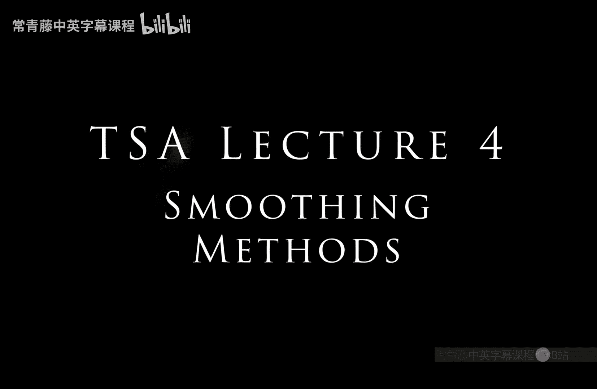
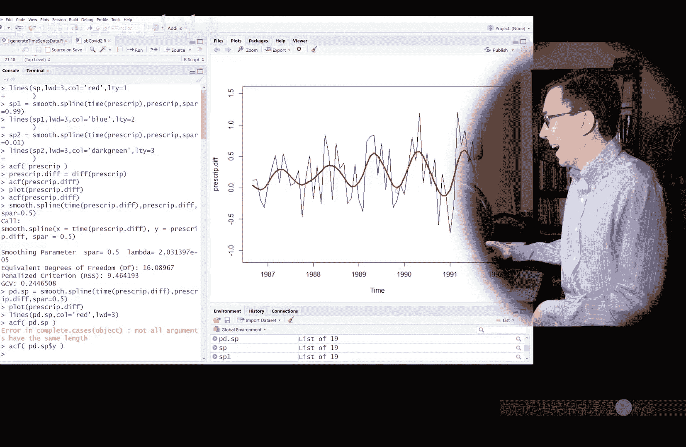

# 004：平滑方法

在本节课中，我们将学习时间序列分析中的平滑方法。这些方法用于减少数据中的噪声，帮助我们更清晰地观察数据的趋势和整体模式。我们将介绍几种不同的平滑技术，并通过R语言演示如何将它们应用于真实数据。

---

## 概述

时间序列数据通常包含大量噪声，这使得识别潜在趋势变得困难。平滑方法通过“平均”或“平滑”数据点来减少这种随机波动，从而揭示数据的基本结构。本节课将介绍几种常用的平滑方法，包括移动平均平滑、核平滑、局部加权散点图平滑（LOWESS）和三次平滑样条。这些方法主要用于探索性数据分析，帮助我们直观理解数据。

---

## 移动平均平滑器

上一节我们概述了平滑的目的，本节中我们来看看最基础的平滑方法：移动平均平滑器。

移动平均平滑器的核心思想是，通过计算一个滑动窗口内数据点的平均值来平滑序列。给定一个时间序列 **X_t**（t 从 1 到 T），我们定义平滑后的序列 **M_t**。

其公式如下：

**M_t = Σ_{j=-r}^{r} θ_j * X_{t-j}**

其中，**r** 是带宽参数，决定了窗口的大小（窗口总长度为 2r+1）。系数 **θ_j** 通常被选择为相等的权重，例如：

**θ_j = 1 / (2r + 1)**

这表示对窗口内的所有点进行简单算术平均。例如，在分析每日数据时，7日移动平均可以平滑掉单日的异常波动，更清晰地显示周趋势。

在R语言中，可以使用 `filter` 函数来实现移动平均平滑。

---

## 核平滑器

移动平均平滑器为所有窗口内的点分配了相同的权重。核平滑器在此基础上进行了改进，它根据数据点与中心点的距离来分配不同的权重，距离越近的点权重越高。

首先，我们需要定义一个核函数 **K_h(x, x_0)**。这是一个非负函数，以 **x_0** 为中心，**h** 为带宽。函数值随着 **|x - x_0|** 的增大而减小，并且其积分是有限的。

以下是几种常见的核函数：

*   **高斯核**：形状类似钟形曲线。
    **K_h(x, x_0) ∝ exp( - (x - x_0)^2 / (2h^2) )**
*   **三角核**：形状为三角形。
    **K_h(x, x_0) = (1 - |x - x_0|/h)_+**
    （其中 `(·)_+` 表示取正值部分，负值则设为0）
*   **Epanechnikov核**：形状为倒抛物线。
    **K_h(x, x_0) = (1 - (x - x_0)^2 / h^2)_+**

那么，如何将核函数用于离散时间序列的平滑呢？核平滑器本质上是一种特殊权重的移动平均平滑器。

其系数 **θ_j** 由核函数在离散点上的取值归一化后得到：

**θ_j = K_h(j, 0) / Σ_{i} K_h(i, 0)**

这样，靠近当前时间点 **t** 的观测值会获得更大的权重，而远处的观测值权重较小。在R中，可以使用 `ksmooth` 函数进行核平滑。

---

## 局部加权散点图平滑（LOWESS）

LOWESS是另一种非常有效的非参数平滑方法。与核平滑类似，它也是局部加权的。

以下是LOWESS方法的核心思想：

它在一个滑动窗口内（例如，围绕点 **X_t** 的 **X_{t-r}** 到 **X_{t+r}**），拟合一个低阶（通常是线性或二次）多项式回归。拟合时，它会根据数据点与中心点的距离分配权重。然而，LOWESS算法的具体实现细节（如权重的精确计算和迭代过程）在R的文档中描述得比较模糊，被形容为一个“复杂算法”。

尽管如此，它仍然是一个强大且常用的探索性工具。在R中，可以直接使用 `lowess` 函数。

---

## 三次平滑样条

最后，我们介绍一种更结构化的平滑方法：三次平滑样条。它通过拟合一个全局的、分段的三次多项式来平滑数据，并加入一个惩罚项来控制平滑度。

首先，理解三次样条。我们将时间区间 [1, T] 划分为 **K** 个子区间，分界点称为“节点”。在每个子区间内，我们拟合一个三次多项式：

**M_i(t) = β_{i0} + β_{i1}t + β_{i2}t^2 + β_{i3}t^3**

为了确保曲线整体光滑，我们通常要求这些分段多项式在节点处连续且具有连续的一阶和二阶导数。

如果仅仅是这样，我们就是在做分段多项式回归。而**三次平滑样条**在此基础上，最小化一个包含惩罚项的目标函数：

**最小化： Σ_{t=1}^T (X_t - M(t))^2 + λ ∫ [M''(s)]^2 ds**

*   **第一项**是常见的残差平方和，衡量拟合程度。
*   **第二项是惩罚项**，它惩罚曲线的曲率（即二阶导数 **M''**）。**λ** 是平滑参数。
    *   当 **λ = 0** 时，惩罚项无效，结果就是普通的最小二乘拟合，可能非常“崎岖”。
    *   当 **λ → ∞** 时，惩罚项占主导，迫使二阶导数处处趋近于0，结果就是一条直线（最平滑的状态）。

因此，通过调节 **λ**，我们可以在拟合优度和平滑度之间进行权衡。这类似于线性回归中的**岭回归**思想，都是通过添加惩罚项来约束模型复杂度。

在R中，可以使用 `smooth.spline` 函数来拟合三次平滑样条。

---

## R语言应用演示

现在，我们将这些平滑方法应用于一个真实的时间序列数据集：美国处方药成本数据（1980年代中期至1990年代初期）。

以下是应用不同平滑器的步骤和效果：

*   **移动平均平滑**：使用 `filter` 函数。例如，7个月和23个月的移动平均。较长的窗口会产生更平滑但也更滞后的曲线，且会在序列两端产生缺失值。
*   **核平滑**：使用 `ksmooth` 函数，选择高斯核。通过调整带宽参数 `bandwidth`，可以控制平滑程度。带宽越小，曲线越贴近原始数据；带宽越大，曲线越平滑。
*   **LOWESS平滑**：使用 `lowess` 函数，调整参数 `f`（平滑跨度）。`f` 值越小，曲线越贴近数据细节；`f` 值越大，曲线越平滑。
*   **三次平滑样条**：使用 `smooth.spline` 函数，调整参数 `spar`（平滑参数）。`spar` 越大，曲线越平滑。

所有方法都揭示了数据中明显的上升趋势和周期性波动。尽管实现方式不同，但在选择合适的参数后，它们往往能给出视觉上相似的趋势估计。

---

## 重要注意事项：平滑的用途与局限

在结束之前，必须强调平滑方法的主要用途和局限。

平滑是一种强大的**探索性数据分析**工具。它帮助我们可视化趋势、发现周期性和异常点，为后续的正式建模提供直觉。例如，对处方药数据的一阶差分序列进行平滑，可以更清楚地看到其季节性成分。

**然而，我们必须谨慎：**

**平滑后的数据不应直接用于严格的统计推断或模型拟合。** 因为平滑过程移除了数据中的“噪声”，而许多时间序列模型（如ARIMA）正是利用这些噪声的结构（如自相关）进行建模和预测。如果对数据平滑后再进行自相关分析或回归，可能会得到误导性的结果，例如发现不存在的相关性或错误判断平稳性。

**正确的做法是**：使用平滑来探索数据、形成假设（例如，“数据可能存在12个月的季节性”），然后基于**原始数据**（或适当的差分后数据）来建立和检验正式的统计模型。

---

## 总结

本节课中我们一起学习了几种重要的时间序列平滑方法：
1.  **移动平均平滑器**：通过窗口内简单平均来平滑。
2.  **核平滑器**：根据距离加权平均，提供了更灵活的平滑方式。
3.  **LOWESS**：一种局部加权多项式回归平滑方法。
4.  **三次平滑样条**：通过带惩罚项的分段多项式拟合实现全局平滑。

我们了解了它们的原理、在R中的实现，并认识到它们主要是服务于探索性数据分析的视觉辅助工具。从下一讲开始，我们将进入课程的核心部分：学习用于预测和推断的正式时间序列模型，如ARMA模型。