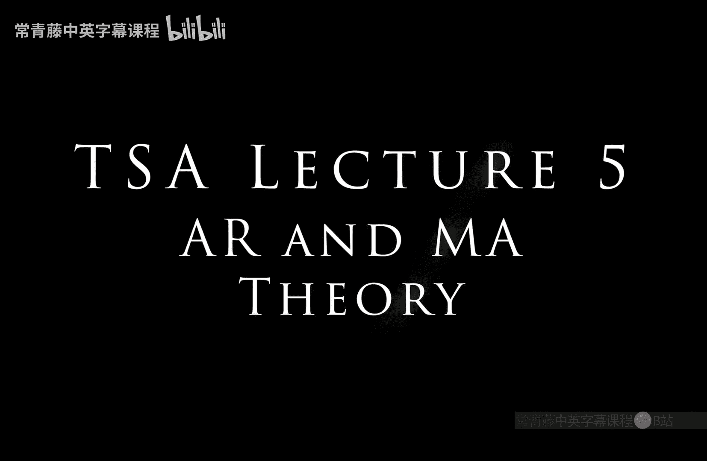
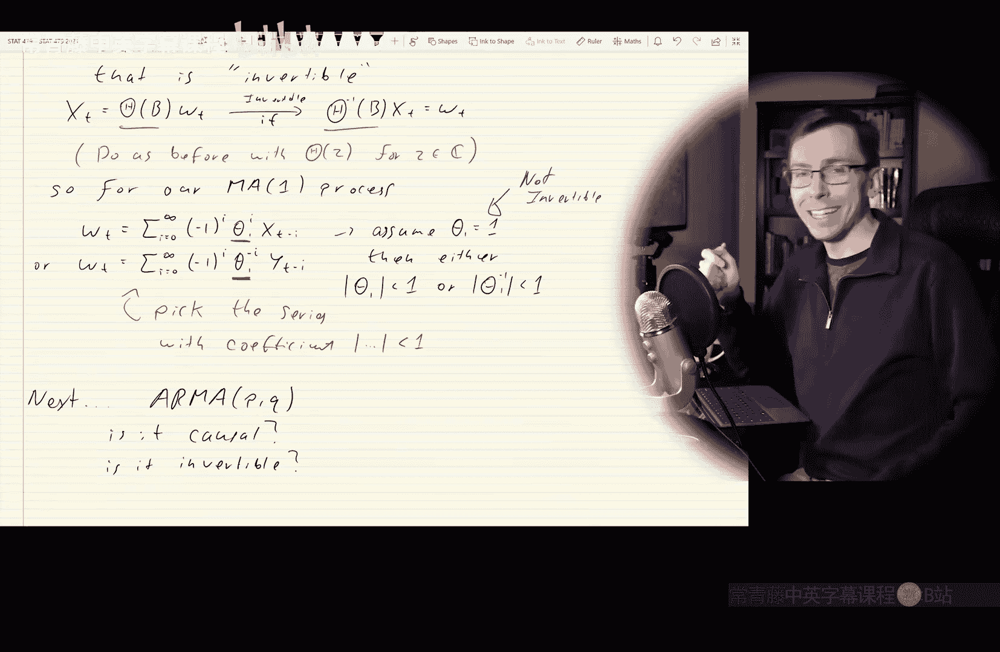

# 005：AR与MA模型理论

在本节课中，我们将深入学习时间序列分析的核心模型：自回归模型和移动平均模型。我们将详细探讨它们的数学性质、因果性与可逆性，以及这些概念在统计建模中的重要性。

## 概述

自回归移动平均模型是时间序列建模的基石。为了理解如何用这些模型拟合数据，我们首先需要深入理解这些随机过程本身。本节将分别剖析AR和MA模型，为后续学习ARMA和ARIMA模型打下坚实基础。

## 自回归模型

自回归模型的核心思想是，当前时刻的观测值可以表示为过去若干个观测值的线性组合，再加上一个白噪声项。

一个 **p阶自回归过程** 可以定义为：
`Xt = φ1 * Xt-1 + φ2 * Xt-2 + ... + φp * Xt-p + Wt`
其中，`Wt` 是均值为0、方差为 `σ²` 的白噪声，`φ1, ..., φp` 是自回归系数。

为了书写方便，我们常使用**后移算子B**（`B * Xt = Xt-1`）和**自回归算子**来简化表达式。定义自回归算子 `Φ(B) = 1 - φ1B - φ2B² - ... - φpB^p`，则AR(p)模型可以简洁地写为：
`Φ(B) * Xt = Wt`

在分析中，我们通常假设过程均值为零。如果过程有非零均值μ，我们可以通过定义 `X̃t = Xt - μ` 将其转化为零均值过程，这不会影响模型的核心性质。

## 因果性

因果性是一个直观的概念：过去影响未来，但未来不影响过去。在时间序列中，我们希望模型是因果的。

考虑一个简单的AR(1)过程：`Xt = φ1 * Xt-1 + Wt`。

*   当 `|φ1| < 1` 时，该过程是平稳的，并且可以表示为仅依赖于过去白噪声的线性过程（即因果表示）：
    `Xt = Σ (i=0 to ∞) φ1^i * Wt-i`
*   当 `|φ1| > 1` 时，过程在数学上仍然是平稳的，但其表示形式会依赖于未来的白噪声，成为**非因果**过程。
*   当 `|φ1| = 1` 时，过程变为随机游走，是非平稳的。

一个关键且有趣的现象是：对于一个非因果的AR(1)过程（`|φ1| > 1`），如果白噪声是高斯分布的，那么总存在一个因果的AR(1)过程（系数为 `1/φ1`），它与原过程具有完全相同的概率分布（即相同的均值和自协方差函数）。

这对统计学意味着**可识别性**问题。如果我们拿到一组数据，我们无法区分它来自系数为 `φ` 的非因果模型，还是来自系数为 `1/φ` 的因果模型。因此，在实践中，我们总是选择并估计**因果的**AR模型，这符合我们对“过去影响未来”的认知。

## 自回归算子的根

为了将AR(p)模型表示为因果的线性过程，我们需要研究自回归算子 `Φ(B)`。

我们将算子中的 `B` 替换为复数 `z`，得到多项式 `Φ(z) = 1 - φ1*z - φ2*z² - ... - φp*z^p`。根据代数基本定理，这个p次多项式可以分解为：
`Φ(z) = (-1)^p * φp * (z - r1)(z - r2)...(z - rp)`
其中 `r1, r2, ..., rp` 是该多项式的根（可能为复数）。

**核心结论**：当且仅当所有根的模长都大于1（即所有根都在复平面上的单位圆外）时，AR(p)过程是因果的，并且可以唯一地表示为一个仅依赖于过去白噪声的线性过程。这就是许多平稳性检验（如ADF检验）中“检验单位根”的数学来源——我们正是要避免根落在单位圆上或圆内。

## 移动平均模型

移动平均模型描述的是，当前观测值受到当前及过去若干期白噪声冲击的线性影响。

一个 **q阶移动平均过程** 定义为：
`Xt = Wt + θ1 * Wt-1 + θ2 * Wt-2 + ... + θq * Wt-q`
其中，`Wt` 是白噪声，`θ1, ..., θq` 是移动平均系数。

同样，我们可以定义**移动平均算子** `Θ(B) = 1 + θ1B + θ2B² + ... + θqB^q`，从而将模型写为：
`Xt = Θ(B) * Wt`

与AR模型不同，MA模型对于任意系数都是平稳的。其自协方差函数在滞后 `q` 步之后截尾（变为0）。

## 可逆性

MA模型也存在类似AR模型因果性的**可逆性**问题。考虑一个MA(1)过程：`Xt = Wt + θ1 * Wt-1`。

我们可以证明，存在另一个MA(1)过程 `Yt = Vt + (1/θ1) * Vt-1`（其中 `Vt` 的方差经过调整），它与原过程 `Xt` 具有完全相同的自协方差结构。

这就产生了统计估计上的模糊性：我们估计的是 `θ1` 还是 `1/θ1`？为了解决这个问题，我们引入**可逆性**概念。如果一个MA过程可以“反转”，表示成当前观测值关于其过去观测值的无限加权和（即 `Wt = Σ πi * Xt-i`），则称它是可逆的。

类似于AR模型的因果性条件，MA(q)过程可逆的充要条件是：其移动平均算子 `Θ(z)` 的所有根的模长都大于1（位于单位圆外）。在实践中，我们总是选择并估计满足可逆性条件的MA模型，这通常也对应着 `|θ1| < 1` 的情形，意味着过去冲击的影响随时间衰减，这符合直观。

## 总结

本节课我们一起深入探讨了时间序列分析的两大核心组件：自回归模型和移动平均模型。

*   我们学习了AR和MA模型的定义与算子表示。
*   我们深入理解了AR模型的**因果性**概念及其与自回归算子根的位置（在单位圆外）的等价关系。统计建模中我们只考虑因果模型。
*   我们探讨了MA模型的**可逆性**概念，其同样与移动平均算子根的位置（在单位圆外）等价。统计建模中我们只考虑可逆模型。
*   我们看到了在特定条件下（如高斯白噪声），可能存在不同的模型参数生成完全相同的观测数据分布，这引出了统计模型的可识别性问题，而坚持因果性和可逆性是解决该问题的标准做法。

掌握这些理论基础至关重要。在下一讲中，我们将把AR和MA模型结合起来，构成更强大的ARMA模型，并继续探讨其因果性与可逆性条件。