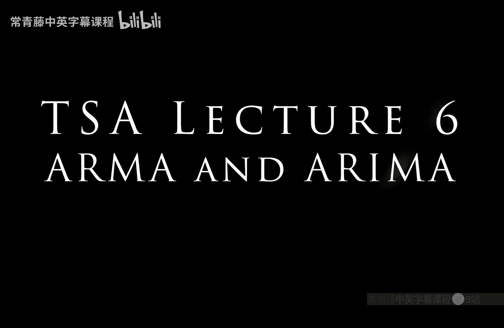
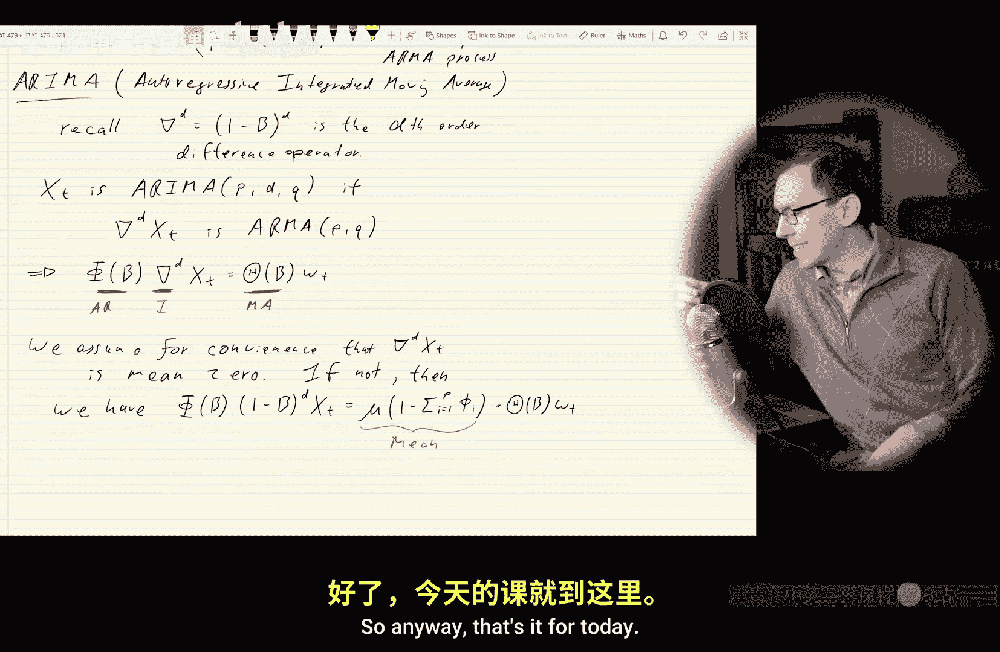

# 006：ARMA与ARIMA模型 🧮

在本节课中，我们将继续学习时间序列的理论知识。上一讲我们分别介绍了自回归（AR）过程和移动平均（MA）过程。本节中，我们将把它们结合起来，探讨自回归移动平均（ARMA）模型，并进一步介绍自回归积分移动平均（ARIMA）模型。掌握这些理论工具，将为我们后续进行模型估计和拟合数据打下坚实的基础。

## 回顾：AR与MA过程 📚

在深入ARMA模型之前，我们先简要回顾一下上一讲的核心内容。

### 自回归（AR）过程

我们讨论了AR(p)过程，即p阶自回归过程。其定义如下：

**公式**：`Φ(B) X_t = W_t`

其中，`Φ(B)`是自回归算子，`W_t`是白噪声。我们得出的关键结论是：如果多项式`Φ(z)`的所有根`r_i`都位于单位圆外（即`|r_i| > 1`），则该AR(p)过程是**因果的**。这意味着`X_t`可以表示为一个因果线性过程，即仅依赖于当前和过去的白噪声。

### 移动平均（MA）过程

接着，我们讨论了MA(q)过程，即q阶移动平均过程。其定义如下：

**公式**：`X_t = Θ(B) W_t`

其中，`Θ(B)`是移动平均算子。类似地，如果多项式`Θ(z)`的所有根都位于单位圆外，则该MA(q)过程是**可逆的**。这意味着白噪声`W_t`可以表示为`X_t`过去值的线性组合。

## 结合：ARMA模型 ⚙️

上一节我们介绍了AR和MA过程，本节中我们来看看如何将它们融合成一个更强大的模型。

ARMA(p, q)模型，即自回归移动平均模型，结合了AR(p)和MA(q)的特点。其定义如下：

**公式**：`Φ(B) X_t = Θ(B) W_t`

或者，等价地写为：
`X_t = φ_1 X_{t-1} + ... + φ_p X_{t-p} + W_t + θ_1 W_{t-1} + ... + θ_q W_{t-q}`

其中，系数`φ_1, ..., φ_p`和`θ_1, ..., θ_q`是实数，且`φ_p ≠ 0`，`θ_q ≠ 0`，以确保模型的阶数准确。

### 模型的可辨识性与简化

在构建ARMA模型时，需要注意一个关键问题：**非唯一性**。有时，一个ARMA模型可能被过度参数化，可以通过约简得到更简单的形式。

**示例**：考虑过程 `X_t = θ X_{t-1} - θ W_{t-1} + W_t`。
- 初看之下，它像是一个ARMA(1,1)模型。
- 但我们可以将其重写为 `(1 - θB) X_t = (1 - θB) W_t`。
- 如果`|θ| < 1`，我们可以“约去”两边的`(1 - θB)`算子，得到 `X_t = W_t`。
- 这意味着，该过程本质上就是**白噪声**，而非真正的ARMA(1,1)模型。

这个例子说明，如果自回归多项式`Φ(z)`和移动平均多项式`Θ(z)`有**公因子**（即共同的根），那么模型就可以被简化。因此，在标准设定下，我们假设`Φ(z)`和`Θ(z)`是互质的（没有公因子），以确保模型是唯一且最简形式的。

### 因果性与可逆性

对于一个ARMA(p, q)过程，我们关心两个核心性质：

1.  **因果性**：如果`Φ(z)`的根都在单位圆外，则该ARMA过程是因果的。这意味着`X_t`可以表示为当前和过去白噪声的线性组合（一个因果线性过程）：
    **公式**：`X_t = Σ_{j=0}^{∞} ψ_j W_{t-j}`，其中系数`ψ_j`是绝对可和的。

2.  **可逆性**：如果`Θ(z)`的根都在单位圆外，则该ARMA过程是可逆的。这意味着白噪声`W_t`可以表示为当前和过去`X_t`的线性组合：
    **公式**：`W_t = Σ_{j=0}^{∞} π_j X_{t-j}`，其中系数`π_j`是绝对可和的。

在实际建模中，我们通常希望并且会寻找具有**因果性**和**可逆性**的ARMA模型表示，因为这样的表示在统计估计中更稳定、更易于处理。

## 扩展：ARIMA模型 📈

在现实数据中，我们经常遇到的情况是，序列`Y_t`本身并非平稳的ARMA过程，但经过差分处理后，可以转化为平稳的ARMA过程。这就引出了ARIMA模型。

### 差分算子

首先，定义d阶差分算子`∇^d`：
**公式**：`∇^d = (1 - B)^d`
其中，`B`是后移算子（`B X_t = X_{t-1}`）。一阶差分`∇ X_t = X_t - X_{t-1}`常用于消除线性趋势。

### ARIMA模型定义

我们说一个序列`X_t`服从ARIMA(p, d, q)过程，如果它的**d阶差分**是一个ARMA(p, q)过程。

**公式**：`Φ(B) (1 - B)^d X_t = Θ(B) W_t`

其中：
- `p`：差分后序列的自回归阶数。
- `d`：使序列变得平稳所需的最小差分阶数。
- `q`：差分后序列的移动平均阶数。

**直观理解**：许多时间序列数据（如股价、气温）可能包含确定性的趋势（如线性增长）。ARIMA模型通过差分运算`(1-B)^d`先移除这些趋势，然后对得到的平稳序列拟合ARMA模型。例如，如果数据有线性趋势，通常`d=1`就足够了；如果有二次趋势，可能需要`d=2`。

### 包含常数项的ARIMA

有时，即使经过d阶差分，序列的均值可能仍不为零。更一般的ARIMA模型可以包含一个常数项`μ`：

**公式**：`Φ(B) (1 - B)^d X_t = δ + Θ(B) W_t`
其中，`δ = μ (1 - φ_1 - ... - φ_p)`。

## 总结 🎯

本节课中我们一起学习了时间序列建模中两个核心的模型家族。

1.  **ARMA(p, q)模型**：融合了自回归和移动平均成分，用于描述平稳时间序列。其关键性质是因果性和可逆性，这取决于相应多项式的根是否在单位圆外。
2.  **ARIMA(p, d, q)模型**：ARMA模型的扩展，通过引入d阶差分来处理非平稳数据（特别是含有确定性趋势的数据）。它先对数据差分使其平稳，再应用ARMA模型。

这些模型为我们提供了描述各种时间序列动态结构的强大数学框架。在接下来的课程中，我们将学习如何利用自相关和偏自相关函数来识别模型的阶数(p, d, q)，并最终进入统计部分——如何从实际数据中估计这些模型的参数。