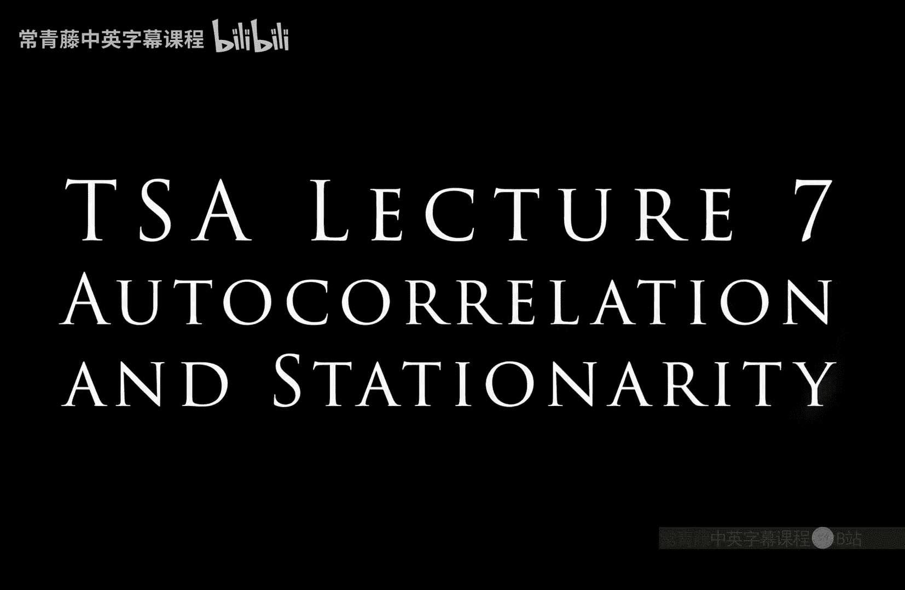
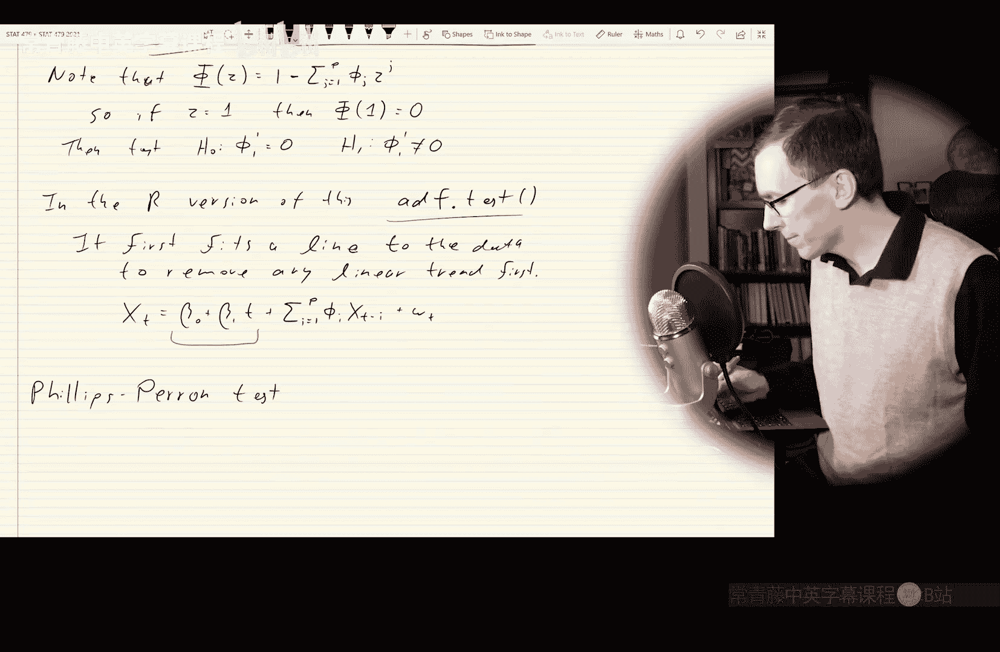

# 007：自相关与平稳性

在本节课中，我们将要学习如何检验时间序列数据中的自相关性以及判断序列是否平稳。这是进行有效统计推断的基础。

在之前的几讲中，我们深入探讨了AR、MA、ARMA和ARIMA模型的数学性质。现在，我们将暂时从繁重的理论中抽身，转而关注对这些模型的实际统计检验。具体来说，今天的课程有两个核心主题：自相关和平稳性。

## 检验自相关性

上一节我们介绍了ARMA模型的性质，本节中我们来看看如何检验数据中是否存在显著的自相关。除非数据是白噪声，否则我们通常会发现一些自相关。我们需要从统计上检验这些自相关是否显著不为零。

以下是两种常用的检验方法：

### Box-Pierce 与 Ljung-Box 检验

这两种检验旨在回答同一个问题：在滞后阶数1到H之间，是否存在非零的自相关？其原假设是：所有滞后阶数（1到H）的自相关系数均为零。

*   **Box-Pierce检验**：其检验统计量 **Q_BP = n * Σ_{j=1}^{H} (ρ̂(j))^2**，在原假设下，它近似服从自由度为H的卡方分布。
*   **Ljung-Box检验**：这是对Box-Pierce检验的改进，尤其适用于有限样本。其检验统计量为 **Q_LB = n(n+2) * Σ_{j=1}^{H} (ρ̂(j))^2 / (n - j)**，同样近似服从自由度为H的卡方分布。

在实践中，我们通常不会直接将检验应用于原始时间序列，而是应用于拟合某个ARMA(p, q)模型后得到的残差序列。如果模型拟合良好，残差应近似为白噪声（即无自相关）。此时，检验统计量的自由度需要调整为 **H - p - q**。在R语言中，可以使用 `Box.test()` 函数进行这些检验。

### Durbin-Watson 检验

Durbin-Watson检验专门用于检验**一阶自相关**。它通常应用于线性回归模型的残差。

该检验的统计量定义为：
**Q_DW = Σ_{t=2}^{T} (r̂_t - r̂_{t-1})^2 / Σ_{t=1}^{T} (r̂_t)^2**
其中，r̂_t 是回归残差。

*   **Q_DW ≈ 2** 表示无自相关。
*   **Q_DW 显著接近 0** 表示存在正自相关。
*   **Q_DW 显著接近 4** 表示存在负自相关。

其P值的计算涉及卡方随机变量的线性组合，计算较为复杂，但R语言中的 `dwtest()` 函数（来自 `lmtest` 包）可以方便地完成。

### Breusch-Godfrey 检验

Breusch-Godfrey检验（BG检验）是Durbin-Watson检验的推广，它可以检验残差中是否存在**高阶（P阶）**的自回归过程。该检验通过比较 **n * R²**（其中R²是残差对其自身滞后项回归的判定系数）与自由度为P的卡方分布来进行。在R中，可以使用 `bgtest()` 函数。

## 检验平稳性

在学习了如何检验自相关之后，我们接下来探讨时间序列分析中另一个基石性的概念：平稳性。平稳性对于参数估计和统计推断至关重要。以下是两种常见的单位根检验方法，用于判断序列是否平稳。

### (Augmented) Dickey-Fuller 检验

Dickey-Fuller检验及其增强版本（ADF检验）是典型的单位根检验。其核心思想是检验自回归多项式是否存在模为1的根（单位根），若存在，则序列非平稳。

*   **基本DF检验**：针对AR(1)过程 **X_t = φ X_{t-1} + w_t**。通过检验一阶差分方程 **∇X_t = φ' X_{t-1} + w_t** 中的系数 **φ'** 是否为零（等价于检验原序列的φ是否为1）。**原假设 H0: φ' = 0 (序列非平稳)**，**备择假设 H1: φ' < 0 (序列平稳)**。注意，这里显著的P值意味着我们拒绝“非平稳”的原假设，支持序列是平稳的。
*   **增强型ADF检验**：将上述思想推广到AR(p)过程。检验方程扩展为：
    **∇X_t = φ'_1 X_{t-1} + Σ_{i=1}^{p-1} φ'_{i+1} ∇X_{t-i} + w_t**
    检验 **φ'_1** 是否为零，其假设与DF检验相同。R语言中的 `adf.test()` 函数（来自 `tseries` 包）在拟合时会先移除数据的线性趋势，然后再进行单位根检验。

### Phillips-Perron 检验

Phillips-Perron检验是另一种单位根检验方法。它与ADF检验的目的相同，但试图对回归假设的偏离（如异方差和误差相关）更加稳健。它使用了Newey-West估计量来校正标准误。在R语言中，可以使用 `pp.test()` 函数（同样来自 `tseries` 包）。

## 总结

本节课中我们一起学习了时间序列分析中两个核心的检验主题：自相关与平稳性。

1.  在自相关检验部分，我们介绍了 **Box-Pierce**、**Ljung-Box**、**Durbin-Watson** 和 **Breusch-Godfrey** 检验，它们主要用于检测序列（尤其是模型残差）中是否存在显著的自相关结构。
2.  在平稳性检验部分，我们探讨了 **（增强型）Dickey-Fuller** 检验和 **Phillips-Perron** 检验这两种单位根检验方法，它们用于判断一个时间序列是否具有平稳性。

理解并正确应用这些检验，是构建可靠时间序列模型、进行有效预测和推断的关键步骤。在接下来的实践中，我们将有机会在R语言中应用这些检验函数来分析真实或模拟数据。