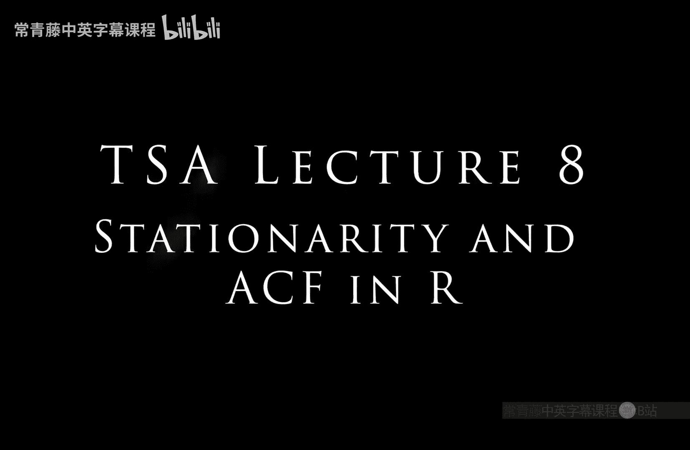
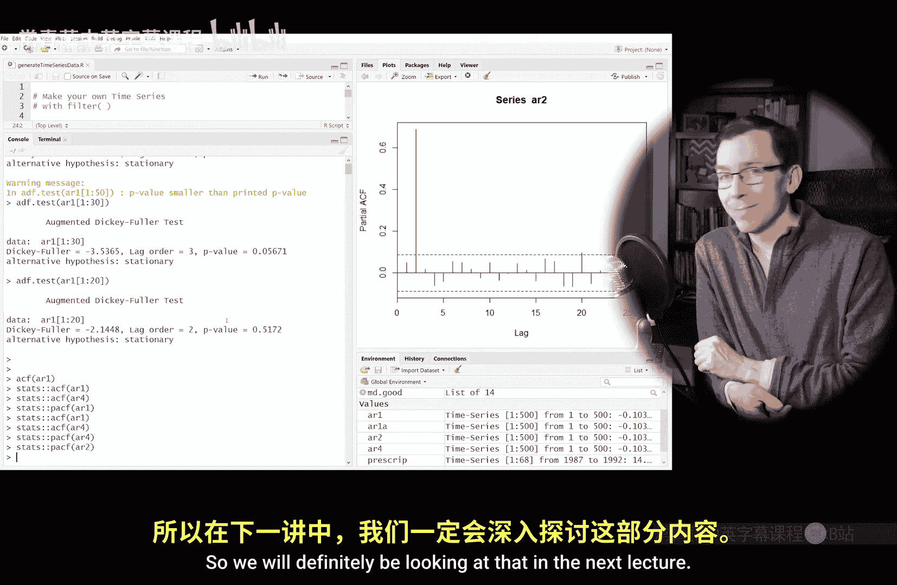

# 008：在R中检验平稳性与自相关函数



在本节课中，我们将学习如何在R软件中实际操作，检验时间序列数据的自相关性和平稳性。我们将使用模拟数据和真实数据，介绍几种关键的统计检验方法，并学习如何解读结果。

上一讲我们主要介绍了自相关检验和平稳性检验的理论知识。本节中，我们来看看如何在R中应用这些理论。

## 准备工作：生成模拟数据

首先，我们需要生成一些模拟的时间序列数据，以便在已知“正确答案”的情况下进行测试。

以下是生成三种不同类型时间序列的R代码：
```r
# 生成500个时间点的白噪声
WN <- rnorm(500)

# 生成一个自回归系数为0.7的AR(1)过程
AR1 <- arima.sim(list(order = c(1,0,0), ar = 0.7), n = 500, method = "recursive")

# 生成一个更复杂的AR(4)过程
AR4 <- arima.sim(list(order = c(4,0,0), ar = c(0.7, -0.4, 0.2, -0.1)), n = 500)
```

## 模型拟合简介

在深入检验之前，我们先简要了解如何为时间序列数据拟合模型。这有助于我们后续分析模型的残差。

以下是使用R函数拟合AR模型的示例：
```r
# 使用ar()函数自动拟合AR模型
ar(WN) # 拟合白噪声，应识别为近似阶数为0
ar(AR1) # 估计AR(1)系数，应接近0.7
ar(AR4) # 估计AR(4)系数，应接近我们设定的参数

# 使用arima()函数手动指定模型阶数进行拟合
# 为白噪声拟合一个不合适的ARMA(1,1)模型
arima(WN, order = c(1,0,1))
```

## 自相关检验

接下来，我们使用几种统计检验来探测时间序列中是否存在显著的自相关。

### Box-Pierce 与 Ljung-Box 检验

`Box.test`函数可以执行Box-Pierce检验或Ljung-Box检验。其原假设是：在指定的滞后阶数内，所有自相关系数均为零。

以下是应用该检验的示例：
```r
# 对白噪声序列进行检验（滞后阶数=1）
Box.test(WN, lag = 1, type = "Box-Pierce") # 预期p值不显著
Box.test(WN, lag = 1, type = "Ljung-Box")  # 预期p值不显著

# 对AR(1)序列进行检验
Box.test(AR1, lag = 1, type = "Box-Pierce") # 预期p值非常显著

# 对一个系数很小的AR(1)序列进行检验（难以检测）
AR1_small <- arima.sim(list(order = c(1,0,0), ar = 0.05), n = 500)
Box.test(AR1_small, lag = 1, type = "Ljung-Box") # 可能无法检测出显著性

# 对一个特殊的AR(2)序列进行检验（φ1=0， φ2≠0）
AR2_special <- arima.sim(list(order = c(2,0,0), ar = c(0, 0.7)), n = 500)
Box.test(AR2_special, lag = 1, type = "Ljung-Box")  # 滞后1阶不显著
Box.test(AR2_special, lag = 2, type = "Ljung-Box")  # 滞后2阶显著
```

**重要提示**：Box检验常应用于拟合模型后的残差。此时，需要从自由度中减去已估计的参数个数（使用`fitdf`参数）。

### Durbin-Watson 检验

Durbin-Watson检验专门用于检测残差中是否存在一阶自相关。需要加载`lmtest`包。

以下是应用该检验的示例：
```r
library(lmtest)
# 检验白噪声
dwtest(WN ~ 1) # 公式`~1`表示只拟合截距项，预期不显著

# 检验AR(1)过程
dwtest(AR1 ~ 1) # 预期非常显著

# 检验真实数据（处方药成本数据）及其线性趋势拟合后的残差
data(prescript) # 假设数据已加载
dwtest(prescript ~ time(prescript)) # 预期残差中仍存在显著自相关
```

### Breusch-Godfrey 检验

Breusch-Godfrey检验是Durbin-Watson检验的推广，可以检验更高阶的序列相关。

以下是应用该检验的示例：
```r
# 加载所需的包（如果未加载）
library(lmtest)
# 检验白噪声，滞后阶数设为6
bgtest(WN ~ 1, order = 6) # 预期不显著

# 检验AR(1)过程
bgtest(AR1 ~ 1, order = 1) # 预期显著

# 检验特殊的AR(2)过程，展示其可检测高阶相关的优势
bgtest(AR2_special ~ 1, order = 1) # 滞后1阶不显著
bgtest(AR2_special ~ 1, order = 2) # 滞后2阶显著
```

## 平稳性检验（单位根检验）

平稳性检验的核心是判断时间序列是否存在单位根。存在单位根意味着序列是非平稳的。

### Augmented Dickey-Fuller (ADF) 检验

ADF检验的原假设是序列存在单位根（非平稳），备择假设是序列平稳。

以下是应用ADF检验的示例：
```r
library(tseries)
# 检验白噪声（500个观测值）
adf.test(WN) # 预期p值很小，拒绝原假设，认为平稳

# 检验观测值较少时的情况
adf.test(WN[1:50])  # p值可能仍较小
adf.test(WN[1:20])  # p值可能变得不显著，数据不足难以判断

# 检验随机游走（非平稳过程的典型例子）
RW <- cumsum(rnorm(500)) # 累积求和生成随机游走
adf.test(RW) # 预期p值很大，无法拒绝非平稳的原假设

# 检验处方药成本数据
adf.test(prescript)
# 注意：adf.test默认会先尝试移除常数项和线性趋势，再对残差进行检验。
# 因此，即使原始序列有明显趋势，结果也可能显示残差序列是平稳的。
```

### Phillips-Perron (PP) 检验

PP检验是另一种单位根检验方法，与ADF检验类似，但在处理序列相关时采用了不同的修正方法。

以下是应用PP检验的示例：
```r
# 检验处方药成本数据
pp.test(prescript) # 结果应与ADF检验类似

# 检验白噪声
pp.test(WN) # 预期p值很大（不显著）

# 比较ADF和PP检验在小样本下的表现
pp.test(WN[1:20]) # 可能与adf.test(WN[1:20])的结果有所不同
```

## 自相关函数与偏自相关函数预览

在结束前，我们预览一下下一讲的重要内容：自相关函数和偏自相关函数图。它们能直观地提示时间序列模型的可能阶数。

以下是绘制ACF和PACF图的示例：
```r
# 绘制AR(1)过程的ACF和PACF图
acf(AR1, main = “AR(1) ACF”)
pacf(AR1, main = “AR(1) PACF”) # PACF在滞后1阶后截尾，提示AR(1)

# 绘制AR(4)过程的ACF和PACF图
acf(AR4, main = “AR(4) ACF”)
pacf(AR4, main = “AR(4) PACF”) # PACF在滞后4阶后截尾，提示AR(4)

# 绘制特殊AR(2)过程的PACF图
pacf(AR2_special, main = “Special AR(2) PACF”) # PACF在滞后2阶后截尾
```

**提示**：偏自相关函数在滞后p阶后出现“截尾”现象，通常暗示这是一个p阶自回归过程。我们将在下一讲详细讨论。

## 总结

本节课中，我们一起学习了在R环境中进行时间序列分析的关键实操步骤：
1.  我们学习了如何生成模拟的AR、MA等时间序列数据。
2.  我们介绍了`Box.test`、`dwtest`、`bgtest`等多种自相关检验方法，并理解了它们在不同场景下的应用。
3.  我们掌握了`adf.test`和`pp.test`这两种单位根检验方法，用于判断时间序列的平稳性。
4.  我们了解到，许多检验（如ADF）在应用前会默认消除数据中的确定性趋势。
5.  我们预览了自相关图和偏自相关图，认识到它们是识别模型类型的强大可视化工具。



通过结合模拟数据和真实数据练习这些检验，我们能够更好地理解统计检验的效力、局限性以及在实际分析中需要注意的细节（如自由度调整、样本量影响等）。这些工具为我们后续建立和诊断时间序列模型奠定了坚实的基础。