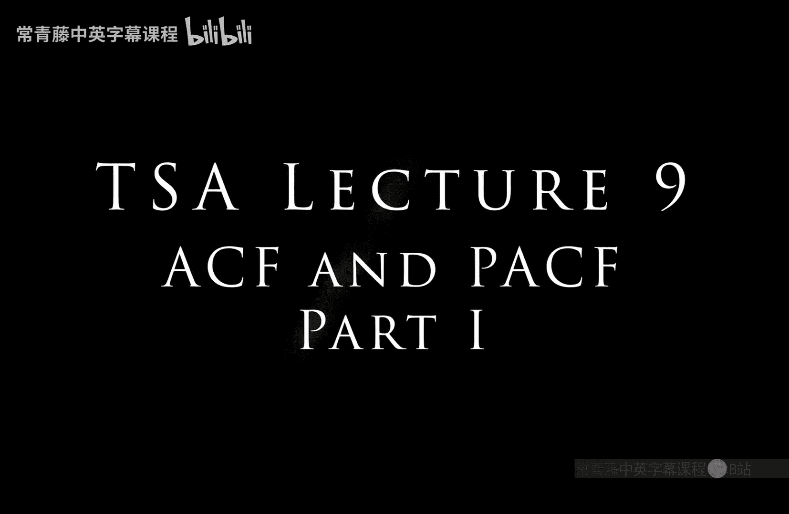
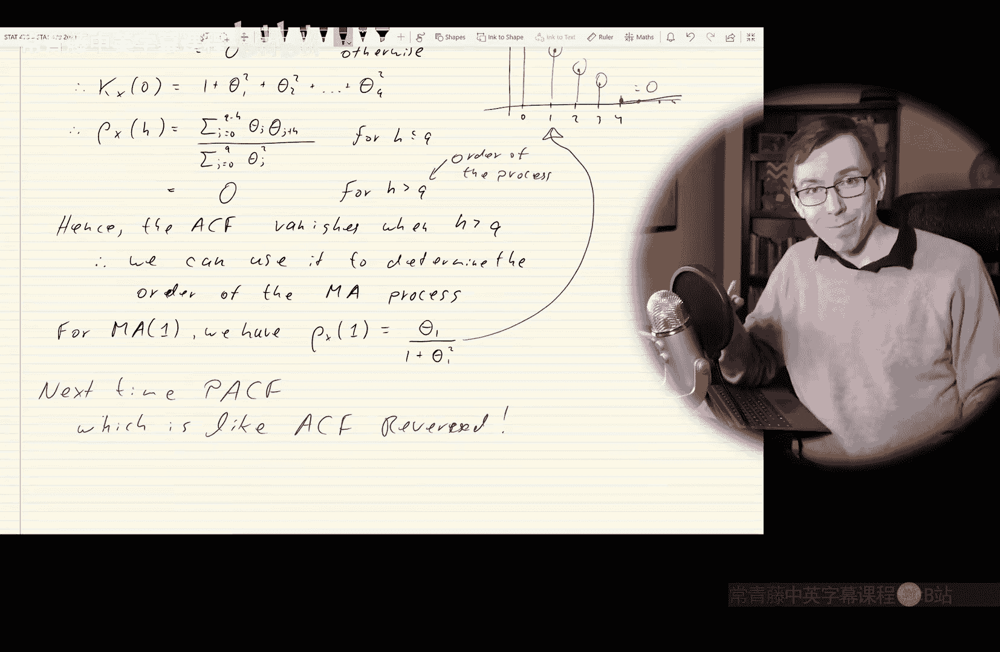

# 009：自相关与偏自相关函数（第一部分）

在本节课中，我们将学习时间序列分析中的两个核心工具：自相关函数（ACF）和偏自相关函数（PACF）。我们将从回顾自相关函数开始，然后深入探讨其“兄弟”——偏自相关函数的概念、理论性质及其在分析时间序列数据中的应用。

## 从相关到偏相关

上一节我们介绍了自相关函数，本节中我们来看看一个更复杂但密切相关的概念：偏相关。为了理解偏自相关，我们首先需要理解在一般随机变量背景下的偏相关概念。

### 什么是偏相关？

考虑两个实值随机变量 X 和 Y。它们之间的相关系数衡量的是它们之间的线性关系强度。然而，有时 X 和 Y 看起来相关，可能是因为它们都与第三个变量 Z 有关。

例如，假设：
*   X 代表房屋价格。
*   Y 代表汽车价格。
*   Z 代表收入。

房屋价格和汽车价格可能呈现正相关，但这很可能是因为它们都受到收入水平的影响。如果我们“控制”或“给定”收入 Z，那么房屋价格和汽车价格之间的相关性可能会消失。这种在给定 Z 的条件下，X 和 Y 之间的相关性，就是**偏相关**。

### 如何计算偏相关？

偏相关可以通过回归分析来计算。以下是计算步骤：

1.  分别用 Z 对 X 和 Y 进行线性回归：
    *   `X_hat = α_0 + α_1 * Z`
    *   `Y_hat = β_0 + β_1 * Z`
2.  计算两个回归的残差：
    *   `Residual_X = X - X_hat`
    *   `Residual_Y = Y - Y_hat`
3.  偏相关系数就是这两个残差序列之间的普通相关系数。

**核心公式**：
偏相关系数 ρ_{XY·Z} = Corr( X - E[X|Z], Y - E[Y|Z] )

如果偏相关系数为零（或接近零），则表明在给定 Z 的条件下，X 和 Y 不相关。如果数据服从联合正态分布，零偏相关还意味着条件独立性，这是一个更强的结论。

## 回到时间序列：偏自相关函数（PACF）

现在，我们将偏相关的概念应用到时间序列中，定义**偏自相关函数**。

对于一个平稳时间序列 {X_t}，在滞后 h 处的偏自相关系数，记作 φ_{hh}，其定义如下：
*   当 h = 1 时，偏自相关系数就等于普通自相关系数：φ_{11} = ρ(1)。
*   当 h > 1 时，φ_{hh} 是 X_{t+h} 和 X_t 之间，在**给定中间所有观测值** (X_{t+1}, X_{t+2}, ..., X_{t+h-1}) 的条件下的相关系数。

**计算理解**：
这相当于进行两次回归：
1.  用 `X_{t+1}, ..., X_{t+h-1}` 预测 `X_{t+h}`，得到预测值 `X_{t+h}` 和残差 `R_{t+h}`。
2.  用 `X_{t+1}, ..., X_{t+h-1}` 预测 `X_t`，得到预测值 `X_t` 和残差 `R_t`。
偏自相关系数 φ_{hh} 就是这两个残差序列 `R_{t+h}` 和 `R_t` 之间的相关系数。

**直观意义**：
PACF 试图揭示在排除中间所有滞后项的影响后，`X_t` 和 `X_{t+h}` 之间是否存在“直接”的关系。这对于识别自回归过程的阶数至关重要。

## 自回归过程的ACF特征

接下来，我们探讨不同类型时间序列过程中ACF的表现。首先从自回归过程开始。

### AR(1) 过程的 ACF

考虑一个平稳、零均值的 AR(1) 过程：
`X_t = φ X_{t-1} + W_t`，其中 |φ| < 1。

通过计算，我们可以得到其自相关函数满足一个一阶差分方程，并具有简单的几何衰减形式：

**核心公式**：
`ρ(h) = φ^h`，对于 h ≥ 0。

这意味着 AR(1) 过程的 ACF 图从 ρ(0)=1 开始，在滞后 1 处为 φ，然后按 φ^2, φ^3, ... 的方式指数衰减到零。如果 φ 为正，则单调衰减；如果 φ 为负，则呈现正负交替的衰减模式。

### AR(2) 及更高阶 AR(p) 过程的 ACF

对于 AR(2) 过程：`X_t = φ_1 X_{t-1} + φ_2 X_{t-2} + W_t`，其 ACF 满足二阶差分方程：`ρ(h) = φ_1 ρ(h-1) + φ_2 ρ(h-2)`。

解此方程得到的 ACF 形式取决于其特征多项式的根：
1.  **两个不等的实根**：ACF 是两个几何衰减项的线性组合，整体仍呈现几何衰减趋势。
2.  **两个相等的实根（重根）**：ACF 是 `(C1 + C2 * h) * (几何衰减项)`，衰减模式可能被一个线性项修饰。
3.  **一对共轭复根**：ACF 的形式为 `(几何衰减项) * cos(θh + 常数)`。这意味着 ACF 在几何衰减的同时，还会产生**阻尼振荡**（正弦波式的波动），振荡频率由复根的幅角决定。

**AR(p) 过程的一般结论**：
无论特征根是实是复，是否有重根，AR(p) 过程的 ACF 通常表现为**混合的几何衰减**（可能伴有阻尼振荡），并且**不会在有限滞后后突然截断**，而是逐渐衰减至零。

## 滑动平均过程的ACF特征

现在，我们来看滑动平均过程 ACF 的特征，这与 AR 过程形成鲜明对比。

考虑一个 MA(q) 过程：
`X_t = W_t + θ_1 W_{t-1} + ... + θ_q W_{t-q}`，其中 θ_0 = 1。

其自协方差和自相关函数有一个非常简洁的性质：

**核心公式**：
对于 h > q，有 `γ(h) = 0` 且 `ρ(h) = 0`。

**推导结果**：
`ρ(h) = (∑_{j=0}^{q-h} θ_j θ_{j+h}) / (∑_{j=0}^{q} θ_j^2)`， 当 0 ≤ h ≤ q。
`ρ(h) = 0`， 当 h > q。

**重要特征**：
MA(q) 过程的 ACF 在**滞后 q 处之后突然截断**（严格为零）。这是一个非常关键的性质。

**直观意义**：
因为 MA 过程只依赖于最近 q 期的噪声，所以相隔超过 q 个时间点的观测值之间没有线性依赖关系。因此，我们可以通过观察 ACF 图在哪个滞后之后变得不显著（接近零），来初步判断 MA 过程的阶数 q。

例如，一个 MA(3) 过程的 ACF 可能在滞后 1、2、3 处显著非零，但从滞后 4 开始全部接近零。

## 总结与预告

本节课中我们一起学习了：

1.  **偏相关与偏自相关**：理解了在控制其他变量影响后，两个变量之间“净”相关性的概念，并将其引入时间序列定义了偏自相关函数。
2.  **AR过程的ACF**：AR过程的ACF通常表现为**几何衰减**（可能伴有振荡），且**不会突然截断**。衰减速度由自回归系数（或特征根）决定。
3.  **MA过程的ACF**：MA(q)过程的ACF有一个标志性特征，即在**滞后 q 之后突然截断为零**。这可用于初步识别MA过程的阶数。

这些特征为我们识别时间序列模型提供了重要线索。在下节课中，我们将重点研究**偏自相关函数**的表现。你会发现一个有趣的对偶现象：对于AR过程，其PACF会在滞后超过阶数p后截断；而对于MA过程，其PACF则表现为几何衰减。结合ACF和PACF的图形，我们将能更有效地在AR、MA或ARMA模型之间做出初步判断。