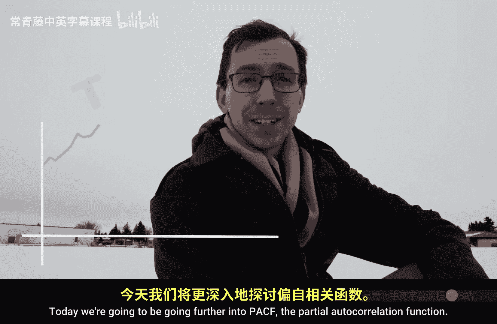
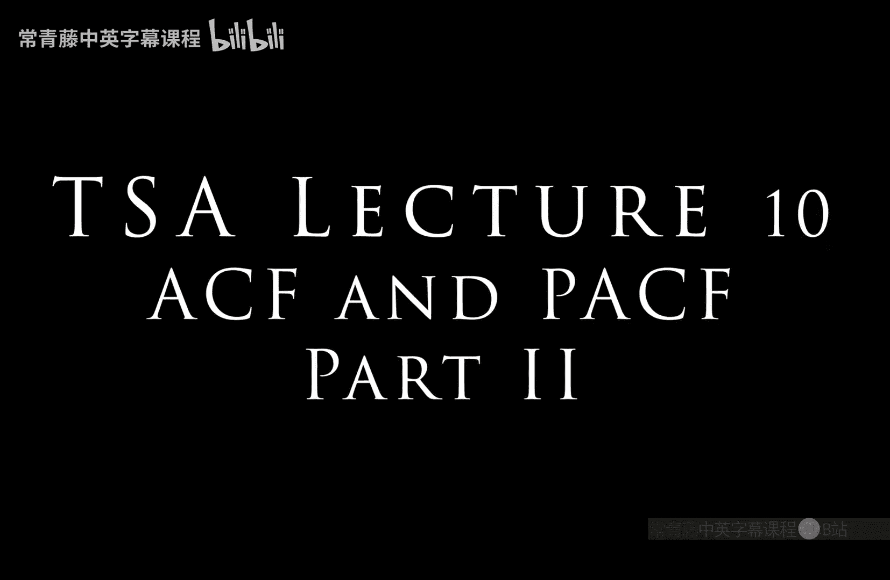
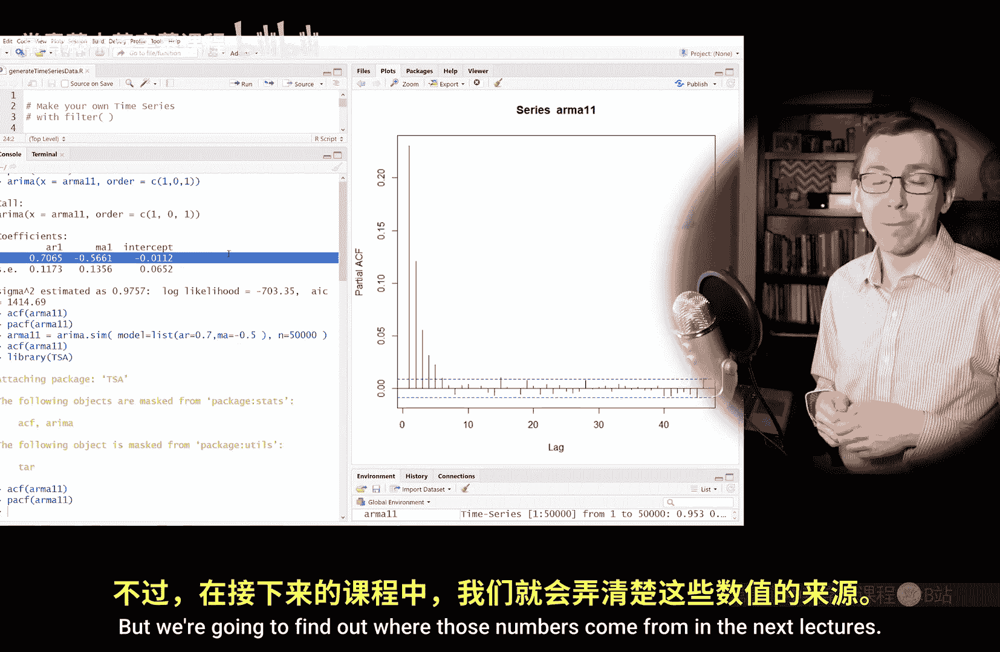

# 010：ACF与PACF（第二部分）






在本节课中，我们将继续学习自相关函数（ACF）和偏自相关函数（PACF）。上一讲我们介绍了ACF和PACF的基本概念，本节我们将深入探讨PACF，特别是它在AR和MA过程中的表现，并学习如何利用这些工具来识别时间序列的模型类型和阶数。

---

## 回顾：偏自相关函数（PACF）的定义

上一节我们介绍了偏自相关的概念。为了确保概念清晰，我们在此简要回顾一下。

对于一个平稳时间序列 \(X_t\)，在滞后阶数 \(h\) 处的偏自相关函数 \(\phi_{xx}(h)\) 定义如下：
- 当 \(h=1\) 时，\(\phi_{xx}(1)\) 就是滞后1的自相关系数。
- 当 \(h>1\) 时，\(\phi_{xx}(h)\) 是 \(X_{t+h}\) 和 \(X_t\) 在剔除了中间观测值 \(X_{t+1}, X_{t+2}, ..., X_{t+h-1}\) 的线性影响后的相关系数。

更具体地说，我们通过将 \(X_t\) 和 \(X_{t+h}\) 分别对中间观测值进行回归，得到拟合值 \(\hat{X}_t\) 和 \(\hat{X}_{t+h}\)，然后计算残差 \((X_t - \hat{X}_t)\) 与 \((X_{t+h} - \hat{X}_{t+h})\) 之间的相关系数。

如果偏自相关为零，意味着 \(X_t\) 和 \(X_{t+h}\) 之间的关系完全由中间的时间点所解释，它们之间没有直接的关联。

---

## AR(1)过程的PACF

为了建立直观理解，我们先从最简单的AR(1)过程开始分析。

考虑一个平稳、因果的AR(1)过程：
\[
X_t = \phi X_{t-1} + W_t, \quad |\phi| < 1
\]
其中 \(W_t\) 是白噪声。

**计算滞后2的偏自相关**

根据定义，我们需要计算 \(X_t\) 和 \(X_{t-2}\) 在剔除 \(X_{t-1}\) 影响后的相关性。这等价于计算以下两个残差之间的相关性：
1.  \(X_t - \hat{X}_t\)，其中 \(\hat{X}_t\) 是基于 \(X_{t-1}\) 对 \(X_t\) 的最佳线性预测。
2.  \(X_{t-2} - \hat{X}_{t-2}\)，其中 \(\hat{X}_{t-2}\) 是基于 \(X_{t-1}\) 对 \(X_{t-2}\) 的最佳线性预测。

对于AR(1)过程，可以证明，基于 \(X_{t-1}\) 预测 \(X_t\) 和预测 \(X_{t-2}\) 的最佳线性系数都是 \(\phi\)。因此：
- \(X_t - \hat{X}_t = X_t - \phi X_{t-1} = W_t\)
- \(X_{t-2} - \hat{X}_{t-2} = X_{t-2} - \phi X_{t-1}\)

现在计算这两个残差的协方差。由于 \(W_t\) 是当前时刻的白噪声，而 \(X_{t-2} - \phi X_{t-1}\) 只依赖于 \(t-1\) 及更早的信息（因果性），因此它们不相关，协方差为零。

所以，对于AR(1)过程，有：
\[
\phi_{xx}(1) = \phi
\]
\[
\phi_{xx}(h) = 0, \quad \text{对于所有 } h > 1
\]

**PACF的图像特征**
AR(1)过程的PACF图会在滞后1处有一个显著的尖峰（值约为 \(\phi\)），而在所有更高的滞后阶数（\(h \ge 2\)）上，PACF值理论上为零（在实际样本中会接近零）。这是一个非常清晰的模式。

---

## 扩展到AR(p)过程

现在我们将结论推广到一般的AR(p)过程。

考虑一个平稳、因果的AR(p)过程：
\[
X_t = \phi_1 X_{t-1} + \phi_2 X_{t-2} + ... + \phi_p X_{t-p} + W_t
\]

**PACF的行为**
对于AR(p)过程，其偏自相关函数具有以下关键特征：
- 对于滞后阶数 \(h \le p\)，\(\phi_{xx}(h)\) 通常非零。
- **对于所有滞后阶数 \(h > p\)，有 \(\phi_{xx}(h) = 0\)**。

**直观解释**
这是因为AR(p)过程具有“p阶马尔可夫性”。要预测 \(X_t\)，只需要最近p个历史值 \(X_{t-1}, ..., X_{t-p}\)。当我们在计算滞后 \(h > p\) 的偏自相关时，例如 \(X_t\) 和 \(X_{t-h}\)，在条件于中间所有的 \(h-1\) 个观测值后，\(X_{t-h}\) 中不包含任何预测 \(X_t\) 的额外信息（这些信息已完全包含在最近的p个值中）。因此，偏自相关为零。

**实际意义**
这一特性使得PACF成为识别AR过程及其阶数p的强大工具。在PACF图中，我们寻找一个“截尾”点：在该点之后，PACF值变得不显著（在置信区间内波动）。这个截尾点就提示了AR模型的阶数p。

---

## MA(1)过程的PACF

接下来，我们看看移动平均过程的表现。以可逆的MA(1)过程为例：
\[
X_t = W_t + \theta W_{t-1}, \quad |\theta| < 1
\]

**计算PACF**
计算MA过程的PACF比AR过程更复杂，因为需要求解回归系数。我们省略繁琐的推导，直接给出MA(1)过程在滞后1处的偏自相关结果：
\[
\phi_{xx}(1) = \frac{-\theta^2}{1 + \theta^2 + \theta^4}
\]
对于更高的滞后阶数，PACF不会像AR过程那样在某个点后严格为零，而是会**逐渐衰减（拖尾）**，通常其绝对值呈几何衰减趋势，并且可能正负交替。

**PACF的行为**
对于一般的MA(q)过程，其偏自相关函数 \(\phi_{xx}(h)\) **不会在有限滞后后截尾**，而是逐渐衰减至零。这与AR过程的PACF形成鲜明对比。

---

## 总结：ACF与PACF的行为模式

根据以上分析，我们可以总结出AR和MA过程在ACF和PACF上的典型模式，这对于模型识别至关重要。

以下是ACF和PACF在不同模型中的行为对照表：

| 过程类型 | 自相关函数 (ACF)                                     | 偏自相关函数 (PACF)                                   |
| :------- | :--------------------------------------------------- | :---------------------------------------------------- |
| **AR(p)**  | **逐渐衰减（拖尾）**                                     | **在滞后p后截尾**（即 \(h>p\) 时，\(\phi_{xx}(h) \approx 0\)） |
| **MA(q)**  | **在滞后q后截尾**（即 \(h>q\) 时，\(\rho(h) \approx 0\)） | **逐渐衰减（拖尾）**                                     |
| **ARMA(p,q)** | 两者均表现为**逐渐衰减（拖尾）**                             | 两者均表现为**逐渐衰减（拖尾）**                             |

**关键点**
- **截尾**：指函数值在某个滞后点之后突然变得非常接近零（落在置信区间内）。
- **拖尾**：指函数值逐渐衰减至零，可能呈指数型或振荡型衰减，不会突然截断。

---

## R语言实例演示

理论需要结合实际观察。让我们用R语言生成一些模拟数据，直观感受ACF和PACF图。

**生成模拟数据**
```r
set.seed(479) # 设置随机种子保证结果可重复
n <- 500      # 生成500个观测值

# 1. 生成白噪声
wn <- rnorm(n)

# 2. 生成AR(1)过程，系数phi=0.7
ar1 <- filter(wn, filter=0.7, method="recursive")
ar1 <- ar1[!is.na(ar1)] # 移除初始的NA值

# 3. 生成MA(1)过程，系数theta=0.7
ma1 <- filter(wn, filter=c(1, 0.7), method="convolution", sides=1)
ma1 <- ma1[!is.na(ma1)]
```

**绘制ACF和PACF图**
```r
# 设置图形布局，一行两列
par(mfrow=c(1,2))

# 绘制AR(1)的ACF和PACF
acf(ar1, main="ACF of AR(1)")
pacf(ar1, main="PACF of AR(1)")

# 绘制MA(1)的ACF和PACF
acf(ma1, main="ACF of MA(1)")
pacf(ma1, main="PACF of MA(1)")

par(mfrow=c(1,1)) # 恢复默认图形设置
```

**观察结果**
- **AR(1)过程**：ACF图呈现缓慢的几何衰减。PACF图在滞后1处有一个明显的尖峰，之后的值基本在零附近波动（截尾）。
- **MA(1)过程**：ACF图在滞后1处有一个尖峰，之后截尾。PACF图则呈现衰减模式，可能正负交替。

**更高阶模型与注意事项**
当我们模拟AR(3)或MA(3)过程时，模式依然成立，但有时不那么明显，尤其是当系数较小或样本量不足时。对于ARMA混合模型，ACF和PACF都会呈现拖尾现象，仅凭图形精确判断p和q的阶数会更具挑战性。

**重要提示**
这些图形模式是“经验法则”。在实际数据分析中，需要结合统计检验、信息准则（如AIC）以及模型诊断来综合判断最优模型。样本量越大，这些图形特征通常越清晰。

---

## 课程总结

本节课我们一起深入学习了偏自相关函数（PACF）的核心内容。

我们首先回顾了PACF的定义，它衡量了在剔除中间观测值影响后，两个时间点之间的纯相关性。接着，我们深入分析了PACF在AR和MA过程中的理论行为：
- 对于**AR(p)**过程，PACF在滞后p之后**截尾**。这是识别AR模型阶数p的关键特征。
- 对于**MA(q)**过程，PACF**逐渐衰减（拖尾）**，而ACF在滞后q之后截尾。

通过R语言实例，我们直观验证了这些理论模式，并认识到在实际应用中，需要谨慎解释图形，并结合其他统计工具进行模型识别。



掌握ACF和PACF的这些特性，是进行时间序列模型识别和定阶的基础。下一讲，我们将开始一个激动人心的新篇章：学习如何从数据中**估计**这些模型的参数。