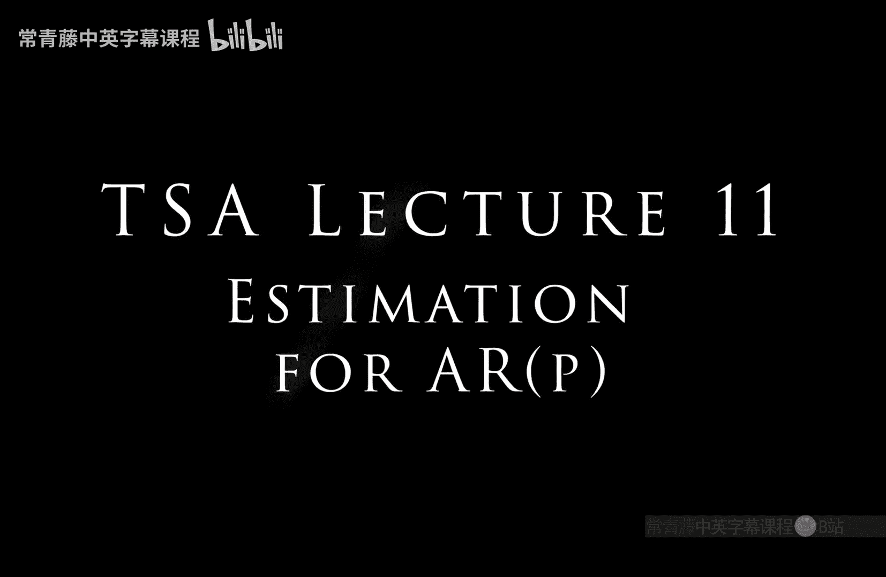
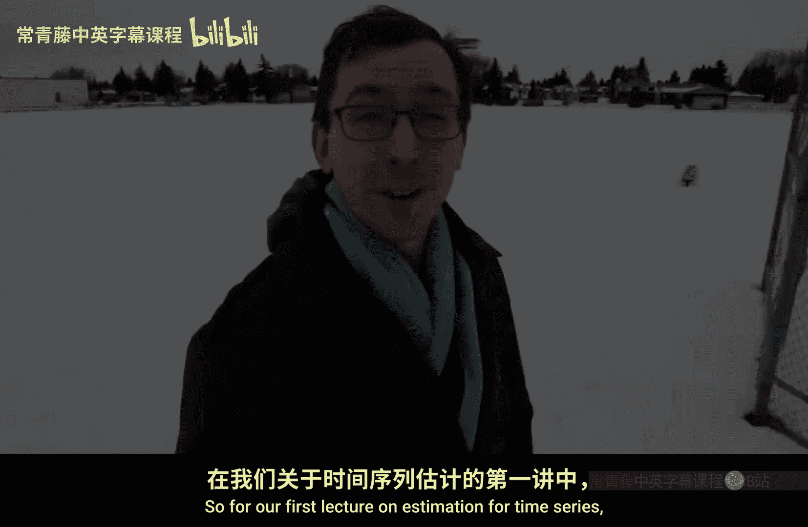
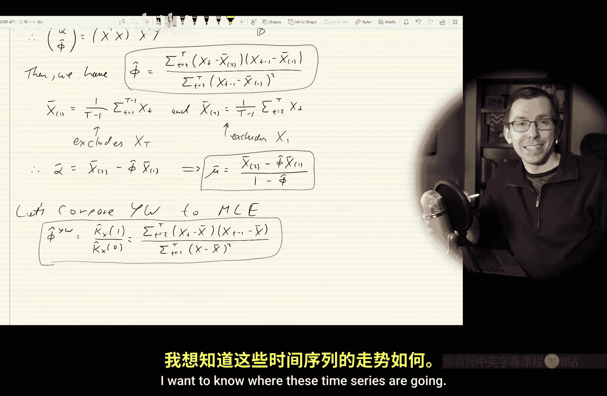

# 011：AR(p)模型的参数估计

在本节课中，我们将学习如何为自回归（AR）过程估计参数。我们将介绍两种主要方法：尤尔-沃克方程和最大似然估计，并比较它们的异同。

---

## 概述与目标

到目前为止，我们已经讨论了不同时间序列（如AR、MA和ARMA模型）的性质。现在，我们将进入统计学的核心环节：参数估计。具体来说，对于AR(p)模型，我们的目标是估计其自回归系数 φ₁, φ₂, ..., φₚ 以及白噪声过程的方差 σ²。

我们将从最简单的AR过程开始，逐步介绍两种最标准的估计方法。

---

## 第一步：估计均值

首先，我们需要估计时间序列的均值 μ。这很简单，使用样本均值即可：

**公式：**
`x̄ = (1/T) * Σ_{t=1}^{T} x_t`

其中，T 是观测数据的总数。计算出样本均值后，我们可以将原始序列减去均值，得到一个均值为0的新序列，从而简化后续计算。

---

## 第二步：估计方差与尤尔-沃克方程

上一节我们介绍了如何估计均值，本节中我们来看看如何估计白噪声的方差 σ² 以及自回归系数 φ。

我们的起点是AR(p)模型的定义：

**公式：**
`x_t = w_t + φ₁ x_{t-1} + φ₂ x_{t-2} + ... + φ_p x_{t-p}`

其中，`w_t` 是方差为 σ² 的白噪声。

为了估计参数，我们构建一个方程组。方法是将模型方程两边乘以 `x_{t-k}`（k=0, 1, ..., p）并取期望。这利用了自协方差函数 `γ(k) = Cov(x_t, x_{t-k})` 的性质。

例如，当 k=0 时，我们得到：
`γ(0) = σ² + φ₁ γ(1) + φ₂ γ(2) + ... + φ_p γ(p)`

当 k=1, 2, ..., p 时，我们得到一系列方程：
`γ(1) = φ₁ γ(0) + φ₂ γ(1) + ... + φ_p γ(p-1)`
`γ(2) = φ₁ γ(1) + φ₂ γ(0) + ... + φ_p γ(p-2)`
...
`γ(p) = φ₁ γ(p-1) + φ₂ γ(p-2) + ... + φ_p γ(0)`

这个方程组被称为 **尤尔-沃克方程**。

我们可以用矩阵形式简洁地表示它：

**公式：**
`Γ φ = γ`

其中：
*   `φ = [φ₁, φ₂, ..., φ_p]^T` 是待估参数向量。
*   `γ = [γ(1), γ(2), ..., γ(p)]^T` 是自协方差向量（从滞后1到p）。
*   `Γ` 是一个 p×p 矩阵，其第 i 行第 j 列元素为 `γ(|i-j|)`。

在实际操作中，我们用样本自协方差 `γ̂(k)` 替换理论值 `γ(k)`，得到估计矩阵 `Γ̂` 和向量 `γ̂`。然后，通过求解线性方程组来估计 φ：

**公式：**
`φ̂_{YW} = Γ̂^{-1} γ̂`

得到 φ 的估计值后，我们可以回代到第一个方程中，估计白噪声的方差：

**公式：**
`σ̂²_{YW} = γ̂(0) - Σ_{i=1}^{p} φ̂_i γ̂(i)`

---

## 最大似然估计方法

上一节我们介绍了基于矩估计的尤尔-沃克方法，本节中我们来看看基于概率模型的**最大似然估计**方法。

MLE要求我们指定误差项的分布。为了使推导可行，我们通常假设白噪声 `w_t` 服从**高斯（正态）分布**。我们以AR(1)模型为例进行说明，因为其形式更简单，但原理可以推广到AR(p)模型。

AR(1)模型为：
`x_t - μ = φ (x_{t-1} - μ) + w_t`, 其中 `w_t ~ N(0, σ²)`

我们的目标是基于观测数据 `x₁, x₂, ..., x_T`，找到参数 `μ`, `φ`, `σ²` 的值，使得数据的联合概率密度（即似然函数）最大。

由于AR(1)过程具有马尔可夫性（当前值只依赖于前一个值），我们可以将联合似然函数分解：

**公式：**
`L(μ, φ, σ²) = f(x₁) * Π_{t=2}^{T} f(x_t | x_{t-1})`

其中：
*   `f(x₁)` 是第一个观测值的边际分布，对于平稳AR(1)过程，`x₁ ~ N(μ, σ²/(1-φ²))`。
*   `f(x_t | x_{t-1})` 是条件分布，`x_t | x_{t-1} ~ N(μ + φ(x_{t-1} - μ), σ²)`。

将具体的正态分布密度函数代入并取对数，我们得到对数似然函数。然而，由于 `f(x₁)` 项中包含 `1/(1-φ²)`，使得整个方程关于参数是非线性的，求解解析解非常困难。

---

## 条件最大似然估计

为了解决MLE中的非线性问题，一个常用的技巧是使用**条件最大似然估计**。其思想是：我们“忽略”第一个观测值 `x₁` 的分布，只基于 `x₁` 已知的条件下来估计后续观测值的似然。

条件似然函数为：
`L_c(μ, φ, σ² | x₁) = Π_{t=2}^{T} f(x_t | x_{t-1})`

代入条件正态分布，并取对数后，我们需要最大化的核心部分是一个**条件平方和**：

**公式（对于AR(1)）：**
`S_c(μ, φ) = Σ_{t=2}^{T} [ (x_t - μ) - φ (x_{t-1} - μ) ]²`

惊喜出现了！如果我们令 `α = μ(1-φ)`，那么上述条件平方和可以重写为：

**公式：**
`S_c(α, φ) = Σ_{t=2}^{T} [ x_t - α - φ x_{t-1} ]²`

这恰好是一个**简单线性回归**模型的残差平方和！其中，响应变量是 `x_t`，预测变量是 `x_{t-1}`，截距是 `α`，斜率是 `φ`。

因此，我们可以直接应用最小二乘法的公式来估计 `α` 和 `φ`：

**公式：**
`[α̂, φ̂]^T = (X^T X)^{-1} X^T Y`

其中，设计矩阵 `X` 的第一列全为1（对应截距），第二列为 `[x₁, x₂, ..., x_{T-1}]^T`；响应向量 `Y = [x₂, x₃, ..., x_T]^T`。

得到 `φ̂` 和 `α̂` 后，我们可以反解出均值估计 `μ̂ = α̂ / (1 - φ̂)`。最后，方差的CMLE估计为：

**公式：**
`σ̂²_{CMLE} = S_c(μ̂, φ̂) / (T-1)`

---

## 尤尔-沃克估计与最大似然估计的比较

现在，让我们对两种方法进行总结和比较。

对于AR(1)模型，尤尔-沃克估计量 `φ̂_{YW}` 本质上是样本自相关系数：

**公式：**
`φ̂_{YW} = γ̂(1) / γ̂(0) = [ Σ (x_t - x̄)(x_{t-1} - x̄) ] / [ Σ (x_t - x̄)² ]`
（求和范围通常为 t=2 到 T，但均值 `x̄` 使用全部 T 个数据计算）

而条件最小二乘估计量 `φ̂_{CLS}` 形式上非常相似，但在计算均值时略有不同：

**公式：**
`φ̂_{CLS} = [ Σ (x_t - x̄₂)(x_{t-1} - x̄₁) ] / [ Σ (x_{t-1} - x̄₁)² ]`
其中 `x̄₁` 是 `x₁ 到 x_{T-1}` 的均值，`x̄₂` 是 `x₂ 到 x_T` 的均值。

**核心区别在于如何处理数据的边界（首尾数据）。**
*   **尤尔-沃克方程**：基于样本自协方差，隐含着对序列平稳性的假设，处理边界时有一种对称性。
*   **条件MLE/最小二乘**：明确地将第一个观测值作为条件，从第二个点开始进行回归，更直接地处理了有限数据集的起始问题。

**结论：**
1.  当样本量 `T` 很大时，两种估计方法给出的结果非常接近，都是相合估计量。
2.  对于小样本，它们可能会给出略有差异的估计。
3.  尤尔-沃克方法总能保证估计出的模型是平稳的（即特征根在单位圆内），这是一个优点。
4.  条件最小二乘/最大似然方法在计算上更直观，直接与回归框架挂钩，并且更容易推广到更复杂的模型（如ARMA）。

在实际应用中（例如R语言中的 `ar()` 函数），通常会提供多种方法供选择，理解其背后的原理有助于我们做出合适的选择。

---

## 总结

在本节课中，我们一起学习了为AR(p)过程估计参数的核心技术。

我们首先介绍了**尤尔-沃克方程**，它通过建立自协方差与自回归系数之间的线性方程组来求解参数，是一种基于矩估计的方法。

接着，我们探讨了**最大似然估计**。为了规避解析求解的复杂性，我们引入了**条件最大似然估计**，它将问题巧妙地转化为一个**最小二乘回归**问题，从而可以方便地求解。

最后，我们比较了这两种主流方法。它们本质上是相通的，主要区别在于对数据边界条件的处理方式。对于大样本，两者结果一致；对于小样本，则各有特点。

参数估计是时间序列建模的基础。在接下来的课程中，我们将利用估计好的模型，进行另一个至关重要的任务：**预测未来值**。