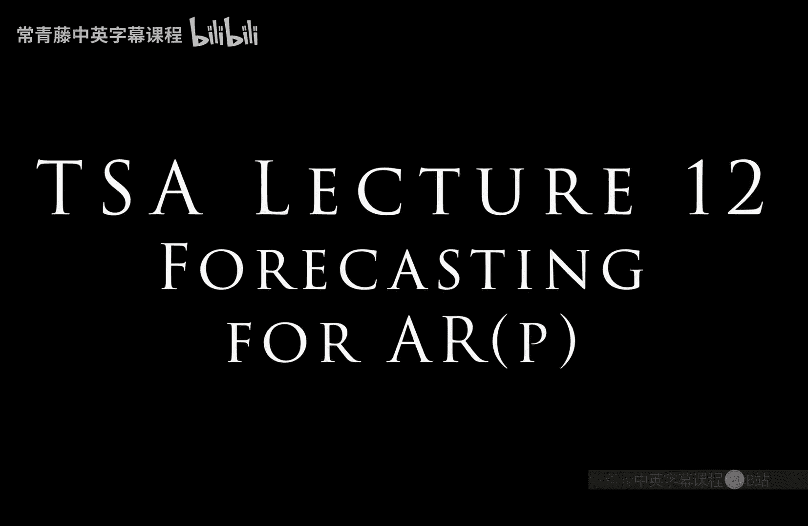
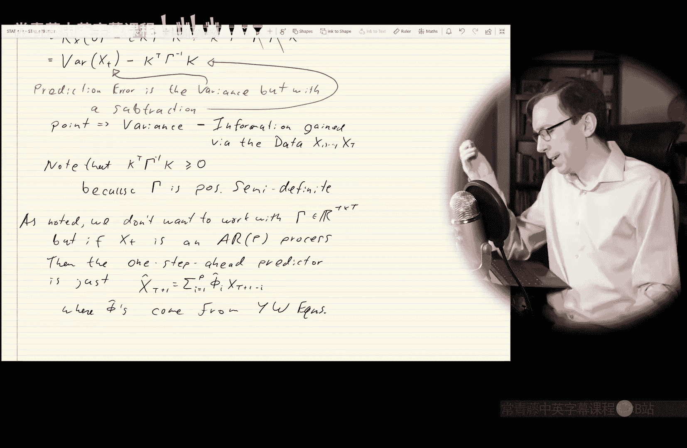

# 012：AR(p)模型的预测 🎯



在本节课中，我们将要学习如何对自回归过程进行预测。我们已经讨论了如何估计AR过程的参数，但通常我们不仅想知道参数是什么，还想知道过程未来的走向，这就是预测。

## 从估计到预测 🔄

上一节我们介绍了如何估计AR过程的系数，使用了尤尔-沃克方程和最大似然估计等方法。本节中，我们来看看如何利用这些估计结果来预测未来的值。

预测的核心问题是：给定从时间1到时间T的观测数据 \(X_1, X_2, ..., X_T\)，我们想要预测未来的值 \(X_{T+1}, X_{T+2}, ..., X_{T+M}\)。

## 预测的基本思路 📈

我们假设时间序列是平稳的，但不一定是AR过程。目标是使用过去的数据来线性预测未来值。我们采用最小二乘法，这是统计学中常用的方法。

我们的预测模型形式如下：
\[
\hat{X}_{T+M} = a_0 + \sum_{t=1}^{T} a_t X_t
\]
其中，\(a_0, a_1, ..., a_T\) 是需要估计的系数。

为了找到这些系数，我们求解以下最小二乘问题：
\[
\min_{a_0, ..., a_T} E\left[ (X_{T+M} - \hat{X}_{T+M})^2 \right]
\]

## 求解预测系数 🧮

通过对系数求导并令导数为零，我们得到一系列方程。首先，关于 \(a_0\) 求导得到：
\[
E[X_{T+M} - \hat{X}_{T+M}] = 0
\]
这意味着预测值的期望必须等于过程本身的期望 \(\mu\)。由此可以推导出 \(a_0 = \mu(1 - \sum_{t=1}^{T} a_t)\)。这表明，我们可以通过将过程中心化（减去均值 \(\bar{X}\)）来简化问题，从而假设过程均值为零继续分析。

接下来，关于其他系数 \(a_t\) 求导，我们得到形如下式的方程：
\[
E[(X_{T+M} - \hat{X}_{T+M}) X_t] = 0, \quad t = 1, 2, ..., T
\]

将这些方程展开，会涉及到序列的自协方差。最终，我们得到一个庞大的线性方程组：
\[
\mathbf{k} = \mathbf{\Gamma} \mathbf{a}
\]
其中：
*   \(\mathbf{k}\) 是一个向量，其元素为 \(Cov(X_{T+M}, X_t)\)，对于一步预测（M=1），这通常是自协方差函数在滞后 \(T, T-1, ..., 1\) 处的值。
*   \(\mathbf{\Gamma}\) 是一个 \(T \times T\) 的矩阵，其第 \(i, j\) 个元素为 \(Cov(X_i, X_j) = \gamma_X(i-j)\)，即托普利茨矩阵。
*   \(\mathbf{a}\) 是系数向量 \([a_1, a_2, ..., a_T]^T\)。

理论上，系数解为 \(\mathbf{a} = \mathbf{\Gamma}^{-1} \mathbf{k}\)，一步预测值为 \(\hat{X}_{T+1} = \mathbf{k}^T \mathbf{\Gamma}^{-1} \mathbf{x}\)，其中 \(\mathbf{x}\) 是观测数据向量。

## 预测的均方误差 📉

我们可以计算这种线性预测器的均方误差（MSE）：
\[
MSE = E[(X_{T+1} - \hat{X}_{T+1})^2] = \gamma_X(0) - \mathbf{k}^T \mathbf{\Gamma}^{-1} \mathbf{k}
\]
这个结果有很好的解释：
*   \(\gamma_X(0)\) 是过程的方差，代表没有任何信息时的预测误差。
*   \(\mathbf{k}^T \mathbf{\Gamma}^{-1} \mathbf{k}\) 是一个非负项，代表了利用历史数据 \(X_1, ..., X_T\) 所获得的信息，它**减少**了预测误差。
*   由于 \(\mathbf{\Gamma}\) 是半正定的，所以信息项非负，确保 MSE 不超过原始方差。

## 实践中的挑战与简化 💡

上述理论框架虽然优美，但在实践中面临巨大挑战：矩阵 \(\mathbf{\Gamma}\) 是 \(T \times T\) 的，对于长时间序列（如T=500或更大），求逆计算量巨大且数值不稳定。此外，我们还需要估计所有滞后阶数的自协方差，远距离滞后的估计本身就不准确。

然而，如果我们**事先知道**数据来自一个 \(AR(p)\) 过程，那么问题将大大简化。对于 \(AR(p)\) 过程，最优的一步预测器只依赖于最近的 \(p\) 个观测值：
\[
\hat{X}_{T+1} = \phi_1 X_T + \phi_2 X_{T-1} + ... + \phi_p X_{T-p+1}
\]
其中系数 \(\phi_i\) 可以通过尤尔-沃克方程（一个仅 \(p \times p\) 的线性系统）估计得到。这意味着我们无需处理庞大的 \(T \times T\) 矩阵。

如果不知道过程是否是AR的，我们则需要更聪明的方法来求解大型托普利茨系统，这涉及到数值线性代数中的专门算法，我们将在后续课程中探讨。

## R语言中的预测实践 🖥️

在R语言中，我们可以使用 `stats` 包中的 `ar()` 函数来拟合AR模型并进行预测。该函数默认使用尤尔-沃克方法，但也提供了最大似然估计（MLE）、普通最小二乘法（OLS）和伯格（Burg）算法等选项。通常，这些方法对于纯AR过程会给出相似的结果。

以下是使用 `ar()` 函数和 `predict()` 函数进行拟合和预测的基本代码示例：
```r
# 设置随机种子以保证结果可重现
set.seed(479)

# 模拟一个AR(1)过程，系数为0.7
ar1_data <- arima.sim(model = list(ar = 0.7), n = 100)

# 使用ar函数拟合模型（默认YW方法）
fit_model <- ar(ar1_data)

# 查看拟合的系数和模型阶数
print(fit_model)

# 进行未来5步的预测
predictions <- predict(fit_model, n.ahead = 5)
print(predictions$pred)  # 预测值
print(predictions$se)    # 预测标准误
```
需要注意的是，`ar()` 函数会尝试用AR模型去拟合任何时间序列。如果数据本身是移动平均（MA）过程或ARMA过程，`ar()` 可能会拟合出一个高阶的AR模型，其系数会呈现几何衰减，这近似对应了可逆MA过程的无限阶AR表示。

## 总结 📚

本节课中我们一起学习了时间序列预测的核心概念。
*   我们从一般化的线性预测框架出发，推导了基于全部历史数据的最小二乘预测公式，它涉及求解一个以自协方差矩阵为核心的大型线性系统。
*   我们分析了预测的均方误差，并理解了历史信息如何降低预测的不确定性。
*   我们指出了直接求解该大型系统在计算上的不可行性。
*   作为一种重要的特例，我们了解到对于 \(AR(p)\) 过程，预测可以简化为仅使用最近 \(p\) 期数据，这通过尤尔-沃克方程等易于处理的方法实现。
*   最后，我们简要介绍了在R语言中执行AR模型拟合和预测的基本操作。



下一讲，我们将探讨如何高效地解决大型托普利茨系统问题，以实现更一般化场景下的预测。