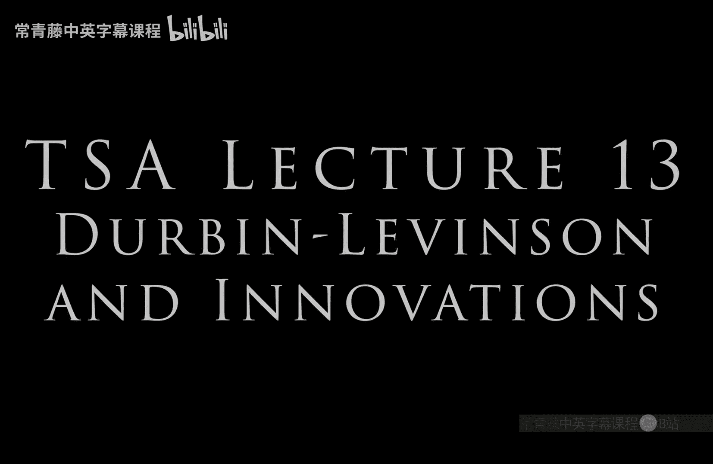
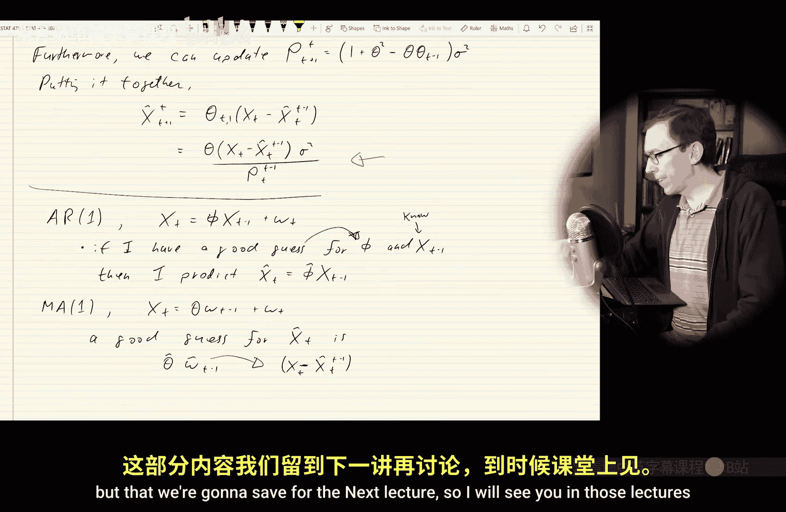
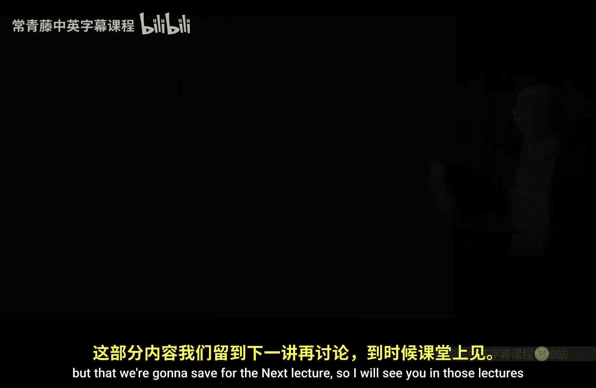

# 013：Durbin-Levinson与创新算法



在本节课中，我们将进一步学习自回归过程的预测方法。上节课我们介绍了线性预测，但求解相关方程组较为复杂。本节课我们将介绍两种解决该问题的算法：Durbin-Levinson算法和创新算法。

上节课我们介绍了如何基于前T个数据点预测第T+1个点，这最终归结为求解一个大型线性方程组。直接求解这个系统（例如通过矩阵求逆）在计算上代价高昂。幸运的是，我们可以利用自协方差矩阵的特殊结构，发展出更高效的算法。

## Durbin-Levinson算法

上一节我们介绍了线性预测的基本方程。本节中我们来看看Durbin-Levinson算法，它利用自协方差矩阵的托普利茨结构，以迭代方式高效求解预测系数。

我们想要预测`X_{T+1}`，其线性预测器形式为：
```
X̂_{T+1} = α_{1}X_T + α_{2}X_{T-1} + ... + α_{T}X_1
```
其中系数向量α需要求解方程 `Γ_T α = k`。这里`Γ_T`是T×T的自协方差矩阵，`k`是自协方差向量`[γ_X(T), γ_X(T-1), ..., γ_X(1)]^T`。直接求逆`Γ_T`需要O(T³)次运算。

Durbin-Levinson算法的核心思想是迭代求解。我们不是一次性求解所有系数，而是逐步构建从1步到T步的预测器。

以下是该算法的迭代步骤：

1.  **初始化**：
    *   设 `α_{1,1} = 0`
    *   设 `P_{1,0} = γ_X(0)` （即用零信息预测`X_1`的均方预测误差，就是方差）

2.  **迭代更新 (对于 n = 2, 3, ..., T)**：
    *   计算第n个预测器的第一个系数：
        ```
        α_{n, n} = (γ_X(n) - Σ_{i=1}^{n-1} α_{n-1, i} γ_X(n-i)) / P_{n-1, n}
        ```
    *   更新其他系数 (对于 i = 1, 2, ..., n-1)：
        ```
        α_{n, i} = α_{n-1, i} - α_{n, n} α_{n-1, n-i}
        ```
    *   更新均方预测误差：
        ```
        P_{n, n+1} = P_{n-1, n} (1 - α_{n, n}²)
        ```

该算法将计算复杂度从O(T³)降低到了O(T²)。对于自回归过程，由于只需要回顾有限阶数（p阶），计算可以进一步简化。

## 创新算法

上一节我们介绍了基于原始观测值的Durbin-Levinson算法。本节中我们来看看另一种思路：基于预测残差（称为“创新”）进行预测的创新算法。

一个“创新”是指一步超前预测的残差：
```
ν_t = X_t - X̂_{t | t-1}
```
其中`X̂_{t | t-1}`是基于直到时间`t-1`的所有观测值对`X_t`的预测。关键性质是，不同时间的创新`ν_t`和`ν_s`（当`t ≠ s`时）是不相关的。因此，创新向量的协方差矩阵是对角阵，这大大简化了计算。

创新算法的目标是使用过去的创新来预测未来值，其预测形式为：
```
X̂_{T+1 | T} = Σ_{j=1}^{T} θ_{T, j} ν_{T+1-j}
```

以下是该算法的迭代步骤：

1.  **初始化**：
    *   设 `X̂_{1 | 0} = 0` （假设过程均值为零）
    *   设 `P_{1,0} = γ_X(0)`

2.  **迭代更新 (对于 T = 1, 2, ...)**：
    *   计算系数`θ_{T, T-j}` (对于 j = 0, 1, ..., T-1)：
        ```
        θ_{T, T-j} = (γ_X(T-j) - Σ_{k=0}^{j-1} θ_{T, T-k} θ_{j, j-k} P_{k+1, k}) / P_{j+1, j}
        ```
    *   更新预测：
        ```
        X̂_{T+1 | T} = Σ_{j=0}^{T-1} θ_{T, T-j} ν_{T+1-j}
        ```
    *   更新均方预测误差：
        ```
        P_{T+1, T} = γ_X(0) - Σ_{j=0}^{T-1} θ_{T, T-j}² P_{j+1, j}
        ```

虽然公式看起来复杂，但其核心思想是用不相关的创新序列替代相关的原始观测序列来构建预测器。

## 算法比较与应用场景

我们已经介绍了两种预测算法。本节中我们来看看它们各自适用的模型类型。

*   **Durbin-Levinson算法更适用于AR过程**：对于AR(p)过程，预测`X_{T+1}`实际上只需要最近的p个观测值。Durbin-Levinson算法能有效利用这一特性。
*   **创新算法更适用于MA和ARMA过程**：对于可逆的MA(q)过程，它可以表示为过去所有观测值的无限加权和。创新算法通过使用不相关的残差，避免了处理长程相关的困难，因此对MA和ARMA模型特别有效。

为了更直观地理解，我们考虑一个MA(1)过程的简单例子：`X_t = θ W_{t-1} + W_t`，其中`W_t`是白噪声。

应用创新算法后，我们会发现大多数系数`θ_{T, j}`（当j > 1时）为零。预测方程简化为：
```
X̂_{T+1 | T} ≈ (某个标度因子) * θ * ν_T
```
这直观地说明，对于MA(1)过程，下一步的预测主要取决于当前的一步预测误差（创新）。我们试图用当前的残差来估计“隐藏”的白噪声`W_t`，进而进行预测。相比之下，AR(1)过程`X_t = φ X_{t-1} + W_t`的预测则直接基于上一个观测值：`X̂_{T+1 | T} ≈ φ X_T`。





本节课中我们一起学习了两种重要的时间序列预测算法：Durbin-Levinson算法和创新算法。Durbin-Levinson算法通过迭代方式高效求解托普利茨方程组，适用于AR类过程。创新算法则通过将预测建立在互不相关的创新序列之上，特别适用于MA和ARMA类过程。理解这些算法的基本思想，有助于我们在使用统计软件进行预测时，了解其背后的计算逻辑。下节课我们将进入R语言实践，学习如何应用这些方法进行实际的时间序列预测。