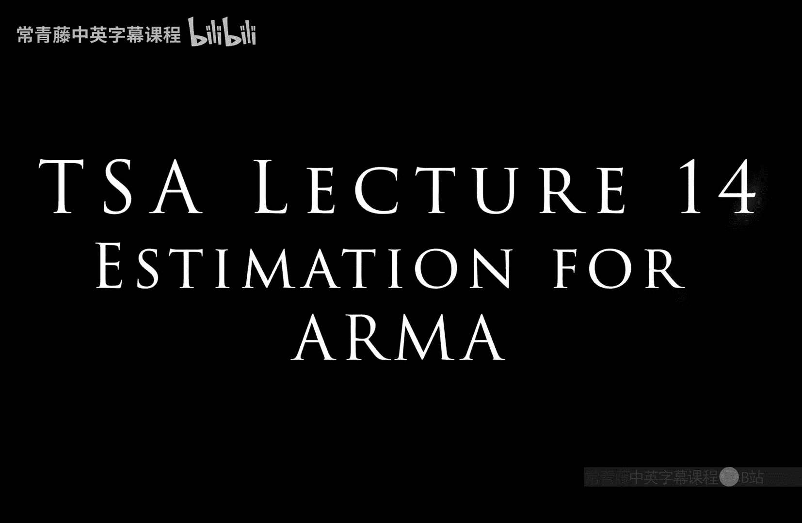
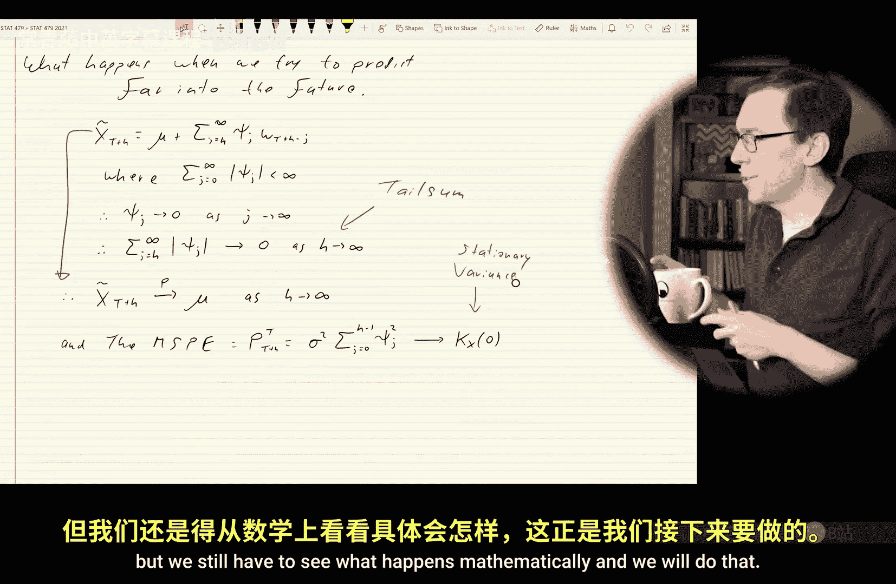

# 014：ARMA模型的估计与预测

在本节课中，我们将学习如何对ARMA模型进行参数估计和预测。我们将沿用处理AR模型时使用的工具，特别是最大似然估计法，但会引入移动平均（MA）部分带来的新挑战。课程将涵盖估计方法、估计量的渐近性质、模型阶数选择以及预测的基本原理。

## 估计ARMA(p, q)模型

上一节我们介绍了AR模型的估计方法，本节中我们来看看如何将其扩展到ARMA模型。ARMA模型包含自回归（AR）和移动平均（MA）两部分，因此我们需要估计的参数更多，包括均值μ、白噪声方差σ²、自回归参数φ₁到φ_p以及移动平均参数θ₁到θ_q。

### 最大似然估计法

我们将继续使用最大似然估计法。这需要一个关键假设：驱动时间序列的白噪声过程是**高斯（正态）**的。如果白噪声不是高斯的，那么ARMA过程本身也不是高斯的，我们就不能直接使用最大似然估计。

与AR模型类似，我们不直接写出整个时间序列的联合密度函数，而是将其分解为一系列条件密度的乘积：
`L(μ, σ², φ, θ) = ∏_{t=1}^{T} f(x_t | x_{t-1}, ..., x_1)`
其中，每个条件密度`f`都是高斯分布。

对于ARMA模型，给定过去所有观测值`x_{t-1}, ..., x_1`，`x_t`的条件分布是一个正态分布：
*   **均值**：一步超前预测值 `\hat{x}_{t-1}^{t}`
*   **方差**：一步超前预测的均方误差 `P_{t}^{t-1}`

因此，似然函数可以写为：
`L ∝ ∏_{t=1}^{T} (P_{t}^{t-1})^{-1/2} exp{ - (x_t - \hat{x}_{t-1}^{t})² / (2 P_{t}^{t-1}) }`

### 处理预测误差方差

我们需要计算每个时间点的预测误差方差`P_{t}^{t-1}`。对于`t=1`，`P_{1}^{0}`就是过程的平稳方差，可以表示为`σ²`乘以一个由ψ系数（来自模型的因果线性表示）决定的常数。

对于`t>1`，我们可以使用**Durbin-Levinson算法**进行递归更新。关键点在于，所有的`P_{t}^{t-1}`都可以写成`σ² * R_t`的形式，其中`R_t`是一个**不依赖于σ²**的量。

将这个关系代入似然函数，我们可以将其重写，从而将σ²与其他参数分离开。通过标准的微积分运算（对σ²求导并令导数为零），我们可以得到方差σ²的最大似然估计量：
`\hat{σ}² = S(μ, φ, θ) / T`
其中`S(μ, φ, θ)`是一个与数据和参数有关的平方和项。

### 集中似然函数

得到σ²的估计量后，我们可以将其代回似然函数，从而得到一个**集中似然函数**，它现在只依赖于参数μ, φ, θ：
`L_c(μ, φ, θ) ∝ [S(μ, φ, θ)/T]^{-T/2} * (∏_{t=1}^{T} R_t)^{-1/2}`
然后，我们通过最大化这个集中似然函数（或其对数形式）来求解μ, φ, θ的估计值。这个过程通常需要数值优化方法来完成。

以下是估计ARMA模型参数的核心步骤总结：
1.  **设定模型阶数**：指定自回归阶数`p`和移动平均阶数`q`。
2.  **构建似然函数**：基于高斯白噪声假设，写出条件似然函数。
3.  **分离方差参数**：将预测误差方差表示为`σ² * R_t`，简化似然函数。
4.  **求解方差估计**：首先得到白噪声方差σ²的估计量`\hat{σ}²`。
5.  **优化其他参数**：将`\hat{σ}²`代回，得到集中似然函数，并优化求解μ, φ, θ的估计值。

在实际应用中，我们通常使用R语言中的`arima()`等函数来执行这些复杂的计算。

## 估计量的渐近性质

在统计学中，我们估计的参数通常具有渐近正态性，ARMA模型的估计量也不例外。这意味着当样本量`T`足够大时，估计量的分布近似于正态分布。这为我们进行假设检验（例如，检验某个参数是否显著不为零）和构建置信区间提供了理论基础。

具体来说，令`β`表示所有参数（φ和θ）组成的向量，`\hat{β}`是其最大似然估计量。那么，当`T → ∞`时，有：
`√T (\hat{β} - β) → N(0, σ² Γ_{p,q}^{-1})`
其中，`Γ_{p,q}`是一个分块矩阵，其元素由两个辅助过程`y_t`和`y'_t`的自协方差和互协方差函数决定：
*   `y_t`：原ARMA过程`x_t`中**仅保留AR部分**所构成的AR过程，即`φ(B)y_t = w_t`。
*   `y'_t`：原ARMA过程`x_t`中**仅保留MA部分**所构成的MA过程，即`y'_t = θ(B)w_t`。

### 示例：AR(1)和MA(1)

对于AR(1)模型`x_t = φ x_{t-1} + w_t`，其参数φ的估计量满足：
`√T (\hat{φ} - φ) → N(0, 1 - φ²)`
有趣的是，当`φ`接近±1时（但仍保持平稳），估计量的渐近方差会变小。当`φ=0`时，过程退化为白噪声，估计量的方差就是白噪声的方差。

对于可逆的MA(1)模型`x_t = w_t + θ w_{t-1}`，通过将其视为一个AR过程，我们可以得到完全对称的结果：
`√T (\hat{θ} - θ) → N(0, 1 - θ²)`

## 如何选择模型阶数p和q？

在拟合ARMA模型之前，我们需要确定自回归阶数`p`和移动平均阶数`q`。常用的方法是使用**模型选择准则**，例如AIC（赤池信息准则）或BIC（贝叶斯信息准则）。

以下是选择模型阶数的常用方法：
*   **自动拟合函数**：R语言`forecast`包中的`auto.arima()`函数可以自动搜索一系列`(p, q)`组合，并选择AIC或BIC值最小的模型。
*   **手动比较**：使用`stats`包中的`arima()`函数手动拟合多个不同`(p, q)`组合的模型，然后比较它们的AIC或BIC值，选择最小的一个。

通常AIC和BIC会给出相同的结果，但并非总是如此。

## ARMA模型的预测

现在，我们转向ARMA模型的预测问题。我们的目标是基于到时间`T`为止的观测数据`x_1, ..., x_T`，预测未来`h`步的值`x_{T+h}`。最优预测（在均方误差最小意义下）是条件期望：
`\hat{x}_{T+h} = E[ x_{T+h} | x_T, x_{T-1}, ..., x_1 ]`

### 基于无限过去数据的预测（理论构建）

为了数学上的便利，我们首先考虑一个理论情形：假设我们可以观测到**无限过去**的数据`..., x_0, x_1, ..., x_T`。基于此的预测我们记为`\tilde{x}_{T+h}`。当实际数据量`T`很大时，`\tilde{x}_{T+h}`和`\hat{x}_{T+h}`会非常接近。

我们利用ARMA模型的两种表示：
1.  **因果表示（无限MA）**：`x_{T+h} = ∑_{j=0}^{∞} ψ_j w_{T+h-j}`
2.  **可逆表示（无限AR）**：`w_{T+h} = ∑_{j=0}^{∞} π_j x_{T+h-j}` （其中`π_0 = 1`）

对因果表示两边取条件期望，由于未来白噪声`w_{T+1}, ..., w_{T+h}`与过去数据独立，其条件期望为0。因此：
`\tilde{x}_{T+h} = ∑_{j=h}^{∞} ψ_j w_{T+h-j}`
预测误差`x_{T+h} - \tilde{x}_{T+h} = ∑_{j=0}^{h-1} ψ_j w_{T+h-j}`，对应的**预测均方误差**为：
`P_{T+h}^{T} = σ² ∑_{j=0}^{h-1} ψ_j²`

对可逆表示两边取条件期望，我们可以得到`\tilde{x}_{T+h}`的一个递归表达式，它依赖于已知数据`x_T, x_{T-1}, ...`以及之前步的预测值`\tilde{x}_{T+1}, ..., \tilde{x}_{T+h-1}`。这说明多步预测可以递归进行：先预测一步，然后用这个预测值去预测两步，依此类推。

### 长期预测行为

当预测步数`h`非常大时，会发生什么？由于因果表示中的系数`ψ_j`是绝对可和的，其尾部`∑_{j=h}^{∞} |ψ_j|`会随着`h`增大而趋于0。这意味着：
*   **预测值趋近于均值**：`\tilde{x}_{T+h} → μ` （当`h → ∞`）
*   **预测误差趋近于过程方差**：`P_{T+h}^{T} → σ² ∑_{j=0}^{∞} ψ_j² = Var(x_t)` （当`h → ∞`）

直观解释是：对于一个平稳过程，随着我们预测得越来越远，过去数据的影响逐渐消失，我们能做的最好预测就是过程的长期均值`μ`，而预测的不确定性则趋近于过程本身的波动性（方差）。

在实际中，我们只有有限数据。下一讲我们将探讨如何将理论预测`\tilde{x}_{T+h}`转化为基于有限数据`x_1, ..., x_T`的实用预测`\hat{x}_{T+h}`。

## 总结

本节课中我们一起学习了ARMA模型的估计与预测基础：
1.  **参数估计**：我们使用最大似然估计法，需要假设高斯白噪声。通过将联合似然分解为条件似然、分离方差参数并构建集中似然函数，可以估计所有参数（μ, σ², φ, θ）。
2.  **渐近性质**：在大样本下，参数估计量服从渐近正态分布，这为统计推断（如置信区间、假设检验）提供了依据。
3.  **模型选择**：可以使用AIC或BIC等准则来选择ARMA模型的合适阶数`(p, q)`。
4.  **预测原理**：最优预测是条件期望。基于无限过去数据的理论预测`\tilde{x}_{T+h}`可以通过模型的因果或可逆表示来计算，其预测误差方差可以明确写出。长期预测会收敛到过程均值。
5.  **实际应用**：尽管推导复杂，但R语言中的现有函数（如`arima()`, `auto.arima()`）可以方便地完成估计、模型选择和预测工作。理解其背后的原理有助于我们正确使用和解释这些工具的结果。