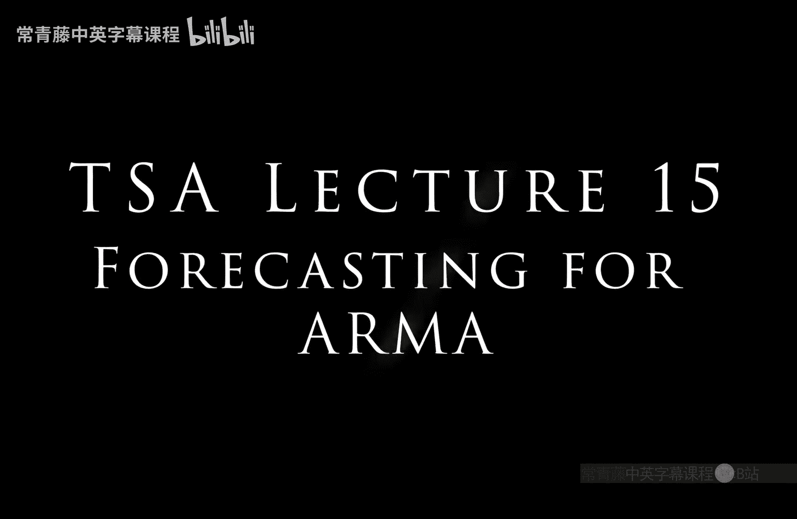
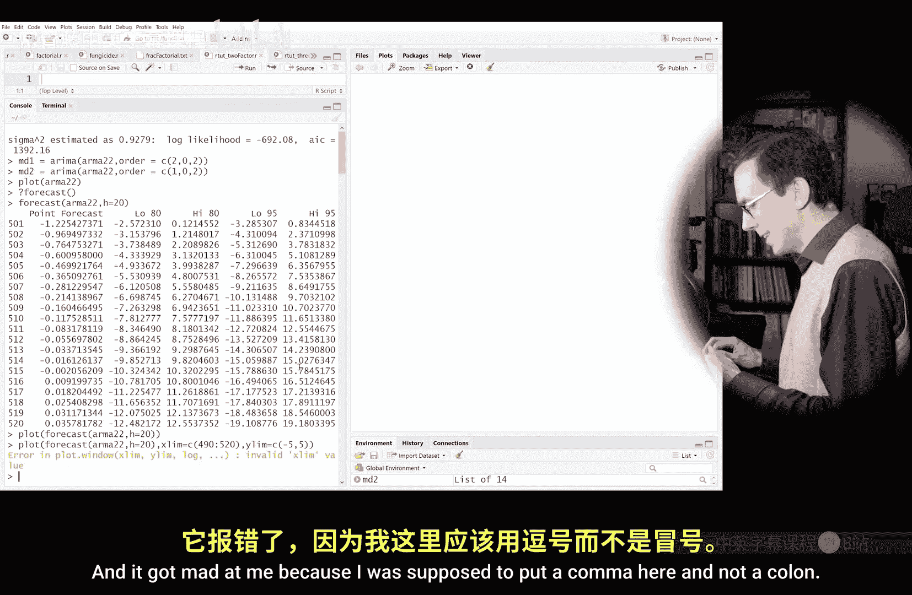
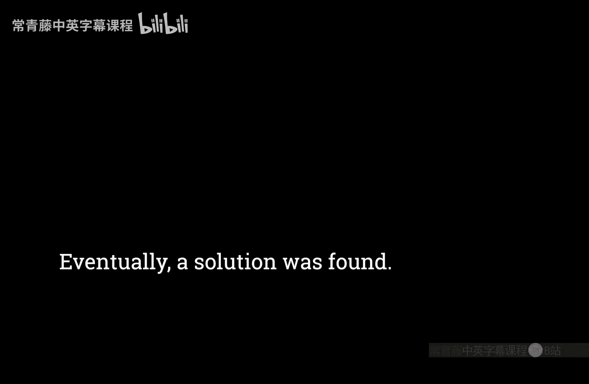
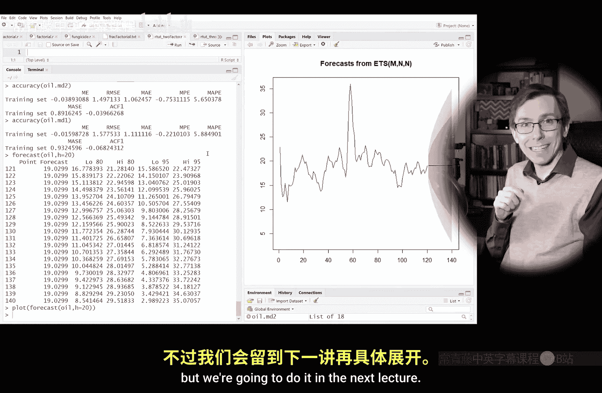

# 015：ARMA模型预测 📈



在本节课中，我们将要学习如何对ARMA模型进行预测。上一讲我们介绍了ARMA过程，讨论了如何估计系数，并开始探讨预测的数学原理。本节中，我们将深入探讨如何利用真实数据进行预测。

## 回顾与数学基础

首先，我们回顾上一讲引入的符号和概念。对于一个ARMA(p, q)过程，其模型为：
**Φ(B)X_t = Θ(B)W_t**
我们假设该过程是因果且可逆的。

在预测中，我们有两个核心预测量：
*   **X̂_{T+h}**：基于观测数据 X_T, X_{T-1}, ..., X_1 对 X_{T+h} 的预测。
*   **X̃_{T+h}**：基于观测数据及假设延伸到无限过去的“完整”数据对 X_{T+h} 的预测。

上一讲我们主要讨论了 **X̃_{T+h}**。我们将其写成因果形式：
**X̃_{T+h} = μ + Σ_{j=h}^{∞} ψ_j W_{T+h-j}**

由此，我们得到了两个重要性质：
1.  当预测步长 **h → ∞** 时，预测值 **X̃_{T+h}** 会收敛于过程的均值 **μ**。
2.  预测的均方误差 **P_{T+h|T}** 为：
    **P_{T+h|T} = σ_w² Σ_{j=0}^{h-1} ψ_j²**
    随着 **h** 增大，它将收敛于过程的方差。

为了更严谨地证明第一个性质（收敛于均值），我们可以使用切比雪夫不等式。我们想证明对于任意 ε > 0，当 h → ∞ 时，概率 **P(|X̃_{T+h} - μ| > ε)** 趋于 0。利用切比雪夫不等式，该概率的上界为 **Var(X̃_{T+h} - μ) / ε²**，即 **(σ_w² / ε²) Σ_{j=h}^{∞} ψ_j²**。由于因果表示要求 Σ_{j=0}^{∞} ψ_j² < ∞，因此其尾部求和 Σ_{j=h}^{∞} ψ_j² 必然随着 h 增大而趋于 0，从而证明了依概率收敛。

## 处理有限数据：截断无限过去

然而，现实问题是我们只有有限的数据（X_1 到 X_T），而非无限的历史数据。因此，我们需要处理如何用有限数据计算 **X̂_{T+h}**。

主要有两种方法：
*   如果数据量 **T** 较小，我们可以直接求解一个线性方程组。
*   如果 **T** 较大，我们需要迭代地进行计算。

我们将利用ARMA模型的可逆表示进行迭代预测。可逆表示将白噪声 W_t 表示为 X_t 的无限线性组合。对模型两边取条件期望，我们可以得到预测的递推公式。

具体而言，对于已知系数 φ₁...φ_p 和 θ₁...θ_q 的ARMA模型，h步预测可以写成：
**X̂_{T+h} = Σ_{j=1}^{p} φ_j X̂_{T+h-j} + Σ_{j=1}^{q} θ_j Ŵ_{T+h-j}**
其中，对于 j < h，Ŵ_{T+h-j} = 0（未来白噪声的期望为0）；对于 j ≥ h，Ŵ_{T+h-j} = W_{T+h-j}（过去白噪声已知或可估计）。

而白噪声项 Ŵ_t 本身也可以通过一个类似的递推公式，利用观测数据 X_t 和之前的白噪声估计值来计算。

因此，预测是一个逐步进行的过程：先利用数据估计出必要的白噪声序列，然后从 h=1 开始，依次计算 h=2, 3, ... 的预测值，每一步都依赖于前一步的预测结果。

### ARMA(1,1) 预测示例

让我们通过一个ARMA(1,1)模型的例子来具体说明这个过程。模型为：
**X_{t+1} = φ X_t + W_{t+1} + θ W_t**

*   **一步预测 (h=1)**：
    **X̂_{T+1} = φ X_T + θ Ŵ_T**
    我们需要知道 Ŵ_T。
*   **多步预测 (h ≥ 2)**：
    **X̂_{T+h} = φ X̂_{T+h-1}**
    因为对于 h≥2，未来白噪声项的期望为0。

那么如何得到 Ŵ_T 呢？我们可以从模型方程迭代求解。从 t=0 开始，假设 Ŵ_0 = 0，然后利用公式 **Ŵ_t = X_t - φ X_{t-1} - θ Ŵ_{t-1}** 依次计算出 Ŵ_1, Ŵ_2, ..., Ŵ_T。

对于这个ARMA(1,1)模型，我们也可以计算其预测均方误差。首先写出其因果表示：**X_t = W_t + Σ_{i=1}^{∞} ψ_i W_{t-i}**，其中 **ψ_i = (φ + θ) φ^{i-1}**。那么 h 步预测的均方误差为：
**P_{T+h|T} = σ_w² [1 + (φ+θ)² Σ_{j=1}^{h-1} φ^{2(j-1)}]**
这是一个有限几何级数，可以求和。当 **h → ∞** 时，它收敛于过程的方差 **σ_w² [1 + (φ+θ)²/(1-φ²)]**，这与我们之前对ARMA(1,1)方差的分析一致。

## 反向预测

除了预测未来，有时我们也可能希望预测过去，这被称为“反向预测”。其目标是根据数据 X_1, ..., X_T 来预测 X_{1-h}。

其数学原理与正向预测完全对称。我们寻找一个线性估计量 **X̂_{1-h} = Σ_{i=1}^{T} α_i X_i**。通过最小化均方误差，我们同样会得到一个由自协方差函数构成的线性方程组 **k = Γα**，其中 **k** 是包含 γ(h), γ(h+1), ... 的向量，**Γ** 是自协方差矩阵。求解这个方程组即可得到系数 α，进而得到预测值。

一个有趣的事实是：对于一个**平稳高斯过程**，向量 **(X_{T+1}, ..., X_1)** 的联合分布与向量 **(X_0, ..., X_{T})** 的联合分布相同。这意味着，对于平稳高斯过程，时间正向运行与反向运行在概率意义上是不可区分的，因此正向预测和反向预测在本质上是相同的问题。

## R语言实战：估计与预测

理论之后，让我们通过R语言来看看如何对真实数据和模拟数据进行ARMA模型的估计与预测。

首先，我们模拟一些数据进行分析。

```r
set.seed(2479) # 设置随机种子保证结果可重复
# 生成AR(2)过程
ar2_data <- arima.sim(model = list(ar = c(0.7, 0.2)), n = 500)
# 生成MA(2)过程
ma2_data <- arima.sim(model = list(ma = c(0.7, 0.2)), n = 500)
# 生成ARMA(2,2)过程
arma22_data <- arima.sim(model = list(ar = c(0.7, 0.2), ma = c(0.7, 0.2)), n = 500)
```

### 模型估计

我们可以使用`Arima`函数（来自`forecast`包）或`arma`函数（来自`TSA`包）来拟合模型。选择模型时，可以依赖AIC（赤池信息准则）或BIC（贝叶斯信息准则）等准则，数值较小的模型通常更优。

```r
library(forecast)
# 为AR(2)数据拟合正确的AR(2)模型
m_correct <- Arima(ar2_data, order = c(2, 0, 0))
summary(m_correct)
# 尝试拟合错误的ARMA(2,2)模型
m_wrong <- Arima(ar2_data, order = c(2, 0, 2))
summary(m_wrong)
```

比较两个模型的AIC，通常正确模型的AIC会更小。我们也可以使用`auto.arima`函数让R自动寻找最优的ARIMA模型。

```r
auto_model <- auto.arima(ar2_data)
summary(auto_model)
```

`auto.arima`会尝试多种模型组合（包括差分阶数），并返回AIC最小的模型。这对于初步探索非常有用。

### 进行预测

使用`forecast`函数可以对拟合好的模型进行预测。

```r
# 对ARMA(2,2)模拟数据进行未来20步的预测
fc <- forecast(arma22_data, h = 20)
plot(fc, main = "ARMA(2,2)过程预测",
     xlim = c(400, 520), ylim = c(-5, 5))
```

预测图会显示历史数据、点预测值以及80%和95%的预测区间。可以看到，随着预测步长增加，预测区间会迅速变宽，点预测最终会趋向于序列的均值。



### 评估预测精度



我们可以使用`accuracy`函数来评估模型的预测精度。它返回一系列误差指标，如平均绝对误差（MAE）、均方根误差（RMSE）等。这有助于在不同模型之间进行比较。

```r
# 假设我们有两个候选模型：m1和m2
accuracy(m1) # 训练集精度
# 比较两个模型在训练集上的精度
accuracy(m1, arma22_data)
accuracy(m2, arma22_data)
```

### 真实数据示例：油价数据

最后，我们使用`forecast`包内置的`oil.price`数据集进行实战。

```r
data(oil.price)
oil <- window(oil.price, end = 1990) # 截取1990年之前的数据以避开后期巨大波动
plot(oil, main = "油价数据（截取）")
# 自动寻找合适模型
oil_model <- auto.arima(oil)
summary(oil_model)
# 进行预测并绘图
fc_oil <- forecast(oil_model, h = 24) # 预测未来两年
plot(fc_oil, main = "油价预测")
```

通过这个过程，我们可以看到时间序列分析是一个探索性很强的领域。我们需要尝试不同的模型，结合AIC/BIC、系数显著性、预测精度等多种信息，来选择一个相对合理且有用的模型。没有绝对正确的答案，关键在于理解数据并找到能合理解释和预测其行为的模型。

## 总结

本节课中我们一起学习了ARMA模型的预测。
*   我们首先回顾了基于无限历史数据的理想预测公式及其性质（收敛于均值）。
*   接着，我们重点讨论了如何利用**有限数据**进行实际预测，核心方法是利用模型的可逆表示进行**迭代计算**。
*   我们还简要介绍了**反向预测**的概念及其在平稳高斯过程中的对称性。
*   最后，通过R语言实战，我们演示了如何对模拟数据和真实油价数据进行**模型估计**、**预测**以及**精度评估**的完整流程。



下一讲，我们将探讨带有季节性成分的时间序列模型。