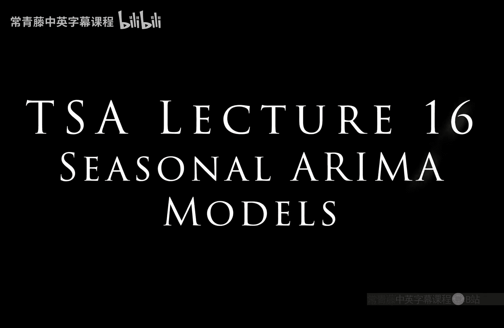
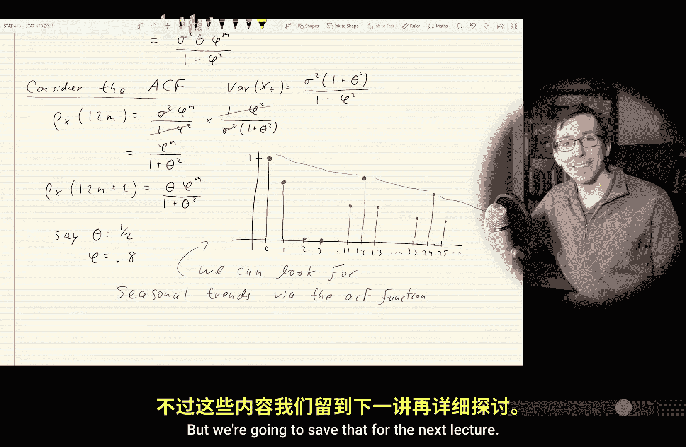

# 016：季节性ARIMA模型

在本节课中，我们将学习季节性ARIMA模型。这些模型用于分析具有周期性或季节性趋势的时间序列数据，例如月度销售额或年度温度变化。我们将探讨如何将之前学到的ARIMA模型扩展到包含季节性成分，并理解其数学表示和性质。

---

## 引言

上一节我们介绍了标准的ARIMA模型。本节中，我们将探讨如何将这些模型扩展以捕捉数据中的季节性模式。许多现实世界的数据，如零售销售额或气温，会表现出以固定周期（如月、季、年）重复的模式。季节性ARIMA模型正是为此类数据设计的。

## 季节性ARIMA模型的基本概念

季节性ARIMA模型的核心思想是，在标准ARIMA模型的基础上，额外考虑时间点之间相隔一个完整季节周期（记为 **S**）的依赖关系。

### 纯季节性AR(1)模型

一个最简单的季节性模型是纯季节性AR(1)模型。其公式如下：
**X_t = φ X_{t-S} + W_t**
其中，**W_t** 是白噪声序列，**S** 是季节周期长度（例如，月度数据中 S=12）。

这个模型意味着当前值 **X_t** 仅依赖于 **S** 个时间单位之前的值 **X_{t-S}**，而与中间的所有值无关。从某种意义上说，这相当于同时运行 **S** 个相互独立的AR(1)过程。

### 一般季节性ARMA模型

更一般地，我们可以定义季节性ARMA(P’, Q’)_S模型。其公式使用后移算子 **B** 表示如下：
**Φ_S(B^S) X_t = Θ_S(B^S) W_t**
其中：
*   **Φ_S(B^S) = 1 - Φ_1 B^S - Φ_2 B^{2S} - ... - Φ_{P'} B^{P'S}** 是季节性自回归多项式。
*   **Θ_S(B^S) = 1 + Θ_1 B^S + Θ_2 B^{2S} + ... + Θ_{Q'} B^{Q'S}** 是季节性移动平均多项式。
*   **P’** 和 **Q’** 分别是季节性自回归和移动平均的阶数。

### 结合非季节性成分：SARIMA模型

通常，时间序列同时包含季节性成分和非季节性（短期）成分。我们可以将两者结合，得到乘积季节性ARIMA模型，记作 **ARIMA(p,d,q)×(P’,D’,Q’)_S**。其完整的模型方程为：
**Φ_S(B^S) φ(B) (∇_S^{D’} ∇^d X_t) = Θ_S(B^S) θ(B) W_t**
其中：
*   **φ(B)** 和 **θ(B)** 是非季节性ARIMA(p,d,q)模型中的多项式。
*   **∇^d = (1-B)^d** 是非季节性差分算子。
*   **∇_S^{D’} = (1-B^S)^{D’}** 是季节性差分算子。
*   **d** 和 **D’** 分别是非季节性和季节性差分的阶数。

这个模型结合了短期波动和长期季节性模式，参数较多，但能更全面地描述复杂的时间序列。

## 季节性模型的特性分析

为了理解季节性模型的行为，我们来分析两个具体例子。

### 示例1：纯季节性AR(1)_12模型

考虑模型 **X_t = φ X_{t-12} + W_t**，其中 |φ| < 1。

**自协方差函数的计算：**
通过递归代入，可以将 **X_t** 表示为白噪声的线性过程。计算其自协方差函数 **γ(h)** 可得：
*   **γ(0) = σ_w² / (1 - φ²)**
*   对于 **h** 不是12的整数倍的情况，**γ(h) = 0**。
*   对于 **h = 12m** (m=1,2,3...)，**γ(12m) = σ_w² φ^{|m|} / (1 - φ²)**。

**关键结论：**
该模型的自协方差仅在季节周期（12的倍数）的滞后处非零。这印证了其本质是多个独立AR(1)过程的叠加。在实践中的一个重要启示是：对于此类纯季节性数据，应直接拟合季节性模型，而非一个高阶的AR(12)模型，后者会引入大量不必要的参数。

### 示例2：混合季节性模型 ARIMA(0,1,1)×(1,0,0)_12

考虑一个结合了非季节性MA(1)和季节性AR(1)_12的模型：
**X_t = φ X_{t-12} + θ W_{t-1} + W_t**

**方差与自协方差的计算：**
利用该模型的方程以及各项之间的不相关性，我们可以推导出：
*   **方差 γ(0) = σ_w² (1 + θ²) / (1 - φ²)**
*   在季节周期滞后处（h = 12m）：**γ(12m) = σ_w² φ^{|m|} / (1 - φ²)**，其中 m ≠ 0。
*   在紧邻季节周期的滞后处（h = 12m ± 1）：**γ(12m ± 1) = σ_w² θ φ^{|m|} / (1 - φ²)**。
*   对于其他滞后 **h**，**γ(h) = 0**。

**自相关函数（ACF）的形态：**
根据上述自协方差和方差，可以画出ACF图。它将呈现以下特征：
1.  在滞后0处，自相关为1。
2.  在滞后1处，有一个由 **θ** 决定的小峰。
3.  在滞后2至11处，自相关接近于0。
4.  在滞后12处，出现一个由 **φ** 决定的主峰。
5.  在滞后11和13处，会出现较小的侧峰，其高度是滞后12处主峰高度的 **θ** 倍。
6.  这种“主峰-侧峰”的模式会在24、36等季节周期倍数处重复出现，且峰值按 **φ^m** 几何衰减。

**实践意义：**
当我们对具有季节性的真实数据绘制样本ACF图时，如果观察到这种在固定周期间隔处出现峰值并几何衰减的模式，就是存在季节性成分的强烈信号。这为我们识别和建模季节性提供了直观的工具。

## 建模实践与软件实现

从数学上讲，季节性ARIMA模型是标准ARIMA模型的直接扩展。参数估计、模型选择（如使用AIC/BIC准则）、诊断检验和预测的所有原理仍然适用。

主要的挑战在于确定合适的季节周期 **S**。通常可以基于数据背景知识（如月度、季度、周度数据）进行选择。对于更复杂的情况，可以使用统计软件中的自动模型选择功能。

例如，在R语言的 `forecast` 包中，`auto.arima()` 函数可以自动尝试包含季节性成分的模型，并帮助确定一个合适的 **S** 值以及模型的阶数 **(p,d,q)×(P’,D’,Q’)**。

---

## 总结

本节课中我们一起学习了季节性ARIMA模型。我们从最简单的纯季节性AR模型入手，逐步介绍了通用季节性ARMA模型的表示方法，以及如何将其与非季节性ARIMA模型结合为SARIMA模型。通过分析两个具体例子的自协方差函数，我们理解了季节性模型在ACF图上表现出的独特模式——在季节周期及其附近出现峰值。最后，我们指出了建模实践中的关键点，即季节周期 **S** 的识别，并提及了可利用现有软件工具（如R中的`auto.arima`）来辅助完成这一过程。在接下来的课程中，我们将使用R软件对包含季节性的实际数据进行完整的分析与建模。