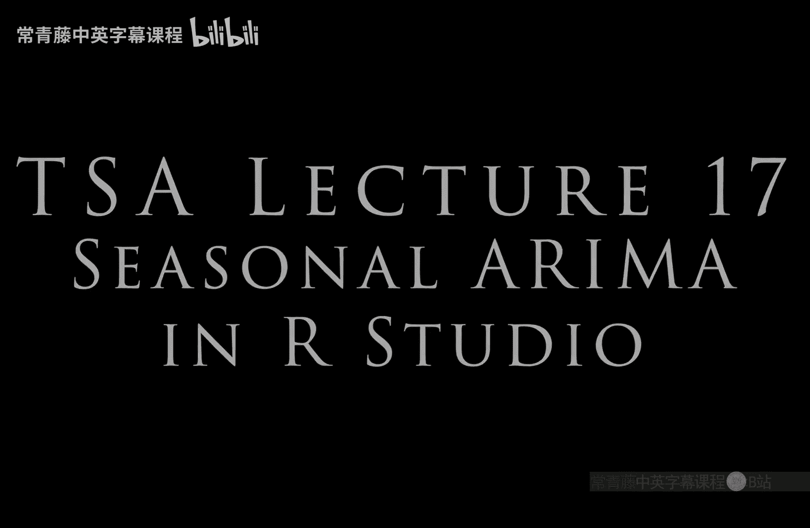
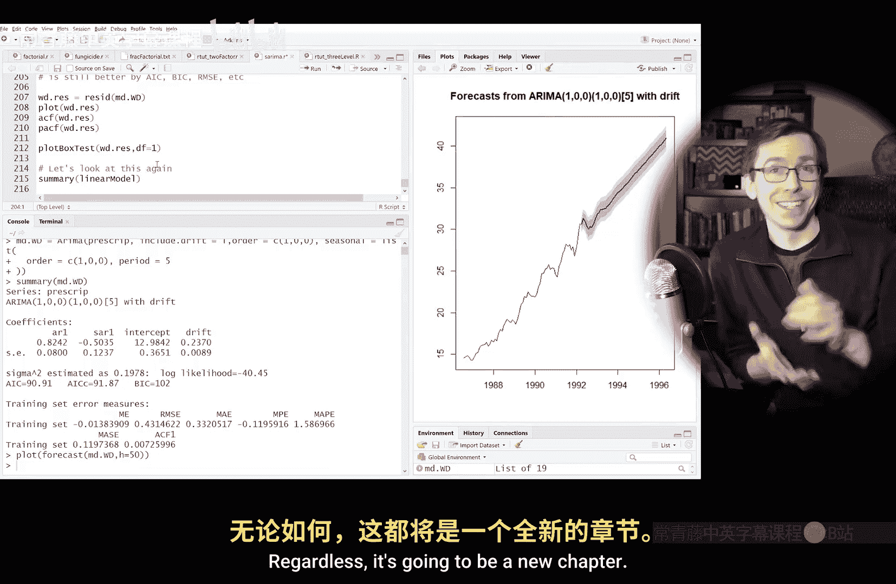

# 017：在R Studio中使用季节性ARIMA模型



在本节课中，我们将继续学习季节性ARIMA模型，但这次我们将使用R Studio进行实际操作。我们将利用之前课程中提到的处方药数据集，应用我们学到的所有工具，包括拟合ARMA过程、ARIMA过程、季节性模型以及线性模型等多种方法来分析时间序列数据。时间序列分析本质上是一个探索性的过程，我们需要花费大量时间拟合模型，以找出最适合我们数据集的方法。本节课我们将通过R Studio代码来实践这一过程。

## 数据加载与初步观察

首先，我们需要加载一些标准的时间序列分析包，并导入数据集。

```r
# 加载必要的R包
library(TSA)
library(tseries)
library(forecast)

# 加载处方药数据集
data(prescription)
```

处方药数据集记录了从1986年8月到1992年3月期间，美国每月的平均处方药成本。通过绘制时间序列图，我们可以观察到数据有明显的上升趋势，并且似乎存在周期性的波动，这暗示数据中可能存在季节性成分。

## 平稳性检验

在拟合模型之前，我们需要检查时间序列的平稳性。我们使用增广迪基-富勒检验和菲利普斯-佩龙检验。

```r
# 执行增广迪基-富勒检验
adf_test <- adf.test(prescription)
print(adf_test)

# 执行菲利普斯-佩龙检验
pp_test <- pp.test(prescription)
print(pp_test)
```

两个检验都给出了较小的p值，这意味着在去除线性趋势后，数据看起来是平稳的。因此，我们的第一步是使用线性模型去除数据中的线性趋势。

## 去除线性趋势

我们使用`lm`函数拟合一个线性模型，以去除数据中的线性趋势。

```r
# 拟合线性模型去除趋势
linear_model <- lm(prescription ~ time(prescription))
prescription_detrended <- residuals(linear_model)
```

去除趋势后，我们得到了残差序列。接下来，我们需要检查这些残差是否还存在任何可识别的模式或自相关性。

## 残差分析

我们绘制去除趋势后残差的时序图、自相关函数图和偏自相关函数图。

```r
# 绘制残差时序图
plot(prescription_detrended, main="去除线性趋势后的残差", ylab="残差")

# 绘制自相关函数图
acf(prescription_detrended, main="残差的ACF图")

# 绘制偏自相关函数图
pacf(prescription_detrended, main="残差的PACF图")
```

ACF图显示出明显的周期性波动，而PACF图在滞后1阶处有一个显著的尖峰，之后迅速衰减。这提示我们，残差中可能包含一个非季节性的AR(1)成分，同时ACF的周期性暗示可能存在季节性成分。

## 拟合非季节性ARIMA模型

基于PACF图的观察，我们首先尝试拟合一个非季节性的AR(1)模型。同时，为了比较，我们也拟合MA(1)和ARMA(1,1)模型。

```r
# 拟合AR(1)模型
ar1_model <- arima(prescription_detrended, order=c(1,0,0))
print(summary(ar1_model))

# 拟合MA(1)模型
ma1_model <- arima(prescription_detrended, order=c(0,0,1))
print(summary(ma1_model))

# 拟合ARMA(1,1)模型
arma11_model <- arima(prescription_detrended, order=c(1,0,1))
print(summary(arma11_model))
```

通过比较AIC和BIC值，我们发现AR(1)模型在信息准则上表现最好，且更为简洁。因此，我们暂时选择AR(1)模型。

## 检查模型残差

拟合模型后，我们必须检查其残差是否像白噪声。我们提取AR(1)模型的残差并进行检验。

```r
# 提取AR(1)模型残差
ar1_residuals <- residuals(ar1_model)

# 绘制残差ACF和PACF图
acf(ar1_residuals, main="AR(1)模型残差的ACF图")
pacf(ar1_residuals, main="AR(1)模型残差的PACF图")
```

尽管ACF和PACF图中的大部分尖峰都落在了置信区间内，但在滞后5、10等处仍能看到一些周期性模式的迹象。为了更正式地检验残差的自相关性，我们使用Ljung-Box检验。

```r
# 执行Ljung-Box检验，考虑已拟合的参数
box_test_result <- Box.test(ar1_residuals, lag=5, type="Ljung-Box", fitdf=1)
print(box_test_result)
```

检验结果显示p值较小，表明残差中仍然存在显著的自相关性。这意味着我们的模型尚未完全捕捉数据中的所有结构，需要考虑加入季节性成分。

## 引入季节性成分

根据ACF图中在滞后5、10等处出现的尖峰，我们尝试为模型添加一个周期为5的季节性成分。我们拟合包含季节性AR(1)、季节性MA(1)以及季节性ARMA(1,1)的模型。

```r
# 拟合非季节性AR(1) + 季节性AR(1)，周期为5
sar1_model <- arima(prescription_detrended,
                    order=c(1,0,0),
                    seasonal=list(order=c(1,0,0), period=5))
print(summary(sar1_model))

# 拟合非季节性AR(1) + 季节性MA(1)，周期为5
sma1_model <- arima(prescription_detrended,
                    order=c(1,0,0),
                    seasonal=list(order=c(0,0,1), period=5))
print(summary(sma1_model))

# 拟合非季节性AR(1) + 季节性ARMA(1,1)，周期为5
sarma_model <- arima(prescription_detrended,
                     order=c(1,0,0),
                     seasonal=list(order=c(1,0,1), period=5))
print(summary(sarma_model))
```

比较这些模型的AIC和BIC，我们发现包含季节性ARMA(1,1)成分的模型表现最佳。其残差的ACF和PACF图显示所有尖峰均落在置信区间内，Ljung-Box检验的p值也不再显著。这表明该模型已能很好地捕捉数据中的相关结构。

## 使用差分法替代线性回归

上一节我们使用线性回归去除趋势。另一种处理趋势的方法是直接对原始序列进行差分。我们计算处方药数据的一阶差分，并对其进行分析。

```r
# 计算一阶差分
prescription_diff <- diff(prescription)

# 绘制差分后序列的ACF和PACF图
acf(prescription_diff, main="一阶差分序列的ACF图")
pacf(prescription_diff, main="一阶差分序列的PACF图")
```

差分后序列的ACF图仍然显示出在滞后5等处的周期性尖峰。我们尝试为差分后的序列拟合包含季节性成分的ARIMA模型。

## 自动模型选择

为了更高效地找到最优模型，我们可以使用`forecast`包中的`auto.arima`函数进行自动模型选择。

```r
# 使用auto.arima自动选择最佳ARIMA模型
auto_model <- auto.arima(prescription, seasonal=TRUE, stepwise=FALSE, approximation=FALSE)
print(summary(auto_model))
```

`auto.arima`函数选择了一个模型：对原始数据做一阶差分，并包含一个周期为12的季节性AR(1)项。这个模型的AIC值很低，且其预测图能合理地延续数据的上升趋势和季节性波动，残差检验也表现良好。

## 包含漂移项的模型

最后，我们尝试拟合一个包含漂移项的ARIMA模型，而不是先进行差分。漂移项可以捕捉数据中的线性趋势。

```r
# 拟合包含漂移项、非季节性AR(1)和季节性AR(1)的模型
drift_model <- arima(prescription,
                     order=c(1,0,0),
                     seasonal=list(order=c(1,0,0), period=5),
                     include.mean=TRUE,
                     xreg=time(prescription))
print(summary(drift_model))
```

该模型也给出了合理的拟合结果和预测。其估计出的月度增长率与最初线性模型得到的结果非常接近。

## 总结

在本节课中，我们一起探索了如何使用R Studio对时间序列数据拟合季节性ARIMA模型。我们从一个处方药成本数据集出发，完整地实践了数据分析流程：
1.  **数据观察与平稳性检验**：识别趋势和季节性。
2.  **趋势处理**：通过线性回归或差分方法去除趋势。
3.  **模型识别与拟合**：依据ACF/PACF图选择模型阶数，并拟合非季节性和季节性ARIMA模型。
4.  **模型诊断**：检查残差是否为白噪声，使用Ljung-Box等统计检验。
5.  **模型比较与选择**：利用AIC、BIC等信息准则，并借助`auto.arima`进行自动化探索。
6.  **预测**：使用选定模型进行未来值预测。




时间序列建模是一个迭代和探索的过程，通常没有唯一正确的答案。关键在于结合统计工具、图形化分析和领域知识，不断尝试和比较不同模型，直到找到一个既能充分捕捉数据特征、残差检验良好，又能做出合理预测的模型。希望本节课的实践能为你分析自己的时间序列数据提供一个清晰的思路框架。