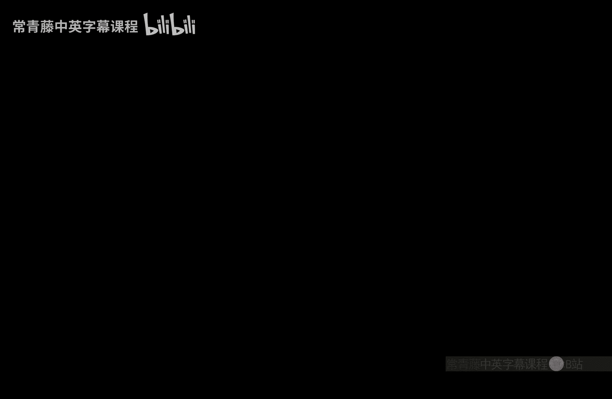
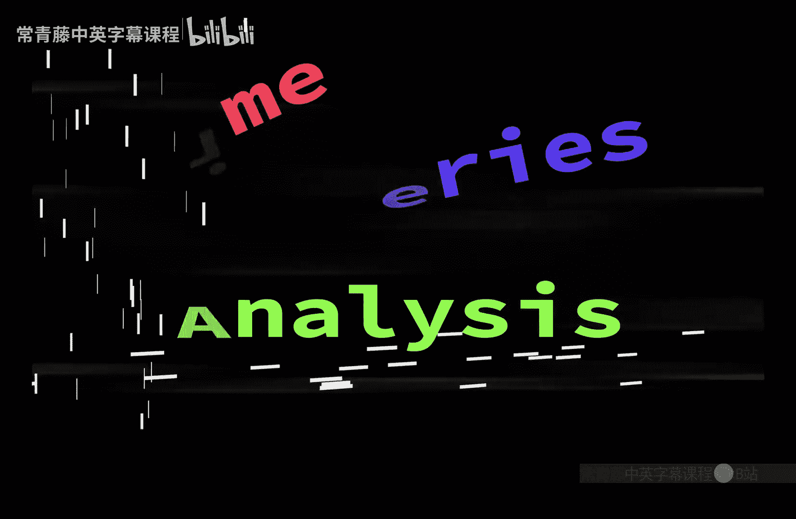
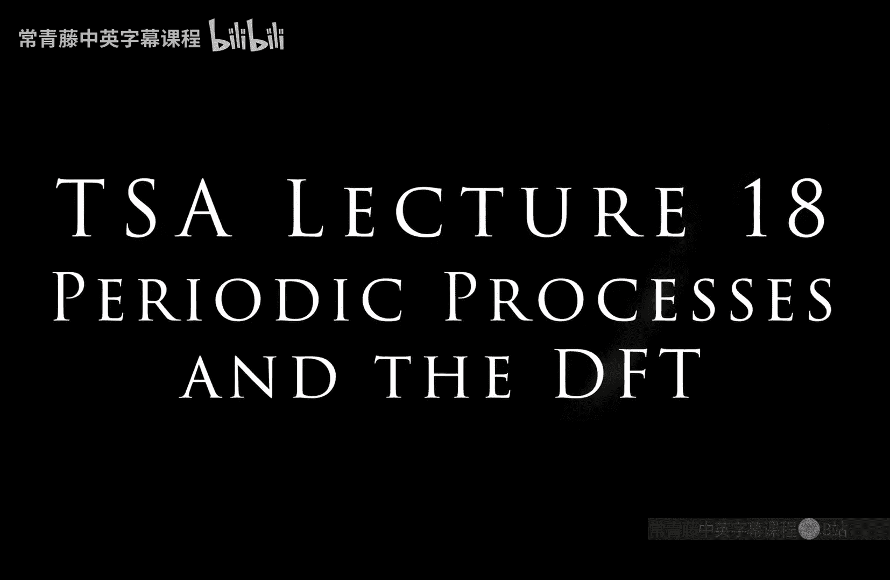
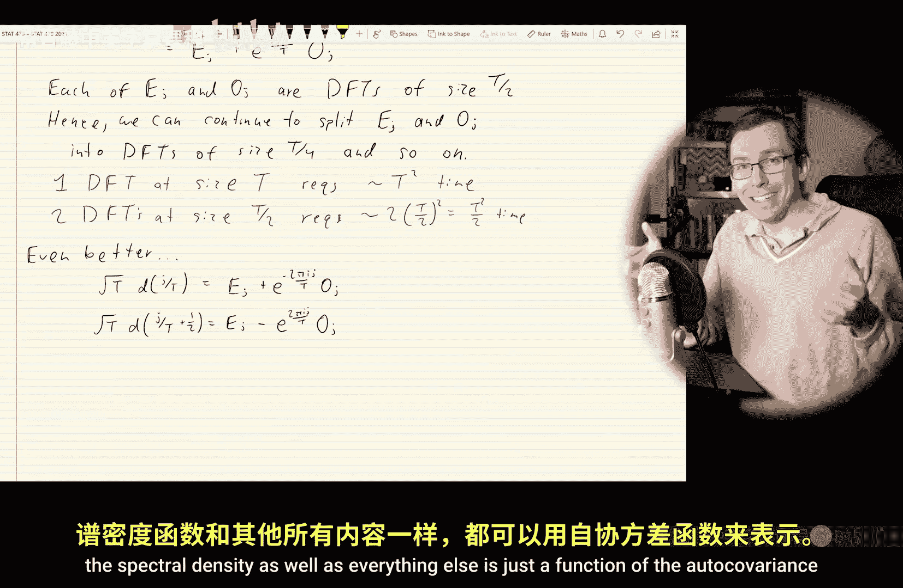

# 018：周期过程与离散傅里叶变换

在本节课中，我们将开启课程最后一个主要章节的学习，即**频域分析**。我们将学习如何从频率的视角来审视时间序列数据，这对于识别数据中的周期性波动（如季节性模式）非常有用。我们将从**周期过程**的概念入手，并介绍一个强大的工具——**离散傅里叶变换**。

---

## 从时域到频域

到目前为止，我们所有的分析都集中在**时域**，即直接观察数据随时间的变化。然而，任何随时间变化的信号都可以从**频域**的角度进行分析。频域分析能帮助我们识别时间序列中哪些频率成分最为显著或“强大”。

## 周期过程

我们从一个基础的**周期过程**模型开始。它本质上是一种平稳过程，其形式如下：

**X_t = A * cos(2πωt + φ)**

其中：
*   **A** 是**振幅**，决定了信号的强度。
*   **ω** 是**频率**，例如，对于月度数据中的年度周期，ω = 1/12。
*   **φ** 是**相位**，决定了信号在时间轴上的偏移。

为了便于分析，我们利用三角恒等式将其重写为：

**X_t = U₁ * cos(2πωt) + U₂ * sin(2πωt)**

这里，我们将 **U₁** 和 **U₂** 视为**均值为零、互不相关的随机变量**。这使得 X_t 成为一个随机过程。如果我们进一步假设 U₁ 和 U₂ 的方差相同，都为 σ²，那么可以计算出该过程的**自协方差函数**：

**γ(h) = Cov(X_{t+h}, X_t) = σ² * cos(2πωh)**

这个结果非常有趣：自协方差只依赖于时间间隔 **h**，而与具体的时间点 **t** 无关，这证明了该过程是**平稳的**。同时，自协方差本身也以余弦波形式随 **h** 变化。

## 更一般的周期过程

为了使模型更贴近现实，我们可以考虑多个频率的叠加。一个更一般的周期过程可以表示为多个不同频率的余弦和正弦波之和：

**X_t = Σ_{j=1}^{Q} [ U_{j1} * cos(2πω_j t) + U_{j2} * sin(2πω_j t) ]**

其中，对于每个频率 ω_j，对应的随机变量 U_{j1} 和 U_{j2} 都是均值为零、互不相关且方差为 σ_j² 的。此时，总的自协方差函数是各个频率成分的自协方差之和：

**γ(h) = Σ_{j=1}^{Q} σ_j² * cos(2πω_j h)**

这样，我们的信号就可以包含多个不同强度的周期性成分。

**⚠️ 警告：混叠现象**
在离散采样时需要注意**混叠**现象。当采样频率不够高时，一个高频信号可能会在采样数据中表现为一个低频信号，导致频率识别错误。

---

## 回归与傅里叶变换

上一节我们介绍了周期过程模型，本节中我们来看看如何将其应用于实际数据。给定一个长度为 T 的时间序列数据 X₁, ..., X_T，我们可以尝试用一组余弦和正弦函数的线性组合来“拟合”或“表示”它。这本质上是一个**线性回归**问题。

对于 T 为奇数的情况，模型可写为：
**X_t = β₀ + Σ_{j=1}^{(T-1)/2} [ β_{j1} * cos(2πt * j/T) + β_{j2} * sin(2πt * j/T) ]**

对于 T 为偶数的情况，形式略有不同，会多出一项。

为什么这样做？因为余弦和正弦函数在一定条件下构成一组**正交基**。这意味着我们可以完美地（或近似地）用它们表示数据。更重要的是，**系数 β_{j1} 和 β_{j2} 的大小直接反映了频率 j/T 在数据中的显著程度**。

以下是求解这些回归系数的关键点：
1.  设计矩阵（由所有余弦和正弦项构成）具有**正交列**。
2.  这使得系数估计变得非常简单，无需进行复杂的矩阵求逆，可以直接计算：

    **β̂_{j1} = (2/T) * Σ_{t=1}^{T} X_t * cos(2πt * j/T)**
    **β̂_{j2} = (2/T) * Σ_{t=1}^{T} X_t * sin(2πt * j/T)** (对于 j 不为 0 或 T/2)
    **β̂₀ = X̄** (样本均值)

## 周期图

为了综合衡量某个频率 j/T 的强度，我们定义**缩放周期图**：

**P(j/T) = β̂_{j1}² + β̂_{j2}²**

**P(j/T) 的值越大，表明频率 j/T 在时间序列中越显著。** 直观上，它可以被理解为归属于该频率成分的方差。

---

## 离散傅里叶变换

直接按上述公式计算所有频率的系数和周期图在数据量大时计算量巨大。幸运的是，这可以通过**离散傅里叶变换** 高效完成。

DFT 的定义如下（其中 i 是虚数单位）：

**D(j/T) = (1/√T) * Σ_{t=1}^{T} X_t * exp(-2πi * t * j / T)**

利用欧拉公式 exp(iθ) = cos(θ) + i sin(θ)，可以将 DFT 分解为余弦和正弦部分。关键的联系在于，**缩放周期图可以通过 DFT 的模平方来计算**：

**P(j/T) = (4/T) * |D(j/T)|²**

因此，计算 DFT 就等价于计算我们之前回归分析所关心的所有频率成分的强度。

---

## 快速傅里叶变换

虽然 DFT 给出了计算方法，但直接计算一个长度为 T 的序列的 DFT 需要大约 O(T²) 次运算。对于大规模时间序列，这依然很慢。解决方案是使用**快速傅里叶变换**。

FFT 是一种高效算法，它利用了 DFT 计算中的对称性和冗余性。其核心思想是**分而治之**：
1.  将长度为 T 的时间序列按奇偶索引分成两个子序列。
2.  原始序列的 DFT 可以通过这两个子序列的 DFT 组合得到。
3.  递归地对子序列进行同样的操作。

当 T 是 2 的整数次幂时，这种算法最为高效，能将计算复杂度从 O(T²) 降低到 **O(T log₂ T)**。现代计算库中的 FFT 算法还处理了 T 不是 2 的幂次的情况。

---

## 总结

本节课中我们一起学习了时间序列频域分析的基础：
1.  我们引入了**周期过程**模型，它由不同频率的余弦和正弦波叠加而成，并且是平稳的。
2.  我们展示了如何通过**线性回归**到一组正交的余弦/正弦基上来拟合数据，其系数揭示了数据中的显著频率。
3.  我们定义了**缩放周期图 P(j/T)** 作为衡量频率显著性的工具。
4.  我们介绍了**离散傅里叶变换**，它是计算周期图的等价且更概念化的方法。
5.  最后，我们了解了**快速傅里叶变换**算法如何通过分而治之的策略，极大地提升了 DFT 的计算效率，使得对大规模时间序列进行频域分析成为可能。

在下一讲中，我们将深入探讨**谱分布**和**谱密度**的概念，并建立它们与我们熟悉的**自协方差函数**之间的重要联系。