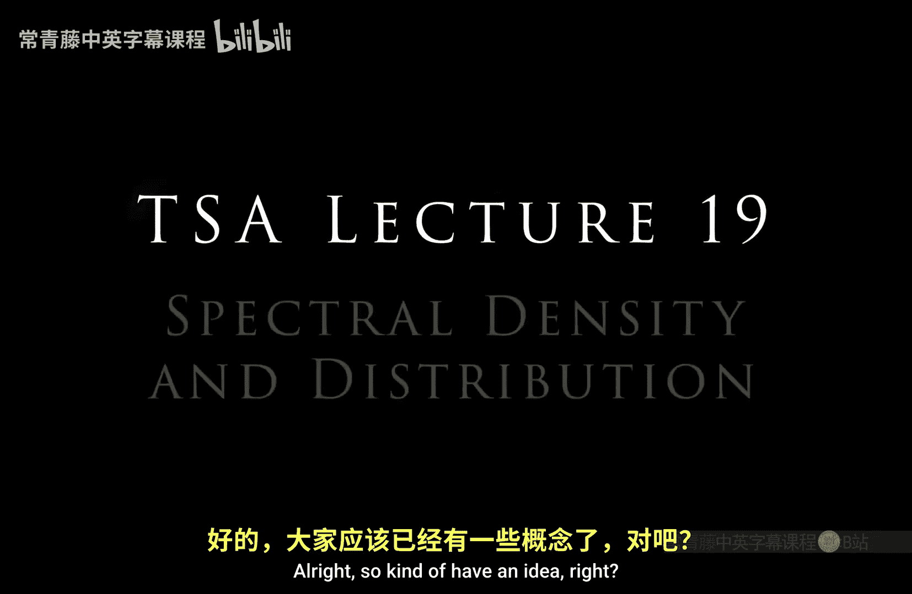
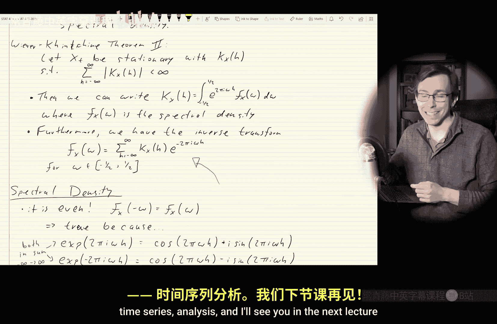

# 019：谱密度与谱分布



在本节课中，我们将学习时间序列分析中谱方法的核心概念：谱密度与谱分布。我们将探讨它们如何与自协方差函数相关联，以及如何帮助我们识别时间序列数据中最显著的频率成分。

## 概述

上一节我们介绍了周期过程，其核心思想是将过程表示为正弦和余弦函数的组合，并通过系数大小来判断哪些频率在时间序列中占主导地位。本节中，我们将进一步深入，学习谱分布和谱密度这两个概念。它们的命名与概率论中的累积分布函数和概率密度函数类似。我们将发现，这两个概念与自协方差函数紧密相关，正如本课程一再强调的，自协方差是时间序列分析的基础。

## 谱分布与维纳-辛钦定理

首先，我们介绍维纳-辛钦定理。该定理建立了平稳时间序列的自协方差函数与谱分布之间的联系。

**定理 1 (维纳-辛钦定理第一部分)**：
令 `{X_t}` 为一个平稳时间序列，其自协方差函数为 `K_X(h) = Cov(X_{t+h}, X_t)`。那么，存在一个唯一的单调递增函数 `F_X(ω)`，称为**谱分布函数**，满足：
1.  `F_X(-1/2) = 0`
2.  `F_X(1/2) = K_X(0)` （即过程的方差）
3.  对于任意滞后 `h`，自协方差函数可以表示为：
    `K_X(h) = ∫_{-1/2}^{1/2} e^{2πiωh} dF_X(ω)`
    这里的积分是黎曼-斯蒂尔杰斯积分。

这个定理表明，自协方差函数可以通过对复指数函数关于谱分布函数积分得到。如果谱分布函数 `F_X(ω)` 是可微的，那么我们可以定义其导数。

## 谱密度

上一节我们介绍了谱分布的存在性，本节我们来看看在什么条件下可以定义其导数，即谱密度。

**定理 2 (维纳-辛钦定理第二部分)**：
令 `{X_t}` 为一个平稳时间序列，其自协方差函数 `K_X(h)` 是**绝对可和的**，即：
`∑_{h=-∞}^{∞} |K_X(h)| < ∞`
那么，谱分布函数 `F_X(ω)` 是绝对连续的，其导数 `f_X(ω) = dF_X(ω)/dω` 几乎处处存在，并称为**谱密度函数**。此时，自协方差函数可表示为：
`K_X(h) = ∫_{-1/2}^{1/2} e^{2πiωh} f_X(ω) dω`
更重要的是，我们有一个逆变换，可以直接从自协方差得到谱密度：
`f_X(ω) = ∑_{h=-∞}^{∞} K_X(h) e^{-2πiωh}`，其中 `ω ∈ [-1/2, 1/2]`。

谱密度具有以下重要性质：
*   **定义域**：`ω` 在 `[-1/2, 1/2]` 区间内。
*   **偶函数**：`f_X(-ω) = f_X(ω)`。这是因为自协方差函数是偶函数，且复指数项在求和时对称。
*   **方差分解**：当 `h=0` 时，`K_X(0) = Var(X_t) = ∫_{-1/2}^{1/2} f_X(ω) dω`。这意味着**过程的方差可以分解为不同频率成分的贡献之和**，类似于方差分析中将总平方和分解为各因素平方和的思想。

## 示例分析

为了更直观地理解，让我们看两个简单的例子。

**示例 1：周期过程**
考虑过程 `X_t = U_1 cos(2πω_0 t) + U_2 sin(2πω_0 t)`，其中 `U_1, U_2` 是不相关的零均值随机变量。其自协方差为 `K_X(h) = σ² cos(2πω_0 h)`。这个自协方差序列不是绝对可和的，因此不存在谱密度函数，但存在谱分布函数 `F_X(ω)`。它是一个阶梯函数，在频率 `±ω_0` 处有跳跃。这直观地反映了该过程的所有“能量”都集中在频率 `ω_0` 上。

**示例 2：白噪声**
白噪声过程 `W_t` 的自协方差为：`K_W(0) = σ²`，`K_W(h) = 0 (当 h ≠ 0)`。这显然是绝对可和的。其谱密度为：
`f_W(ω) = ∑_{h=-∞}^{∞} K_W(h) e^{-2πiωh} = σ²`
这是一个常数函数。表明白噪声在所有频率上具有均匀的“能量”密度，这解释了其名称中“白”的由来（类比白光包含所有颜色的光）。

## 滤波与ARMA过程的谱密度

我们已经知道如何从自协方差计算谱密度。但对于像ARMA这样的常见模型，是否有更简便的方法呢？答案是肯定的，这涉及到滤波的概念。

考虑一个“过滤”过程：`Y_t = ∑_{j=-∞}^{∞} a_j X_{t-j}`，其中系数 `{a_j}` 绝对可和。定义**脉冲响应函数** `A(j) = a_j` 及其**频率响应函数**（傅里叶变换）：
`A(ω) = ∑_{j=-∞}^{∞} a_j e^{-2πiωj}`

**定理 3 (滤波的谱密度)**：
如果 `{X_t}` 具有谱密度 `f_X(ω)`，那么过滤后过程 `{Y_t}` 的谱密度为：
`f_Y(ω) = |A(ω)|² f_X(ω)`
这意味着，滤波操作对谱密度的影响，仅仅是乘以频率响应函数模的平方。

这个定理可以优雅地应用于ARMA过程。任何一个因果可逆的ARMA(p,q)过程 `φ(B)X_t = θ(B)W_t` 都可以表示为白噪声的无限滑动平均形式：`X_t = ∑_{j=0}^{∞} ψ_j W_{t-j}`。这里，系数 `{ψ_j}` 对应滤波系数 `{a_j}`，而 `W_t` 是白噪声。频率响应函数 `Ψ(ω)` 恰好是移动平均算子与自回归算子在 `z = e^{-2πiω}` 处取值的比：
`Ψ(ω) = θ(e^{-2πiω}) / φ(e^{-2πiω})`
由于白噪声的谱密度是常数 `σ²`，根据定理3，ARMA过程的谱密度为：
`f_X(ω) = |Ψ(ω)|² σ² = |θ(e^{-2πiω}) / φ(e^{-2πiω})|² σ²`
这个公式让我们无需计算复杂的自协方差，直接通过模型参数就能得到谱密度。

## 实际应用与代码演示

在理论介绍之后，让我们通过R代码来看一个实际例子。我们生成一个包含多个特定频率成分的周期信号，并加入一些白噪声。

```r
set.seed(479)
n <- 512
t <- 0:(n-1)
signal <- sin(2*pi*32/n * t) + 0.5*cos(2*pi*16/n * t) + 0.8*sin(2*pi*16/n * t + pi/6) + 1.2*cos(2*pi*96/n * t)
x <- signal + rnorm(n, sd=0.5)

# 计算周期图 (谱密度的估计)
xx_fft <- fft(x)
xx_periodogram <- (2/n) * Mod(xx_fft)^2
freq <- (0:(n-1))/n

# 绘制周期图
plot(freq, xx_periodogram, type='l', main='Periodogram', xlab='Frequency', ylab='Intensity')
abline(v=0.5, lty=2) # 标记 Nyquist 频率 (1/2)

# 找出最强的频率成分
sorted_periodogram <- sort(xx_periodogram, decreasing=TRUE, index.return=TRUE)
top_freq_indices <- sorted_periodogram$ix[1:16]
top_cycle_lengths <- 1/freq[top_freq_indices]
print(top_cycle_lengths[1:8])
```

运行代码后，我们会在周期图中观察到几个突出的尖峰。通过识别这些尖峰对应的频率（或周期长度），我们可以发现数据中隐藏的周期性成分（例如，对应周期长度约为16、32和5.33）。即使数据被噪声污染，主要的频率成分依然可以通过谱分析被检测出来。

## 总结

本节课我们一起学习了时间序列谱分析的核心：谱分布与谱密度。
*   我们首先通过**维纳-辛钦定理**理解了谱分布与自协方差函数之间的等价关系。
*   在自协方差绝对可和的条件下，我们定义了**谱密度** `f_X(ω)`，它代表了方差在不同频率上的分布，并且是偶函数。
*   通过**滤波定理**，我们掌握了如何计算线性过滤后过程的谱密度，并推导出**ARMA过程谱密度**的简洁公式：`f_X(ω) = σ² |θ(e^{-2πiω}) / φ(e^{-2πiω})|²`。
*   最后，通过代码演示，我们看到了如何从实际数据中估计谱密度（周期图），并识别出主导的频率成分。



谱密度为我们分析时间序列提供了全新的视角，即从“时域”转换到“频域”。它特别擅长揭示数据中的周期性、季节性以及各种频率的振荡模式。在接下来的课程中，我们将以此为基础，学习如何进行谱估计和统计推断。