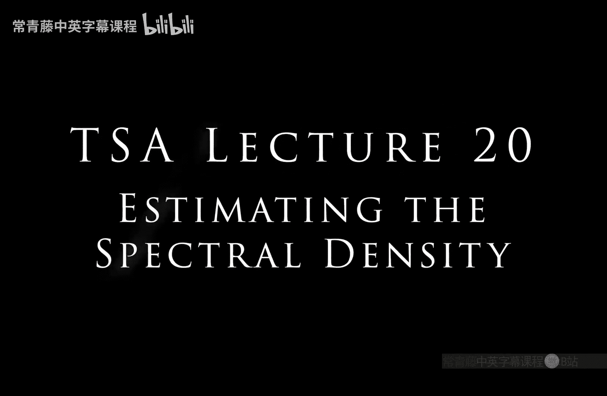
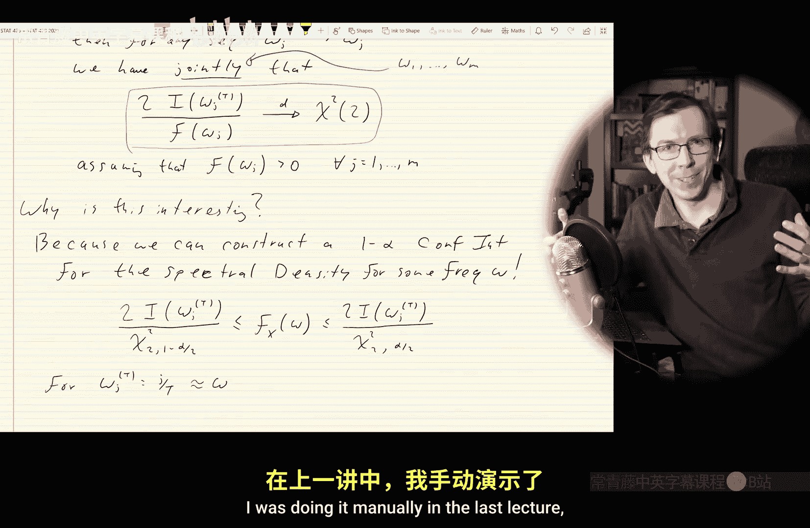

# 020：谱密度估计 🎯

在本节课中，我们将学习如何利用谱方法进行实际的统计分析，核心目标是**估计谱密度函数**。我们将发现，我们已经掌握的工具——**周期图**——正是这个估计器。本节课将深入探讨其细节，并介绍谱方差分析以及谱密度的置信区间构建方法。

---

## 离散傅里叶变换回顾 📊

上一节我们介绍了谱密度的数学概念，但在实际中，我们面对的是数据而非数学模型。因此，我们需要从数据出发来估计谱密度。这一切的起点是离散傅里叶变换。

给定一个时间序列数据 \( x_1, x_2, \ldots, x_T \)，其离散傅里叶变换定义为：
\[
d(\omega_j) = \frac{1}{\sqrt{T}} \sum_{t=1}^{T} x_t e^{-2\pi i \omega_j t}
\]
其中，频率 \( \omega_j = j / T \)，\( j = 0, 1, \ldots, T-1 \)。

这个变换可以分解为实部和虚部，分别对应余弦变换和正弦变换：
*   **余弦变换**：\( d_c(\omega_j) = \frac{1}{\sqrt{T}} \sum_{t=1}^{T} x_t \cos(2\pi \omega_j t) \)
*   **正弦变换**：\( d_s(\omega_j) = \frac{1}{\sqrt{T}} \sum_{t=1}^{T} x_t \sin(2\pi \omega_j t) \)

它们的关系是：
\[
d(\omega_j) = d_c(\omega_j) - i \cdot d_s(\omega_j)
\]

离散傅里叶变换是可逆的，我们可以通过逆变换从频域数据恢复原始时域数据：
\[
x_t = \sum_{j=0}^{T-1} d(\omega_j) e^{2\pi i \omega_j t}, \quad t = 1, \ldots, T
\]

---

## 周期图作为谱密度估计器 🔍

现在，我们来看看如何从数据估计谱密度。核心工具是**周期图**。

对于频率 \( \omega_j \)，周期图定义为离散傅里叶变换模的平方：
\[
I(\omega_j) = |d(\omega_j)|^2 = [d_c(\omega_j)]^2 + [d_s(\omega_j)]^2
\]

通过一系列代数推导（包括对数据进行中心化处理，即减去均值 \( \bar{x} \)），我们可以将周期图表示为样本自协方差函数的余弦变换：
\[
I(\omega_j) = \sum_{h=-(T-1)}^{T-1} \hat{\gamma}(h) \cos(2\pi \omega_j h)
\]
其中，\( \hat{\gamma}(h) \) 是在滞后 \( h \) 处的样本自协方差函数估计。

这个形式让我们联想到维纳-辛钦定理。该定理指出，对于一个平稳过程，其谱密度 \( f(\omega) \) 是其真实自协方差函数 \( \gamma(h) \) 的傅里叶变换：
\[
f(\omega) = \sum_{h=-\infty}^{\infty} \gamma(h) e^{-2\pi i \omega h}
\]

**结论**：周期图 \( I(\omega_j) \) 是谱密度 \( f(\omega) \) 的一个**估计器**。它用有限的样本自协方差 \( \hat{\gamma}(h) \) 代替了无限的真实自协方差 \( \gamma(h) \)。

然而，对于较大的滞后 \( h \)，样本自协方差 \( \hat{\gamma}(h) \) 的估计质量会变差（因为用于估计的数据点变少）。因此，在实践中，我们常使用一个截断版本，只对 \( |h| \leq M \) 的滞后进行求和，其中 \( M \ll T \)：
\[
I(\omega_j) \approx \sum_{h=-M}^{M} \hat{\gamma}(h) \cos(2\pi \omega_j h)
\]

---

## 谱方差分析 📈

从方差分析的角度，我们可以将时间序列的总变异分解到不同频率成分上。这提供了理解周期图的另一种视角。

我们可以将中心化后的数据 \( x_t - \bar{x} \) 表示为一组余弦和正弦函数的线性组合（一个饱和模型）。通过最小二乘法，可以精确拟合数据，其系数正是我们之前定义的余弦变换和正弦变换。

当我们计算数据的总平方和（总变异）时，一个关键的性质是：不同频率对应的余弦和正弦基函数是正交的。这使得交叉项在求和时为零。最终，总平方和可以分解为各个频率成分的贡献之和：
\[
\sum_{t=1}^{T} (x_t - \bar{x})^2 = 2 \sum_{j=1}^{(T-1)/2} I(\omega_j)
\]

**这意味着**：我们将数据的总变异（总平方和）分解为一系列频率 \( \omega_j \) 对应的平方和。每个频率成分 \( I(\omega_j) \) 可以视为拥有**2个自由度**的平方和。这与经典方差分析的思想一致，只不过这里的“处理”是不同频率的周期成分。

> **注意**：虽然数学上等价，但在实际计算中，我们不会真的去解这个巨大的线性回归系统，而是使用高效的**快速傅里叶变换**算法。

---

## 大样本性质与置信区间 📉

理解了周期图是谱密度的估计器后，一个自然的问题是：这个估计器有多好？我们在大样本下（即数据量 \( T \to \infty \)）研究其性质。

我们假设时间序列 \( X_t \) 是一个平稳过程，具有绝对可和的自协方差函数，因此谱密度存在。

**期望**：首先，在一定的正则条件下，可以证明周期图的期望值渐近地趋近于真实的谱密度：
\[
\mathbb{E}[I(\omega_j)] \to f(\omega) \quad \text{当 } T \to \infty，且 \omega_j \to \omega
\]

**分布**：为了构建置信区间，我们需要知道周期图的抽样分布。对于一个**线性过程**（例如ARMA过程），在更强的自协方差衰减条件下，我们可以得到一个极限定理。

具体来说，对于一系列趋向于固定频率 \( \omega \) 的离散频率 \( \omega_{j,T} \)，有以下**联合收敛分布**结果：
\[
\frac{2 I(\omega_{j,T})}{f(\omega)} \xrightarrow{d} \chi^2_2
\]
其中，\( \chi^2_2 \) 表示自由度为2的卡方分布。

这个定理非常强大，因为它允许我们为谱密度构造置信区间。

**置信区间**：基于上述极限分布，我们可以推导出谱密度 \( f(\omega) \) 的近似 \( 1-\alpha \) 置信区间。对于某个我们感兴趣的频率 \( \omega \)，选择数据中与之最接近的离散频率 \( \omega_j \)，则置信区间为：
\[
\left[ \frac{2 I(\omega_j)}{\chi^2_{2, 1-\alpha/2}}, \ \frac{2 I(\omega_j)}{\chi^2_{2, \alpha/2}} \right]
\]
这里，\( \chi^2_{2, \alpha/2} \) 和 \( \chi^2_{2, 1-\alpha/2} \) 是自由度为2的卡方分布的上侧分位数。

---

## 总结 🎓

本节课中，我们一起学习了谱密度估计的核心统计方法。

1.  **估计器**：我们明确了**周期图** \( I(\omega_j) \) 是谱密度 \( f(\omega) \) 的自然估计器，它本质上是样本自协方差函数的傅里叶变换。
2.  **方差分析视角**：我们从方差分析的角度理解了周期图，它将数据的总变异分解到不同频率上，每个频率成分贡献一个具有2个自由度的平方和。
3.  **统计推断**：我们探讨了周期图的大样本性质。最重要的是，对于线性过程（如ARMA模型），标准化后的周期图渐近服从卡方分布。这为我们构建谱密度的**置信区间**提供了理论基础。

通过本节课的学习，我们不仅知道了如何用周期图估计谱密度，还掌握了评估这种估计不确定性的统计工具。在接下来的课程中，我们将继续探讨更复杂的谱估计方法，并学习如何在R语言中实现这些分析。