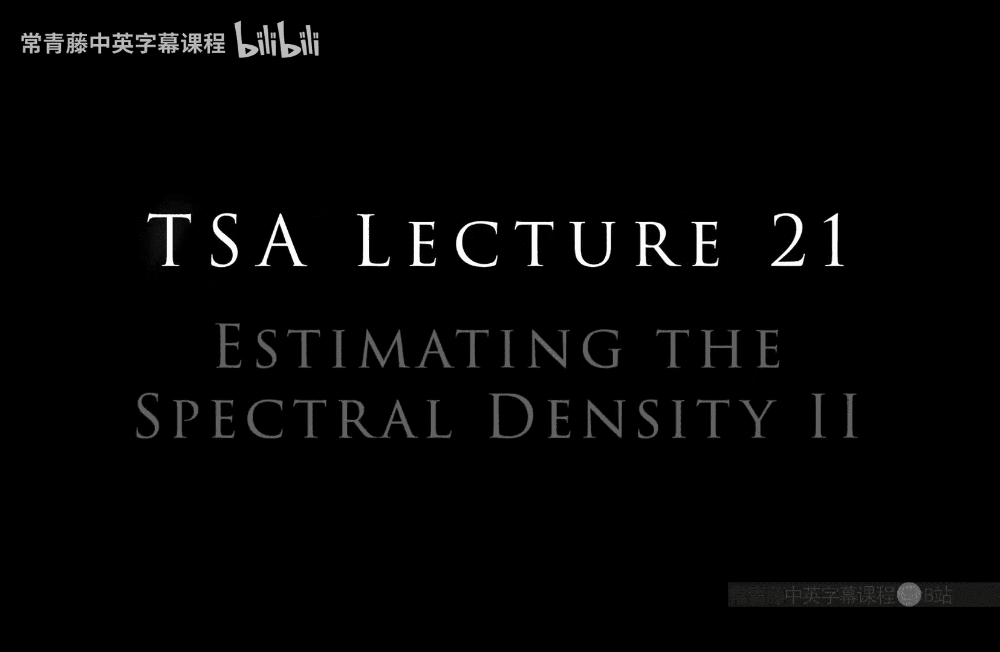
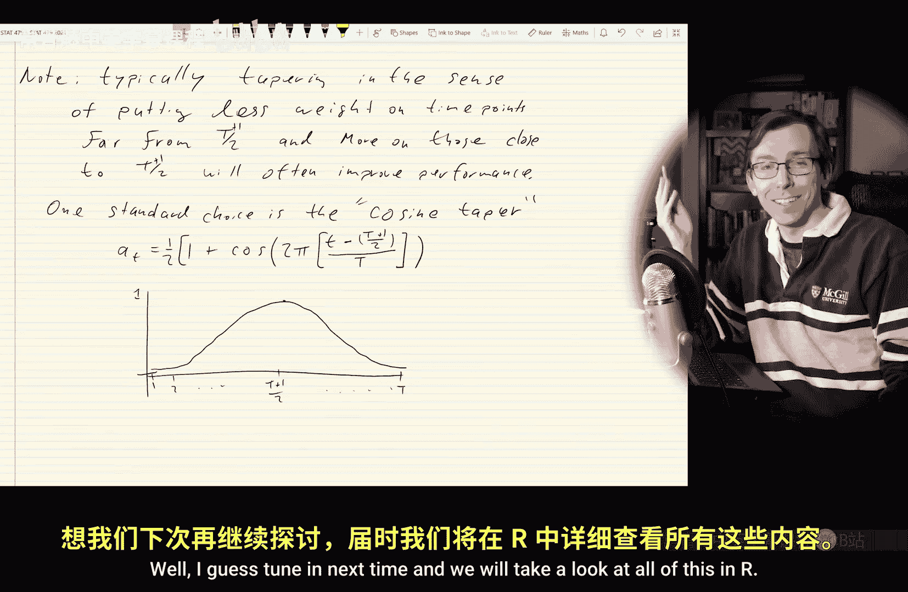

# 021：谱密度估计 II

在本节课中，我们将继续讨论谱密度的估计方法。上一讲我们介绍了周期图，它是一种有效的估计器，但仍有改进空间。本节我们将探讨多种平滑和优化估计的技术，包括Bartlett方法、Welsh方法、频带平均、加权平均、锥化以及相关核函数的概念。这些方法旨在通过减少方差或聚焦于特定频率来获得更好的谱密度估计。

---

## Bartlett方法

上一节我们介绍了周期图，本节我们来看看如何通过Bartlett方法来改进估计。Bartlett方法的核心思想是将时间序列分割成多个不重叠的等长子序列，分别计算每个子序列的周期图，然后对这些周期图进行平均。

对于一个长度为 \( T \) 的时间序列 \( X_1, \ldots, X_T \)，我们将其分割成 \( K \) 个长度为 \( M \) 的不重叠子序列，其中 \( M = T/K \)。每个子序列可以表示为：
- 第1段：\( X_1, \ldots, X_M \)
- 第2段：\( X_{M+1}, \ldots, X_{2M} \)
- ...
- 第K段：\( X_{T-M+1}, \ldots, X_T \)

对于每个子序列，我们计算其离散傅里叶变换（DFT）并得到周期图 \( I^{(i)}(\omega_j) \)，其中 \( i = 1, \ldots, K \)。Bartlett估计器定义为这些周期图的平均值：

\[
\bar{I}(\omega_j) = \frac{1}{K} \sum_{i=1}^{K} I^{(i)}(\omega_j)
\]

使用Bartlett方法的效果是，我们考虑的频率点变少了（因为 \( \omega_j = j/M \)），但估计的方差降低了。这是因为我们对 \( K \) 个独立估计进行了平均。此外，计算 \( K \) 个较小的DFT通常比计算一个大型DFT更快，且易于并行化。

---

## Welsh方法

Welsh方法与Bartlett方法思路相似，但它允许子序列之间存在重叠。这意味着在分割时间序列时，各段可以部分重叠，从而可能利用更多数据窗口来获得更平滑的估计。虽然具体实现略有不同，但其核心目标与Bartlett方法一致：通过平均多个估计来降低方差。

---

## 频带平均（Banding）

接下来我们探讨在频域进行平均的方法，即频带平均。与在时域分割数据不同，频带平均是将频率 \( \omega \) 划分成多个频带，然后在每个频带内对周期图值进行平均。

我们定义一个以 \( \omega_j \) 为中心、带宽为 \( (2M+1)/T \) 的频带 \( B \)：

\[
B = \left\{ \omega : \omega_j - \frac{M}{T} \le \omega \le \omega_j + \frac{M}{T} \right\}
\]

其中，\( 2M+1 \) 是频带内包含的离散频率点数。带宽 \( (2M+1)/T \) 表示该频带覆盖的单位区间比例。

对于给定的频带 \( B \，我们计算平均周期图：

\[
\bar{I}(\omega_j) = \frac{1}{2M+1} \sum_{i=-M}^{M} I\left(\omega_j + \frac{i}{T}\right)
\]

这种方法的优点是，如果谱密度在频带 \( B \) 内近似为常数，那么通过平均可以减少估计的方差。从理论上讲，经过适当标准化后，\( 2(2M+1) \bar{I}(\omega_j) / f_X(\omega_j) \) 会依分布收敛于自由度为 \( 4M+2 \) 的卡方分布，据此可以构建置信区间。

---

## 加权频带平均

我们还可以对频带内的周期图值进行加权平均，而不仅仅是简单平均。这引入了更大的灵活性。

定义加权平均周期图：

\[
\tilde{I}(\omega_j) = \sum_{i=-M}^{M} c_i I\left(\omega_j + \frac{i}{T}\right)
\]

其中，权重系数 \( c_i \) 满足 \( \sum_{i=-M}^{M} c_i = 1 \)。当所有权重相等，即 \( c_i = 1/(2M+1) \) 时，就退化为简单的频带平均。

在满足一定条件（如 \( M/T \to 0 \) 且 \( \sum c_i^2 \to 0 \)）时，该估计量是渐近无偏的，并且不同频率处的估计值渐近不相关。其极限分布是一个加权卡方和，但可以近似看作自由度为 \( 2L \) 的卡方分布，其中 \( L = 1 / \sum_{i=-M}^{M} c_i^2 \)。当权重相等时，\( L = 2M+1 \)，与之前的结果一致。

---

## 核函数选择：Daniel核

如何选择权重系数 \( c_i \) 呢？一个常见的选择是使用Daniel核。其思想是反复对序列应用均匀平滑操作。

*   **一次应用**：产生权重为 \( [1/3, 1/3, 1/3] \) 的均匀核。
*   **二次应用**：相当于对均匀核进行卷积，产生形如 \( [1/9, 2/9, 3/9, 2/9, 1/9] \) 的三角权重。
*   **多次应用**：会产生更高阶（如抛物线形）的平滑权重。

这类似于均匀分布的反复卷积。在R中，可以通过指定平滑次数来控制核的形状。此外，还有**修正Daniel核**，它初始就给中心点更高的权重（例如 \( [1/4, 2/4, 1/4] \)），从而更快地形成平滑效果。

---

## 锥化（Tapering）

前面介绍的方法主要在频域进行操作。现在我们将视角转回时域，介绍锥化技术。锥化是指对原始时间序列数据本身施加一个权重函数（锥化窗口），通常给予序列中间部分较高的权重，两端部分较低的权重。

设 \( X_t \) 是零均值平稳时间序列，其谱密度为 \( f_X(\omega) \)。定义锥化后的序列 \( Y_t = a_t X_t \)，其中 \( a_t \) 是实数权重系数。\( Y_t \) 的离散傅里叶变换为：

\[
D_Y(\omega_j) = \frac{1}{\sqrt{T}} \sum_{t=1}^{T} a_t X_t e^{-2\pi i \omega_j t}
\]

可以证明，锥化后序列 \( Y_t \) 的周期图的期望值不再直接等于 \( f_X(\omega_j) \)，而是原谱密度与一个**谱窗**函数 \( W_T(\omega) \) 的卷积：

\[
\mathbb{E}[I_Y(\omega_j)] = \int_{-1/2}^{1/2} W_T(\omega_j - \lambda) f_X(\lambda) d\lambda
\]

其中，谱窗 \( W_T(\omega) = |A(\omega)|^2 \)，而 \( A(\omega) \) 是权重序列 \( \{a_t\} \) 的离散傅里叶变换。这意味着，对时域数据锥化的效果，在频域上相当于用一个特定的窗函数对谱密度进行局部平滑。

一个经典的例子是**Fejér**或**Bartlett核**（注意与之前的Bartlett方法区分），它对应于不对数据做任何锥化（即 \( a_t = 1 \)）时产生的谱窗，其形式为：

\[
W_T(\omega) = \frac{\sin^2(T \pi \omega)}{T \sin^2(\pi \omega)}
\]

有趣的是，之前讨论的频带平均方法，也可以等价地表示为使用某种特定谱窗的锥化操作，这体现了时域和频域方法之间的深刻联系。

锥化通常能改善估计性能，因为它减少了因时间序列截断（两端突然变为0）而引起的频谱泄漏。一个常用的锥化函数是**余弦锥**，在时域定义为：

\[
a_t = \frac{1}{2} \left[ 1 + \cos\left( \frac{2\pi (t - (T+1)/2)}{T} \right) \right]
\]

这个函数在序列中心达到最大值1，向两端逐渐平滑地衰减到0，从而强调中间数据，削弱边界数据的影响。

---

## 总结

本节课我们一起学习了多种谱密度估计的改进方法。
1.  **Bartlett和Welsh方法**通过在时域分割并平均多个周期图来降低方差。
2.  **频带平均及其加权版本**则在频域对相邻频率的周期图进行平均或加权平均，同样旨在减少方差，并可通过选择核函数（如Daniel核）来调整平滑方式。
3.  **锥化技术**通过给原始时间序列施加一个两端衰减的权重窗口，在时域进行预处理，其频域效应等价于用谱窗对谱密度进行平滑，有助于减少频谱泄漏。

所有这些方法都没有绝对的“最佳”选择，它们提供了从不同角度审视和估计谱密度的工具。在实际分析中，我们常常需要尝试多种方法并调整参数（如带宽 \( M \)、权重核、锥化函数等），以探索数据中隐藏的周期特性。下一讲我们将通过R语言代码来实践这些方法，直观地观察它们的效果。