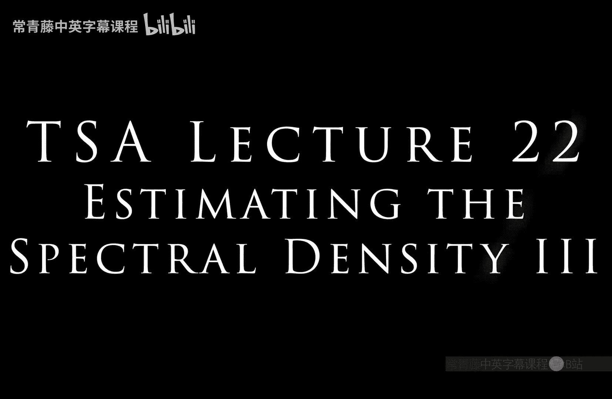
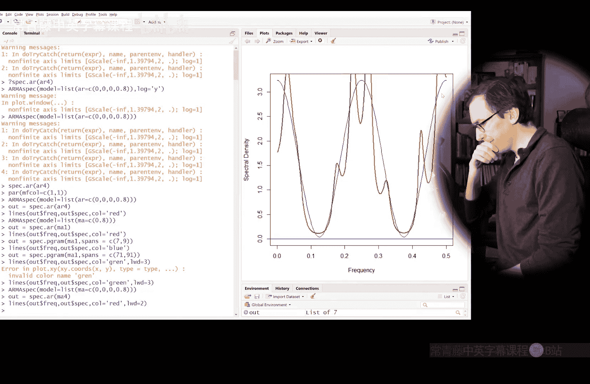

# 022：谱密度估计 III 🎯



在本节课中，我们将学习如何使用**参数化方法**来估计时间序列的谱密度。到目前为止，我们主要使用了周期图及其平滑版本，这些都属于**非参数统计**的范畴。然而，如果我们假设数据来自一个自回归（AR）或自回归滑动平均（ARMA）过程，我们就可以通过拟合模型来直接计算其谱密度。本节课我们将深入探讨这种方法，并通过R代码进行实践。

## 参数化谱密度估计 📈

上一节我们介绍了非参数化的谱密度估计方法。本节中，我们将探讨一种不同的思路：**参数化估计**。

其核心思想是：与其直接从数据计算周期图，不如先为数据拟合一个参数化时间序列模型（如ARMA模型），然后基于拟合好的模型来计算其理论谱密度。

具体步骤如下：
1.  为观测数据拟合一个ARMA(p, q)模型，得到参数估计值 \(\hat{\phi}\) 和 \(\hat{\theta}\)。
2.  使用这些估计参数，计算该ARMA过程的谱密度。

一个更常见且在实践中易于实现的方法是：**仅拟合一个自回归（AR）模型**。R语言中的许多函数默认采用此方法。

### AR模型谱密度公式

假设我们为数据拟合了一个AR(p)模型，并得到了参数估计 \(\hat{\phi}_1, ..., \hat{\phi}_p\) 以及白噪声方差估计 \(\hat{\sigma}^2\)。那么，在频率 \(\omega\) 处的谱密度估计为：

\[
\hat{f}_x(\omega) = \frac{\hat{\sigma}^2}{|1 - \sum_{k=1}^{p} \hat{\phi}_k e^{-2\pi i k \omega}|^2}
\]

这个公式与我们之前推导的AR过程理论谱密度公式一致，只是将真实参数替换为了其估计值。

### 置信区间

与周期图方法类似，参数化估计也能给出谱密度的渐近置信区间。对于较大的样本量 \(T\)，有：

\[
\frac{\hat{f}_x(\omega)}{1 + \sqrt{2p/T} \, z_{1-\alpha/2}} \leq f_x(\omega) \leq \frac{\hat{f}_x(\omega)}{1 - \sqrt{2p/T} \, z_{\alpha/2}}
\]

其中 \(z_{\alpha}\) 是标准正态分布的分位数。这与非参数方法中使用的卡方分布置信区间形成了对比。

### 理论基础与注意事项

参数化方法有一个强大的理论支撑：**对于任何平稳过程，都可以找到一个有限阶的因果AR过程，使其谱密度任意接近原过程的谱密度**。这意味着，即使真实过程不是AR过程，用AR模型来近似其谱密度在理论上是可行的。

然而，需要注意以下几点：
*   上述结果是渐近的，要求样本量 \(T \to \infty\)。
*   同时，自回归阶数 \(p\) 的增长速度必须满足 \(p^3 / T \to 0\)，即不能增长过快。
*   在实践中，即使真实过程是ARMA，其可逆表示可以写成一个无限阶AR过程，但系数通常会快速衰减。因此，用一个中等阶数（如5或10）的AR模型来近似通常是足够的。

## R语言实践 💻

理论部分之后，让我们进入RStudio，看看如何实际进行谱密度估计，并比较参数化与非参数化方法。

首先，我们需要生成一些示例数据来进行分析。

```r
# 设置随机种子以保证结果可重复
set.seed(2479)

# 加载必要的包
library(TSA)
library(astsa)
library(forecast)

# 模拟数据
# 1. AR(1) 过程，系数为 0.8
ar1 <- arima.sim(model = list(ar = 0.8), n = 500)
# 2. 季节性 AR(4) 过程 (系数仅在滞后4处非零)
ar4_seasonal <- arima.sim(model = list(ar = c(0, 0, 0, 0.8)), n = 500)
# 3. MA(1) 过程，系数为 0.8
ma1 <- arima.sim(model = list(ma = 0.8), n = 500)
# 4. 季节性 MA(4) 过程
ma4_seasonal <- arima.sim(model = list(ma = c(0, 0, 0, 0.8)), n = 500)
```

### 非参数化估计：`spectrum()` 与 `spec.pgram()`

R基础包中的 `spectrum()` 函数（或直接使用 `spec.pgram()`）提供了非参数化的谱密度估计。默认使用**修正的Daniel平滑器**对周期图进行平滑。

`spans` 参数用于控制平滑窗的宽度。数值越大，平滑程度越高。

```r
# 对AR1数据使用非参数化估计
# 默认设置，平滑较少
spec_raw <- spectrum(ar1, plot = FALSE)
# 使用 spans 参数增加平滑 (例如，使用宽度为31的窗)
spec_smooth <- spectrum(ar1, spans = 31, plot = FALSE)

# 绘制对比
plot(spec_raw$freq, spec_raw$spec, type = "l", col = "blue",
     main = "非参数化谱估计对比 (AR1数据)",
     xlab = "频率", ylab = "谱密度 (对数尺度)")
lines(spec_smooth$freq, spec_smooth$spec, col = "red", lwd = 2)
legend("topright", legend = c("原始周期图", "平滑后 (spans=31)"),
       col = c("blue", "red"), lty = 1, lwd = c(1,2))
```

### 参数化估计：`spec.ar()`

`spec.ar()` 函数通过拟合AR模型来进行参数化谱估计。默认使用AIC准则自动选择AR模型的阶数 \(p\)。

```r
# 对AR1数据进行参数化谱估计
spec_ar <- spec.ar(ar1, plot = FALSE)
# 绘制结果
plot(spec_ar$freq, spec_ar$spec, type = "l", lwd = 2, col = "darkgreen",
     main = "参数化(AR)谱估计 (AR1数据)",
     xlab = "频率", ylab = "谱密度")
```

### 方法比较与叠加

将参数化估计的结果叠加到非参数化估计的图上，可以直观比较。

```r
# 在同一图中比较非参数平滑估计与参数化估计
spectrum(ar1, spans = 31, main = "AR1数据谱估计对比",
         xlab = "频率", ylab = "谱密度 (对数尺度)")
# 添加参数化估计曲线
lines(spec.ar(ar1, plot = FALSE)$freq,
      spec.ar(ar1, plot = FALSE)$spec,
      col = "red", lwd = 2)
legend("topright", legend = c("非参数 (spans=31)", "参数化 (AR)"),
       col = c("black", "red"), lty = 1, lwd = 2)
```

### 分析不同数据生成过程

让我们将这两种方法应用于我们生成的所有数据集，观察其表现。

以下是针对不同数据的观察：
*   **AR(1) 数据**：参数化方法 (`spec.ar`) 能给出非常平滑且准确的估计，因为它正确指定了模型形式。非参数方法需要合适的平滑才能接近真实形状。
*   **季节性 AR(4) 数据**：参数化方法成功捕捉到了季节频率（0.25和0.5 cycles/time unit）处的峰值。未经平滑的非参数周期图非常嘈杂，而过度平滑可能会抹平这些重要峰值。
*   **MA(1) 数据**：参数化方法需要拟合一个相对高阶的AR模型来近似MA过程，其估计曲线可能不够平滑或包含虚假波动。非参数方法通过适度平滑，有时能更好地展现真实的谱形状（MA(1)的谱通常较为平坦或单调）。
*   **季节性 MA(4) 数据**：情况类似，参数化估计可能产生复杂的波动模式。需要谨慎解释这些波动是真实特征还是模型近似带来的伪影。

### 查看真实谱密度

对于ARMA模型，我们可以使用 `armaspec` 函数（来自 `TSA` 包）计算其**真实**的理论谱密度，以便与估计值比较。

```r
# 计算 AR(1) 系数为 0.8 的真实谱密度
true_spec_ar1 <- armaspec(model = list(ar = 0.8), plot = FALSE)
# 计算并绘制估计谱与真实谱
spec_est <- spec.ar(ar1, plot = FALSE)
plot(true_spec_ar1$freq, true_spec_ar1$spec, type = "l", lwd = 3,
     main = "AR1: 真实谱 vs 参数化估计谱",
     xlab = "频率", ylab = "谱密度")
lines(spec_est$freq, spec_est$spec, col = "red", lwd = 2, lty = 2)
legend("topright", legend = c("真实谱密度", "估计谱密度 (AR)"),
       col = c("black", "red"), lty = c(1, 2), lwd = c(3,2))
```

## 总结与要点 🎓



本节课我们一起学习了时间序列谱密度估计的参数化方法。

*   **核心思路**：通过为数据拟合一个AR（或ARMA）模型，然后利用模型的理论公式计算谱密度。
*   **主要函数**：在R中，`spec.ar()` 用于参数化估计，`spectrum()` 或 `spec.pgram()` 用于非参数化估计。
*   **方法比较**：
    *   **参数化方法** 在模型指定正确时效率高、结果平滑，并能提供理论上的置信区间。即使模型不完全正确，AR模型也能很好地近似许多平稳过程的谱密度。
    *   **非参数化方法** 更灵活，不依赖于特定的模型假设。但其结果严重依赖于平滑程度（`spans`参数）的选择，面临着**偏差-方差权衡**：平滑不足则估计方差大、曲线嘈杂；过度平滑则会引入偏差，可能掩盖真实的谱特征（如尖锐峰值）。
*   **实践建议**：没有一种方法总是最优。建议在实际分析中同时尝试多种方法（参数化、不同平滑程度的非参数化），并将结果进行对比。通过观察谱密度图中的峰值、谷值和平坦区域，可以推断时间序列中存在的周期性、季节性或白噪声成分。

参数化谱估计为我们提供了另一种强大的工具来理解和揭示时间序列中的频率域特征。结合非参数方法，我们可以更全面、更稳健地进行分析。