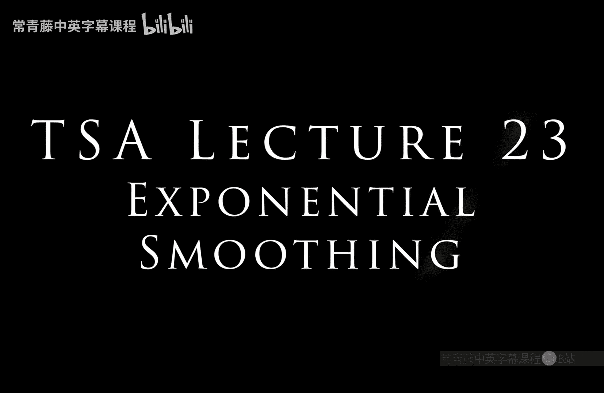
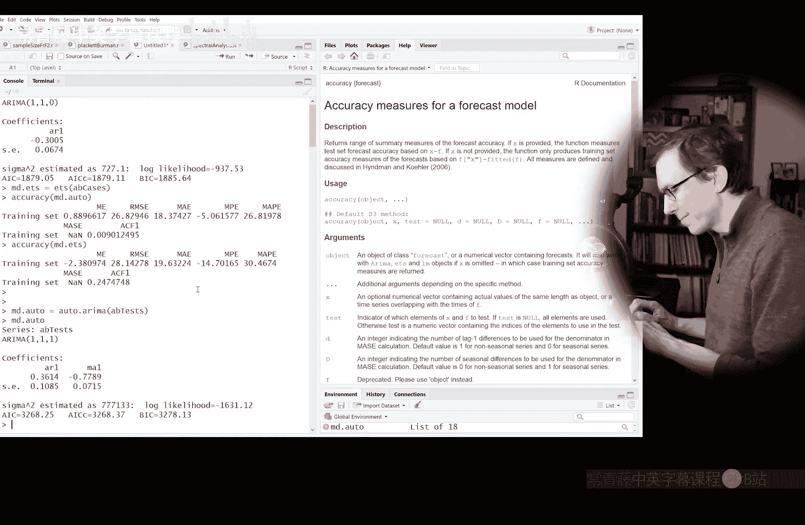

# 023：指数平滑法 📈




在本节课中，我们将学习一种名为指数平滑的时间序列建模与预测方法。我们将探讨其基本概念、与ARIMA模型的联系，并通过R语言中的实际案例来应用这些方法。

---

## 概述 📋

指数平滑法是一种广泛使用的预测技术，尤其适用于没有明显季节性但可能包含趋势的数据。与之前课程中深入讨论的ARIMA模型不同，指数平滑法采用了一种加权平均的思维方式，对近期观测值赋予更高的权重。本节课我们将介绍简单指数平滑、双指数平滑（霍尔特-温特斯法）的基本原理，并了解它们如何与特定的ARIMA模型相关联。

---

## 简单指数平滑 📉

上一节我们回顾了课程初期提到的移动平均平滑器。本节中我们来看看一种不同的平滑方法：简单指数平滑。

简单指数平滑通过一个递归公式来创建平滑序列。其核心思想是，新的平滑值是当前观测值与上一期平滑值的加权平均。

**公式**如下：
`S_t = α * X_t + (1 - α) * S_{t-1}`
其中：
*   `S_t` 是时间 `t` 的平滑值。
*   `X_t` 是时间 `t` 的原始观测值。
*   `α` 是平滑参数，取值范围在0到1之间。
*   初始值通常设为 `S_1 = X_1`。

参数 `α` 控制平滑程度：
*   `α` 接近1时，模型几乎完全依赖最新观测值，平滑效果弱。
*   `α` 接近0时，模型赋予历史平滑值很大权重，结果更为平滑。

这种方法之所以被称为“指数”平滑，是因为如果将公式迭代展开，会发现每个历史观测值 `X_{t-j}` 的权重按 `(1-α)^j` 呈指数衰减。因此，它是一个使用**全部历史数据**的加权移动平均平滑器。

从信号处理的角度看，这种平滑相当于一个**低通滤波器**，旨在滤除时间序列中的高频随机波动。

---

## 双指数平滑（霍尔特线性趋势法）📈

简单指数平滑适用于没有趋势的平稳序列。如果数据包含趋势（持续上升或下降），人们通常使用双指数平滑，也称为霍尔特线性趋势法。

这种方法在简单指数平滑的基础上，引入了一个额外的方程来捕捉和更新趋势成分。

以下是模型的初始化与更新方程：

**初始化**：
`S_1 = X_1`
`B_1 = X_2 - X_1` （初始趋势估计，可理解为斜率）

**平滑方程**：
`S_t = α * X_t + (1 - α) * (S_{t-1} + B_{t-1})`
`B_t = β * (S_t - S_{t-1}) + (1 - β) * B_{t-1}`

其中：
*   `S_t` 是截距项（序列水平）。
*   `B_t` 是斜率项（趋势）。
*   `α` 和 `β` 都是介于0和1之间的平滑参数。

`B_t` 的方程本身也是一个指数平滑形式，它平滑的是连续两期水平值 `(S_t - S_{t-1})` 的变化量。通过这种方式，模型能够动态地估计并更新数据中的趋势。

---

## 与ARIMA模型的联系 🔗

一个有趣的事实是，简单指数平滑在数学上等价于一个特定的ARIMA模型。

**结论**：简单指数平滑对应于 **ARIMA(0,1,1)** 模型。

让我们来验证一下。ARIMA(0,1,1)模型的形式为：
`(1 - B) X_t = (1 + θ B) W_t`
其中 `B` 是后移算子，`W_t` 是白噪声。

将其展开并重新排列，可以得到预测公式：
`X_t = X_{t-1} + W_t + θ W_{t-1}`

在进行一步向前预测时，我们利用直到 `t-1` 时刻的信息。未知的 `W_t` 期望为0，而 `W_{t-1}` 可以用上一期的预测误差 `(X_{t-1} - X_{t-1的预测值})` 来估计。经过代数变换，最终的预测公式会呈现为：
`X_t的预测值 = α * X_{t-1} + (1 - α) * X_{t-1的预测值`
这正是简单指数平滑的递归形式，其中 `α = 1 + θ`（注意 `θ` 通常为负值）。

类似地，双指数平滑（霍尔特线性法）与 **ARIMA(0,2,2)** 模型存在联系。虽然公式推导更复杂，但核心思想一致：这些指数平滑方法都可以在ARIMA模型的框架下找到对应的形式。

---

## R语言实践：霍尔特-温特斯法 🛠️

理论之后，我们来看看如何在R中应用这些方法。我们将使用阿尔伯特省2020年2月至8月的新冠病例数数据。

R的基础`stats`包中提供了`HoltWinters()`函数。该函数可以实现加法或乘法形式的霍尔特-温特斯法，后者适用于具有乘法性季节性的数据。

对于我们的数据（无明显季节性），我们使用加法模型并禁用季节性成分。

**以下是关键步骤**：
1.  **拟合模型**：如果不指定参数`alpha`（水平平滑）和`beta`（趋势平滑），函数会自动优化它们以最小化一步预测误差。
    ```r
    # 拟合霍尔特-温特斯模型，无季节性
    hw_model <- HoltWinters(ab_cases_ts, gamma = FALSE)
    ```
2.  **查看参数**：运行后可以查看优化得到的`alpha`和`beta`值。
3.  **进行预测与绘图**：使用`plot()`函数可以绘制原始序列及拟合的平滑序列。
    ```r
    plot(hw_model)
    ```
4.  **手动调整参数**：你可以尝试不同的`alpha`和`beta`值，观察平滑效果的变化。例如，`alpha=1`会使预测几乎等于上一期观测值（类似随机游走），而`alpha=0.1`会产生一个非常平滑但可能滞后于实际变化的序列。

---

## 扩展：ETS模型框架 📦

除了`HoltWinters()`，`forecast`包中的`ets()`函数提供了更现代、更灵活的指数平滑模型框架。

`ets()`函数允许通过模型代码字符串来指定误差类型（加法A/乘法M）、趋势类型（无N/加法A/乘法M）和季节性类型。例如，“AAN”表示具有加法误差、加法趋势且无季节性的模型。

**其优势包括**：
*   自动模型选择功能。
*   提供AIC等模型选择准则。
*   输出分解后的水平、趋势成分图，便于理解。

使用示例：
```r
library(forecast)
ets_model <- ets(ab_cases_ts)
plot(ets_model) # 绘制序列分解图
```

---

## 方法对比：指数平滑 vs. ARIMA ⚖️

最后，一个自然的问题是：哪种方法更好？我们可以通过预测精度指标来比较。

我们同时对阿尔伯特省新冠病例数据拟合自动选择的ARIMA模型（使用`auto.arima()`）和ETS模型，并计算它们的预测误差。

**代码示例**：
```r
# 拟合ARIMA模型
arima_model <- auto.arima(ab_cases_ts)
# 拟合ETS模型
ets_model <- ets(ab_cases_ts)

# 比较预测精度
accuracy(arima_model)
accuracy(ets_model)
```

在本案例中，`auto.arima()`选择的ARIMA(1,1,1)模型在均方根误差（RMSE）和平均绝对误差（MAE）上略优于ETS模型。对于测试数量数据，ARIMA(1,1,1)也表现稍好。

这提醒我们，**没有放之四海而皆准的“最佳”模型**。最佳实践是：
1.  根据数据特性（趋势、季节性等）尝试多种模型。
2.  不要完全依赖算法的自动选择，应结合统计检验和业务理解进行判断。
3.  使用样本外预测精度作为重要的评估标准。

正如统计学家乔治·博克斯所言：“所有的模型都是错的，但有些是有用的。” 关键在于为你的具体问题找到那个“有用”的模型。



---

## 总结 🎯

本节课我们一起学习了时间序列分析中的指数平滑方法。
*   我们从**简单指数平滑**开始，理解了其作为加权移动平均平滑器的基本原理。
*   接着，我们介绍了**双指数平滑（霍尔特线性法）**，它通过引入趋势方程来处理具有趋势的数据。
*   我们探讨了这些平滑方法与**ARIMA模型**（如ARIMA(0,1,1)）之间的深刻联系。
*   最后，我们在R中实践了**`HoltWinters()`函数**和更先进的**`ets()`函数**，并使用阿尔伯特省新冠疫情数据比较了指数平滑与ARIMA模型的预测性能。

指数平滑法提供了不同于经典ARIMA模型的建模视角，是时间序列预测工具箱中的一个重要组成部分。理解其原理和适用场景，将帮助你在面对实际数据时拥有更丰富的分析手段。