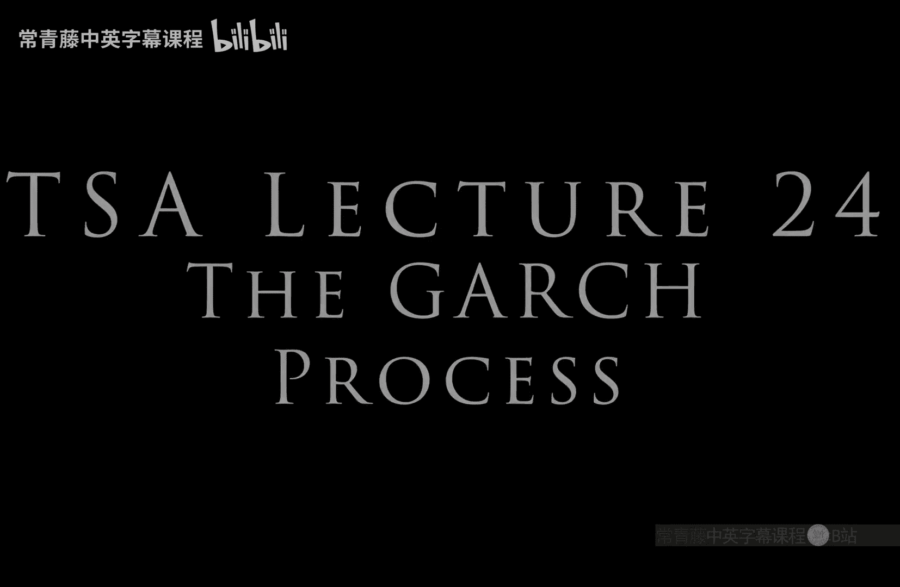
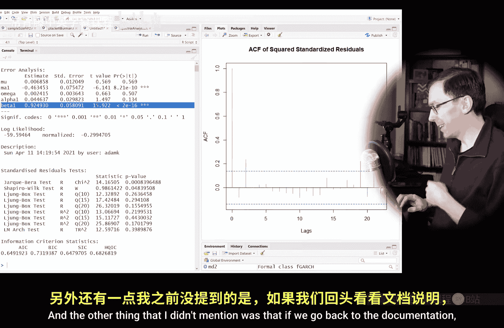

# 024：GARCH过程



在本节课中，我们将学习一个特殊的主题：GARCH模型。GARCH是“广义自回归条件异方差”的缩写。这个模型扩展了我们之前学习的自回归和ARMA模型，但这次我们将重点关注方差的变化。在本课程中，我们一直假设白噪声过程的方差是恒定的，但在现实中，时间序列的方差（或波动性）常常会随时间变化，这在金融时间序列中尤为常见。本节课将介绍如何对这种时变方差进行建模。

## 模型背景与动机

上一节我们回顾了ARMA等模型，它们主要关注序列的均值结构。本节中，我们来看看如何将注意力转向方差。

在标准的时间序列模型中，我们通常假设误差项（白噪声）的方差是恒定的，即同方差性。然而，在许多实际应用中，特别是金融领域，序列的波动性会随时间发生显著变化。例如，股票价格可能在某个时期平稳波动，而在另一个时期剧烈震荡。GARCH模型就是为了捕捉和建模这种“条件异方差性”而设计的。

## 从ARCH模型开始

为了理解GARCH，我们首先从更简单的ARCH模型入手。ARCH代表“自回归条件异方差”。

### ARCH(1)模型定义

ARCH(1)模型由两个方程定义。第一个方程描述观测到的“收益率”或“增长率”序列 \( R_t \)：

\[
R_t = \sigma_t W_t
\]

其中，\( W_t \) 是独立同分布的标准正态白噪声，即 \( W_t \sim N(0, 1) \)。关键点在于，标准差 \( \sigma_t \) 是随时间变化的。

第二个方程定义了时变方差 \( \sigma_t^2 \) 如何依赖于过去的收益率：

\[
\sigma_t^2 = \alpha_0 + \alpha_1 R_{t-1}^2
\]

这里，\( \alpha_0 > 0 \) 且 \( \alpha_1 \geq 0 \) 是模型参数。\( \alpha_0 \) 可以看作是方差的“基线”或下界。\( \alpha_1 \) 衡量了前一期收益率的平方对当前方差的影响程度。

### ARCH(1)模型的性质

以下是ARCH(1)模型的一些关键性质：

*   **条件分布**：给定过去的信息（如 \( R_{t-1} \)），\( R_t \) 的条件分布是均值为0、方差为 \( \sigma_t^2 \) 的正态分布。这正是“条件异方差”的含义——方差依赖于过去的值。
*   **无条件性质**：虽然条件方差在变化，但收益率序列 \( R_t \) 本身的无条件均值仍为0，并且序列是**不相关的**。然而，这并不意味着 \( R_t \) 是独立的，因为方差之间存在依赖关系。
*   **平方序列**：如果我们考虑平方收益率 \( R_t^2 \)，可以证明它服从一个AR(1)过程：
    \[
    R_t^2 = \alpha_0 + \alpha_1 R_{t-1}^2 + u_t
    \]
    其中 \( u_t \) 是一个均值为0的噪声项（但不再是正态分布）。这为我们分析方差动态提供了另一个视角。
*   **参数约束**：为了保证过程平稳且方差有限，需要 \( 0 \leq \alpha_1 < 1 \)。如果进一步要求 \( R_t^2 \) 的四阶矩有限（即方差有限），则需要更强的约束 \( 0 \leq \alpha_1 < 1/\sqrt{3} \)。违反此约束会导致分布的尾部比正态分布更“厚”。

## 扩展到GARCH模型

ARCH模型的一个自然扩展是GARCH模型，它在方差方程中加入了自回归项，使其更灵活、通常也更简洁。

### GARCH(1,1)模型定义

GARCH(1,1)模型是实践中最常用的形式。其方程如下：

收益率方程：
\[
R_t = \sigma_t W_t
\]

方差方程：
\[
\sigma_t^2 = \alpha_0 + \alpha_1 R_{t-1}^2 + \beta_1 \sigma_{t-1}^2
\]

与ARCH(1)相比，方差方程中多了一项 \( \beta_1 \sigma_{t-1}^2 \)。这意味着当前方差不仅受上一期收益率冲击（\( R_{t-1}^2 \)）的影响，还受上一期方差（\( \sigma_{t-1}^2 \)）本身的影响。

### 为何称为“广义”自回归？

类似于ARCH模型，GARCH模型的平方序列 \( R_t^2 \) 可以表示为一个ARMA过程。具体来说，GARCH(1,1)对应的 \( R_t^2 \) 是一个ARMA(1,1)过程。参数 \( \alpha_1 \) 扮演了“自回归”部分的角色，而参数 \( \beta_1 \) 扮演了“移动平均”部分的角色。这就是“广义自回归”中“自回归”一词的由来。

## 模型估计与应用

理论介绍完毕，接下来我们看看如何在实践中应用GARCH模型。

### 模型拟合与R语言实现

在R语言中，我们可以使用 `fGarch` 包中的 `garchFit()` 函数来拟合GARCH模型。该函数默认使用最大似然估计法。以下是基本步骤：

1.  **数据准备**：对于价格等原始序列 \( X_t \)，我们通常先计算其对数收益率作为建模对象 \( R_t \)：
    \[
    R_t = \log(X_t) - \log(X_{t-1})
    \]
    这近似于百分比收益率，并且通常能获得更稳定的序列。
2.  **模型设定与拟合**：我们可以指定均值方程和方差方程。例如，拟合一个包含AR(1)均值项和GARCH(1,1)方差项的模型：
    ```r
    # 假设 r 是对数收益率序列
    library(fGarch)
    model <- garchFit(formula = ~ arma(1,0) + garch(1,1), data = r)
    summary(model)
    ```
3.  **结果解读**：`summary()` 输出会提供参数估计值、标准误、显著性检验，以及一系列关于标准化残差的诊断检验（如Ljung-Box检验、ARCH-LM检验等），用于评估模型拟合效果。信息准则（AIC, BIC）可用于模型比较。

### 实例：COVID-19病例数据的波动性分析

我们以阿尔伯塔省的COVID-19每日新增病例数据为例。原始序列显示，病例数在不同波次期间波动性明显不同。我们对其取对数并计算一阶差分（近似增长率），然后尝试用GARCH类模型进行拟合。

通过尝试不同的模型（如纯GARCH(1,1)、AR(1)-GARCH(1,1)、MA(1)-GARCH(1,1)），并比较信息准则和残差诊断图，我们可以选择一个相对合适的模型来描述病例增长率的波动性模式。拟合好的模型可以给出条件标准差的估计序列，直观展示波动性如何随时间演变。

## 模型扩展

GARCH模型家族非常庞大，有许多变体以适应不同的数据特征：

*   **高阶模型**：可以定义ARCH(p)或GARCH(p, q)模型，让方差依赖于更多期的过去信息。
*   **集成GARCH (IGARCH)**：用于建模方差中的持久性冲击。
*   **指数GARCH (EGARCH)**：允许正面和负面冲击对波动性有不对称的影响。
*   **GARCH-M模型**：在均值方程中引入条件方差或条件标准差项，用于研究风险与收益的关系。
*   **与其他模型结合**：GARCH结构可以作为误差项，与任何描述序列均值结构的模型（如ARIMA、回归模型）结合使用，形成完整的均值-方差模型。



## 总结


本节课中我们一起学习了GARCH过程。我们从恒定方差的假设局限出发，引入了能够刻画时变波动性的ARCH模型。通过分析ARCH(1)模型的条件与无条件性质，我们理解了其核心思想。接着，我们将其推广到更强大、更简洁的GARCH(1,1)模型，并解释了其名称的由来。最后，我们介绍了如何在R语言中实现GARCH模型的拟合与诊断，并以COVID-19数据为例进行了演示。GARCH模型是金融计量经济学和时间序列分析中不可或缺的工具，它为理解和预测波动性提供了坚实的框架。