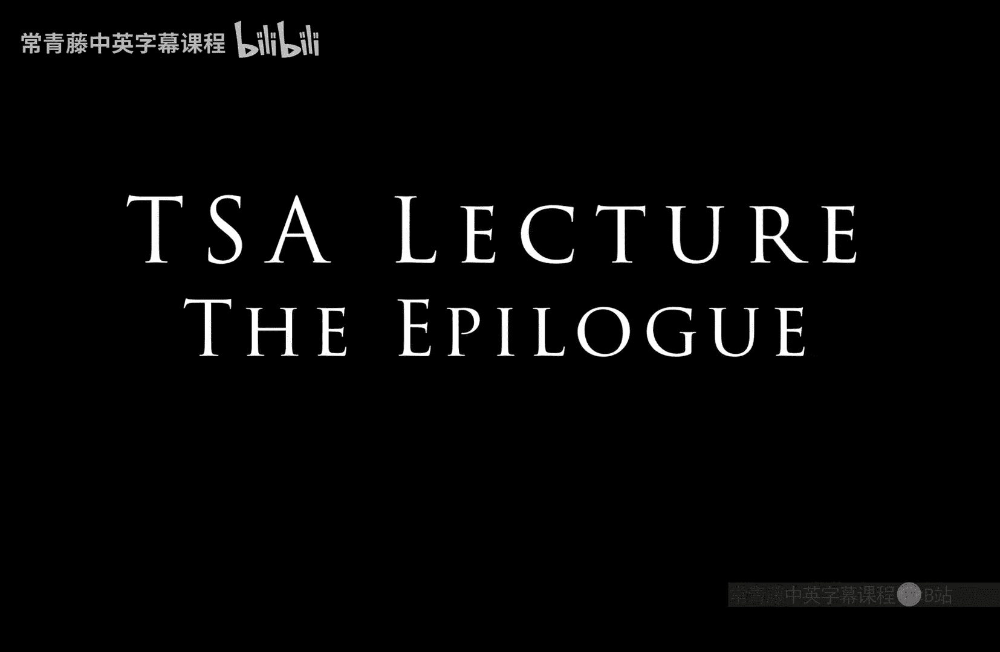
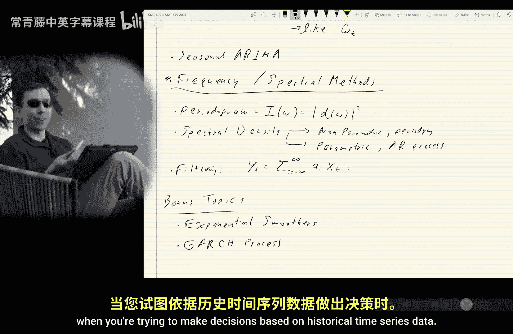
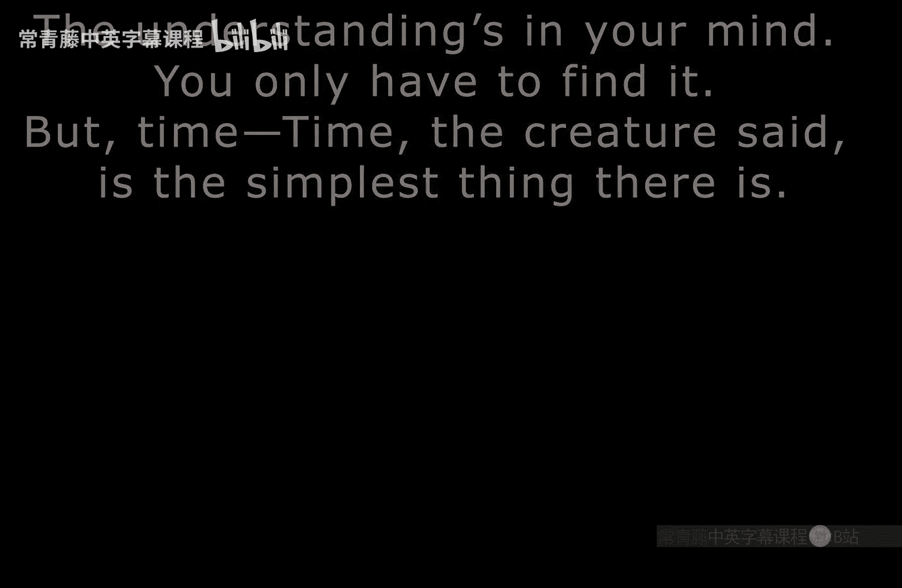

# 025：STAT479 课程总览

在本节课中，我们将对 STAT479 时间序列分析课程的全部内容进行一次全面的回顾。我们将从课程起点开始，梳理我们学习过的所有核心概念、模型和方法，并总结它们之间的联系。

## 课程概述与起点

欢迎来到 STAT479 时间序列分析的最后一讲。祝贺大家完成了这门课程。今天我们将进行课程回顾，总结我们从哪里开始，以及经过超过30小时的讲座视频后，我们最终到达了何处。

时间序列是统计学中一个非常精妙的领域。它融合了许多不同的内容。一方面，它有点像回归分析，但回归分析假设所有观测值相互独立，而时间序列则明确知道观测值之间存在时间相关性，我们必须处理这些相关性。另一方面，我们试图拟合模型来观察数据，但很多时候，我们的模型只是在尝试对过程的“噪声”进行建模。对于一个平稳过程，平稳的噪声过程很像纯粹的噪声，它是一系列随时间的随机波动，遵循某种平稳分布。然而，根据平稳过程的行为，我们可以了解很多关于时间序列的信息，包括如何理解、估计、建模和预测它，这些都是关键部分。

我们是从观察不同类型的“噪声”开始这门课程的。那时，我们介绍了白噪声、自回归过程和移动平均过程。我们最终得到了白噪声、AR过程和MA过程，这些在课程一开始就介绍了，后来你会发现，这基本上就是我们整个课程要讨论的核心，因为它们是三个主要的构建模块。

我们在课程开始时引入的另一个主要概念是自协方差函数。自协方差是本课程的关键部分，因为课程中几乎所有内容都源于自协方差函数。无论是绘制ACF图、估计模型参数，还是估计谱密度，都离不开自协方差。

我们还讨论了互协方差和平稳性的概念。在实践中，我们经常有两个时间序列，因此可能对互协方差感兴趣，即两个序列如何相互关联或相关。我们花了大量时间讨论平稳性。

平稳性是本课程的另一个关键点，因为我们需要它来进行统计分析。只有当我们要估计的对象不随时间变化时，我们才能进行统计。如果均值随时间变化，我们就无法计算样本均值。自协方差也是如此，我们只能从数据中估计自协方差或查看ACF图，前提是我们的过程是平稳的。因为最终为了估计这些量，我们需要进行某种平均，而只有当我们试图估计的量在不同时间点上保持不变时，跨时间点平均才有意义。

## 第一章：基础估计与检验

在第一章中，我们讨论了均值估计、方差估计和自协方差估计。我们还研究了ACF图和白噪声检测。在实践中，我们无法先验地知道噪声是白噪声，还是来自某个移动平均过程或AR模型。从本课程中可能学到的一点是，如果你绘制出一个平稳过程，它可能看起来就像一堆静态噪声，但其中可能隐藏着有趣的特征，也可能没有。如果是白噪声，从某种意义上说，它就不那么有趣，因为它已经尽可能地随机了。

## 第二章：统计模型与平滑

在第二章中，我们开始研究时间序列的统计模型。我们首先看的是线性回归。正如之前提到的，尝试用线性回归来拟合数据中的线性趋势是可以的，但必须意识到，最小二乘估计器并非为处理相关观测值而设计。这里的关键点是，最小二乘法假设观测值不相关。因此，在处理时间序列数据应用线性回归时，必须记住这一点。你可能会得到与尝试用带漂移项的时间序列模型拟合相同的结果，但在线性模型中，我们假设误差或观测值之间不相关，而这在有自回归或移动平均过程的情况下显然不成立。

第二章中还有一个额外的部分，即平滑的概念。平滑是一个很好的工具，但它更像是一个定性主题，因为没有绝对“正确”的平滑方法或平滑量。它更像是一种可以用来发现时间序列数据中趋势的技术。使用平滑时需要小心，因为你通常不希望平滑数据后再进行统计分析，因为这会改变数据的概率特性。平滑更像是在最后阶段，你可以观察平滑后的结果，看看趋势是上升还是下降。它是一个非常有用的工具，我们讨论了许多不同的方法，如局部加权散点图平滑法、三次样条、核平滑器，以及简单的移动平均平滑器，后者使用移动平均过程来过滤时间序列。

平滑以这种方式起作用，正如我们在谱分析部分提到的，它就像一个低通滤波器，去除了数据中的高频或快速波动，只留下平滑的低频趋势。

## 第三章：ARIMA模型

之后，我们开始讨论ARIMA模型，这是我们课程大部分时间讨论的内容。ARIMA模型，即自回归积分移动平均模型。在这一部分，我们讨论了自回归部分、移动平均部分，并将它们组合起来引入了ARIMA模型，讨论了其各个方面。一个需要记住的关键点是，可能有不止一个模型可以拟合你的数据。因为最终你需要担心参数冗余、因果性或非因果性、可逆性或不可逆性等问题。我们发现，在随机意义上，可能存在不同类型但行为完全相同、无法区分的时间序列过程。因此，在使用这些模型时，我们必须非常小心，这就是为什么我们通常强制实施因果性和可逆性等概念。我们还希望确保AR部分和MA部分没有公因子，因为如果有公因子，在查看特征多项式时会导致问题。

在这一部分，我们还讨论了平稳性检验和自相关检验。本课程中我们感兴趣的主要问题包括：我的数据是平稳的吗？或者我的数据是不相关的吗？对于数据不相关的问题，我们回顾了Box-Pierce和Ljung-Box检验，它们都用于检验数据中是否存在显著的自相关。我们还研究了Durbin-Watson检验和Breusch-Godfrey检验，这些检验用于查看线性模型的残差。许多这些工具不仅适用于时间序列，也适用于一般的线性模型，这就是为什么你可以在R的`lmtest`包中找到它们，因为你是在检验线性模型的残差，想知道残差是否看起来不相关。如果残差看起来相关，那么可能需要做更多工作来找出这些相关性的来源或如何建模这些相关性。

我们还讨论了平稳性检验，本课程主要讨论的是增广迪基-富勒检验。它是众多所谓“单位根检验”中的一种。我们之前讨论过，如果我们有非平稳数据或非平稳ARMA过程，那么自回归多项式的根会落在复平面的单位圆上，这将给我们一个非平稳过程。因此，当你进行单位根检验时，你的零假设是认为根在单位圆上，备择假设是根不在单位圆上。所以零假设是数据非平稳，备择假设是数据平稳，即所有根都离单位圆足够远，我们可以安全地声称拥有一个平稳时间序列过程。这有点令人困惑，因为人们总倾向于认为零假设是平稳性，但实际上是非平稳性，这是在自己数据上运行此类检验时需要记住的一点。

还有Phillips-Perron检验，这是另一种基本做相同事情、检验平稳性的方法，类似于增广迪基-富勒检验。Phillips-Perron检验使用略有不同的方式计算检验统计量，但基本思想相同，都是问：我的特征多项式是否至少有一个根在单位圆上？如果没有，我们就拒绝零假设，并声称我们有一个平稳过程。

另一个需要记住的是，在进行这些检验时，必须注意涉及的参数，如自由度、滞后阶数等。能够检验这些不同方面总是好的，因为可能在一个设定下看不到显著结果，但调整检验中的一些参数后，就可能发现显著结果。

我们还讨论了ACF和PACF，因为它们是时间序列中非常有用的工具，可以直观地理解数据发生了什么。ACF就是自相关函数，它是对称的，具有许多良好的数学性质。绘制数据的ACF图也很有趣，它可以告诉我们很多关于显著自相关的信息，这些显著自相关至少能提示我们数据中可能存在自回归或移动平均过程，或两者兼有。我们还可以使用互补工具——偏自相关函数来分析数据。偏自相关考察的是偏相关的概念，并将其扩展到自相关。偏相关基本上是说，在给定另一个变量的条件下，两个变量不相关。我的标准例子是房屋价格和汽车价格，它们可能相关，但如果在考虑个人收入后，它们可能就不相关了。如果有人更有钱，他可能在房子和汽车上都花更多钱，反之亦然。因此，在这种情况下，以个人收入为条件，汽车和房屋价格可能看起来彼此不相关。偏自相关函数基本上是说，如果我有一个时间序列数据，我想知道某些时间点在给定所有中间点的情况下是否相关。这为我们提供了一种查看时间序列数据中相关性的新方法。

我们发现了一个很好的小图表，基本上说明了类似这样的内容：对于AR过程，ACF呈几何衰减，而PACF在滞后p阶后消失。当然，对于数据来说，它永远不会精确为零，我们仍然会在零附近有一些噪声或小的波动，但从数学上讲，在滞后p阶后它等于零。对于移动平均过程，我们看到相反的情况：ACF在滞后q阶后消失，而PACF呈几何衰减。因此，这两个工具对于真正理解给定时间序列数据集的情况非常有用。再次强调，需要是平稳的才能查看这些图。如果你的时间序列不平稳，你就无法正确进行这种估计，你可能会在ACF和PACF中看到到处都是极大的峰值。从某种意义上说，你可以用它来确定是否拥有非平稳时间序列，因为对于非平稳序列，你通常会看到到处都是巨大的相关性，通常是巨大的正相关性。

## 第四章：估计与预测

接下来我们在本课程中讨论的大事是估计和预测，这是处理时间序列时想要做的两件大事。我们有时序数据，当然可以观察并试图理清发生了什么，但最终我们想要估计模型的参数，并且我们想要进行预测，因为几乎可以肯定，如果你在观察某物随时间演变，你不仅关心它从哪里开始、如何到达这里，还关心它未来会走向何方。我几乎无法想象任何时间序列场景下你会对预测不感兴趣，无论是金融（我想知道我的投资是否会赚钱）、环境（我们几年后是否会生活在沙漠中，而不是这个宜人的埃德蒙顿？），还是COVID病例（我是否需要继续待在后院的房子里躲避所有人，或者一切都会好转？）。每当我们观察随时间变化的事物时，我们都想进行预测，而在尝试进行预测时会出现一些有趣的复杂性。

我们在这一部分研究了对AR过程的预测，然后更一般地对ARMA过程以及季节性模型进行了预测。回想一下，对于AR过程，我们有我们的朋友——尤尔-沃克方程。一般来说，AR过程的估计和预测是时间序列中最简单的设置，因为尤尔-沃克方程非常好用，易于计算，你可以手动完成，就像你在一次作业中必须做的那样。你可以估计参数，可以使用AIC等信息准则来确定模型中应包含多少项，最终你可以进行预测。关于AR过程预测的一个好处是，对于预测，我们只需要前p个观测值，假设我们正在处理一个AR(p)过程。当然，我们仍然需要整个数据集，因为我们将使用整个数据集来估计模型参数φ1到φp，所以更多的数据仍然有好处。但好处是，我们不必使用整个数据集来尝试估计或预测未来的时间点，这使得运行起来非常容易。

这与对ARMA过程做同样的事情形成对比。因为如果我们有一个具有非平凡移动平均分量的ARMA过程，我们就无法使用尤尔-沃克方程这种好用的设置，而是最终使用最大似然估计。同样，我们有两种不同的方法：条件最大似然和非条件最大似然。区别在于，当你使用条件方法时，你会得到一个漂亮的线性方程组；如果不使用条件方法，你会得到一个非线性系统。如今计算机可以处理非线性系统，但在过去，你真的希望一切都是线性方程组，因为如果是线性的，你可以快速求解；如果是非线性的，你就会陷入困境。如今，非线性问题对计算机来说仍然很难，但可以做到，而且经常被做到，比如在R中拟合ARMA或ARIMA模型的包中。

另一个问题是预测。因为预测现在需要所有数据。当我们试图处理这些移动平均部分时，我们需要数据在某种意义上追溯到尽可能远。我们曾有一个有点滑稽的设定，即想象我们拥有无限的数据，这在数学上非常好，但在实践中行不通。不过至少在数学上，我们可以考虑拥有无限的数据，数据追溯到无限的过去，然后我们可以考虑基于此进行建模。在实践中我们没有无限数据，这导致了几种我们可以用于预测的方法。

我们有Durbin-Levinson算法。这基本上是如何使用我们的自协方差矩阵来求解方程组。它在数值线性代数以及数值ODE等领域也有应用，时间序列中也是如此。我们还研究了创新算法。关于创新算法的关键一点是，这些基本上是一步超前预测的残差，它们的行为很像白噪声。所以它们有点像白噪声的估计。解释它的最佳方式是，如果我们观察我们认为的第t个观测值与实际看到的第t个观测值之间的差异，剩下的就是残差，它很像白噪声过程。其思想是，如果我们试图估计这些对象，相对于这些创新（即残差）进行预测，在某些情况下通常比尝试Durbin-Levinson等方法更容易。同样，这两种方法在方程表达上都非常复杂和繁琐。

## 第五章：季节性模型与谱方法

我们还有季节性ARIMA或SARIMA模型。从某种意义上说，季节性模型并没有真正太新的东西，它实际上只是说我们有另一个AR和/或MA部分，可能还有一个季节性差分，我们只每隔一定时间点应用它。这在数据中非常常见，因为通常你观察的数据具有某种周期性，无论是温度的年度周期、金融的季度周期，还是五月份这里日照的每日周期。你的时间序列中经常有这些周期性行为，寻找季节性模型很重要，但最终季节性模型与非季节性模型并没有本质上的深刻不同。不过拟合它们确实需要一些努力，你必须考虑什么是合理的周期。你可以像`auto.arima`函数那样从数据中尝试估计它，或者你可以根据问题的背景尝试做出有根据的猜测。如果你有每日观测值，每周周期很常见；如果你有月度数据，每年12个月可能有一个周期。在尝试查看真实数据、真实时间序列数据时，总是需要注意这些事情。

之后，我们进入了频域，事情变得更有趣了。在频域中，我们可以做很多以前尝试做的事情，但我们可以从频率的角度而不是时间的角度来做。我们主要研究的是周期图。记住，周期图是离散傅里叶变换应用于我们时间序列后的平方幅度。离散傅里叶变换就像本课程中的许多东西一样，只是一个巨大的线性方程组，你通常不想直接求解。所以你做什么？你使用快速傅里叶变换。在频率设置中，我们试图弄清楚的关键是周期图。原因之一是它会告诉我们时间序列数据中存在的不同频率的强度，我们可以用它来寻找周期性行为。我们非常简要地讨论了周期过程，这是一种与我们在本课程中花费大量时间研究的ARMA过程略有不同的平稳随机过程。这些过程具有非常强的频率，我们可能试图通过周期图来检测。

但周期图也是估计谱密度的一种方式。谱密度是另一个关键点，以至于我们花了三讲不同的课来讨论估计谱密度的不同方法。有一种非参数方法，它基于周期图。还有一种参数方法，它基于AR过程。同样，有两种不同的方法来估计谱密度。我们可以直接计算周期图并使用它，但这通常不是好的方法。我们可以做的是尝试不同的技术来改进我们的估计，比如分组、Bartlett方法（将数据分成几块，对每块拟合周期图，然后平均周期图）。记住，我们假设有一个平稳过程，所以数据前半部分的周期图应该与后半部分的周期图相同。这是平稳性成为贯穿整个课程关键主题的另一个原因，如果我们要使用任何这些技术，我们确实需要一个平稳过程。

你可以尝试将多个周期图平均在一起，可以使用分组（即将多个频率平均在一起），可以使用平滑（即使用Daniel核方法），这只是应用不同类型权重的另一种方式，是一种更广义的分组方式，以尽可能平滑周期图作为谱密度的非参数估计量。

你也可以采用参数方法，这是人们也喜欢使用的一种。我不是一个应用型的、处理大量时间序列数据的工程师类人物，所以我不知道不同领域（金融数据、信号处理、环境数据）的人们在实践中喜欢使用什么，他们可能有自己的偏好。但我能说的是，有不同的方法，有些人喜欢基于AR过程的非参数方法，有些人喜欢参数方法。在那种情况下，你只需将AR过程拟合到你的数据，R中的函数可能使用尤尔-沃克方程，我认为它只是使用AR函数拟合那些参数，使用AIC，然后直接从该过程计算谱密度，因为正如我们之前讨论的，我们可以过滤时间序列，并确定这将如何影响谱密度。

过滤的概念。如果我们有一些Y_t，它等于从负无穷到正无穷对a_i * X_{t-i}的求和，现在我们有了基于某些系数a的时间序列X的过滤版本。我们发现，对于这种过滤将如何影响谱密度，有一个简单的公式。如果我们有白噪声，谱密度是常数，每个频率都与其他频率同等表示。但我们可以使用白噪声转变为自回归和移动平均以及更一般的ARMA过程的方式来过滤它。如果我们这样做，那么我们可以快速找出一般ARMA过程的谱密度，正如我们在谱方法的一讲中所做的那样。

最终，所有这些谱方法实际上只是为我们提供了一种不同的方式来查看时间序列数据，通过查看频谱（即周期图或谱密度的某种估计），我们可以了解时间序列数据中哪些频率最突出，这又会给我们一些关于如何思考这些数据的思路。它可以为拟合季节性模型找到有用的周期，也可以发现与白噪声的偏差，因为如果我们有一个白噪声过程，我们应该看到一个平坦的周期图或谱密度；如果我们没有看到，我们就有一个相当强的迹象表明我们没有白噪声。

## 第六章：扩展主题与总结

课程最后还有一些扩展主题，它们本身也相当精妙。我们有指数平滑的概念，它为我们提供了另一种拟合时间序列模型和进行预测等工作的工具。这是一种与我们之前所做的略有不同的方法，但我们确实看到它与ARMA过程密切相关。我们还研究了GARCH过程。到目前为止，在本课程的所有其他部分，我们假设背后有白噪声驱动一切，总是有白噪声，并且白噪声具有恒定方差。这在实践中不一定发生，事实上，方差通常会随时间变化。GARCH过程试图考虑到这一点，这是金融人士喜欢它的原因之一，因为波动性（无论你持有股票还是债券）就像随机游走一样，没有太多可做的，但你仍然可以对波动性建模：我们是在小幅上下波动，还是在大幅上下波动？这在尝试基于历史时间序列数据做出决策时会产生很大差异。

以上就是对本课程所做内容的回顾。这是一个非常大的主题，时间序列是这样一个领域，有大量的研究投入其中，因为每当你在统计学中提出一个有趣的东西时，你几乎可以通过说“如果我们加上时间维度，然后在时间上再做一遍会怎样？”来把它变成另一个完整的研究计划或博士论文。这基本上就是时间序列，但事情在涉及时间相关性时变得相当复杂。经典统计学中有太多内容基于不相关的独立数据，而时间序列为我们提供了一些工具，用于思考当数据可能存在相关性时的情况。是的，整个课程基本上就是ARIMA模型和自相关，我们所做的一切中大约90%就是这两件事，但其中涉及如此多的细微之处：如何与之合作、如何估计、如何建模、如何思考、如何处理真实数据。这是一个非常有趣的探索性主题，我希望你在这门课程中学到了很多，希望你能走出去，尝试自己处理更多时间序列。也许有人会付钱让你去为某个公司做时间序列分析，因为时间序列数据无处不在，知道如何处理它非常有用。

再次感谢大家参加所有这些讲座。如果你没有参加所有讲座，请回去看讲座，然后再回到这里，我会感谢你参加了所有讲座。对着我的相机讲话，想象着一大群明亮、快乐的面孔一直对我微笑，这绝对是一种体验。希望你在电脑前盯着屏幕时就是这样做的。如果没有，嗯，我实际上没有任何数据表明情况相反，所以我对自己的感觉相当好。无论如何，再次感谢，祝你在未来查看所有这些数据以及在实际世界中使用所学知识时好运。