# 【Algorithms Lab】计算几何 ｜ Computational Geometry p01 P01_凸包算法 -BV1Jtn7zSEXD_p1-

The topic of this first lecture is conxha。Let's start with an example of an application where we may need a convexol。

 let's say that you work with a group of biologists who study certain animals， for example。

 black rhinos and these biologists would like to know the area of habitat of these animals。

And the extension of this habitat。To the first approximation。

 this habitat can be described with the convetxhu of all the locations where black rhinos were observed。

For example， on the left hand side， you can see that they have been spotted all over Africa and the shaded region is the smallest convictx area that covers all those locations so as an algorithm developer。

 you may suggest to your colleagues to use the convictxhu of all these sightings as an approximation for the area of the habitat。

So now let's formally introduce the notion of convexity and of the convexhu。We say that a shape。

 a geometric shape is convex if for any two points in it。

 the line segment connecting those two points completely lies in this shape let's do a quick test of understanding please think about the following geometric object and answer the following question。

Which of these objects are convex and which are not。 So take a moment。

 think about it and fill out the answers。 Okay， so now we are ready to define a convex hall for any region in the plane or for any subset of the plane。

 It convex hall is defined as the smallest convex set that contains that subset。

 so here on the bottom you have three examples。The bottom left is depicting the convictxhu of a set of points。

In the middle， a chain of segments and on the right it convictshull of a simple polygon。

In all these cases， you can see that cons how is indeed the smallest conx set that contains completely contains the given region or a set of points。

Another analogy that sometimes is convenient to use or to visualize what a conx hall is。

As imagine that a set of points given in the plane is a set of nails that you nail in a wooden plank。

And now we surround all these nails with the rubber band and release the rubber band。

 So the shape that this rubber band will take while it's retracting is the smallest conx set and is the conx how。

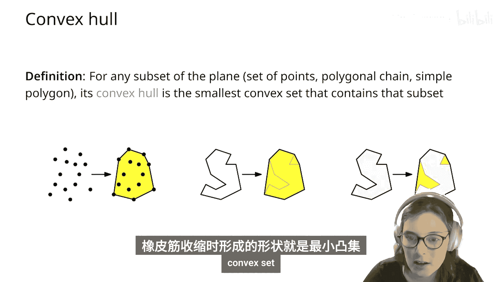

Now that we have defined what a convex all is， we can formulate the conxile problem。

 the problem is asking us to give an algorithm that computes the convex all of a given set of end points。

And we want to compute it as fast as possible。 So in the following few videos。

 we will discuss these problems and multiple different solutions to this problem。First。

 let's discuss what we can expect from an algorithm solving this problem。

 so we know that the input has end points and is represented with two end coordinates。

 so the input has linear size。So what can we say then about the output to this problem？

If we assume that the input end points are distinct and it is a safe assumption to make。

 then we can say that the output will have at least two points if all the points somehow fall on one line。

 then the convex how will be described by two end points， right。And at most。

 the output can have end points if all end points lie in the conx position。Okay。

 so then what it means。Is that the output of the economic cell problem requires between a constant and a linear size space to describe the solution。

Okay， so let's think about the following question。Can we hope。

To design an algorithm that will compute a convex hall of end points。It'sFaster than in linear time。

 in the worst case。So， let's。Take a second to think about this question。Okay。

 to answer this question， we should。Think about the representation of the output。

 What is the connects， how it is a set， and how can we represent it。Well。

 the figure on the right hand side gives us intuition that the conxhull will be a simple polygon。

 and thus we can represent it as a sequence of vertices。

 We have already said that in the worst case scenario， all endpoint can lie on the conxhull。

 So the polygon representing the conxhull will require linear space to be described。And thus。

 if we are relying on an algorithm， that will。Report the conile to us。

 It will have to spend at least linear time to report the solution。

So the output is a convicx polygon， it should be returned as a sorted sequence of points along the boundary。

 and the usual convention is that we are going to return them in a contraclockwise water along the boundary okay now that we know that the linear time is the minimum that the algorithm can take canway actually hope to find one。

The answer to this question is not that straightforward and we will discuss it in the first session。

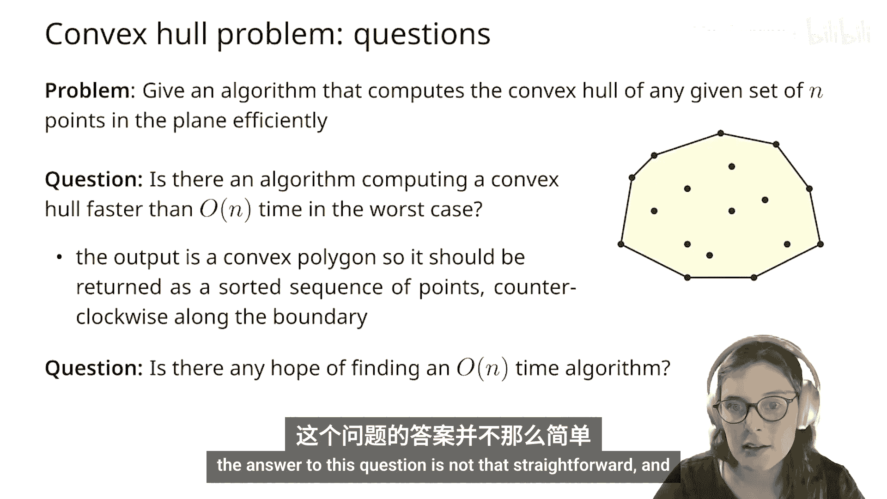

Before we get to designing the algorithms for the economic health problem， let's discuss。

What steps we need to take to develop an algorithm in general？

When you are given a new geometric problem to design an algorithm for。

 we suggest that you start by drawing many different sketches to gain insight into the problem。

 make various observations。Find useful properties based on which you can develop the algorithm。

 So let's see an example of how this process would work。So for the convex whole algorithm。

 we want to draw a lot of sketches， gain insight， make observations。

 and find properties that will be useful when we will be developing algorithms。So what can we say。

After drawing many sketches of convex house， what properties a convex hall may have。Well， firstly。

 we have already mentioned this， but let's repeat this and state it as a property that iconconshu of a set of points。

Will always be described by a subset of points， and the edges of the convexhull will be the segments connecting a pair of points lying on the convexhull。

Finally， if we draw a line containing an edge of a conxhu in the example。

 this is the line going through two points P and Q lying on the conxhu。

 we can make an observation that all the remaining points lie to the left of this line。

 if the direction of the line points in the counter clockwise direction around the boundary of the conxhu。

So we are going to formulate this as a property， the supporting line of any conile edge has all input points to one side。

And now making these observations and stating them as properties will allow us to suggest。

Several different algorithms to find convex house。

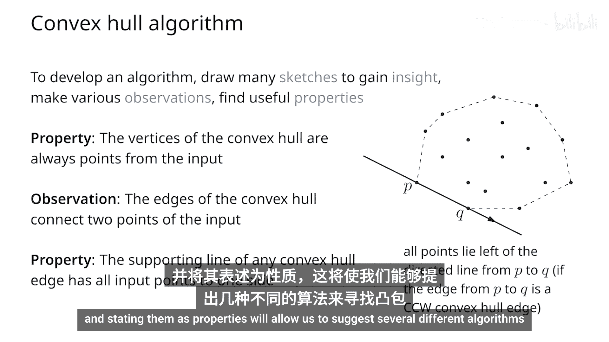

As a first approach， let's start with a very simple and straightforward algorithm that uses the last property that we have formulated。

Had to find all the edges that are the edges of the convex hole。

 So what the following algorithm does。It considers all ordered pairs of points， P and Q。

 it considers a directed line。Going through PN Q and checks if the remaining points lie strictly to the right of the directed line。

If no such point exists， then the algorithm recognizes that the edgepQ is indeed an edge of a convexhu and it adds it to a set E as the last step。

 the algorithm will take all the edges from the set E。

 sort them and output the edges of the convexhu in an order Conclockwise around the point。Okay。

 as the first step， this is a simple algorithm that will produce a desired context hole。

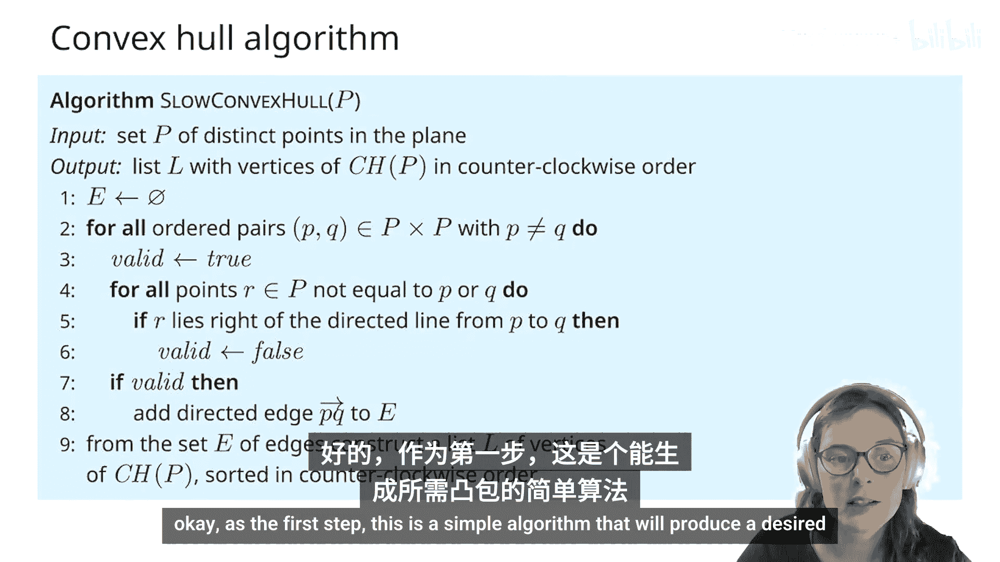

But I want to suggest that you think about the following questions and I will leave this as an exercise before our meeting and Monday。

First question is about handling thegenricies。 What happens in line 5 if the point R lies on the line going through P and Q。

 How does the algorithm handle it and does it handle it correctly。

Question number two is what is the running time of the algorithm？Finally。

 the last question is this algorithm robust against rounding errors and note that robustness in geometry is a huge issue that we will be talking later in the course about when we will be talking about engineering algorithms。

Let's consider another approach and hopefully come up with a faster algorithm than our first attempt。

 We are going to construct the convicxhu incrementally by inserting points one by one from left to right。

We first will compute the upper boundary of the economicshull and then the lower boundary of the economicxhu in this way。

 the points on the upper boundary of the economicxhull will appear in the order consistent with the x coordinates。

So the main idea will be to first sort all the points。On their x coordinates from left to right。

And then insert these points in this order one by one and maintain the upperhu for all the points that have been inserted。

We recommend to start withdraw drawing a lot of sketches， considering many different examples。

 making observations， so this will be a good step towards designing an algorithm。

So the first observation that we can make is when we consider the upperhu of a set of points going from left to right。

 every three consecutive of points on the conshu are making only right turns。

So we are going to use this property to suggest the following algorithm。

 we're going to start with inserting the first two points in our current convictx hall。

We will consider the third point。 and if the third point with the first two is making a right turn。

 we're going to keep the three points in the current convicx hall。 So far on the first three points。

 we have a correct upperhu。After we insert the fourth point。

 we observe that the last three points are making a less turn。 In this case。

 we want to remove the third point from the chain。We are left with only three points in the chain that are making a right turn。

 So so far for the first four points。We have a correct upper。

We are going to consider the fifth point。 again， the last three points on our chain are making a left turn。

 So we are going remove the one。 but last point from this chain。And again。

 were ending up with the last three points making a right turn。

 So then we are moving on to inserting the next point and the next point。 and so far。

 our chain is making right turn。 So it is a proper upperhu of the first several points。Finally。

 when we are adding the eighth point， we see that we are making a left turn。 Now。

 we need to remove the one， but last point from the chain。

 We are still making a left point in the last three points on the chain。

 So we are going repeat removing the points from the chain as long as the last three points are making a left turn。

So now we are left with the upper hole chain that is only making right turns。

 And after adding two more points to it。We are done constructing the opera hall。

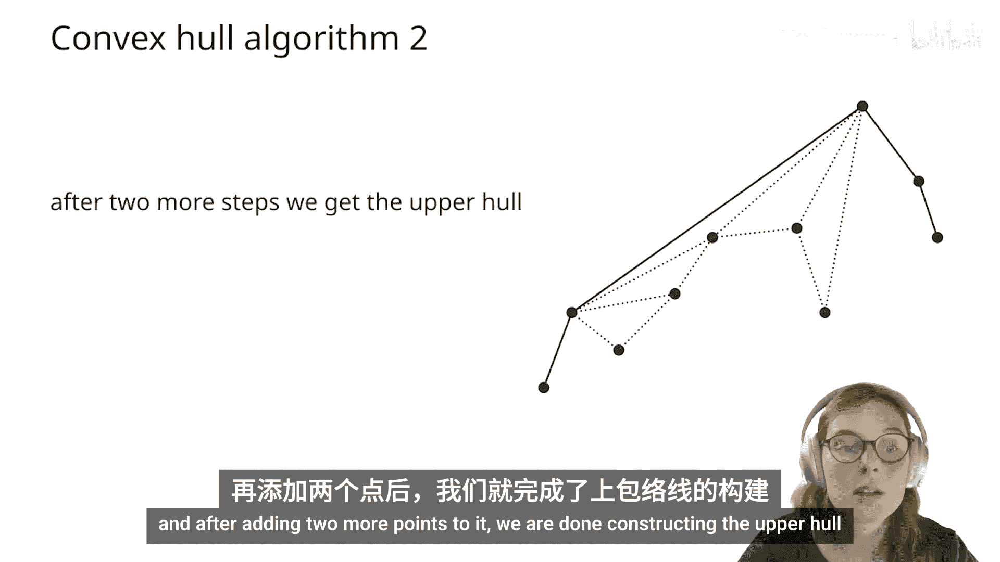

So we are going to write down this idea of the algorithm in the following pseudocode。

We start in the line 1 by sorting all the points by their x coordinate。

We're going to put the first two points in a list L upper that will maintain the upper hole for the first eye points。

And then in the for loop from the third point to the end point。

 we will append the point pi to the list L upper and while the last three points of L upper make a left turn。

 we are going to remove the second point from the end。At the end。

 this algorithm will produce a correct。Upperhu of a set of points。

 So now that we have computed the upperhu of a set of points， we can repeat the same for the lowerhu。

 And then we will concatenate these two chains。

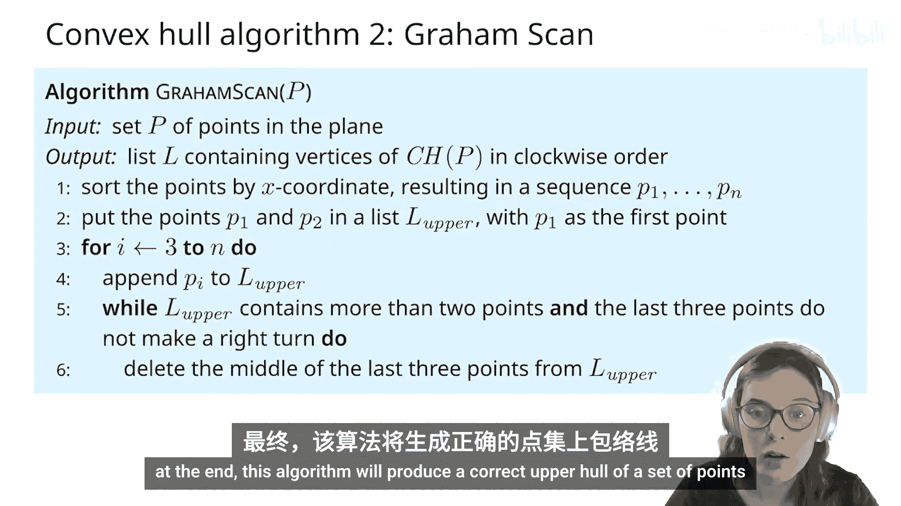

Making sure that we don't have duplicate points in them。

When we are proing the correctness of an algorithm。

 we want to make sure that the observations we have made and the properties that we used to build our algorithm are correct。

And secondly， we want to make sure that the algorithm handles those degenerate cases correctly。

For example， in the case of the conshull problem， degenerate cases may come in the form of three linear points or maybe two points with the same x coordinate。

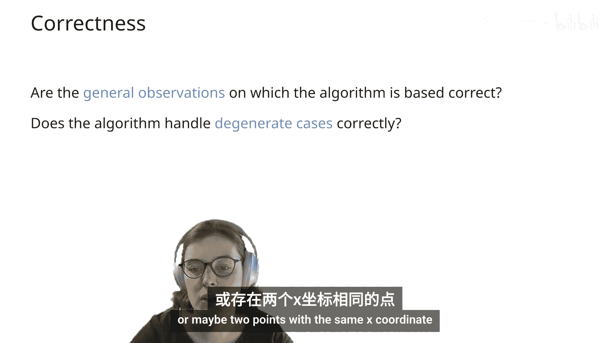

And indeed， for the conxhu algorithm that we have just developed。

 we want to make sure that if we have two points with the same x coordinate。

 the algorithm will behave correctly， either we can prove that no matter in which order we process the points。

 the algorithm will behave correctly。Or if we notice that it may not exactly behave correctly in the way that we have designed it that we need to modify it and fix it。

And secondly， how are we dealing with three or more clean points if they lie on the conxhu。

 Do we want to include knit points of the edges of the conhu into the list that we output or not。

 this depends， of course， on the application and depending on the answer we may want。

To adjust the algorithm， accordingly。And the second step is to analyze the efficiency of the algorithm。

To do that， we simply identify for each line of the sort code how much time it takes to execute it and how many times it gets executed overall。

Recall that for constant number of constant size objects。

 any operations on them we assume to take constant time and we do not worry about the constant values themselves。

To answer the question of how many times each line gets executed。

 we will consider the loop structure and figure out how many times each line of code gets executed。

Sometimes， a naive。Bound on how many times each line gets executed will be too loose。

 and to get a tighter analysis of the running time of the algorithm。

 we will need to use some global arguments。

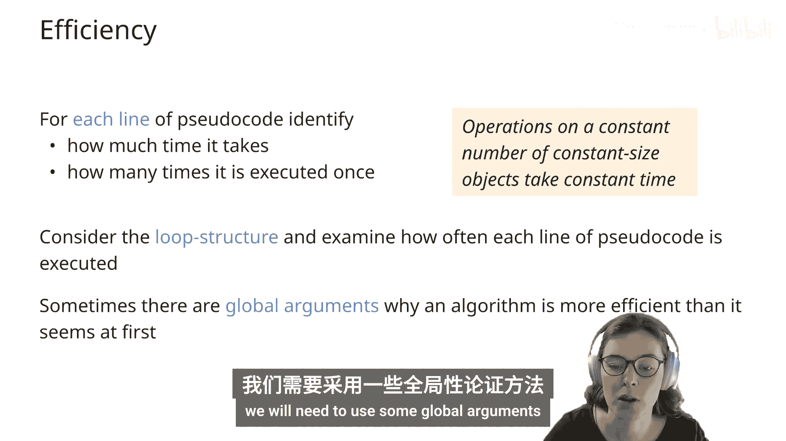

So， let's analyze。The running time of the grams can algorithm that we have just developed。

Line 1 sorts the set of points B by their x coordinates， and thus takes。Big of and Lagenine。

Line two takes a constant time because it's an operation on a constant number of constant size geometric objects。

Line 4 and line 6， both as well， take constant time to execute。

And now we have the outer for loop that gets executed n minus2 times。

And the inner while loop that we don't know how many times it executes each time。

 but let's just denote it as。Parameter， K I。So now we can put all these together。

 sum them up and obtain the total running time of the Gm scan algorithm We can simplify the expression that we get to this format。

Big of and log n is the first term， and the second term is the sum。From3 to n of big off1 plus K I。

So， now， we want to argue。What values K I may take and obtain the final expression for the running time。

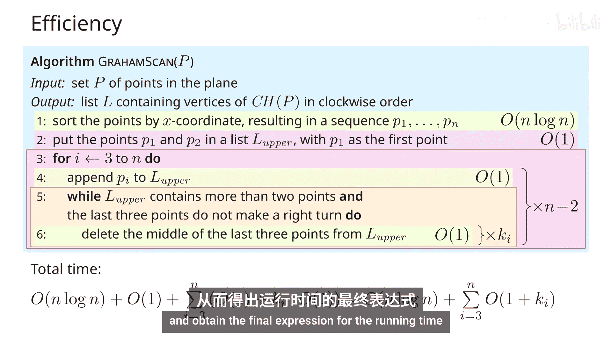

As a first attempt， we can simply say that K I will be bounded by n from above。

 So K I may be at most a linear function。 That is because K I is the number of points that gets removed from the chain。

And there cannot be more than end points removed from the chain， right。

 So then if we bound each K I by a linear function。

 we get the total running time big O of at squared。

The question now is this analysis tight and it does not feel this way because bounding each KI by a linear function feels a bit like a loose bound。

So let's try again and use some。Observations and some global arguments why the running time of the of the algorithm is actually smaller。

So let's recall what happens within one iteration of the outer loop。 Here。

 I have an intermediate state of the execution of the algorithm of the example that we considered earlier。

We have just added one more point to the chain， and now we will remove all the points that make the last three points make a left turn。

And now what we are claiming is that for the first few points。

 this is the correct upper boundary of the convexhull。

 That is all the points to the left of this red line。

 Our processed will never be added to the chain again and thus will never be removed from this chain again。

😔，So the global argument that we will use is that each point can be removed from this chain only once。

And this gives us an upper bound of n and the total sum of all K Is。So now， instead of bonding each。

K I separately by n from above。 We can bound the total sum of them by n from above。And we will get。

 as a result， the total running time of big oaf and lugget。

So now let me summarize our intermediate result as the conxhu of a set of points in the plane can be computed in big of and log and time。

 and I will also add this is the worst case optimal we have not discussed why this is the worst case optimal。

 but let's discuss it on Monday in our meeting。Of course， the question that we always ask。

 can we do better。Can we， for example， find an algorithm that takes big of n times H time if the conx how has H vertices。

Note that if H is rather small， this could be a faster algorithm。 And even further。

 can we design an algorithm， Maybe that takes big of analog log age time。

And the answer to both of these questions is yes we can and we will discuss this in the following。

 we're going to design an output sensitive algorithm whose running time will depend on the size of the output in our case it will depend on the number of vertices that will lie on the convexhull So the idea that we're going to use here is we're going to find the first point that definitely lies on the convexhull and then we're going to try to wrap around the remaining point while building the conxhull。

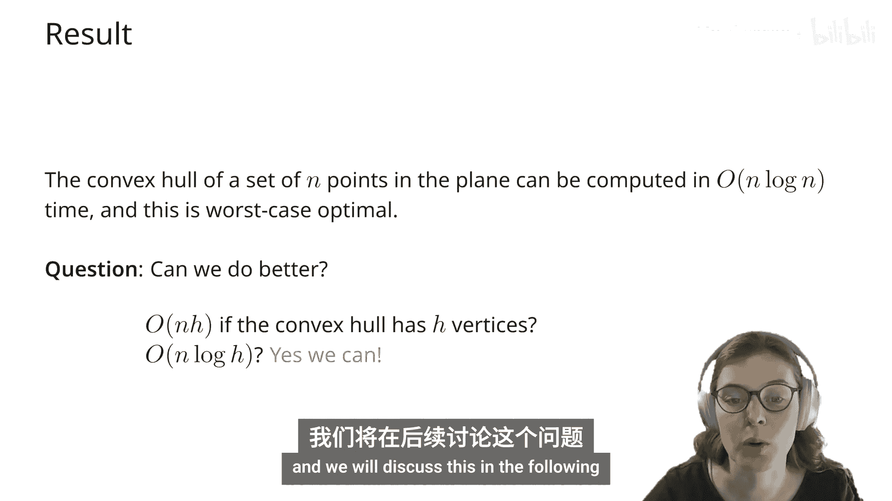

So let me propose the following pseudo code and in the right bottom corner。

 I'm going to illustrate this with a small example。

So first we start with the virtual point somewhere at infinity p0。

And we find the rightmost point P1 from the input set P。

 And we insert P1 into the list L representing the output of the algorithm。

Next we will execute the while loop that does the following for the next point pi plus1。

 we want to choose such a point that maximizes the angle pi minus1 pi pi plus so for the first step we want to find point P2 that maximizes the angle p0 p1 p2。

So in the first iteration。Of the while loop。Our algorithm will consider all the points from the input set P。

Find the one that maximizes the angle。And place this point into list L。In the next it。

 we are looking for the next point that maximizes the angle P1， P2， P3。And so on。In this way。

 we are wrapping around our input points and at the end， once we reach the first point。

 we break the loop and return the list L。

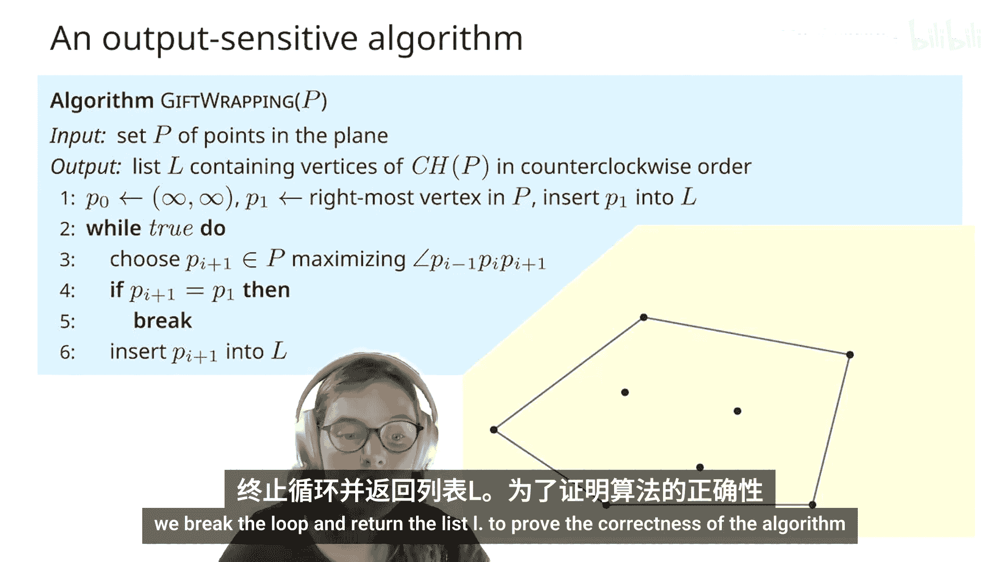

To prove the correctness of the algorithm， we can use the loop invari of the following form points P1 through P are the first I points of the convexhu of the input set of points。

To prove this invariant， we start with initialization， Indeed， P1 by construction is on thecon Xel。

And in the maintenance， we can use the property that the algorithm ensures that all the points lie to one side of a line drawn through P and P plus 1。

So now let's again analyze the efficiency of the new algorithm。

 the first line will take linear time because we are finding a vertex with a maximum x coordinate。

Line 3， for the same reason， also takes a linear time to execute。

And lines four and six both take constant time。Finally。

 the while loop will execute H times where H is the number of vertices on the convex hub。

So to put this all together， the total running time。Adds up to big O of H times n。

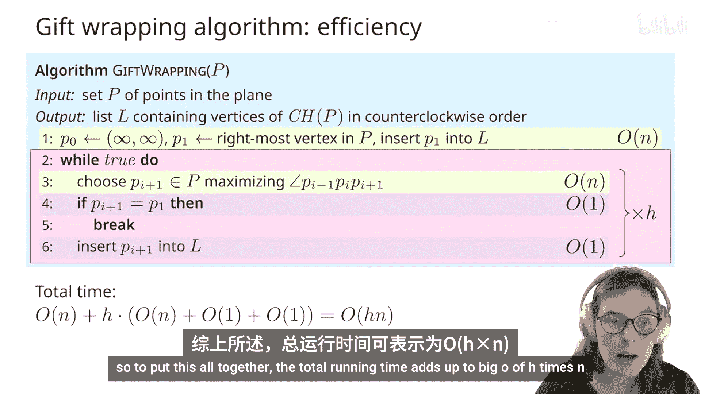

So now we have designed two algorithms。1， that takes in log end time。

To execute and another that takes n times H time to execute the question is when do we choose which algorithm to use and of course the answer is when we know that the convexile has few points on it。

 then we're going to use the second algorithm， and if the convexile may contain a lot of points。

 then we're going to use the first one。Again， I'm going to ask the question， can we do better？

And again， the answer is yes。We are going to use a trick that combines both of these algorithms in a very smart way and achieves a better running time。

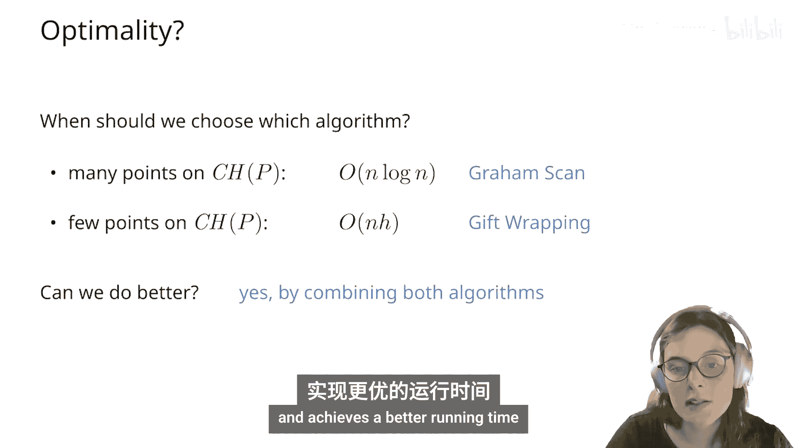

Before I show you the last algorithm for today， let me introduce you to Timothy Chan。

 he is a computational geo and if you ever attend one of our computational geometry conferences you may see him there so let me keep him here in the corner and I' will tell you about the trick that he has invented that allowed him to speed up not only the convicxhu algorithm but also many others So what Timothy suggests is the following he says suppose that we know suppose that we know the number of points that will lie on the convicxhu then we can do the following trick。

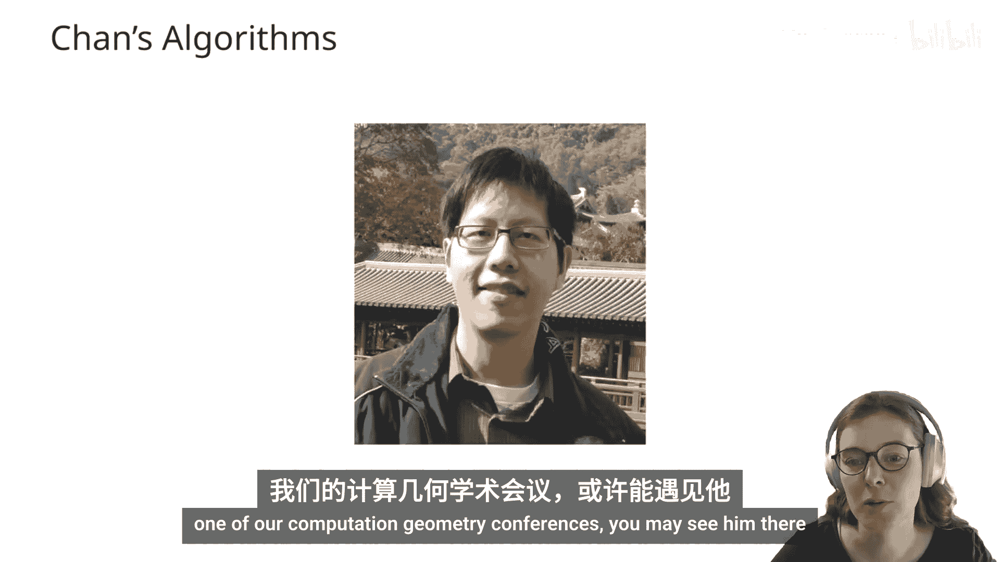

First， we start by partitioning the input set of points into smaller sets P with H points each then within each of these sets we can run the Gms scan algorithm and finally to merge all the resulting convex house we're going to use a gift wrapping technique。

So， the first part is。Applying gras can and over H times。

 and the second part is using the gift wrapping algorithm to construct the final conxhu。

So let's look a bit closer at what the gift wrapping part of the pseudo code does。 Again。

 we start with P0 at infinity and P1 being the rightmost point in the set P。

And then we repeat the following operation age times。We have the nested for loop， that goes。

Over all subsets， P， and within each subset in it finds the point that maximizes the angle。PJ-1， P J。

 Q I， Finally， in line 8 out of all these maximum points within each set。

 it finds the global maximum point that will be added to the list。

So now let's quickly analyze the running time of this algorithm。

And this will be easy because we know the running time that each component will take。

So we know that line3 will take big of H log H each time it executes。

And the total number of times that this line will execute is n over h times because that's the number of subsets that we partitioned P into。

 So the total running time of this part is big O n log H。For the second part。

 the trick here is to find point Q I in line 7 in the time that is logarithmic in H。

 Trust me for now that this is possible。 I'll show in the moment how this can be done。Finally。

 the lines 8 and 9 take the following time to execute。

 We have two nested loops which result in lines 8 and 9 executing H times。

 and line 7 executing over n times， and this is because the outer loop executes h times and the inner loop executes n over h times。

So if we put these together， we can see that the second part of the algorithm also takes big off and log H time。

So this is going to be the total running time of the algorithm League of and log H。

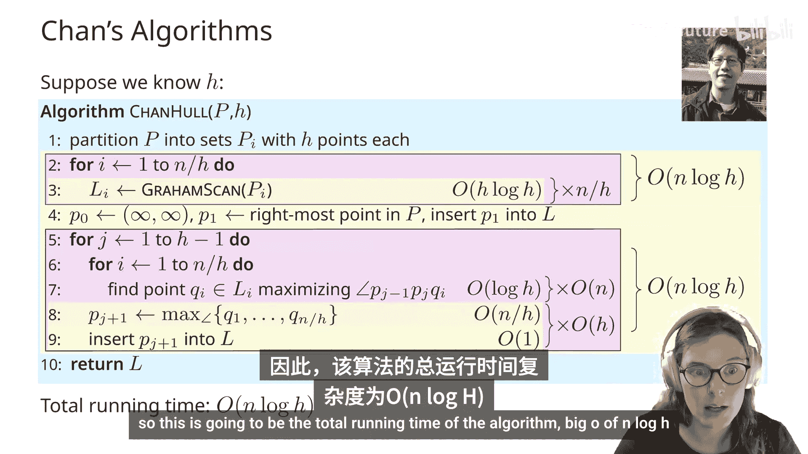

Now， let's see an example of how this works。We start with 16 points。

We split these points into four subsets of size 4。And for each， we run Gm scan to compute。

They Convics hall。So now we have four smaller conx holes that we want to merge into one big conx hole。

We start with a point p0 at infinity， and now within each convex hall of the subset。

 we find a point that maximizes the angle to the already constructed chain。

The reason why this can be done in logarithmic time in H is because the points of each convicxhu are ordered in the countryclockwise order around the polygon。

 which allows us to find tangent lines from any point in logarithmic time。

So now after we have completed the gift wrapping part on the convex house。Built in the previous part。

 we are done。Okay but we did make an assumption that we know the value of H。

 What if we don't know the value of H here I'm going to show you again the same pseudocode as before but I replace H with some parameter M here。

 So now let me hide the running time analysis and I'm going to add two more lines before the end of this algorithm what this will do is if M is large enough that we will finish wrapping our convetx hall and end up closing it up in the loop then we return the list L successfully and otherwise we return a failure。

So now we can call on this algorithm for multiple values of M。

 and hopefully we will end up with a reasonable running time algorithm。

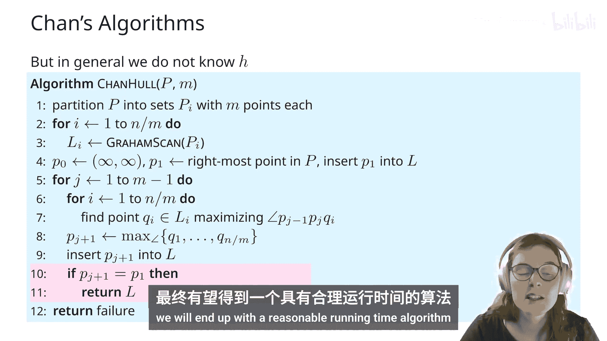

That will be a function of T。 and we will call the previous algorithm。For that value of M。

So now I want you to pause the video and think of which function for M you would suggest。

And which running time this function would result in。

And the answer here is that M should take the following function。

 It will be the minimum between n and the two to the power of 2 to the T。

 The idea here is that M will grow fast enough so that we will hit the correct value for the conx hall quick。

But it doesn't grow too fast that we don't waste too much running time。

So let's analyze the running time of this algorithm for this choice of M。Well。

 the main procedure in line 3 takes n log M time， which in our case will be big O of n log of2 to the2 to the T。

 Now how many times the line will get executed， Well， we will terminate when we reach H。

So the value of T， when we break out of this slope will be log log H。

 and thus this line will get executed。 Big o of log log h times。

 So now putting the running time together we get that the total running time will be given by a sum for T from 0 to log log H of big O of n of log 2 to the2 to the T log of2 to the2 to the T is just 2 to the T right And now we can replace the sum。

Using the formula for the sum of the series of exponents。

Which reduces to the total running time of big O of N log H。

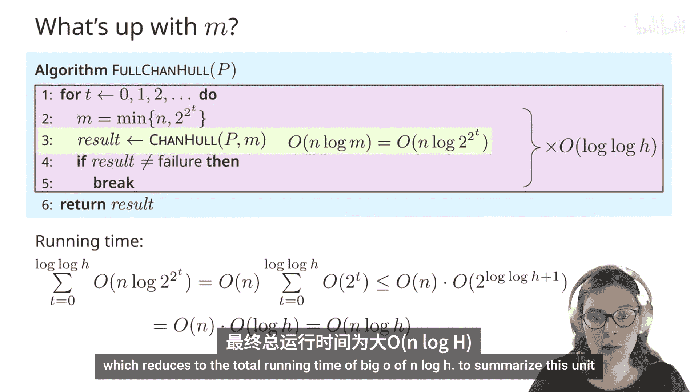

To summarize this unit， we have started with a naive。

 simple algorithm that was pretty slow but straightforward to come up with。

 Then we developed a more efficient algorithm called Grcan。

We continued with an output sensitive gift wrapping algorithm。 and finally。

 we used the timid chance technique to join the two algorithms in one and obtained。

A better running time。There are other techniques to compute convex hall that we haven't covered。

 A natural approach to take here is to consider a divide and conquer approach where we recursively partition the input set of points into two subsets。

 solve the problem on each subset and then merge solution。

 depending on how we partition the input set of points into two subset。

 we can encounter different challenges。 For example。

 if we arbitrarily split the points into two parts， like you can see in the image， then。

To merge the two solutions， we will need to find extreme vertices in each direction。

We could partition the points， for example， using their x coordinate， so find the median x value。

 everything with a smaller x coordinate is in one subset and everything with a larger x coordinate in the other subset。

To merge the solutions to this two sub problems， we would then need to find common tangent lines。

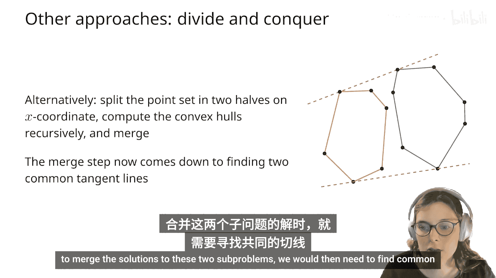

Finally， let me say a couple of words about convexhus in higher dimensions。

 a convexhu of a point set in three dimensions is a convex polyhedron。It will have vertices。

 the zero dimensional objects， edges， the one dimensional objects and faces。

 which are the two dimensional objects。The interior is going to be the three dimensional object。

 The boundary of the of such a convexhu can be represented as a planar graph。

 so it will have linear number vertices edges and faces， but if we go into higher dimensions。

 which of course， is possible。 our convex h in for example4D will have vertices。

 zero dimensional objects edges。

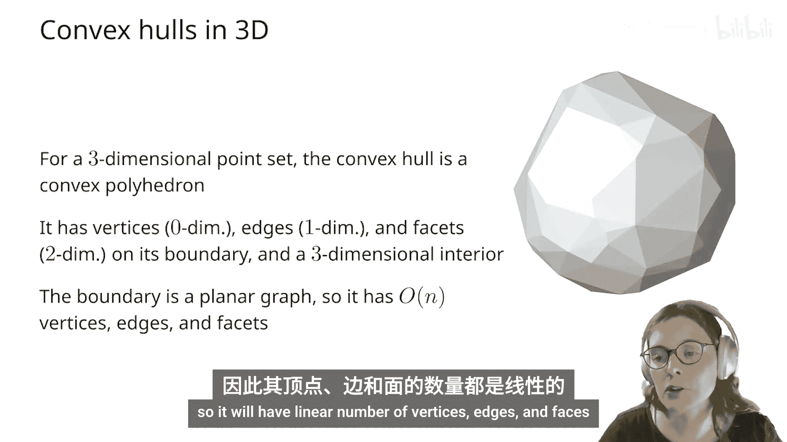

Two facets and three facets， and the interior will be a four dimensional object。Now。

 the boundary of a four dimensional convexhu can have quadratic number of facets in the worst case。

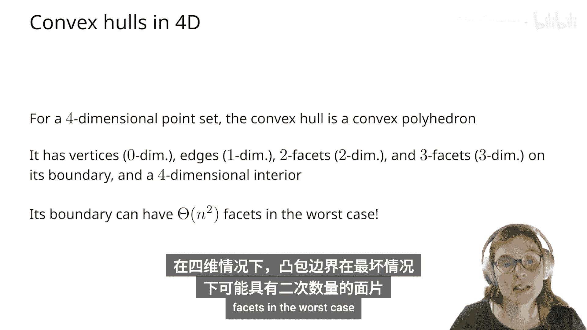