# 【Algorithms Lab】计算几何 ｜ Computational Geometry p02 P02_平面扫描算法用于查找线段交点 -BV1Jtn7zSEXD_p2-

Welcome， today we're going to look at the problem of finding the sections in a set of line segments。

 So that's I growthmy problem we're looking at。We're going to use that to learn about a great technique to the design geometric algorithms in the plane namely the plane sweep paradigm。

 and eventually we're also going to see a data structure for planar subdivisions。

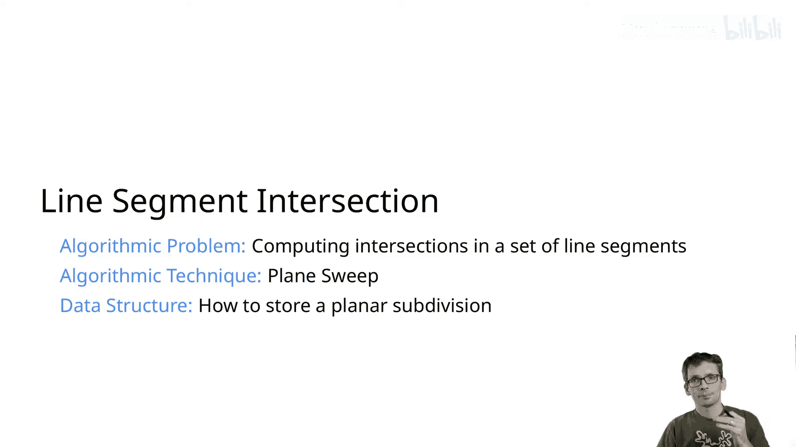

So let's start with an application example from wildlife management。 So here we want to save a。え么子。

From。Getting hit by cars。 So the data that is used for this is we have a street network。

 We have GPS data of moose and we want to combine that data to find where do mo cross roads。

 So combining two types of data in a geographic setting。

 that is a common problem and we have that with other data you might want to combine。

 let's say land use and rainfall。 and this is a problem of map overlay。

 So in a geographic information system data is stored in layers。

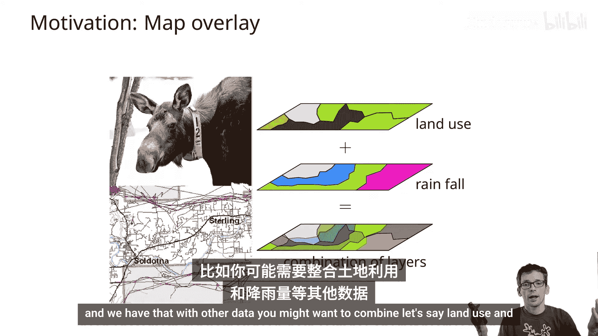

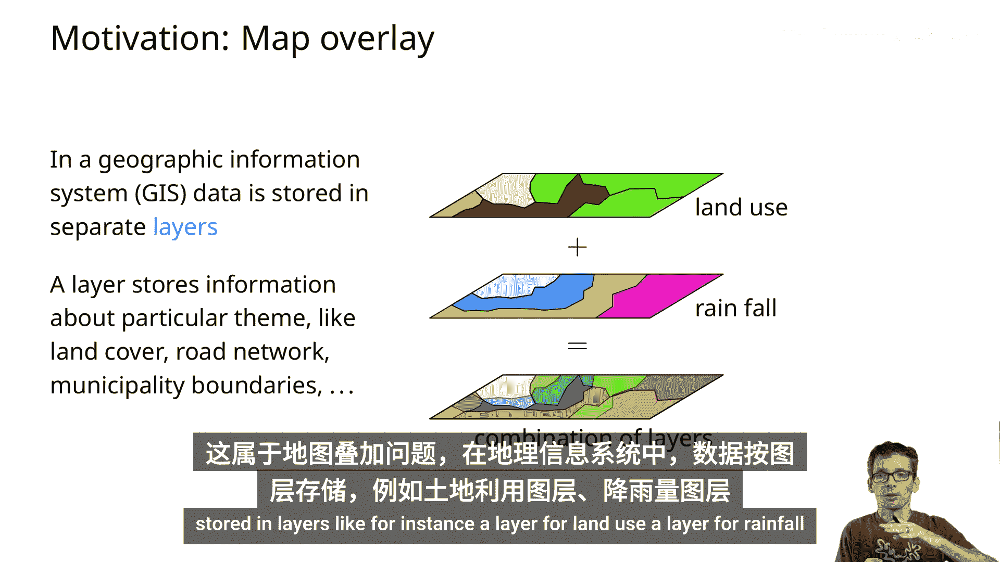

Blackphones is the layer for land use are layer for rainfall， and then the problem of map overlay。

Is combining。Two or more such layers in this example here， one layer might be forest。

 other one might be road， and then the possible per question would be how much road goes to the forest。

But the first problem that we will have to solve for this is where does the road actually enters a forest and exits a forest。

 So we want to find the intersections between the roads。And the forest boundaries。

 And that's why we are going to look at the problem。

 line segment intersectionse sectionction in this setting。 So here you have roads on forest。

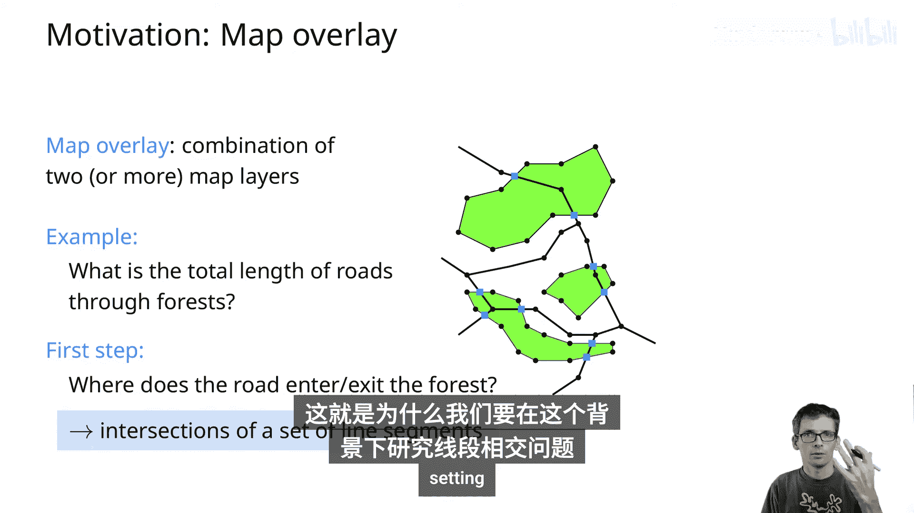

Previously， we had roads and Moose。

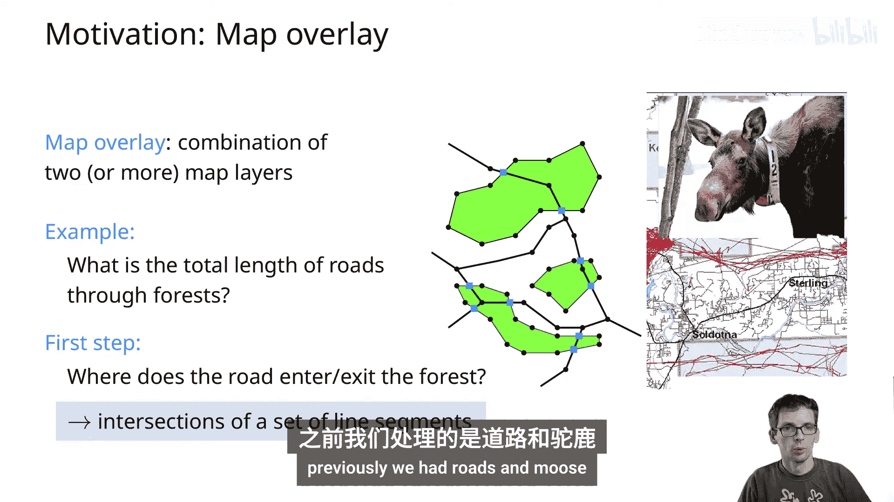

And the geometric problem that we now want to solve is。Give a set of line segments in the plane。

Find all intersection points between pairs of line segments。And for each of these intersections。

 we put all of the intersections that intersect in that point。

So in the application it was slightly different because we had two sets of line segments and we only wanted an intersection between those two sets。

 but we will here just take one set for simplicity。

 you do see typically an intersection is between two segments， it can also be between more segments。

Here there's a segment endpoint in。 So we have to think a bit about what do we actually mean by an intersection and what we're going to do is we're going to。

Treat the segments as closed sets， and intersections are now common points between these closed sets。

 So this segment here， which just has an end on that adds a segment that counts as an intersection。

 So to start off， let's think about the following question。

 Can we give a simple algorithm that finds all intersection points。

And then we ask ourselves is this simple algorithm actually worst case optimal。

So you can pause a video maybe and think for a small moment about how would you solve this by a simple alz？

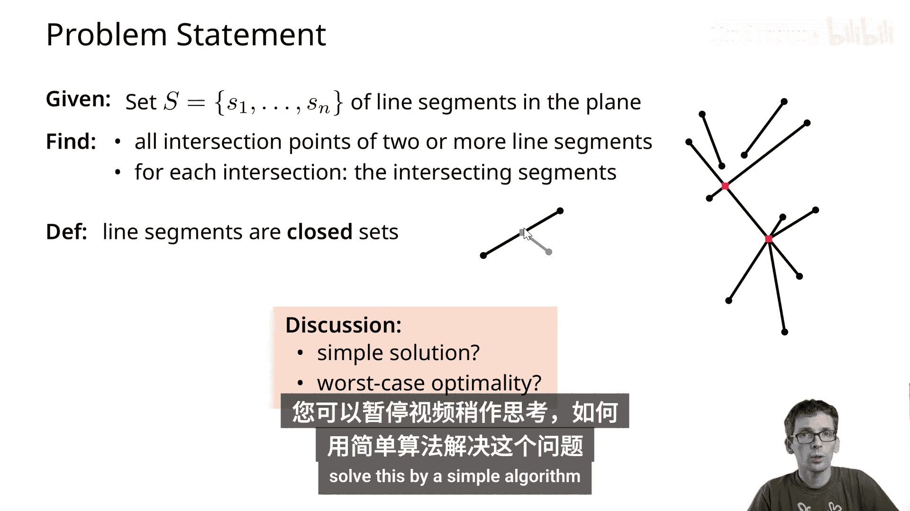

So this is as simple as it gets。We take simply every pair of line segments。

Test that for intersection。 and if they intersect， we report that intersection。😊，In this way。

 we're going to find all intersection points。Note that we don't go into detail how we find intersection between two line segments because that's an operation on constant complexity objects。

 so we assume that that can be done if you want to implement the algorithm and that's of course something you still need to think about。

So what is the running time of this algorithm？Essentially， it's it's constant type of pair。

 We have a quadratic number of pairs and choose two pairs。So the running time is quadratic。

And the correctness simply follows from the fact that we test every possible pair in any intersection。

 we also have a pair that intersects So in this way we will find all intersection points now。😊。

To the second part of this question， as a quiz。Is this algorithm worst case optimal， Yes or no。

The answer is。Yes， I mean， it feels like a somewhat terrible algorithmm。

 but it is worst case optimal。And here's an example of a configuration。Of line segments。

 where every pair of line segments。Intersects， that means we have a quadratic number of intersections。

 So any algorithm that reports all intersections will also。

Take quaratic time And in that sense of for that reason， this algorithmsma is worst case， optim。

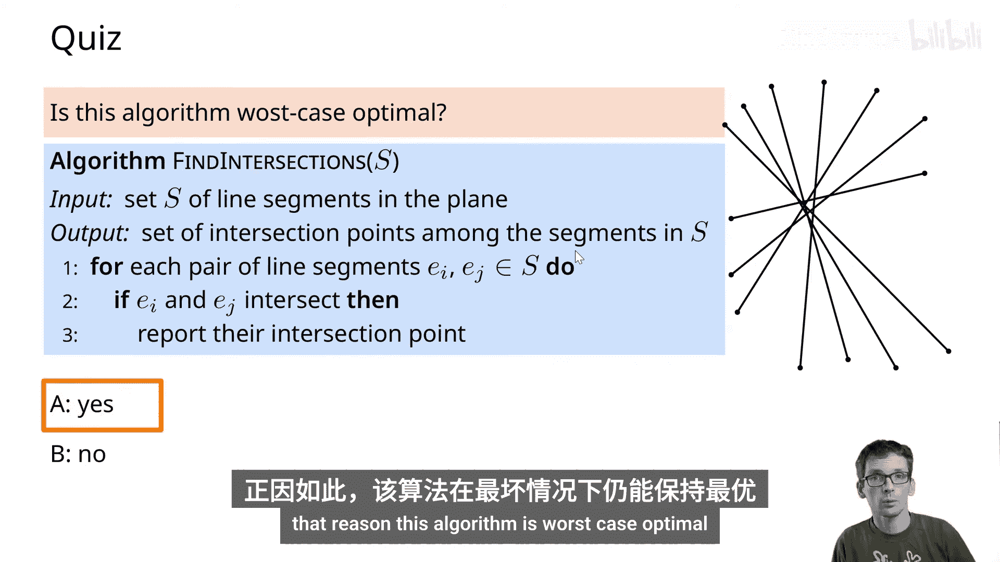

If we think about the example that we had previously。😊。

Then a kic time algorithm seems not really appropriate。

Because while there could be a quadrotic number of intersections， if you look at these examples。

 there won't be a quadrotic number of intersections。😊。

So there will be more like a constant number or possibly a linear number of intersections。

 but certainly it will not be quadratic。So what we would like to have is if the number of intersections is small。

 let's say at most linear， then we would like to have a fast algorithm。

 let's say an n lock n time algorithm and such an algorithm is called output sensitive or every algorithm is input sensitive in the sense that it depends on the size of the input。

 but what we want to have is an algorithm that also depends on the output size。

 which ones faster if the output size。

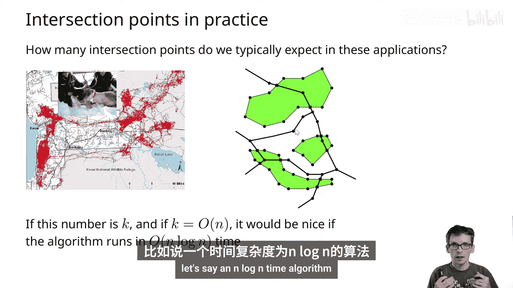

Is small。 And what we're going to see is to design an output sensitive algorithm for line segment inter。

We want to develop an algorithm for findings and intersections and a set of line segments。

 We're going to。First， develop the underlying ideas and concepts to design such an algorithm。

 and this will eventually lead to a plain sweep。I was。

So whenever we are designing a geometric algorithm。

 what we want to do first is to develop a geometric intuition about the problem and get a geometric insights。

 so we want to find properties of the problem， make observations about the problem and we'll do so by drawinging many sketches。

What we wanted to achieve is to get an output sensitive algorithm。

 meaning that we have to avoid testing all pairs of line segments。So。

 what we want to achieve is that。Let's say I have this line segment and that line segment。

 those two clearly don't intersect and we will want to avoid testing those ones。😊，So for those two。

One simple observation of why they don't intersect is the following， I mean。

 they don't even overlap in terms of their wisepans。So， what we could do。

Is first determine all pairs of line segments that are overlapping Y spans and only test those。

For intersection。 So if I want to find overlapping wisepans。

This is essentially a one dimensional problem because I can project everything onto the y axiss。

 So what I want to do is now I to find overlapping intervals So on that I can do by a simple scan from left to right the question now is does this lead to an output sensitive is。

 if I first find all pairs with overlapping y range and then only test those for an intersection is this an output sensitive s。

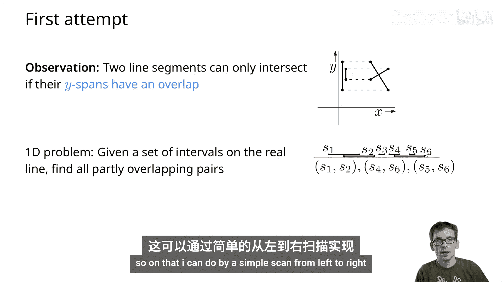

So here's a more quiz about it。Option 1， yes。It is output sensitive， but it's actually not correct。B。

 no， it is not output sensitive， but if after testing the y ranges。

 we would also test for the X ranges if we could do that， then that would be output sensitive。Or no。

 it is not output sensitive and testing X ranges and y ranges will not。

Lead to something output sensitive。Correct answer is C。

 so this overlapping y and x range I mean that sounds like a nice idea。

 but it doesn't work in several ways for one I would have to do this somehow simultaneously Also even if they have overlapping x and y where spans so like in this setting I can give you a joint y coordinate I can give you a joint。

X coordinate， but there are no intersections。 So this observation alone。Is not yet enough。So， let's。

Have a look at this specific example here once more。

 So how could we quickly find out which segments don't at or reduce the number of segments that we need to test。

So somehow we would want to avoid if we take this segment and that segment。

Avoid testing them for intersectional， let's say slightly easier here or better for my example。

 if I take those two segments， so the second and fourth one they don't intersect one way to actually see it is there's really a segment in between but what do you mean by that so one way to formalize this。

 I mean we were already working with y and x coordinate is if I look at the overlapping y range。

 so if I look at a y。That they have in common。Then， okay， they have this y in common， but。

There is something in between， and that will be we find observation two line segments can only intersect if they have overlapping Ypanm。

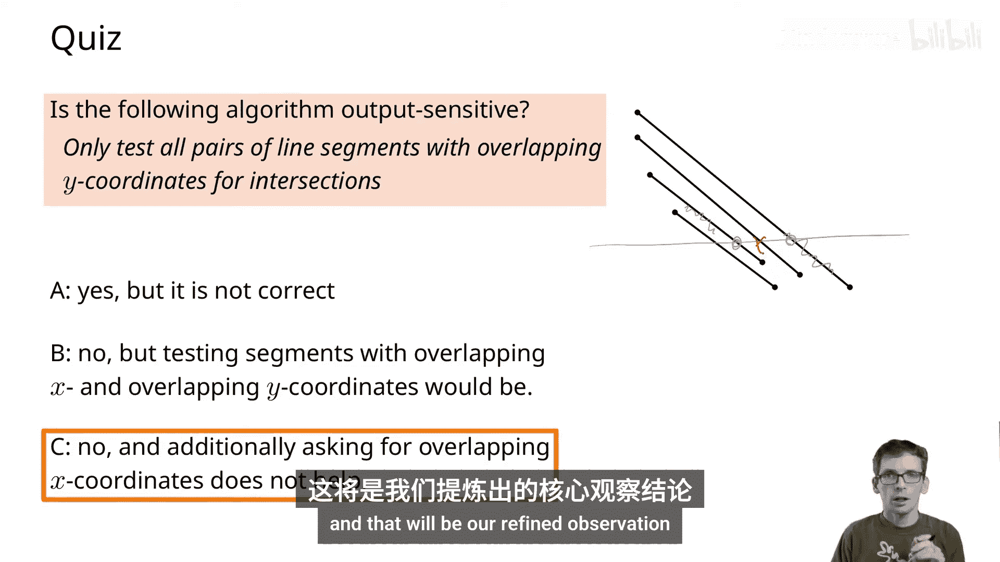

And at some point， so for some y coordinate， they are also adjacent in terms of the X order。

 so they have here joined y coordinate， but theres something in between。

While here we have an intersection and the corresponding segments， I mean， obviously in that point。

 they are， they have a common X coordinate， but just before， let's say。

They are adjacent in terms of of the x order here。 So if I do one。

 if I just count them from left to right。 So that's the observation that we're going to do。

 that means that for every y coordinate， we need to solve a one dimensional problem。

 but we want to solve this essentially for all y values simultaneously or efficiently for all y values。

So how can we do this， what we want to make use of here？Is that if I compare。

Let's say already have this blue line。 So if I compare the order， the x order here， I mean。

 it's the same as x order here。It is the same as x order here。

Here is x orderta is different and it changed at that vertex。

The idea is if I move kind of my horizontal line here。

Then for while the orderura stays the same and only at special points。At special Y coordinates。

 it changes。So let's try this with a horizontal line starting。

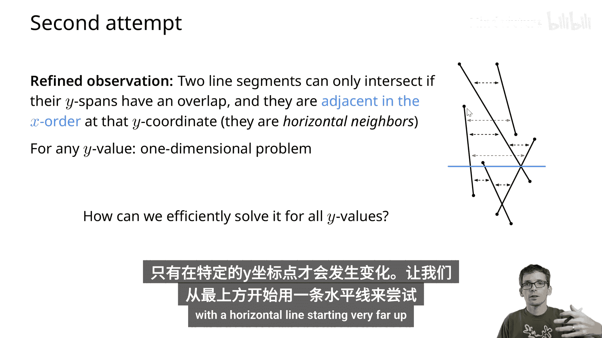

Very far up。So here I have my horizontal line。Initially there are no line segments。

 there are no intersections。 Now I hit the first line segment。😊，Okay。

 there can still not be any intersection。I go further down。

 and the next interesting point is where the second line segment here。As it。Upper end。

 but still those two line segments do not intersect。 I move downwards。Now。

I get another segment and in terms of the order， I have 1，2，3。

 So if I want to know whether the intersections， I will have to test for one and 2。

 and I will have to test for two and 3 and one and2 indeed have an intersection。

 So I first hit this endpoint here， but then I reach the intersection。

 So what we're doing here is with sweeping the plane with a horizontal sweep line。

 The situation that we have is。Take something to sweep。So we're sweeping。Top。

Down and essentially everything up to my sweep line， I now already know。

 I have already computed the intersections， everything below， I don't know。

 and I maintain the current status。😊，Add。The sweep bag and this status， we actually call status。

 And then from this， what we need to know is if I'm at a current status。

 what is the next event so that I can update。The situation at my sweep。

And that is the plain sweep technique。

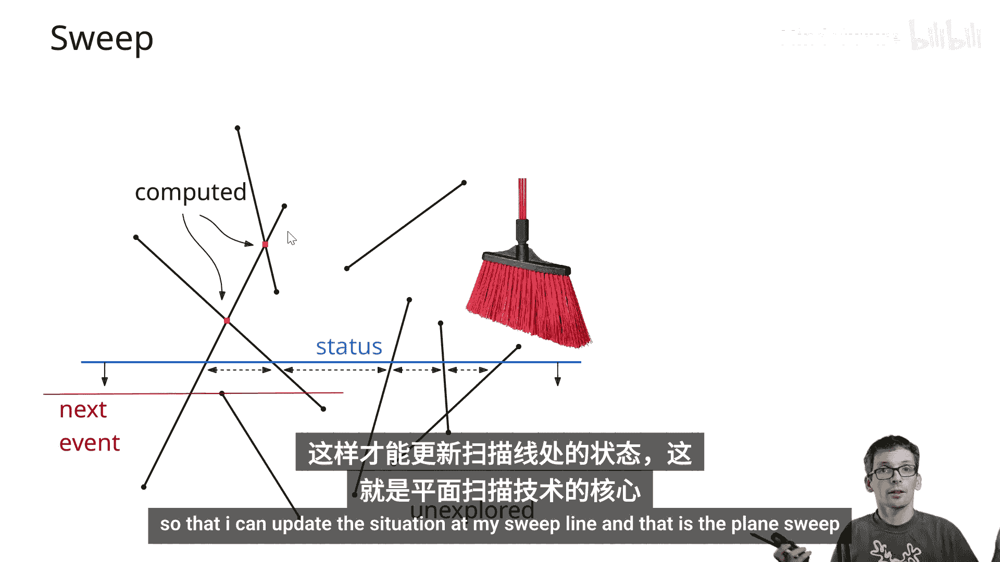

So you imagine a horizontal line passing over the plane from top to bottom。

Solving the problem as it moves。There are kind of two key concepts here。

 one is the situation at the sweep line， which we call the status。

So the relevant situation at the correct position of the sweep line thats so the sweep line is a blue line and the relevant situation here is the order。

Of those segments。The second key concept are events。

So if I only move the sweep line slightly and I don't go over a special。Point， so I don't go over。

 In this case， the next one would be an endpoint of the segment， but it。

Sweep plan also changes that intersection point if I don't go over any of those points。

 it stays the same， so I need to know the next event to be able to update my status appropriately。

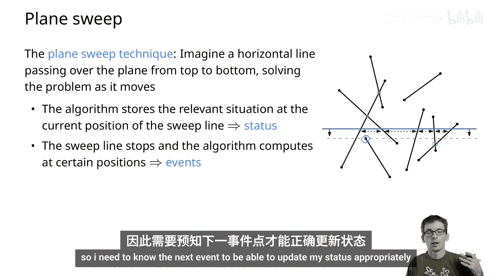

And then the idea is up to this we line， I've computed everything I need to know。

 meaning here I found all intersections above this we line。

 and then I use the events in the future plus the status to compute the intersections that are still to come。

 So in our setting the status is a set of line segments。

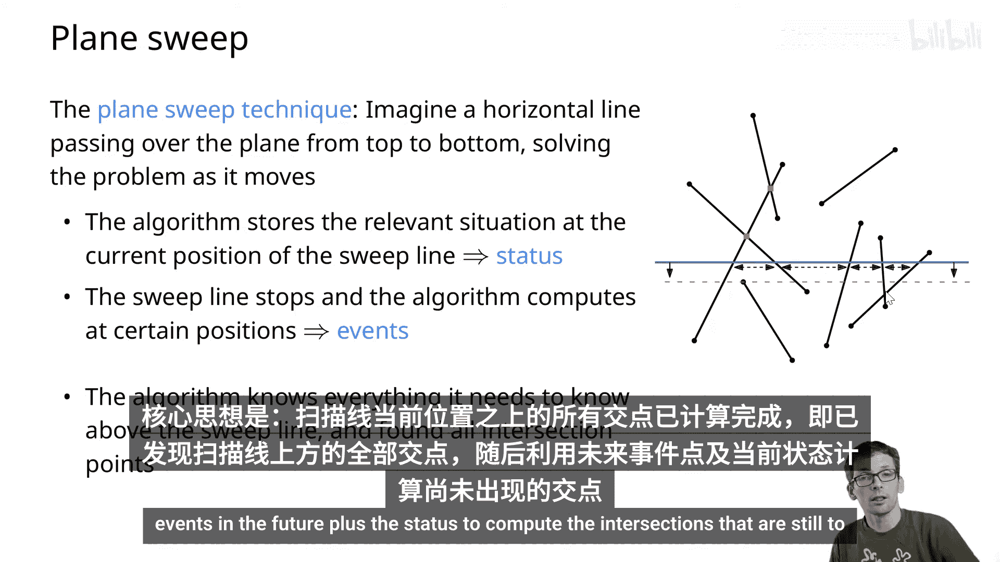

Interssected by the sweet line。In order， so ordered from left to right。So here that would be simply。

S3 comes first here。 So S3 comes first in the order。Then I have S4。S5 year and。And6。

And this one didn't give it get a name。So let's call this S7。So S7 also belongs to the order。

And then the events are the interesting。Why coordinates。

And what we've seen is interesting is if a segment starts。If a segment ends。

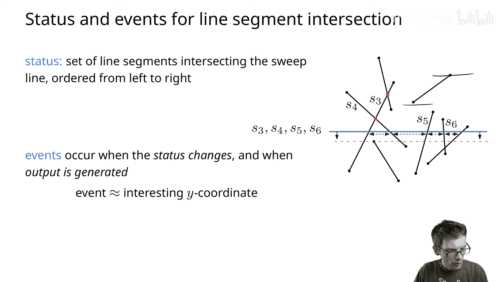

And it has extra points。So with all of this in mind， let's do this sweep again。So we stopped。

At the top。We first hit the upper endpoint of S1。 What we want to do at that point。 We want to add。

S1。To the status。 So now our status is S1。The next event that we would want to detect is the start point of S2。

 and then we would want to add S2 after S1 in the status。 So now our status is S1 S2。Then。

 we want to。Half as the next event， the start of S3， Then we would add S 3。

Between S1 and S2 in the status because it lies in between。

Well be adding S4 at the beginning as a first element in our aura。

 and then the next event that we want to find is this intersection point here。

 And if you look at what happens here，As 1 and S3， simply。Sb order。In the status。Yeah so。

Previously I had as status S4， S1。If we。S 2。But if I'm just slightly below this line。Then。

These two swap their orderura。The next event then would be removing S2 from the order。

Then we will move S1。Here we are as five。We both the next intersection and so on。

So when do events happen that we already looked at。

So events happens if I have to add a segment to the status， so that is an upper endpoint。

 if I have to remove one， that's a lower endpoint and at intersection point。

And at any other y coordinate。 so if if we don't have any of those three cases。

 the status say stays the same。 So these are the points where the status changes。And otherwise， it。

So before we are now actually going to design the algorithm， we will exclude some。Difficult cases。

 some degenerate cases， these eventually will want to solve。

 but excluding these cases will make designing the algorithm much simpler。

And these cases are cases where the concepts that we are talking about are not that well defined。

 we wanted to go from one event to the next event， but what do we do if two events happen at the same time。

 for instance， what happens if we have two endpoints with the same y coordinate。

Let's not think about that for now， let's assume endpoints have different y coordinates。

We will also want to ignore on another case when more than two line segments intersect in a point。

Can you think of other cases we might want to ignore？So there are more cases for one here。

We said no two endpoints have the same y corner。But actually。

 so we want to have no events with the same Y coordinates， so no to endpoints or intersection points。

Have the same y coordinates。And we also don't want to handle cases where segments overlap。Like here。

Or where vertex lies， endpoint lies on other on another segment。 So we only want to have。

Interses that happen。In the interior of the nine segments that do not include inputs。

So those are the cases that we want to ignore for now。 Let's do one more quiz before we look into。

Data structures that we're going to use。And that is a following。

 So let's assume we don't have a set of line segments。 We have two convex polygons。

And we want to find so the intersection of two convex polygons is again， a convex polygon。

 and we want to find this intersection。Using a plain sweep eye。In the setting。

 what will be the complexity of the states， Will it be linear。Constant。Oh quite。It will be。

Constant because we only have four at most four sections with a sweep line。

 so the status will have constant complexity。So to sum up the ideas and concepts that we've developed so far。

 if we want to design a plane sweepep technique， we will have to have a closer look at the status and the events and in particular we have to think about data structure so how are we going to store the status。

 how are we going to store the events Next we're going to look at data structures for a plane sweep algorithm so we already looked at the concept that we need for plane sweep algorithm the key concepts where the status so the situation at the current sweep line and the events so when does the sweep line change and we now have to think about how do we store the status。

 how do we store the events。And for this， I mean， questions that we have to think about as。😊，I mean。

 if， if I have my events， I would want to be able to find the next event。 And then at that event。

 I would have to officially update the status。 So these operations that。

For which we need suitable data sources。So we're going to call these data structures。

So event list or the event list is abstract data structure that stores all events in the order in which they occur and the status structures and the abstract data structure that maintains。

The current status。 So here we have the status So the status for the in the setting of line segment intersection is。

For the current。Sweep line。The segments that I intersected。Yin。Order， so in in their X order。

 So how do we want to store those。 So we have。Objects， we want to stores them。

Ordered and keep in mind that when the sweep line moves。

 these segments might want might disappear or new ones might appear。

 so we need some kind of dynamic data structure for a sorted set。

And the data structure that naturally comes to mind is a balanced binary way search tree。

 So that is what we're going to use for the status structure。

 we are going to take a tree where the line segments are stored at the leaves。

So balance binary research tools you can implement in different ways you could also store the elements also at interior node we for simplicity will assume they are at the leaves that means that at the interior node you will need to have those will only be used for searching so I have a node S2 here which is not the node where S store S2 but where I simply have to decide am I left or right of S2 and now let's assume I hit an upper end point So here let's say here the segment S9 starts。

Then I will have to take this vertex here。And determine。Where it is。In terms of it the X order。

So for this， I will see， okay， it's to the left。Of s4。The right of S2， left of S3 found it。

And then I need to update the data structure， adding。S 9 here。That is if I have an upper end point。

 if I are lower endpoint， where let's say S9 ends here。Then， I will have to。

Simply remove S9 from the tree。 So this one， there is note here。Where are we S3？

Third type of event that we have to think about is intersection events and in an intersection02 segments change to swap the order。

 so we will have to swap order of。Let's say here S9 at S3 in the3。

 So that would look like S so all of this can be done nicely with the balanced primary search。

 so that's what we're going to do。Next next， let's think about events。

 We have low and upper endpoints as events， those we know in advance so we can simply sort them by y if you would want to。

 but how do we find it a section point events。So it seems slightly unlogical that we can kind of use intersection point events where these are the actually kind of the。

 I mean we are trying to find intersection， so if I would know where they are。

 I would already be done。So， here we will use。That intersectionses only happen。

If two segments are ded。So that was kind one of the observations that we used。

When designing the algorithm that before this intersection happens。

 these two segments actually need to be adjacent。At the very beginning of the sweep。

 there aren't any adjacent segments。What does that mean at some point。

 these two segments must have become adjacent， so there is an event。

At which those two become adjacent。 And if at that event， I can test those two segments。

 whether they have an intersection in the future。 I can find the intersection event。

 The proof I essentially already argued， if you slightly look up from the intersection and。😊。

Not cross any event。Then at that point， those two are adjacent。

At some point they have to must have become adjacent。

 so that's the point for the event that we at which we want to make sure that we determine that intersection point。

Now， what data structure do we want to use for the event？And how makes this more specific。😊。

For this quiz， so if I want to avoid inserting the same event several times。

What is the suitable data structure for the event queue。Mary。And Min heap。Or a balanced binary。

 surgery。So an array is not useful in the setting， even if we have a sorted array。

Because we have to be able to insert the intersection point events， we don't know them in advance。

 so we need a dynamic data structure， a Minheap and a balance binary to search we are both dynamic。

 they are boths in principle suitable data structures for the setting。

 but if I want to avoid inserting the same intersection several times into the status structure then I have to be also be able before I insert something to search whether it's already in it and for that a Minheap is not。

I mean， meaning he is not for searching， so that's why the correct answer here is balanced buying research piece。

Now you might wonder， so why do I make a fuss about finding checking whether an intersection is already in the eventless can that actually happen？

Yes， it can。 So let's look at an example。 So let's look at。This inter point。So when did I add it？

To the Acu。Okay， so let's draw the horizontal line。So I move the line up。And。Here。

 so at this intersection point， those two segments S and S prime became。Adjacent。

So that's where I might have to turn。That this intersection will happen in the future。

But if I look at S and S prime。Then if I obviously if I move slightly further up。

 I said here they become adjacent， so actually I have a range here in this range S and S prime。

Im not adjacent。But。And mean you see S here and S prime here， here they were adjust。

So S and S prime were at some point adjacent at some point not adjacent。

 then again adjacent and to avoid inserting S and S prime several times or the intersection points several times into the Ven queue。

We use a balanced binary research tree here。 and asO P would have been detected twice。Okay。

 so much about data structures。 Now we want to move on to algorithms。

 So let's sum up what we've seen about data structures。 So we have the event list。

 So that's an abstract data structure to store the events in order。

Here we were using a binary search tree for that。 and there's a status structure。

That is to store the or maintain the current status at the sweep line。 Again。

 we used a binary search tree for that。 And next we are actually going to design an I。

We want to design a plain sweep algorithm for line segment intersection。

We talked about the concepts we need， the status and the event。

We talked about the data structures that we need， for the status and for the events。

 so now we are actually ready to design an I。So this is a situation that we are looking at at the beginning of the algorithm。

 So what do we have， We start with a sweep line at the top。

 So that means that we're going to start with an event list， which Okay， it's initially empty。

 but we then can insert。The endpoint of the line segments in order。

So we start with an empty event list。 but then we add the endpoint。 So let's call this S1 upper。

Has to upper。S3 up。And so on to the event list。We need our status， the status initially as empty。

So let's call that T。Is。Initially， empty one。To be precise and empty binaryry， balance binaryry。

 search free。 And then what we do is we。Take the next event， handle that event。

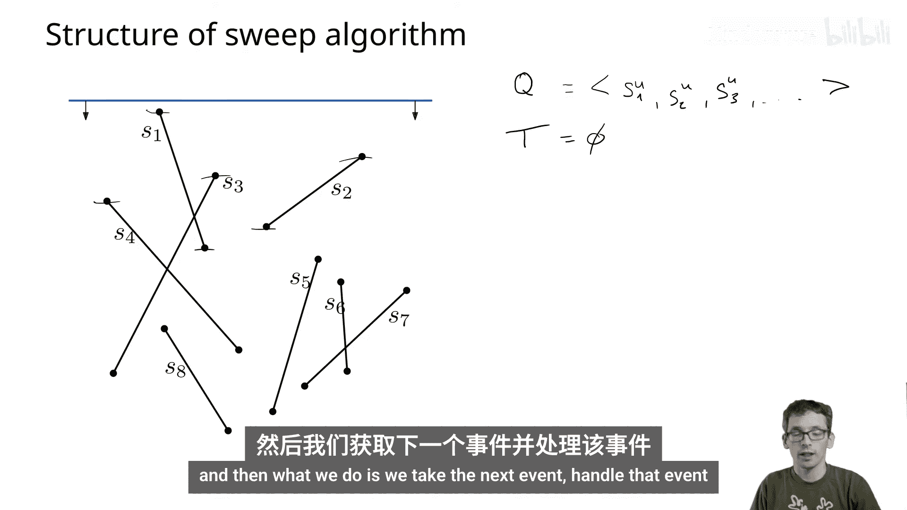

So here what details is。We start with an empty。Event list， but we can immediately add the endpoints。

Of the segments。We initialize the status to be empty and as long as AI events。

We find the next event point， so let's call that P， and we're going to handle that event。

And now everything interesting in this algorithm actually happens in the handle Even point routine。

So let's think about we have what kind of events do we have。 We are upper endpoints， lower endpoints。

 intersection points。 So this handled endpoint routine will need to have a case for each of these three cases。

 So let's start with the upper endpoint。 So if I have an upper endpoint of a segment S。

 what we're going to need to do is we're going to。

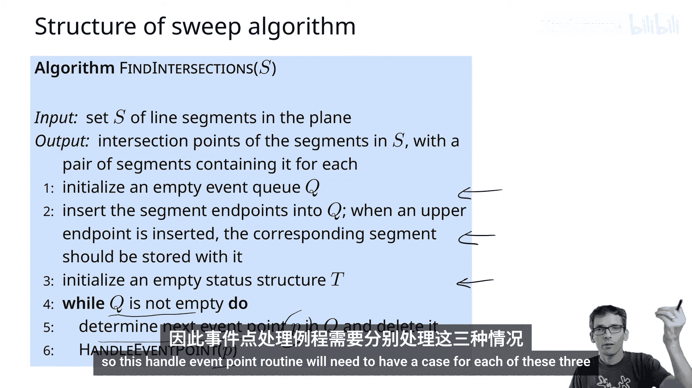

Search for that endpoint in the status or search where to insert it in the status。

 so we're going to insert it between this segment and that segment。Now the status is up to date。

 we still want to check whether through the new adjacent Cs here。We。

Are able to determine intersection point that happens in the future。 So we are adding S。😊。

S is adjacent to this segment here。So I'm going to test whether the segment and S。

 whether they intersect， let's say they don't， then I don't have to do anything。And then。

I'm going to test all the other adjacent segment。And let's say they do intersect in the future。

 So then I'm going to insert that intersection point into the event list。

I do that with a left neighbor， I do that with a right neighbor。😊。

And that's all that I need to do for our endpoints。

So what happens at a lower end point at the lower endpoint？Off S。

 I'm going to delete S from this status。你一字意思。Now we have a new pair of adjacent。Segments。

So that pair， I'm going to test whether they intersect in the future and。Depending if they do so。

 I'm going to add the dissection。Third and final type of event， intersection port events。

So here S an S prime inter。Let's think about it for a moment， what are the steps that we need to do。

You might want to report them as equal point first， we will do that last。

 so the first thing that we are going to do is we are going to exchange S and S prime in the status。

So here we had S before S prime。Here we will have S prime before S。

 so that means we have to swap them。Now we also have new adjacencies namely between the old left na of S and S prime。

 So we need to test with ourselves intersect。Likewise。Between S。And what's now to the right。

If they intersect， so let's say they intersect here。Then I'm going to add that intersection。

And finally， I already mentioned it in the beginning， we will want to report the intersection。

We've handled all events。

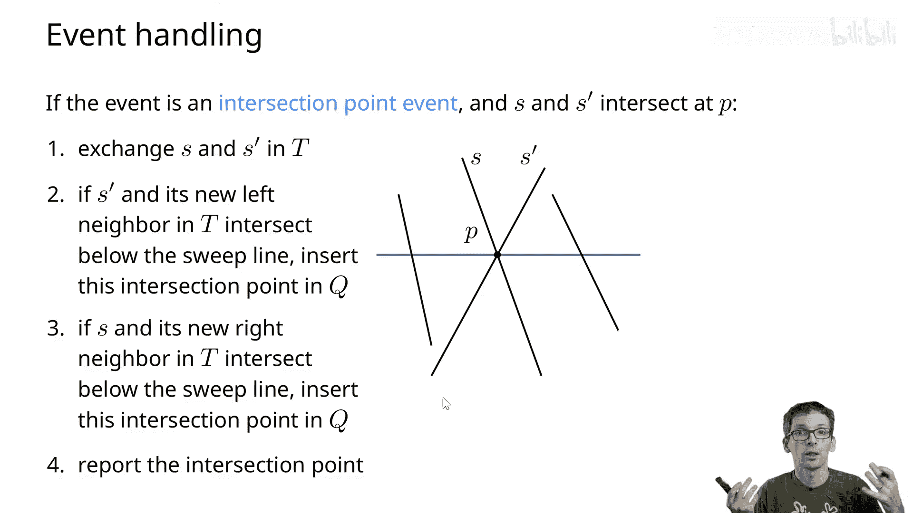

We have our eyebrows。So how fast is it， Did we achieve our objective of designing an output sensitive。

 I was。So let's do this quizz here。 What is the overall running time of the algorithm on end line segments assuming that they have。

Ca the 6。So is it n log n plus k， Is it n plus k times log n or is it order n times k， it is。어라。

N plus K and brackets。Times。Log in， so why is that the case， so how do we analyze the running time？

We go through this step by step， initializing an empty queue we can do in constant time。

Inserting the segments into the queue so that depends on what the data structure we're using we're using a balanced binary search tree。

We're adding2 n event So that's per insertion。 let's say it's log n time。 So we get off n log n here。

AndThis is also constant of one。Creating an empty status。So the interesting part is here。

So we have the time that it takes to determine the next event， so that will be of order log n。

But now the key question is。How much。Does it take。To handle an event。

So what did we do so initially we had to possibly search for upper endpoints we had to search where does it go。

 we had to insert into the status， we had to delete into this status， we had to swap。

 and mean you can also see swap as deleting one and inserting it again。

This will be similarly efficient。We are then for instance hard to look at so we have new Year resideencies。

 so we had to look at the two new neighbors and see whether they intersect and that we also only had to do twice also say event list changes。

Get rid of one event and we might get up to two new intersections so if they swap。

 they could kind of intersect their new neighbors so we might get two new events。

So in terms of running time， I mean， we were using patterns binary research trees。

 so insert deletion。Swing， so swap， think of it if you want to as delete insert。

 all of this is order lock and time for balance binary search trees， finding neighbors。

 so finding neighbors as predecessor successor query。For it's auto lock in time。

Deleting and inserting into a balanced binary search fee or a log in time。So all of this。

Takes Aura log n time。 So here this。And we have order。log嘅。This was also a okay。You can add this up。

Now， the question is， how often。Does it happen？How often does it happen is a question。

 how many events can we have， So we definitely have the endpoint events So that are n upper endpoints and lower endpoints。

 So that's two end events。And then for every intersection point we have an event。

 so we have K intersection points， so we get K such events， So in total order n plus K events。

 each of them took order log n time to process。

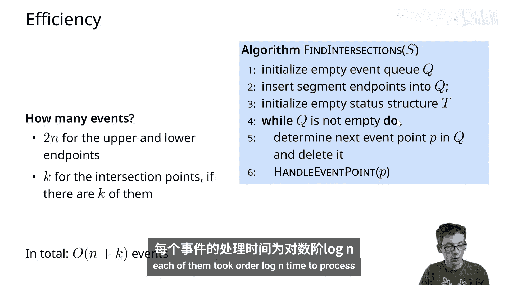

The initialization takes inlock and time for creating the initial event list。So overall。

 this gives us order n plus k in brackets times log n time or without brackets。

 order n log n plus k log n time， So we have our output sensitive algorithm。

 in particular if k is sufficiently small， so if it's at most linear this algorithm once in N log n time。

Curious fact， it is actually not worst case optimal because if we have a quadratic number of intersections。

 it actually once in。N squared。 So K is n squared then n squared times log n time。

 So then you can also ask about， can we get a faster algorithm。

 It is possible to get a faster algorithm。 It is then also more involved。

 But en log auto n log n plus K is possible。It's also the best possible because course this problem even without intersections。

 so testing whether there's an intersection at all will take order n log n time。

 we can also not be faster than what we are outputpoting。

 So optim is order n log n plus k we got quite close to this with order n log n plus k log n so this is running time and very often we only look at the running time when we talk about algorithms but here the space complexity is also interesting。

So how much storage does this eye take？So what are we sting， we sting。The event list and the status。

How big can the status be at any point in time， the largest number of line segments that we can intersect with simply all line segments。

But thats a linear number， so and a binary research tree a balanced binary research tree on a linear number of objects has linear complexities or the status has size or n the event list is also balanced by a research tree but now on the events we said we can have at most a quadratic number of events。

 so potentially we are having a balanced binary research tree on a quadratic number of events。

That could be a problem。 So let's think about how can we avoid or also can we avoid this。

 So given that we might have a quaratic number of events is efficient in terms of storage。An issue。

So actually from one perspective here is that it's actually not。

Obvious and actually not even the case that we can get an event list that has。Quratic size。

 even if we have a quadratic number of events。Because those would have to be in the list all at the same time。

But the easy way out here actually is we are going to make sure that at any point in time we only have a linear number of intersection points and we can do this in the event list。

 we can do this by making sure that we only store the intersection points of currently adjacent segments。

So keep in mind， we have situations where。We have these。Let's say these two segments and。

If those are segments in between， then these two segments。They were， I mean。

 they became adjacent here， then here they were non adjacent here they became adjacent and so on。

For this intersection， we only， it's enough when we insert it here。 We obviously。

 at this earlier point， do not know whether we have to insert it or not， but it's the latest。

Here or actually。At the point where they are no longer adjacent， we can simply say， okay。

 let's delete that event for now。😊，And add it again the next time they become adjacent。

 So in this way， because we only have adjacent segments and we only have a linear number of adjacent segments。

 we get linear storage。 So now everything is in place。 we only said at the very beginning。

 Let's exclude some problematic cases， degenerate cases。

 So now we have to think about how to actually handle those。 And there's good and bad news。

 The good news is there are certain cases that are。😊。

Easy to handle and the bad news as others are not so。 So let's start with the easy ones。

 If I have two endpoints with the same y coordinate or an endpoint and intersection with the same y coordinate。

 So what we're going to do is we are going to order them simply lexographically。

 So meaning if they have the same y coordinate。Then I'm saying the event that is with the smallest x coordinate that comes first。

 So I'm handling these here in this example from left。To right。

You can imagine having your sweep line to slightly tilt it。So those are the same y coordinate。

 then we had events with intersections of more than two line segments like this one here。

 not only more than two in this case， but we also have segments starting and ending there。

The way to handle this is simply with care， so there's not of no kind of easy way out。

Have to handle these this type of degenrate cases， I mean， it's you just have to make sure that。

The aura that you go out with。Is an actual order， but it's maybe not an easy case of swapping。

 but you simply need to figure out that order。 Then we had as another case， overlapping segments。

So that's actually a fairly nasty case， it in terms of robustness。But in principle。

 the way to handle this。Is to。Again， define find some kind of order on these。

 the order that you could use here is if you have some kind of ID per segment。

 then you're going to do that。But degenerate cases are really somewhat challenging to handle in particular if you want to implement algorithm。

 because then this is very much a question about the robustness of your algorithm and for sweep plan algorithms that is a bit of a challenge。

Okay， to wrap up this part about。The plane sweep algorithm for line segment intersections。

 So for every sweep algorithm。 So not only for this specific one。

 what we want to define is a status So the situation that's the sweep line and。

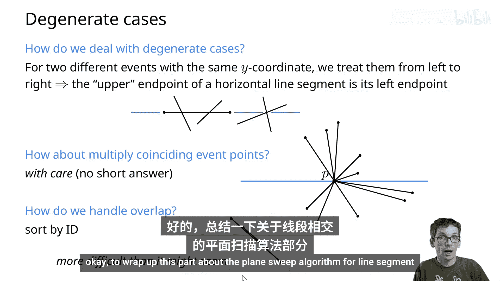

The event list。I mean， the event list will， I mean。

 the key part is to define the status And from that， see what。

 what are the events that we're going to need to handle。 then we're going to。

Need to choose data structures for the status in the event queue。And with all that in place。

 the path that you have to think about when designing the algorithm is， how do you handle the event？

😊，With that you will have the algorithm in place so then it's a matter of analyzing the algorithm and for that you will have to look at how many events do you have。

 how much time does it take to handle one event and that will give you your running time then finally you will have to handle de general cases。

But very often in eye design， you you can make some kind of general position assumption for the purpose of designing the algorithm。

 I mean， for your implementation that will not help。

So this wraps up the plane sweep algorithm for finding intersections and a set of line segments。

 Our motivation for this was map overlay。 So next we're going to go back to that problem of map overlay and see I mean won't go into detail about it。

 but we're going to see what we need to solve this problem now。

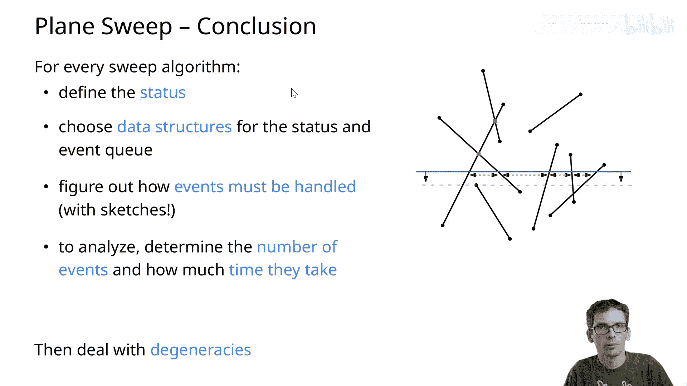