# 【Algorithms Lab】计算几何 ｜ Computational Geometry p03 P03_用于平面细分的双向链表 -BV1Jtn7zSEXD_p3-

Our motivation to study the line segment intersection problem was the problem of map overlay。

 so let's get back to that now and in particular we're going to see a data structure to store planar subdivisions because that's essentially the map layers that we are dealing with so to solve the map overlay problem what we looked at so far was if I want to combine two layers and they consist of regions bounded by line segments and I have to be able to find those intersections between those line segments that problem we've solved。

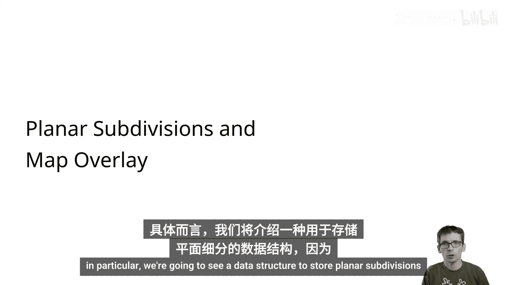

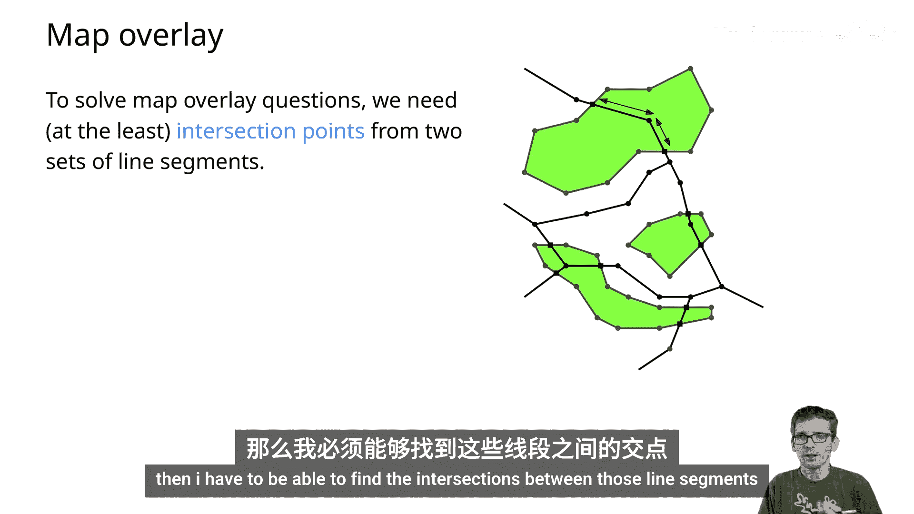

So now the key problem that we still need to look at is how do we actually represent subdiics。

 so how do we represent these map layers？And we're going to see a data structure for that。

 The data structure is called doubly connected。 edgeless。

 and we're going to see why it's called that later or short Del。 So what is a planar subdiicial。

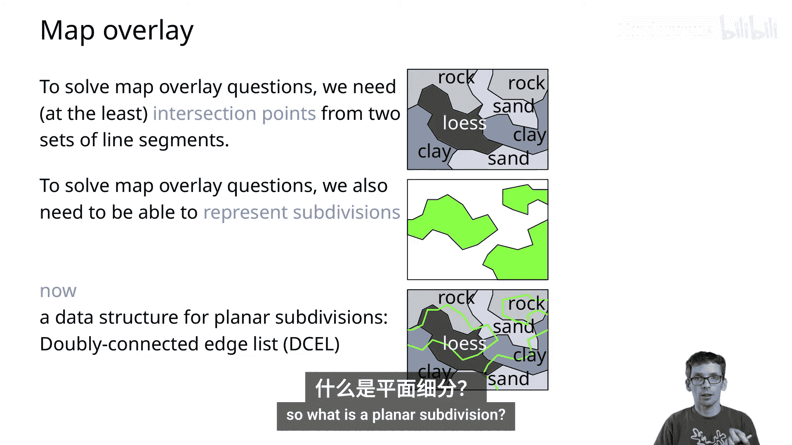

So plan of subdivision is a subdivision of the plane induced by a set of non intersecting line segments。

Or they only dissect at common endpoints。 So here we have a planner subdivision， It has us。Objects。

 vertices， edges and faces。 So the vertices are the endpoints of these line segments。

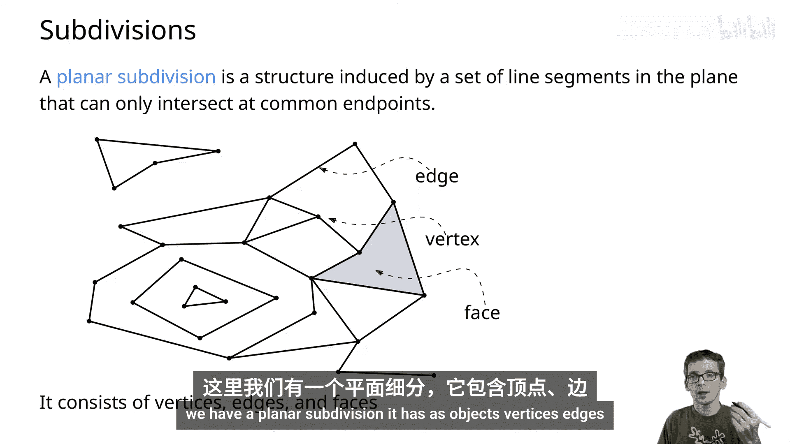

So yeah， we have to。What it is the address。Edges we see the interior of those line segments and then the faces。

看哈。Regions bounded by so two dimensional connected regions that don't contain any of the line segments。

 And we also have the， I said， bounded， but。So this outside here that we also count as a face。

 that's our outer face。Let's start with some terminology if。A vertex is part of an edge。

We say that vertex is incident to that edge。 Likewise， this edge is incident to that face。

 So that's always when the objects have different dimensionalities。

 and we have this inclusion property。 So that vertex is part of an edge or vertex is part of a face。

 If we have neighboring objects of the same dimension， then we talk about a。So for instance。

 we have that this phase is adjacent。2。The outer phase。 Let's have a closer look at the faces。

 So every planar subdivision has one outer face。 So one phase does that does not have an outer boundary。

 So every other phase actually has an outer boundary。 So any。

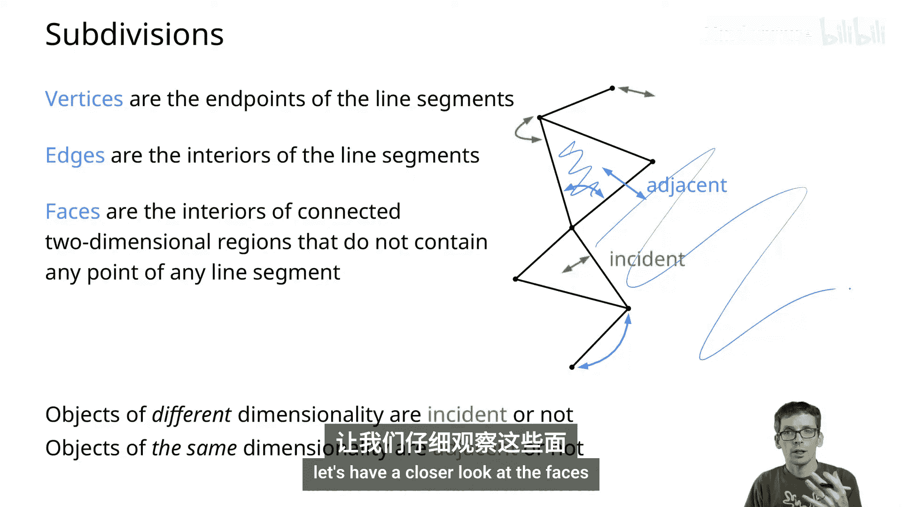

Let me pick a face here。 so there's face here。It hath。As an alpha boundary。

These segments with vertices。 So every phase， except for the outer face， has an outer boundary。Every。

Phase has。Zero or more inner boundary so functions in this phase here。I mean。

 it has an outer boundary， but it in particular also has。2， so God holds so the general。

Idea of in terms of data structure， what we we want to have is we want to have the vertices as objects。

 edges as objects， faces as objects， and some are pointers。

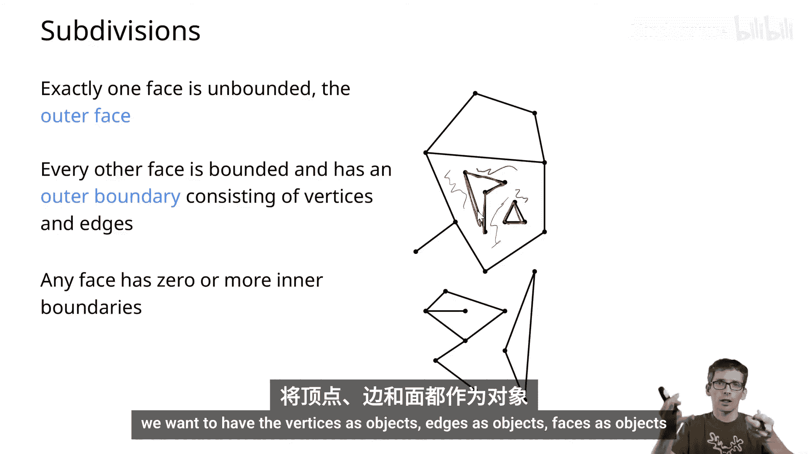

In between， and the key question is。What kind of pointers do we want to have？So do we want to have。

Poiners I from， I mean， if I have a phase and the。The vertices incident to that phase， I mean。

 do I want to have from that phase appointed to each of these vertices？

What happens is that phase and changes do we have to update all of those two disease。

 So these kind of questions we need to address。And what is what seems like a good idea is to make the edges central objects of such a data structure and why is that the case。

 Because edges actually in terms of the incidences are nicely behaved so every。

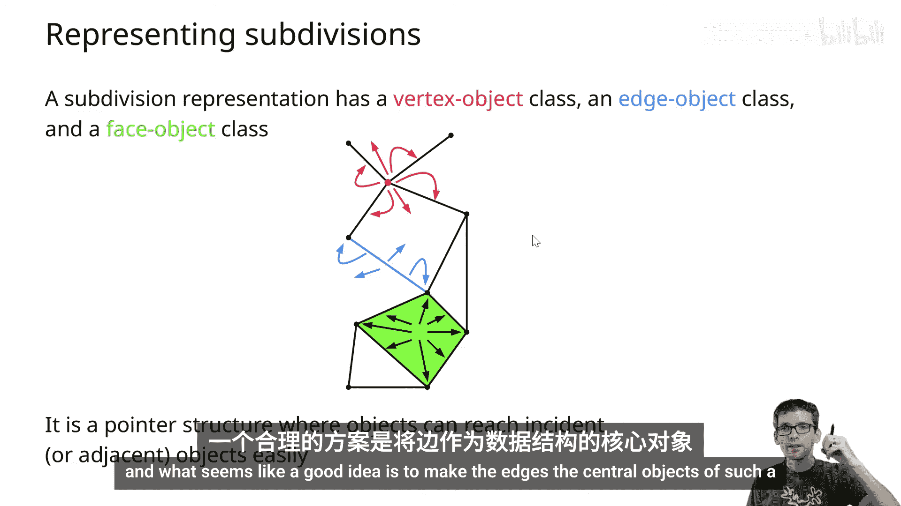

Edge has exactly two vertices that are incident to that edge。And it's incidentally exactly two faces。

So for this edge， those are the V1 and V2 other vertices。F1 and F 2 are corresponding cases， so far。

So good。 What we would like to have is we would like to have a way to distinguish。These two vertices。

 not just have two vertices， but have some kind of。From the perspective of that edge。

 having having these having way of distinguishing them。

 And the way to do that is kind of to give an orientation to that edge。

 So if that edge points upwards。Then this vertex is the origin of that edge。

 and this is the destination。This also allows us to distinguish the faces so that one face that is to the right and one face。

That is。To the left。So if we can give an orientation to it。Hdge。That's a good thing。 Now。

 from the perspective on it of a face， it would be nice if these。Orientations are consistent。I mean。

 imagine I'm this face here。H， for some reason no。That this edge belongs to me。

Then it would be nice to simply be able to follow。Hedges。Around。The face。

So we would like to for this phase， be able to go to the next edge on that phase。

Or to the previous edge on that face。 and likewise， to the next edge here。

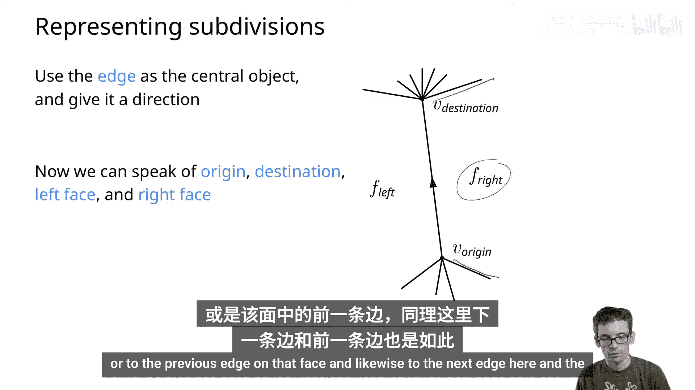

And the previous one。Here and we would like to do so in a consistent way。 but that is problematic。

 I mean， if let's say I'm starting here， so I give this at that orientation。

And now I want to be able to go walk around the faces。 So I walk around this twinangle。

This edge has to be like this and this one like that， so far so good。This one has to。

 if I want to go around this to。It has to be like this。But now with this triangle here， I'm screwed。

 So here， this triangle I have。Those go here， so there's no way to orient this。So， that doesn't work。

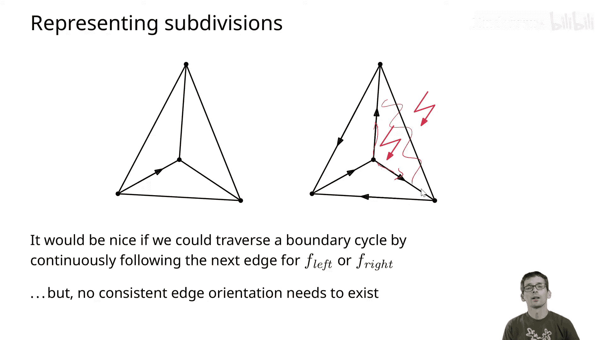

And here comes a trick， and here comes a kind of specialty of this。Data structure， I mean。

 it's called doubly connected edge list。

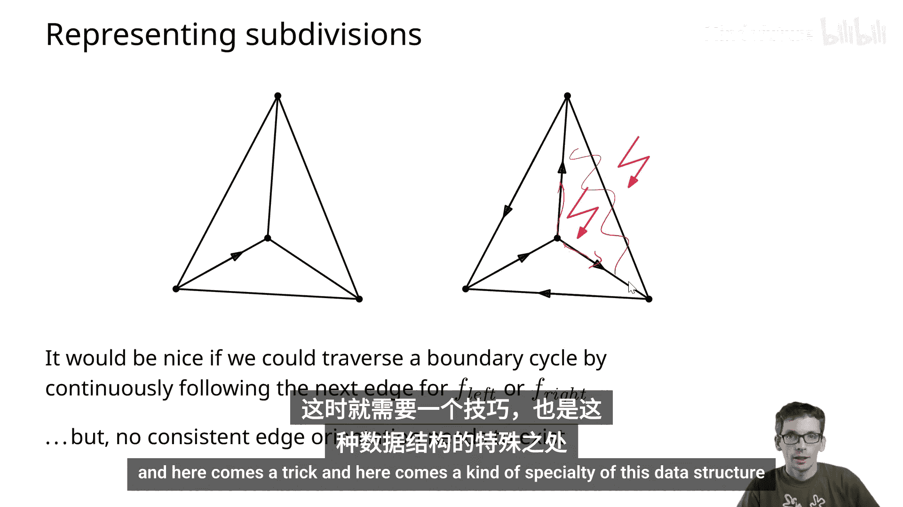

What we do here actually is we dont have edge， but we have half edge。

So imagine you have an edge and split it in half but。Alongong its actual direction。Like you see here。

 this allows us to get consistent orientations。So now I can walk around this phase using this half inch。

 and I can walk around this case using the other half edgech。 so that's very nice So let's。

Puts this into a data structure for every half edge。 So it for every half edge here， I will。

 it will have a twin。So the twin will be the half edge and the other。

Direction and a half it will now be incident。To only one phase。

 So then it is also easy to say what is the next half edge and the previous half edge。

 because that's the next half edge in relation to that face and the previous one to that face。

 And likewise， for the twin。

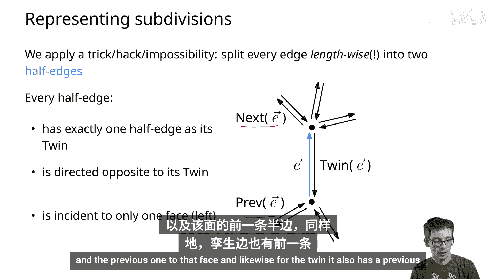

It also has the previous and the next half edge。

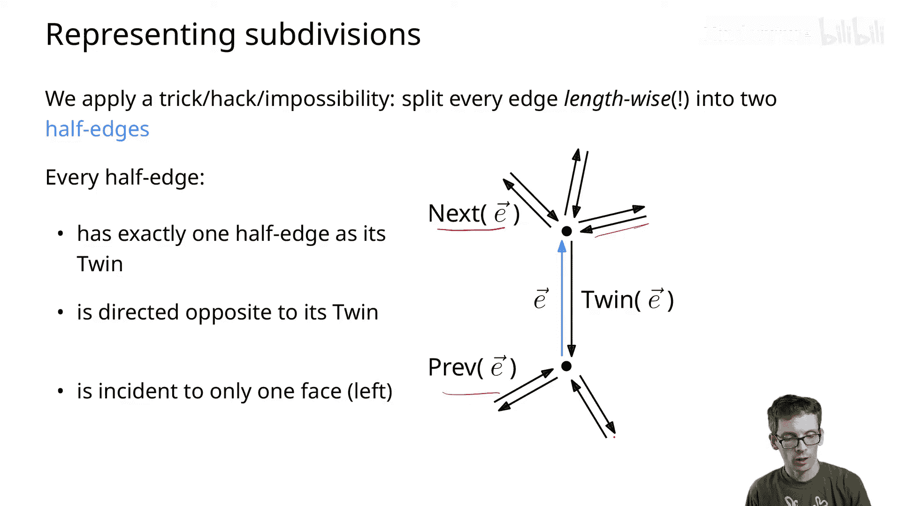

So that works out nicely。 So what we have now so far is。We have our vertex objects。

 The vertex objects are pretty simple。 I mean， they will have some kind of coordinate。

 and every with every vertex， we restore one incident edge。

 So we're not going to store all incident edges because that would be。

 because that simply is not necessary and would be more than we need。 And then for the half edges。

 what were going to store is for the half edge we want to know。It's a original。It's twin。

 the other it's twin half edge。The incident phase。And the next and the previous of it。

So you already see。I mean， you would have maybe expected that next to the original we store the destination。

 so why don't we do that？

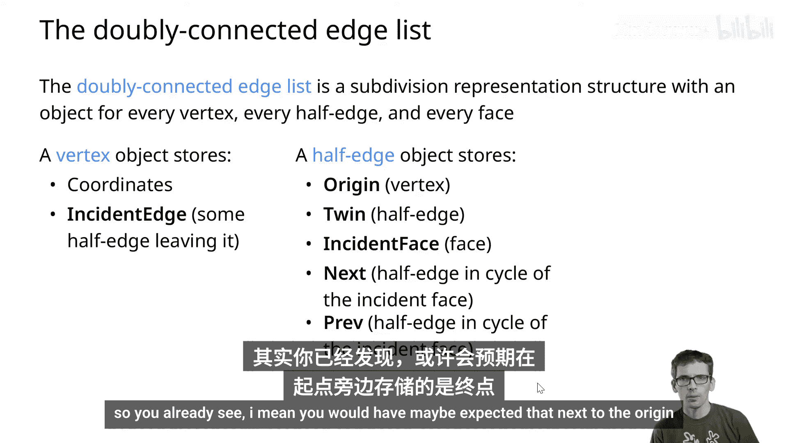

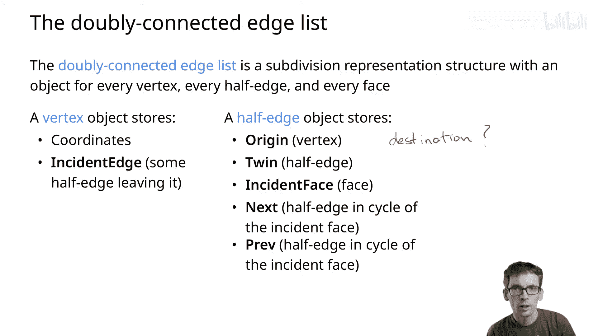

Because we can find it out easily by asking is the twin which we know。For it's a wge that gives us。

All right， let's finish。So this might come a bit。As a surprise， this data has structure。

 but it is powerful enough to do the local operations that we want to do。 For instance。

 think about this for a moment if I have I give you a vertex。

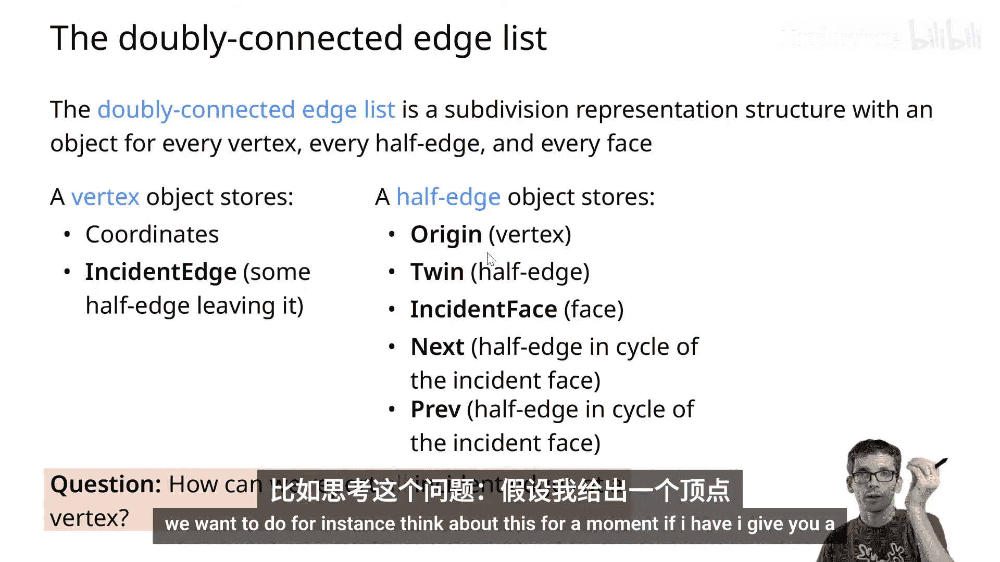

And now you want to report all incident edges。 How do you do that， Okay。

 so let's think about that together。 I have a vertex。 I would like to have all incident edges。아オ涅夫。

But I can take that one。 So here's an incident H。 That's my。Incident edge。So what can I do from here。

 I can ask this incident edge。For it。Twin。😡。

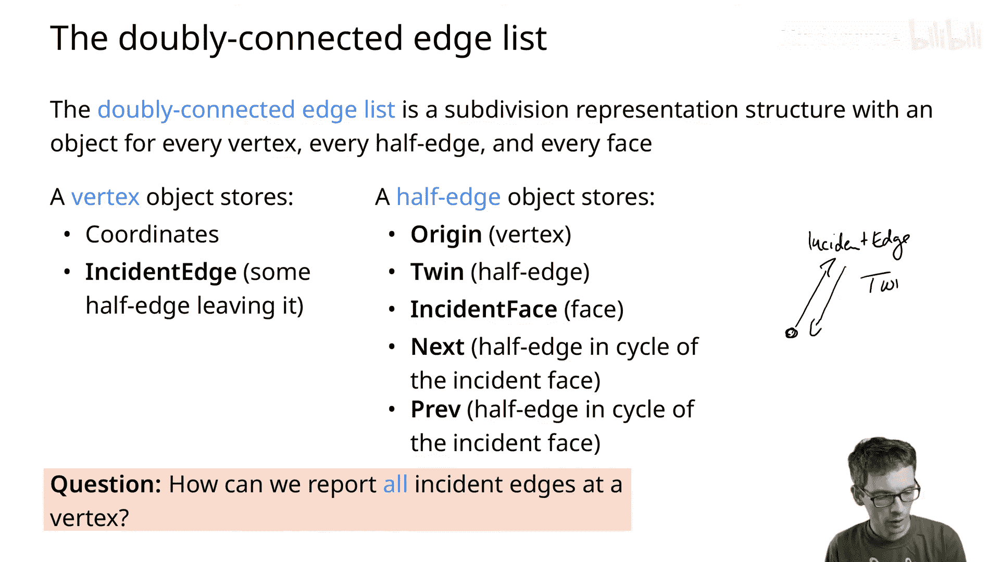

That twin will bring me back to that vertex， but more importantly。I can follow that twin。

I can ask the Putn。For the next half edge along the face， and that will be my next incident edge。

I can ask them。That edge， half edge for its twin and so on until I'm back at my original half edge。

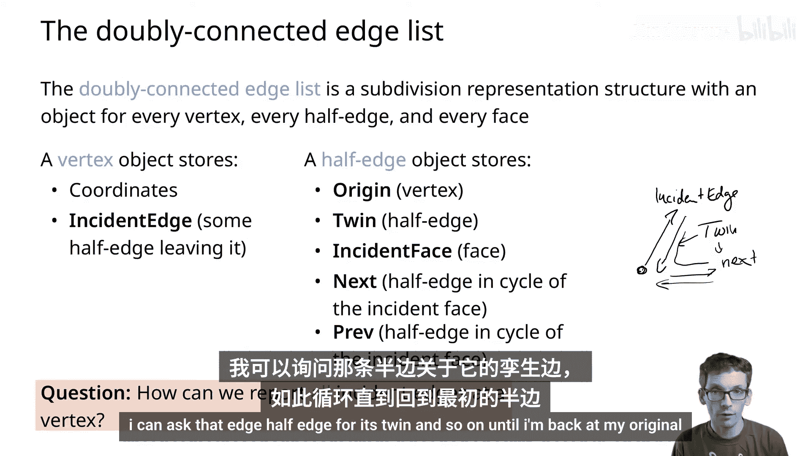

て两对。So that's just one example of that this is enough in terms of what we need to store。

For the vertices and the half edges。ThePs we still need to talk about。 So for a phase。

 what do we need？

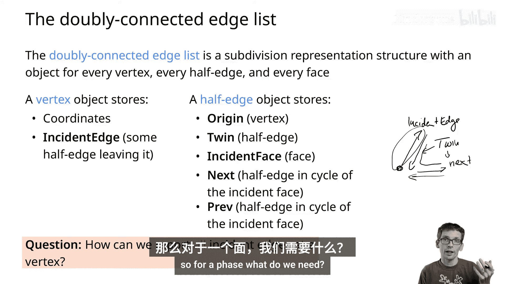

I mean， for a phase， we need access to its outer boundary and possibly to its inner boundaries and what we do。

As we were going to store one half edge。For the auto boundary and。For every inner boundary。

 also one half it。 So we you see here， we have this phase that。One pointer to one of the half edges。

 because from there I can find all others by going through the next or previous if you want to。

 and then I have pointers to the inner boundaries and again， just to one half edge。

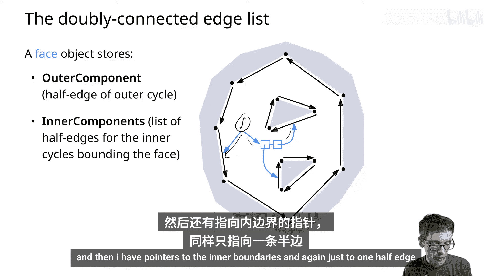

So that's all we need here just as a summary we can vertices to one incident edge faces to one half edge of the outer boundary。

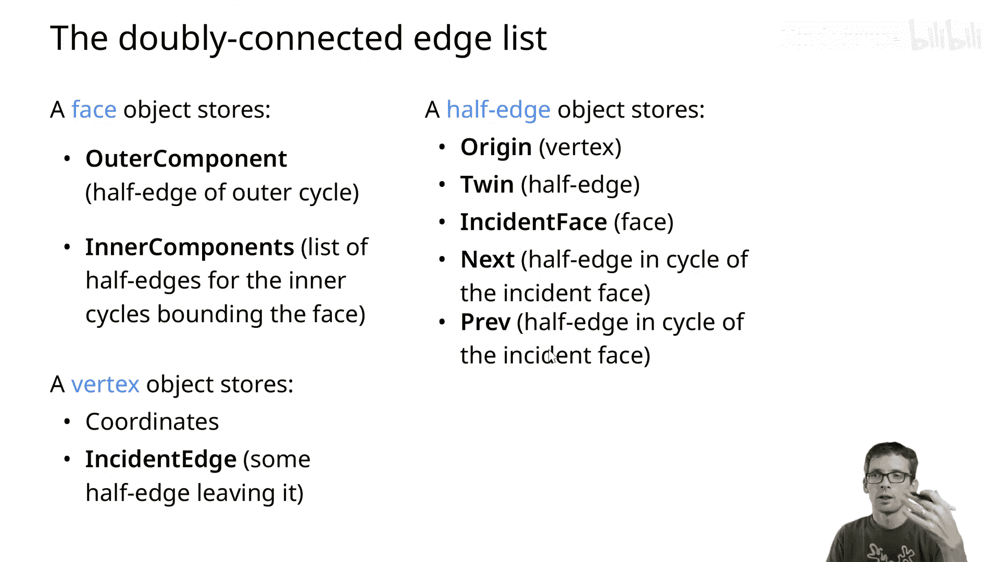

One half edge for each in a boundary and the half edges then half of which and twin。

 It's interface a Next and previous， let's use the following quiz to。

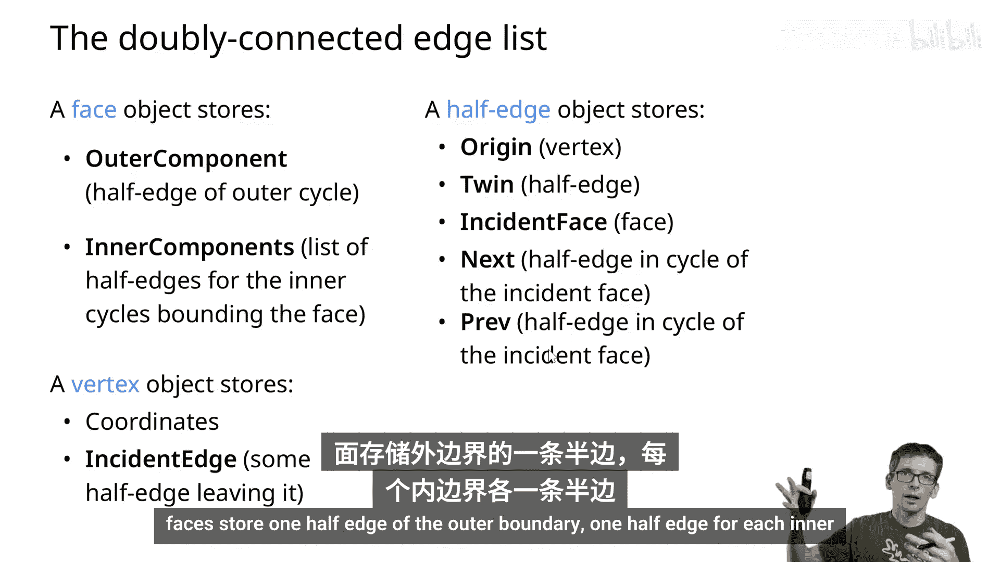

Think about these notions a bit。

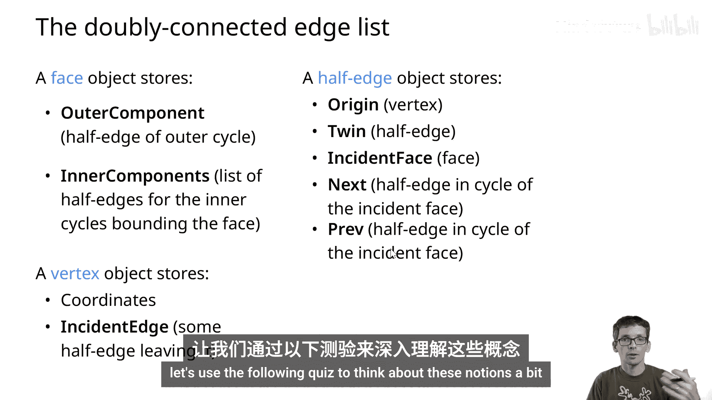

Which of the following statements is not always to the next of the previous of an edge is edge again。

The incident phase of an edge。It's the incident phase of the next step。

Or the twin of the previous of the twin of an edge is the next step。So the answer is the last one。

 the twin of the previous of the twin of an edge is not always the next edge。

 The other two attribute。 So I take this edge， the previous of that edge along that phase might be it would be this one。

 And if I go from the previous to the next time again。

Fhi next and previous were kind of were defined to be the next and previous on the。

Of the incident phase。 So that is also certainly true。Now I have an edge。

Let's see when the last one is not true。 I have an edge。 I take its twin。Of that twin， I take the。

Previous。And of the previous。The twin。That kind of looks like the next step， but of course。

If there's more going on here。It is not necessarily the case， and that's a R connected Dtitchlist。

The reason we were talking about it was map overlay。

 So let's me briefly go back to the map overlay problem。

 but I don't want to go into it in detail because you now have the two ingredients that you need and from that you can design your own sweep plan algorithm for the map overlay problems。

 The starting point is we have two subdivisions。 We want to compute the overlay。

 edges of the overlay will be parts of the edges of the original subdivisions cut at intersection points。

And the vertices will also be the vertices will be the originalal vertices plus intersectionable。

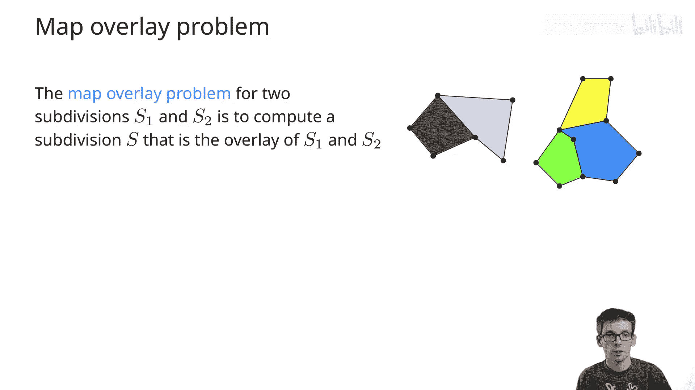

What we need is we need to find those intersection points。 and on the way。

 also make sure that we kind of split the faces correctly。

 and then we are done details of this you can find also in the。

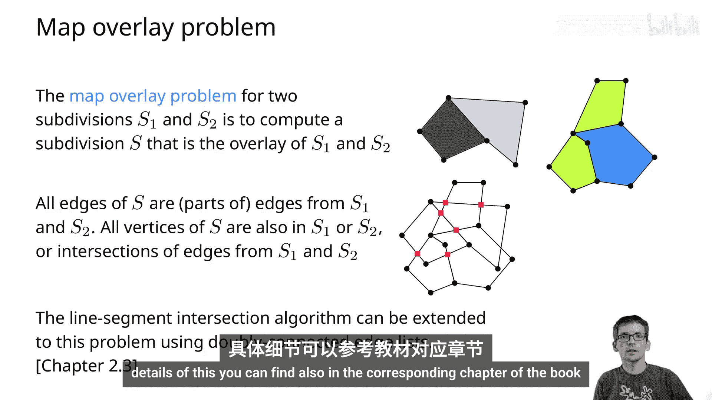

Corresponding chapter of the book。To wrap things up for today。

 the application that we were looking at was map overlay， the geometric problem。

 which we used to solve it was a lines segment intersection disse problem。

 the algorithmic technique used for this was plain sweep， and we looked at that in a lot of detail。

And to store subdivisions， we use doubly connected Elist。

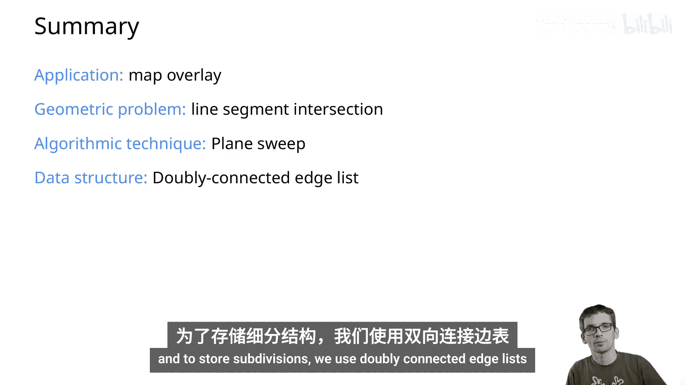

See you next time。