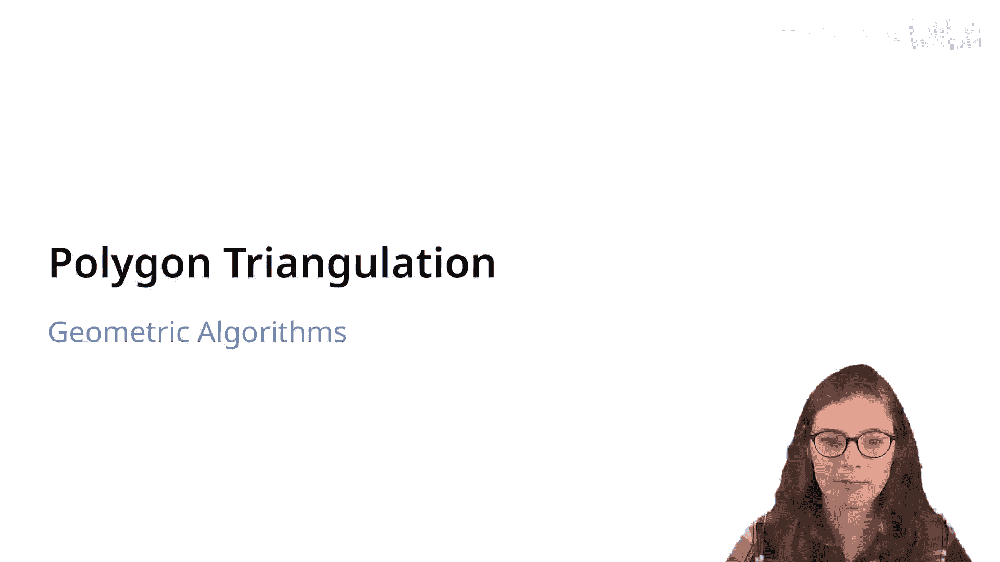
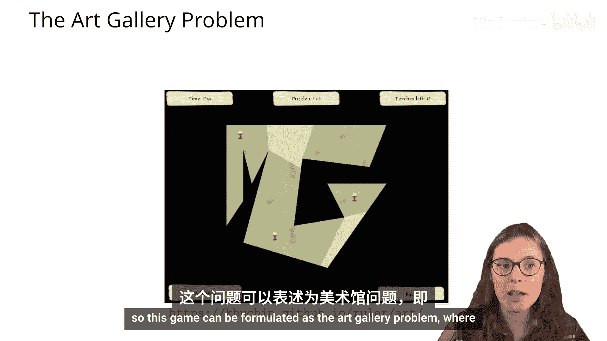
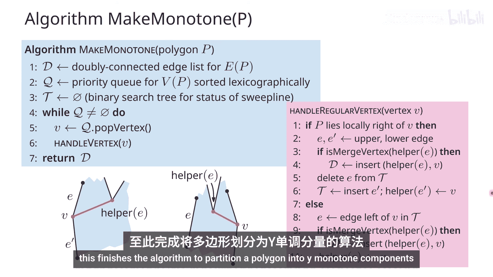
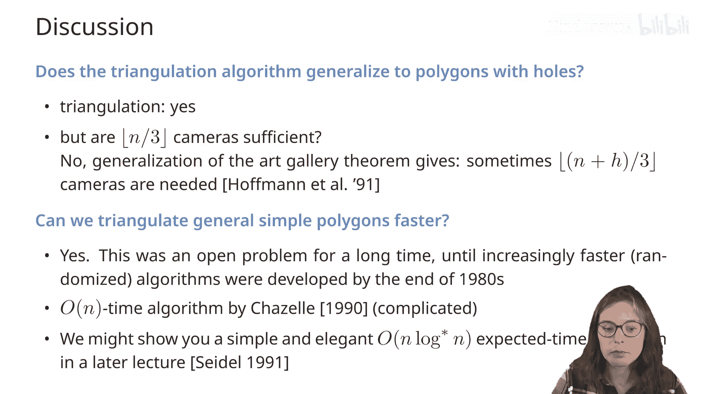

# 【Algorithms Lab】计算几何 ｜ Computational Geometry p04 P04_多边形三角剖分_美术馆问题 -BV1Jtn7zSEXD_p4-

Hello， the topic of today's lecture is polygon triangulation。

Let's start with one of the games that is implemented within the geometric game framework here you can see a dark room that is almost completely lit by two lights。

 but theres still some area that is in the shade the rules of the game is that you need to place a certain number of flight to eliminate the whole area。

 so this game can be formulated as the art gallery problem。

Where we are asked to place a smallest number of cameras that will see the whole area of some art gallery that we represent as a polygon so in the example on the right hand side you can see that five cameras placed in these specific locations。

 you can see the whole interior of the polygon。For this lecture。

 we will make the assumption that the polygon describing the art gallery is simple。

 that means that there are no holes in the polygon and that it is described by an vertices。

So let's define what we mean when we say a camera sees the interior of a polygon。

 we say that point P is visible from some point C， both points lie inside the polygon if the segment C completely lies within the polygon P。

 so here on the right hand side P is visible from C because the green segment Cp completely lies inside the polygon P and P prime is not seen from C because the segment Cp prime intersects the boundary of the polygon。

For a single camera placed in some location inside a polygon。

 we can find all the points that are visible from the camera's location。

 and these points will form a so called star shaped region。

 The definition of a star shaped region is exactly that that it can be completely seen from one point。

So now we want to minimize the number of cameras we need to use to survey the whole area of the art gallery。

And of course， the number of cameras that we will have to use depends on the size of the polygon on N。

 but also on the shape of the polygon。And in fact， it is an NP hard problem。

 meaning that there is no efficient algorithm that can find the smallest number of cameras to survey the whole area of a given polygon。

But what we can consider is some combinatorial bounds。

Simple upper and lower bounds needed to cover the whole area of the polygon。 Trivily。

 we need at least one camera and。Atmost， and cameras。

Right because we can place a camera in each vertex of the polygon and in this way we will definitely see the whole interior of the polygon。

 but are there any better bounds on the number of cameras that are needed and that are sufficient to survey any polygon of a given size N to prove a given upper bound。

 we will try to prove that。That particularly many cameras always suffices for any polygon of a given size。

 And to prove a lower bound， we will try to construct a family of examples of polygons that require that many cameras to survey their interior。

 So let's try to find some better upper and lower bounds on the number of cameras that are needed for any polygon of size N。

The first observation that we can make here is triangles are easy to guard。

 indeed if you place a camera in any point inside a triangle。

 it will completely see the whole interior of the triangle。

So then a natural idea to place the guard inside a polygon is to partition the polygon into triangles and place a camera within each triangle。

Now we have reduced the question to triangulating a given polygon， but that is， of course。

 if we can find such a triangulation， so I want to end this section with the following three question。

 does a triangulation always exist I it unique and how many triangles does a triangulation have for a given polygon of size N？

Well， in fact， the answer is， yes， a triangleang lesion always exists， it's not necessarily unique。

 but it will always consist of n minus two triangles if the size of a polygon is n。

Let's try to prove this theorem。 We're going to prove this by induction on n。

 We start with n equals 3。 And for this case， the polygon is triangle itself trivially。

 It is already a triangulation， consisting of 3-2 equals1 triangle。Okay， so the base case is trivial。

 let's see how we can prove the induction step。Suppose we have a polygon of size。

 and that is greater than3。Then let's consider the leftmost vertex V。

 and let's denote its two neighbors U and W。 Now let's consider the edge UW， there can be two cases。

 Either this edge is a diagonal in the polygon， meaning that this edge completely lies in the interior of the polygon。

 In this case， we can cut off this triangle Uvw and reduce the size of the polygon。

 therefore completing the induction step。 Okay， but what if UW is not a diagonal in the polygon。

 Well， that means that within triangle Uvw， there may be other points of the polygon。

 We're going to find such a point T， that is furthest away from UW。 and this will ensure that。

The segment， VT completely lies inside the polygon。

 and as we can split the polygon into two smaller sub polygons。Indeed。

 we can partition the polygon along the diagonal VT into two smaller polygons of size M and n minus m plus 2。

 and after we applied the induction hypothesis to two smaller subpolygons， we get n minus2 triangles。

Okay， we have proven that Hangulation always exists。

 and it consists of n minus2 triangles for a polygon of size n。

 but does the proof provide us with an algorithm？And if it does。

 what would be the running time of it， So take a moment to think about these two answers。Indeed。

 we can build a recursive algorithm based on the ideas of the proof and the running time of the algorithm will be quadratic。

Back to the art gallery problem， we have observed that guarding triangles is easy and we have just proven that any polygon P can be triangulated into n minus two triangles if P has n vertices。

So now we can simply triangulate the given polygon P and place a guard or a camera inside every triangle this will give us n minus two cameras。

 however we can reduce this number to about and over two cameras if we pair triangles in a smart way and place a camera on each edge joining each pair of triangles。

We can further reduce the number of cameras needed if we consider socalled vertex guard。

 meaning cameras that are placed in the vertices of a polygon。

 So how many cameras are needed to guard a given polygon。 Well。

 let's prove the following theorem that N 3 floor guards are sometimes necessary and always sufficient to guard a simple polygon with n vertices。

 What does it mean sometimes necessary and always efficient。

 While this is your upper and lower bound on the number of guards needed to guard any polygon of size N。

Recall that to prove a lower bound， we want to construct a family of examples for arbitrary large N that will require。

 in this case， n over three cameras to guard them。So pause the video。

 take a few minutes and see if you can come up with an example for arbitrary large N of a polygon that will require n over three cameras to guard it。

Okay， let's see if your examples are similar to mine this polygon is called a comp polygon because of the spikes。

If we count't we see that we spend three vertices for each spike and indeed we need to place a guard across each spike to see the tip of the spike if we try to place a guard some place in between the two spike it's not going to see the tips of the spikes。

 so we will need an over three cameras to guard a polygon of this shape。Now。

 to prove the upper bound， we need to prove that n over three guards are always sufficient to guard any polygon of size n。

 so to prove it we're going to start with triangulating the polygon。

The second step is to three color theertices of the resulting triangulation。

What do I mean by three coloring the vertices， we need to assign one of three colors to each vertex so that no edge has two incident vertices of the same color。

In the figure on the right， you can see that all vertices are colored in three colors and none of the edge has two and points of the same color。

How can we prove that this is always possible while we can use induction or we can consider a dual graph。

 which is a graph that has a node for each triangle in the triangulation and two nodes are connected if the two corresponding triangles share an edge？

The dualgraph of a triangulation is a tree， and then we can traverse this tree and color the vertices of the triangles in the color so that no edge has two end points of the same color。

Now。Given that all vertices are colored in one of three colors。

 we can choose the smallest color class， and the smallest color class will have at most and over three vertices。

Thus， to find the placement of n over three guards in a polygon of size n。

 what we do is first we compute the triangulation， we compute the dual graph of the triangulation。

 and we color the vertices of the triangulation by traversing the dual graph。

 and finally we select the smallest color class to place the guards in it。

This will guarantee that all triangles are covered by guards because every triangle has three vertices of different colors。

So what is the running time of this algorithm？Well we have said that we can find a triangulation with a quadratic running time algorithm。

 then we can compute the dual graph and find the coloring of the vertices in linear time。

 so in total we get a quadratic running time algorithm the bottleneck here is of course computing the triangulation so in the following we're going to see how to improve the running time of a triangulation algorithm。

We're going to build a faster triangulation algorithm using the following idea。

 We' are going to partition the input polygon into simpler parts。

 and we're going to triangulate those parts individually。 So what should these parts be。

 what polygons are easy to triangulate。We are going to use whymonotone polygons。

 So consider the following two step procedure in step 1。

 we partition the polygon P into Ymonone subpogons。

A y monotone polygon is such that any horizontal line intersecting it intersects it in one connected component for example。

 the right polygon is not y monotone because there exists a line L that intersects it into two components on the other hand the left polygon is y monoone because any line intersecting it。

 intersects it in one connected component。A useful property of a y monoton polygon is that if we consider the top and the bottom vertex and we consider the boundary segments between these vertices。

 moving along these boundaries we're always moving either up or down after partitioning the input polygon into y monoton pieces。

 we're going to triangulate each of those pieces separately。

To subdivide a polygon into Y monootton pieces， we're going to classify the vertices often input polygon into the following five types。

The first four types will be so called turn vertices。 If we follow the boundary of a polygon。

 when we pass a turn vertex， we're going to change the vertical direction in which we move。

For example， moving along the boundary in this direction after passing this vertex。

 we change from moving downwards to moving upwards。 So this vertex D is a turn vertex。

So let's see what kind of vertices can be turned vertices。

The first type of a turn vertex is a start vertex。If we sweep the polygon with the horizontal line。

 when it passes a start vertex， it's going to give rise to a new connected component。

 That is why it's called a start vertex。 Gemetrically。

 we can identify this vertex by considering the two incident edges。

 If both of them are moving downwards from the vertex。

 and the interior angle of the polygon is less than 180 degrees。 then this is a start vertex。

The next vertex is a split vertex。When we sweep over the split vertex with the horizontal line。

The connected component gets split into two。That is why it's called a split vertex。Locally。

 we can identify a split vertex again by considering the adjacent edges。

 Both of them need to be going down， but now the interior angle。Is greater than 180 degrees。Next。

 the n vertex is the symmetrical case of the start vertex。

 This is where the connected component on the sweep line when passing the nvertex terminates。Again。

 we can identify the end vertex locally by considering the incident edges。Both edges。Go upwards。

 and the incident angle is less than 180 degrees。And finally， there is a merge vertex。

 which is the symmetric case of a split vertex when a sweep line。Passes a merge vertex。

 The two connected components on the line merge into one。The two incident edges。

To the vertex are going upwards， but the interior angle of the polygon is now greater than 180 degrees。

Finally， there is a regular vertex。 This is the vertex where the vertical direction of the boundary does not switch。

Now we're going to prove the following lemon。 If a polygon does not contain split and merger vertices。

 then it is by monotone。To prove it， we are going to prove the contra positiveitive statement。

 Suppose the polygon P is not Y monottonone。That means by definition。

 there is a horizontal line L that intersects it in more than one connected component。

So let's consider such line L。 and let's extend the boundary going through the point Q in this example until the next intersection with the line L。

 There can be two cases。 In the first case， the boundary intersects the line L from top to bottom。

Then we can consider the segment between the points Q and R and argue that there must be a split vertex on the segment of the boundary。

In the second case， after extending the boundary， it intersects the line L from bottom to top。

 and in this case there must be a merge vertex on the segment of the boundary between vertices Q and R。

In both cases， we get either split vertex or emerge vertex on the boundary of the polygon。Thus。

 if a polygon does not contain split and merge vertices， then it is Y monoton。

This implies that if we want to partition a polygon into Y monoton components。

 then we want to get rid of the split and merge vertices by adding diagonals that partition them。

But of course， we need to be careful so that these diagonals that we add do not intersect the boundary of the polygon or each other。

We are ready to present the algorithm to partition a polygon into Y monoton components。First。

 we're going to see how to add diagonals to get rid of this split verticity。

 We are going to do the following。For each vertex v。

 we are going to compute the edge of the boundary of the polyan that lies to the left of V。

For example， in the figure on the right， three points of the polygon point to the same edge as their left edge。

The idea is to connect the split vertex v to the lowest vertex W that is above V with the same left edge。

So in the example on the right， W will be the lowest vertex that is pointing to left V。

By inserting the diagonal VW， we are going to get rid of this split vertex v。To find such a vertex W。

We're going to store a pointer called helper in every edge that will point。

To the lowest such vertex W。When a sweep line reaches the split vertex v。

 it will check which helper does the edge to the left of V has and insert the diagonal to that helper。

And now we're going to see how to get rid of the merge purchases。

When the merge vertex V is reached by the sweep plane。

 we first update the helper of the edge to the left of V to set it to V itself。If the next vertex。

 v prime reached by this sweep line is split vertex， then we simply add the diagonal V V prime。

If the next vertex reached， the prime is on the right boundary。

 That means that the left edge will update its helper pointer to the prime。

 and we insert the diagonal V V prime。And if V prime is on the left boundary。

 meaning that we have reached the endpoint of the edge left of V。

 then we simply connect V to V prime。Another way of dealing with mech vertices is to observe that if we rotate the polygon by 180 degrees。

 all mergech vertices become split vertices， and we know how to deal with split vertices to summarize the events of our sweep line algorithm are given by the vertices of the polygon sorted by their Y coordinate。

 the status of the sweep plane algorithm are all the components that the horizontal sweep line L intersects with all the pointers from the vertices to the left edges and with all the helper pointers stored in every edge。

We are ready to put together all the observations， by so far， in a pseudo code。

We're going to use a doubleubly connected edge list G for the output。

We are going to populate the priority queue with the vertices of the polygon sorted by their white coordinates。

And we're going to use a binary search treat T as the status data structure， as we said before。

 we want to store each connected component in the status data structure。

 so we're going to keep the left edges of each connected component in T。So now。

 while the priority queue is not empty， we're going to extract the next vertex v and we're going to handle it depending on its type。

First， consider the case where v is a start vertex。

 then we simply insert the left edge E into the status data structure。

 and we set V to be the helper of E。Next， if V is an n vertex。

 we want to check if the helper of the left edge E points to some merge vertex。If it is so。

 then we insert the diagonal from V to that merge vertex。

 and we delete E from the status data structure T。Now， if V has a split vertex， as said before。

 we're going to go through its left edge E and connect V by a diagonal to the helper of E。

We then will insert the right edge E prime into the status structure T to designate the new component。

And we're going to update the helper of E to B V， and we will set the helper of E prime to again。

 point2 V。If v is a merge vertex， then first we consider the right edge incident to V。

And we check the helper of E。 If it happens that the helper of E is a merge vertex。

 then we need to insert the diagonal from V to that helper of E。

 and we delete edge E from the status structure T。Next， we consider the left edge E prime of V。

 and we check what its helper is。Again， if its helper is a merge vertex。

 we're going to insert the diagonal connected to V。And next。

 we update the helper of E prime to now point to V。Finally， to process the regular vertex v。

 we're going to consider two cases where v is on the left boundary and when V is on the right boundary。

 If V lies on the left boundary of the polygon， then denote E to be the top edge and E prime to be the bottom edge incident to V。

And check whether the helper of E is sub mergege vertex。If indeed that is the case。

 we connect it to V by inserting a diagonal。 We then delete E from the status structure T。

 we insert E prime into the status structure T， and we set V to be the helper of E prime。Now。

 if V is on the right boundary of the polygon， then we again check the left edge of V and check its helper If the helper is a merge vertex。

 then we insert the diagonal connecting it to V。And we update the helper of the left H E to now point to v。

This finishes the algorithm to partition a polygon into Y monoton components。

We now are going to analyze the described algorithm of partitioning a polygon into Y monotone components first we're going to prove the correctness and to do so we're going to prove that first all the split and merge vertices are removed。

And second， that we do not introduce any intersections by inserting the diagonals the way we do。

The first claim is straightforward by construction we need to check how we get rid of the split and the merge vertices when we reach a split vertex we add a diagonal going upwards from that vertex and thus indeed the split vertex is removed and a little bit more tricky but we again can show that we get rid of all the merge vertices by connecting them with a diagonal that goes downwards from these merge vertices。

To prove the second claim， we're just going to do the case analysis。

 consider the first case where V is a split vertex and V prime is the merge vertex。

 and we insert the diagonal V v prime。 because V is the next event following the processing of the point V prime trapusoidal area Q is empty。

 and thus inserting the diagonal V V prime cannot introduce any crossings。

 The other cases are analogous。 So now that we have proved the correctness of the algorithm。

 Let us analyze its time and space complexity。 Let's prove the following theorem。

 A simple polygon with an vertices can be partitioned in some time using some space into y monotone polygons。

 So what is the time and the space requirements of the algorithm that we have just developed。

 Let's consider the steps that it takes。First， the algorithm creates the priority queue。

Then it needs to initialize the status data structure， and then for each event。

 what it does is it deletes the next vertex from the queue。 it needs to search。

 delete and insert elements into the status data structure and it will add at most two diagonals to the Wub connected edge list。

 If we use the mean heap for the priority queue initializing it takes linear time。

 Iizing the status data structure takes constant time because initially it will be empty。 Now。

 for the time that is spent for each event， the delete operation takes logarithmic time。

 the search delete and insert elements into the status structure also take logarithmic time and adding at most two diagonals to the W connected edge list is constant in time。

 So in total with spent logarithmic time in。For each event。

 And we know that there' is going to be an event。Finally， for the space。The space will be linear。

Is it easy to see， Well， we can charge each extra auxiliary variable that we use。

To the vertex or to the edge that it uses and each vertex and each edge will only use constant number of those。

 So indeed， the space is going to be linear。So now we can fill in the blanks and say that a simple polygon with a vertices can be partitioned in engan time using linear space into Y monoton polygons。

Going back to our two step procedure， step one was to partition a polygon into Wimonton sub polygons and now we know how to do it。

So now let's see how to implement the step two， which is triangulate each y minorton sub polyan。

Recall our observation that a boundary of a Y monotton polygon can be split by the topmost and the bottommost vertex into two monotone chains going from top to bottom。

The approach here to triangangle it a w monoton polygon is going to be greedy。

 We're just going to stop from top to bottom and add the diagonals as we go。

 So let's start with the topmost vertex again， moveve down with a sweep line。And at the moment。

 when we can insert diagonals to the previously covered vertices， we will do so。

So how can we describe this process， what is the invariant here？

Well let's again repeat the few first steps of this sweep line process。

 we are covering the part of the polygon until we jump to the other side of the boundary to connect the diagonals。

 so until the first diagonal is inserted， the area that is covered by sweep line is an upside down funnel shape。

The property of the funnel shape is that the two chains on its two sides consist of concave vertices。

Concave vertices are those whose measurement is greater than 180 degrees。 And on the other side。

 convex vertices are those whose angle is less than 180 degree。 to be more precise。

 the funnel that we see when triangulating a wmon and polygon is going to be of the following shape。

 It will have only one chain consisting of multiple vertices。

 and it will have one straight edge on the other side。 As soon as we reach the end of this edge。

 we're going to start inserting the diagonals to the opposite side。Of the funnel。

So this is a simple case of a funnel that we can see when triangulating the polygon。

 so let's see the full algorithm for triangulating a y minorton polygon。

The algorithm is the following。Again， consider the vertices of the polygon by the decreasing y coordinate。

 We are going to initialize an empty stack and push the first the vertices in it。

And then for each next vertex， we are going to do the following。

Let U J be the next vertex that we are going to process。

And let's assume that U J and the vertex that lies in the top of the stack S lie on different sides of the boundary。

Then until stack S is not empty， we're gonna pop each next vertex from it and connect to U J by a diagonal。

This corresponds to the simple case that we considered in the previous slide。After we are done。

 we're going to push the previous vertex Uj minus1 and the current vertex Uj into this stack。

In the second case， where UJ and the top vertex of the stack lie on the same side of the boundary。

 we are going to pop the vertices from the stack one by one。

 and we're going to insert the diagonals into the polygon connecting the vertex from the stack to UJ as long as UJ sees that vertex from the stack。

As soon as we reach a vertex in the stack that UJ does not see anymore。

 we push that vertex back into the stack， and then we insert UJ into the stack。Finally。

 to process the last point you N。We are going to connect it to all the vertices that are still in the stack。

 except for the first and the last。So this simple algorithm lets us triangulate a Y monoton polygon。

So now question， what is its running time？The running time of the algorithm to triangulate a ymonnoton polygon is indeed linear。

 Now， we can join this result with a previous theorem that any simple polygon with anvertices can be partitioned in ymonnoton polygons in engan time using linear space。

 We can combine these two results into the following theorem。

 A simple polygon with anvertices can be triangulated in big o of engan time using linear space。

Question， does this result follow immediately。We are splitting a polygon into multiple y monoone subpogons。

 and each of them can take linear time to triangulate。 But again， if we are doing counting carefully。

 we can charge each operation to a vertex or to an edge and show that each edge in each vertex gets charged only a constant number of operations。

 So indeed， the final result follows。To summarize our two step procedure was to partition the polygon into whymonton subpogon and then triangulate the Y monoton sub polygons that we have obtained in the first step。

So now if we want to go back to solving the art gallery problem， we can take triangulation。

 color the vertices and find the n over three guards to cover the polygon so far we have considered simple polygon。

 but can we use the same algorithm to triangulate polygons with holes。Well， in fact， yes。

 we can triangulate a polygon using the same algorithm， but for polygons with holes。

 the art gallery theorem no longer holds。 we can no longer expect to be able to cover a polygon with n over three cameras。

 Instead， we can show that n plus H over three cameras are sometimes needed and always sufficient。

 if we have a polygon with n vertices and H holes。Now， another question。

 can we find an even faster triangulation algorithm， And again， the answer is yes。

 Triangulation of a polygon has been an open problem for a really long time。

 S increasingly faster algorithms have been developed by the end of 1980s。

 but these algorithms were randomized。 So far， we have considered only deterministic algorithms。

Finally， in 1990， Bernard Jaazelle published his famous algorithm of linear triangulation of a simple polygon。

 His algorithm is so complicated that nobody takes to implement it。

 and the constants hidden in the big onenotation are so enormous that it would not be practical in any way。

But for the analysis of the asymptotic running times。

 we can say that there exists a linear running time algorithm to triangulate a polygon。

Later in this course， we may consider a much simpler algorithm that takes big O and lock star and running time to triangulate the polygon where lock star is an iterated logarithm。

 it is the number of times that you need to take the logarithm of n to get to the value that is less than1。

