# 【Algorithms Lab】计算几何 ｜ Computational Geometry p05 P05_用于点定位的垂直分解_第1部分-数据结构 -BV1Jtn7zSEXD_p5-

Welcome， today， I want to talk about point location。

 more specifically building a data structure for point location。

 The data structure that we're going to look at will be the vertical decomposition。

 And a big highlight is how we're going to construct it。

 Naly using randomized incremental construction。 So let's start with an example。

 So imagine I have some kind of map。😊。

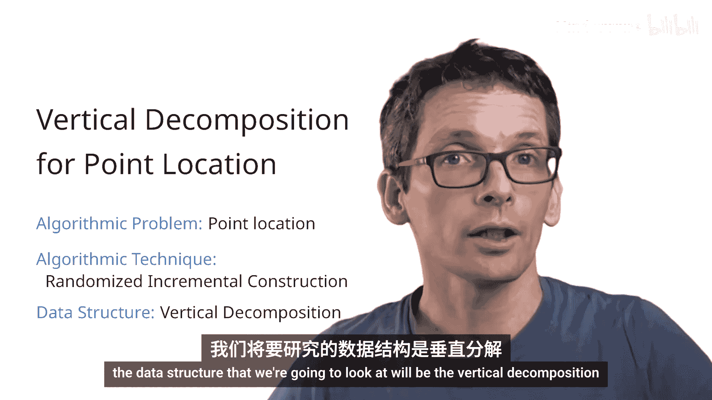

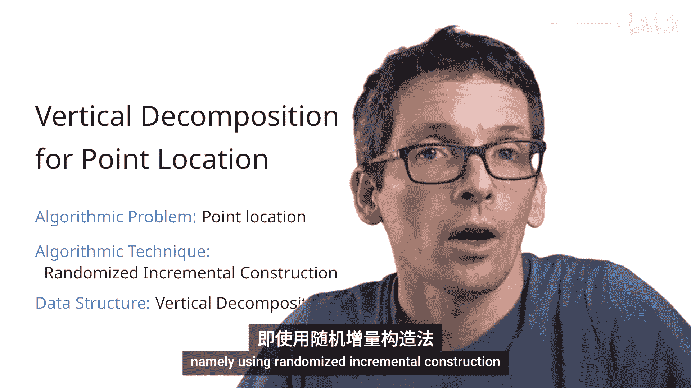

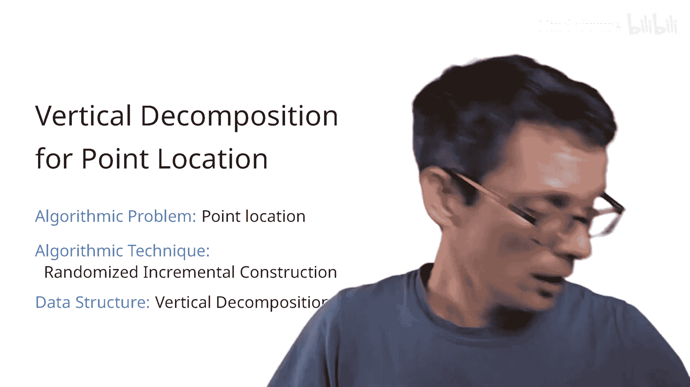

AndNow the question is， where is Peru？

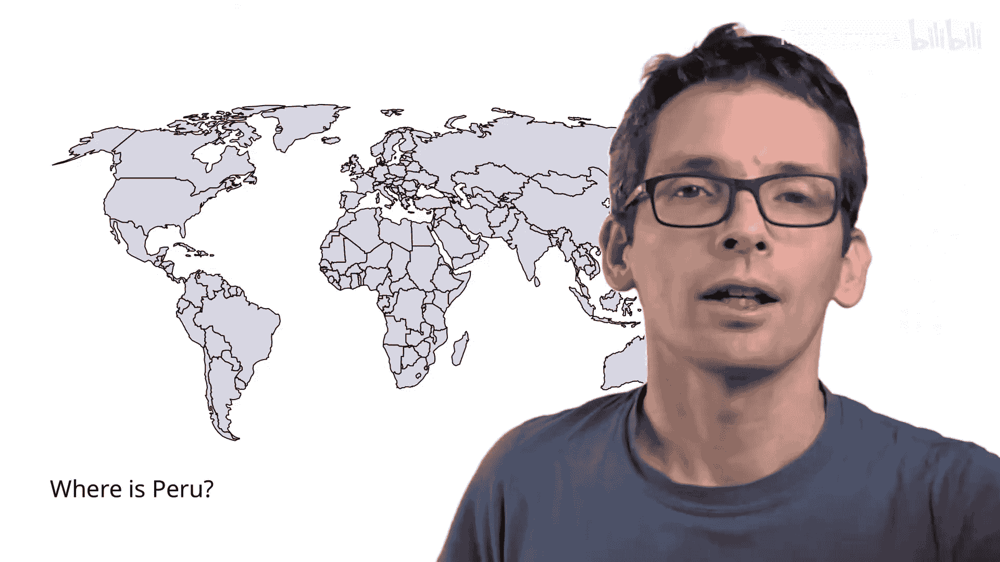

So let's， let's try。 So maybe per is。

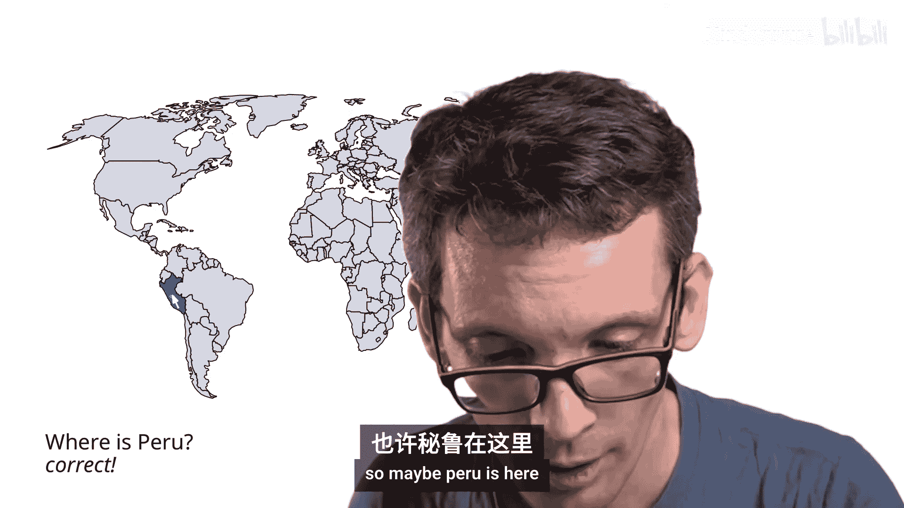

Here。And yes， that's correct。 So where is。

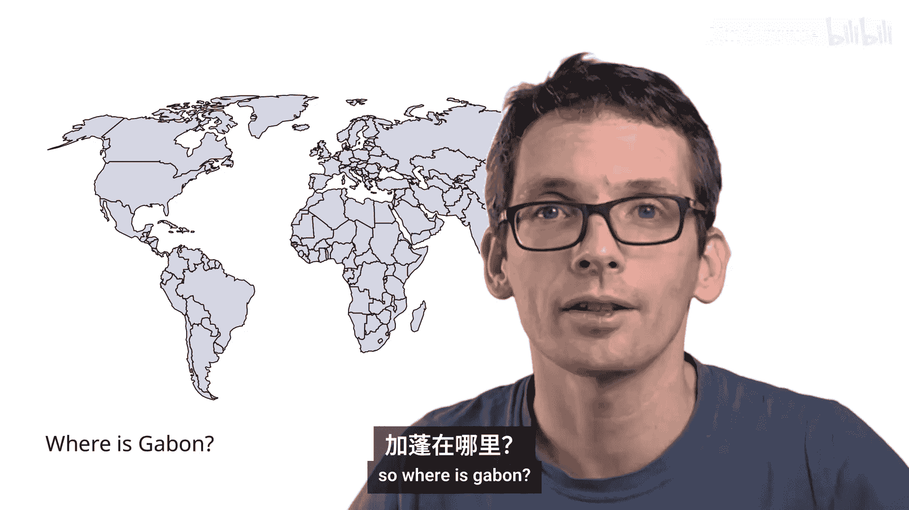

Gbon。Let me try。 I think maybe。

Here， no， that's Ka here。

That's Ugana。That is。

Come on so what algorithm make problem or data structure problem did we have here？😊。

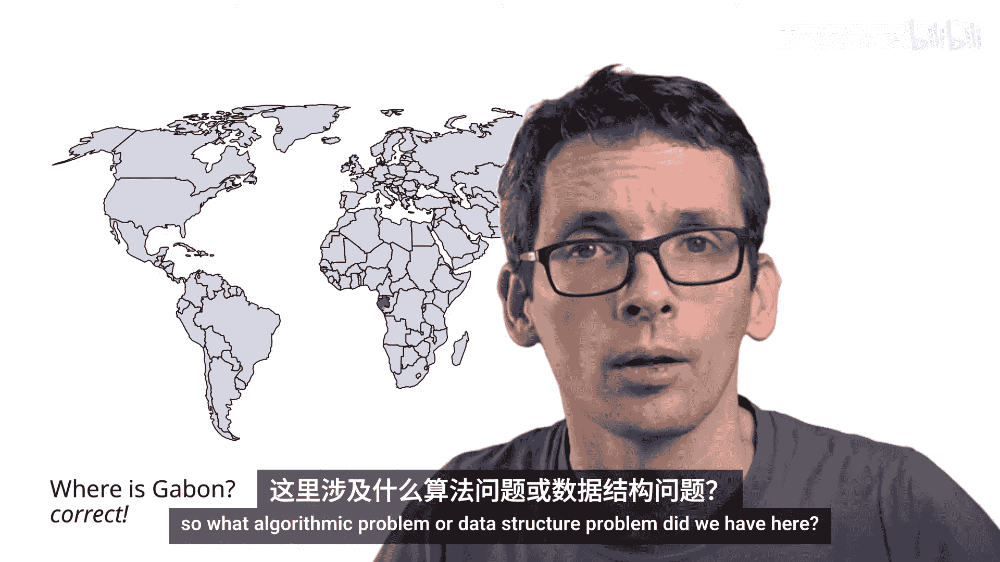

So we have a plan subdivision by map。

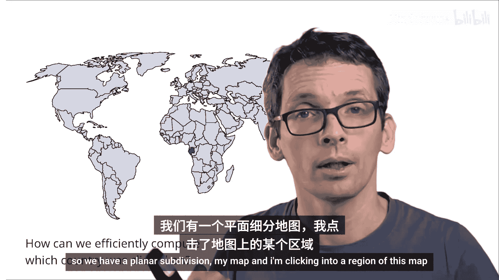

And I'm clicking into a region of this map and what I want to know is which region did I click into。

😊，And such a query， I want to handle efficiently。So let's phrase that once more in terms of planar subdivision。

 So we have a map。

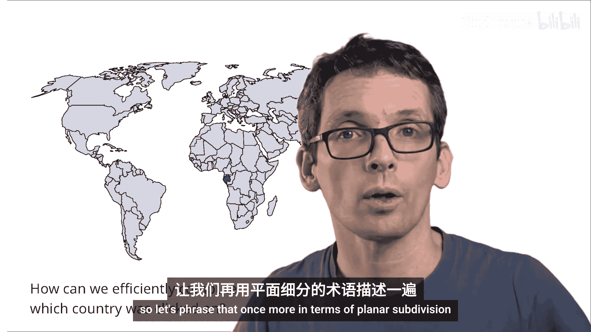

And。You will get a location， so you get a position on the map and you should determine which country this position lies in。

 And now， of course， if if you have a map。And one location。

 then there is not much here that you can do。 but the underlying assumption here is that we want to do this query。

 this question about where a point may lie， that we want to do it over and over again。

 So we want to query many locations。😊，And that is then the point location problem we can use this on maps。

 but generally speaking， it is useful when we're working with planar subdivisions and we need to find points in regions So one example is also for motion planning we're going to use somewhere as a subpro the point location problem and as part of our motivation is that we're also going to see a great algorithm technique。

 namely randomized incremental construction。 So point location is a data structure problem because we want to build a data structure on a planar subdivision which allows us for efficient point locationqueries。

 So we want to preprocess a planar subdivision in such a way that when we then get a query point Q that we can efficiently find the phase that contains Q。

 if you think of how we store planar subdivision。 so。😊。

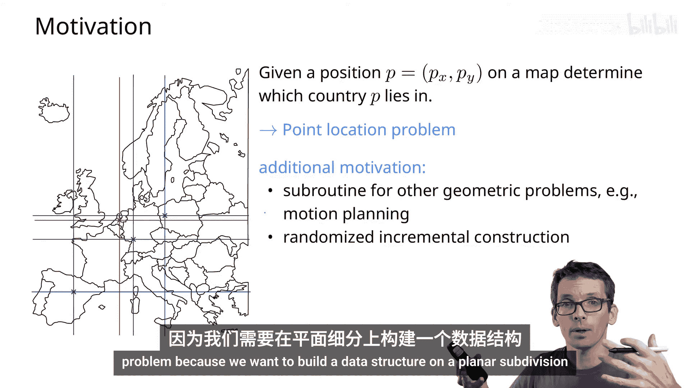

If you store the planar subdivision at W connected edgelist。

 W connected edgehes are good in terms of local operations。

 but this is more kind of a global query where there is no efficient way of quickly finding that face if you just have the W connected edgedge as a recap so what do we mean by a planar subdivision we mean the part of the plane into faces on edges and vertices by non- crossing。

Line segments and non crosssing means that they might share vertices。

 So this segment and this segment and this segment shares this vertex， but they don't cross。

 And the problem that we are considering is a data structure in question。

 What we're interested in is certainly the query time。I mean。

 that's what we're saying we want to have efficient queries。😊。

But let's think about what else do you want to have？😊，The more we store often enough。

 the faster we can do query， so there can be a trade off between query time and space that we use。So。

 the next。Quantity is a space requirement。And then to a lesser extent。

 we are also interested in the preprocessing time。 so the preprocessing time is not quite as important because as soon as I' built the data structure。

 I don't care about the preprocessing time， but all of these three quantities， query time。

 storage requirement， preprocessing time is what we typically look at when we have a data structure problem like this。

😊，So let's think about how to solve this。 You might already have some ideas or might already know some suitable data structures like you might be thinking of a qua tree or a Kd tree。

 and these are suitable for point location。😊，But it is difficult with these data structures to get a guarantee on the time that it takes to do a query。

 So we are going to take a different perspective here and in terms of Ibu design a good starting point is often to think about the 1D problem。

 So let's start with that what is a corresponding1 dimension problem。And then， if you。

Know what the problem is。 How do you solve it？Okay， let's make a quiz out of this。

 So the  oneD problem and the  oneD problem my regions are simply intervalts。😊。

My query point is just a real number， and now I want to build a data structure so that I can efficiently find the interval that contains my point。

 So how fast can we do that， Can we do that in order lock n time using a linear size data structure or order lock n time。

 but we need a quadratic size data structure。😊，Or maybe we cannot。

Do anything really and always need linear time。The correct answer is。

A or a log and time using a linear size data structure。 we can， for instance。

 use a balanced bind research tree。 We could also simply use the sorted array in this setting。

It would have the disadvantage that A， it's not dynamic B。

 it would be also more difficult to generalize to two dimensions。

 So that's why I'm naming the balance binary research for you。Okay， so back to what we。

Trying to achieve。 So we now know how to solve the 1D problem。Now， the question is。

 can we reduce our two dimensional problem for the one dimensional problem？

And so what we naturally would do would。B to first solve it on one of the dimensions， let's say x。

And then try to solve it on the other image。 And that is actually exactly what we're going to see next。

 First， we're going to have a look at a simple solution to the point location problem。

 Namly the sla decomposition So the idea that we wanted to explore was the following we wanted to reduce the twodial point location problem to a 1 d problem。

 namely a problem on the x coordinates So that was a balanced binary research tree and see how far that gets us。

 What we're going to see is that the solution that we get in this way is not quite ideal yet。

 and we are going to see why that is the case。 but that will also serve as a motivation of why we will then consider our final solution。

 the vertical decomposition。😊，Okay， so when we look at the x coordinate。😊，Of the planar subdivision。

 so meaning the xonent of the vertices， what does that actually mean in terms of the geometry of the problem that we are looking at？

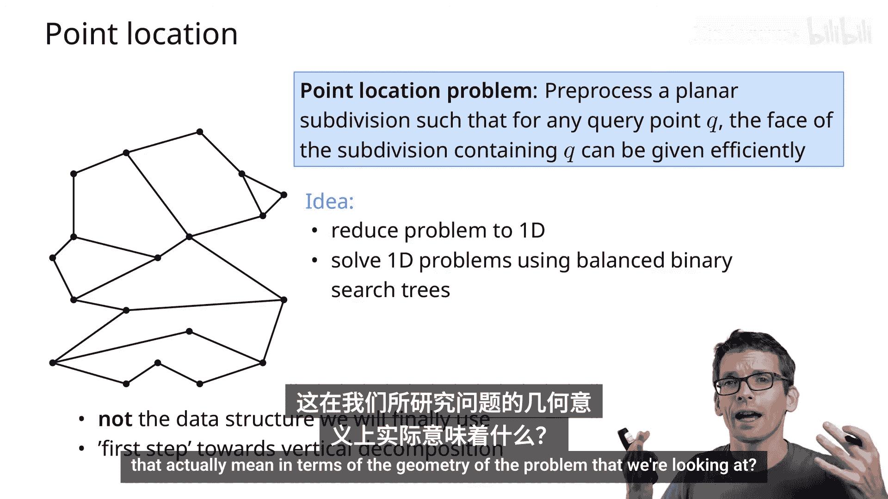

So what it means is that we actually。😊，Drawing vertical lines。

Through the vertices of the planar subdivis。 So if we search on the x coordinates。

What we end up with So if we have， if this is our query here。

Then what we end up with after a search on the X coordinates is a vertical slab namely this slab。

 and that's why it's called SlaAP decomposition and now we will have to find the location of that vertex within the sla。

😊，So now we again have to solve another problem。But it is again。😊，Essentially。

 a one dimensional problem because within a slab， each of the segments of our subdivision completely crosses the s。

 possibly with a vertex on the boundary， meaning there's also a way to find order on these segments within the sla。

 meaning that I can build， for instance， a balance by research search pre。

 And that's what we're going to do on such a s， with the consequence that if I now。

Have a query point。Then I will be able to use my balance binary research tree。To find。Which。

Of the faces within that slab the。Cary point lies。So we're going to use a balanced spine research tree on such a。

Slap or strip。 So if we know between which two edges。

 So if I know this query point lies between those two edges。

 then I can store with such an edge also a phase， let's say like this。

And that phases and what I'm going to report for my point location problem。

 So let's put this together again。 We start with a planar subdivis。

 We build one big balanced pine research tree on the x coordinates。

 This the leaves of this tree correspond to slabs。😊，And for each slab， we again。

 are going to build a balanced binary search tree on。The W order。And that's all。

There is about the slap decomposition。So now if I have。A query point like here。😊。

What I'm going to do， I'm first going to query my X tree。That will find this slab。

O by following this arrow here。And then within that tree， which is on these regions of the slab。

I'm going to search on why。And that will give me。This face。So here is again， query on X。

Gives me a slap。Qury on why。Gives me my face， and that's a data swap。Now for data structures。

 the key two questions that we want to ask。Is what's the query time and what's the space requirement？

We can also ask about the preprocessing time so you can think about that。

 but that's right now not what we are interested in。

 but lets think about query time and space requirement。😊，Let's make this a quiz。😊。

So what is the running time of a query on a slab decomposition that stores。ASockdi with N edges。

And how much space？Do we need to store the s decomposition？So is it a？

Or a lock n time and linear space， or is it B or a lock and time and quadratic space。

 or is it C log squared n time and linear space。The answer is B。Autolog en queries and squared space。

So first of all， why order and lock and queries because we spend lock and time in the search3 on X？

Plus log a time in the search tree for the y。 So that's log n plus log n together is order log n。

 So why do we need quadratic space。 So here's an example that needs quadratic space So what we have here is we have lots of long edges namely roughly n half of them and then we have these short edges again roughly n half and as a consequence what we will get is that we will have roughly n half slabs and each of these cuts through。

All of these edges， meaning that each of the slas will also have complexity of order n So or n2。

 meaning that on each of these I will build a binary search of size or n we have n of these gives me quadratic space。

 So in terms of query time， the data structure is very good。😊。

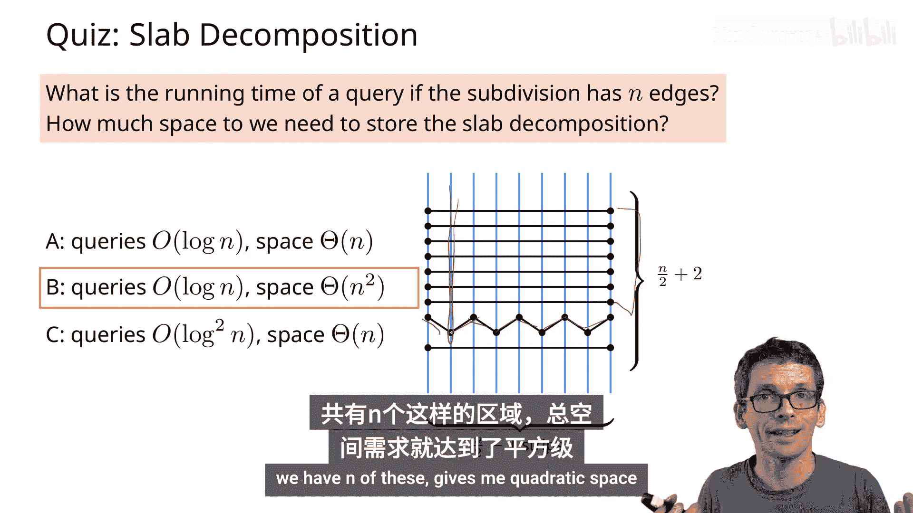

In terms of the space， we would like to have something better than n squared。

So let's think about why did we get n squared here and what could we do better？

 So the n squared came from the fact that， I mean， each of these vertical lines cuts through quite a lot of faces。

 So I mean， let's take this vertical line here。 and really only has anything to do with this vertex which such only has something to do with the face here and let's say the outer face up there。

 but it creates lots and lots。😊，Of intersections。 So then the question is。

 how can we get fewer intersections， a simple idea and we'll have to see how that actually works out in terms ofqueries。

 So that will take us a while， but a simple idea would be to say if those intersections down they are not relevant。

 let's simply stop at the end of a phase。 So if I have this vertex I have this vertical line and I simply stop as soon as I hit segment of the subdivision。

 So we're going to inter the vertical lines whenever they intersect an edge of the subdivision。

 which essentially is what a vertical decomposition corresponds to Now this will not allow us to first sort on x and then on y so we have to do that more complicated but will still be able to do it and this will give us a data structure with linear space or drastically better data structure a different perspective on this data structure。

 what we' are now actually doing。😊，Is we're cutting the phases into simple shapes and now need some kind of data structure。

On these simple shapes。And that's what we're going to see next。

 So next we're going to look at the vertical decomposition。

 We're first going to look at a vertical decomposition as a geometric concept and then later see how we store them as a data structure and then also see how we're going to construct vertical decompositions。

 So what is a vertical decomposition。 essentially what we have is we're going to start with a planar subdivision。

😊，We're drawing vertical extensions through the vertices of the subdivision。

 but only until we hit a line segment， the next line segment of the subdivision。

 So this is called a vertical decomposition or or also trapezoidil decomposition or vertical map。

 trapezoid map。 All of these things are the same thing。

 I'm going to call it vertical decomposition to make our life easier。

 we're going to make a couple of assumptions。😊，And the first one is that it will be convenient to have a bounding box around vertical decomposition。

 So we have a bounding box R， which includes a whole subdivision the vertical decomposition will be within that bounding box。

 We want to exclude some degenerate cases， which we can then handle later。

 and the first one is the following。😊，So it's always problematic if we want to draw a vertical line。

 but there is already something there and of course， if our plane has subdivision。😊。

Includes vertical lines， then we cannot really do our vertical extension there。

 so we want to exclude this case。😊，So we assume that this does not happen。

 So let's change that like this。 We can still have a problem namely in the following situation。

 So even if there's not。A vertical segmentment in the subdivision， if。

Vertices have the same x coordinate， then we have this problem that they would both want to pick。

This vertical extension。 And also we simply want to have a well defined order on the x coordinates。

 Let's assume that all vertices have distinct x coordinates。

A nice property of the subdivision is that if we look at the faces there。啊。Essentially。

 just two types of phases namely the following。 So we have these。 So here， for instance。

We have this triangular face and of course， we have more of those here， for instance。我 here啊。

And we have trapezoid faces。And so they look like this and we have plenty of those over there。

 and of course we can see this triangler case as a special case of the troezzoil case。😊。

So we have very simple phases have。Constant complexity。3 or four。

And we can describe them in the following way。So， each phase。Is bounded by a buff from a segment。

And we're going to call that the top segment of that phase。So that is this segment here。

It is bounded from below low。By a bottom segment。And that is this segment here。

 So I'm not just talking。 Button does not simply refer to the part that belongs to that face。

 but simply the segment。That is part of the bottom boundary， and then。There are vertices。

On the left and right， that the term where the face ends。So there's this left point here。

And that right point。So if I give you those four quantities， top。Bottom， left point， right point。

Then that gives you the trapezoid or triangle that you're interested in。

Once more two segments and two endpoint of segments describe one face so that's nice because now every phase is defined by four line segments of course in principle if you think of this as a planar subdivision and their kind of vertical extensions going down to here then you might wonder shouldn't I have vertices here so this is really just a trapezoid but for the purpose of the vertical decomposition we're going to see the face simply as this trapezoid。

And we not have extra vertices here for the vertical extensions that hit the face in between。

So now as a basic building block， we have these faces， triangles and trapezoids。

 and we're going to connect them。😊，Using adjacencies。

So every phase will have as objects eventually the segments are define。

 but it will also know the neighbors so that we can traverse the the vertical decomposition also locally。

 so this will look。😊，As follows between two trapezoids。

 let's say I have this trapezoid and that trapezoid， if they share a verrule extension。

 then I'm going to call their neighbors。And I indicate this by this red arrow here and every trapezoid has between one and four neighbors。

 as you see here so。Let's say this triangle。 it has one neighbor。

 Let's see whether we can find one with four neighbors。Yeah， the one exit。We have one，2， three。

 four neighbors。 Now， of course， you might wonder what about this case here。

 couldn't we have many more neighbors。Or probably you don't actually wonder about this because you already know that this will not happen because we were assuming general position or we were excluding this as a degenerate case。

 We were saying these。Vertices cannot have the same x corner， and then this will not happen。

 How do we store a vertic decomposition and how complex is a resulting data structure。

So what we want to store is a vertical composition like here。😊。

And it is in principle airplane plane a subdivision。

 so we could be storing it as a doub connected auto edge list。

 but that is actually not so convenient， And we're going to see a more direct way to store it。

 And the ingredients for this we've already seen as the first ingredient is the faces and that these faces can be described by。

😊，4 objects， line segment of the original planar subdivision that bounded from above the line segments that bounded from below and then endpoint of segments that give us the left。

And the right boundary of that face。 So each phase is stored by these four objects。

And then we want to have adjacency between faces。 So additionally， with each face。

 we store its neighboring phases。 So we store up to four pointers。Two neighboring face。

 so in this case it's three。But it's between one and4。And that we're going to store with a face。

Then was every line segment。So not the verticaltic extensions。

 but the original line segments like like the bottom one here。

 we are going to store the face of the original subdivision that it belongs to。

 and then with each vertex we are simply going to store the coordinates and that is what we need to store overall。

 So let's go back to the original problem of point location So let's assume and we are not there yet。

 but let's assume。😊，If I give you a query point， we could find the trapezoid that contains that query point。

 trapezoid or tri， So give them a trapezoid， how do we actually find the face of the originalness help division。

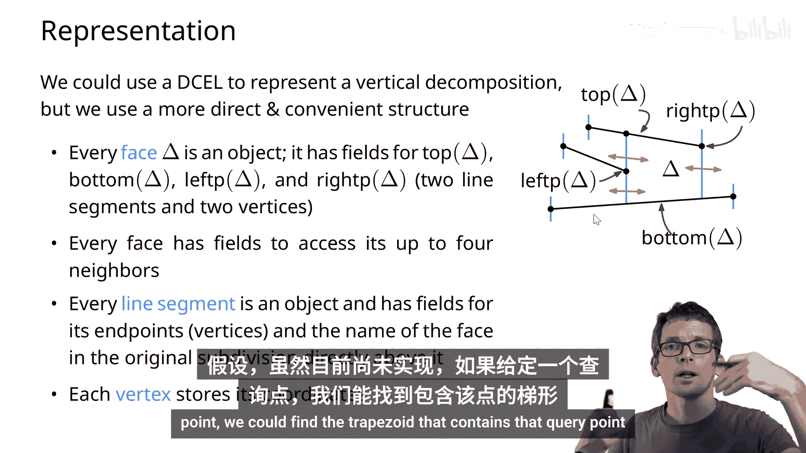

That this trapezoid belongs to。Okay， so here are three options。😊，We store the face。Was the trapezoid？

Or we store that information in a hash table。Or we access the bottom edge， which stores that face。

The correct answer is we're going to access the bottom edge。😊，And with every edge of a subdivision。

 we store the phase above it so that edge can tell us which phase this trapezoid belongs to。

 Now let's have a look at the complexity of the resulting data structure。So in particular。

 what we're interested in is how many vertices do we have and how many trapezoids。

 So let's assume we have n segments as in our original planar subdivision。😊。

Then each of these segments。 So let's let's pick one。 This one， for instance， induces some vertices。

Namely， its original vertices。And。Also， we have these vertical extensions which hit a line segment somewhere。

And these give me some more vertices。 So for each of my n segments， I have 1，2，3，4，5，6 vertices。

 So I have6 n vertices。That's not quite oil yet。😡，Because we have additionally this bounding box。

So we additionally have this one， this one， that one， and that one。 So we have to add that。

 So that's 6 n plus  4。So a subdivision has6 n plus 4 vertices。 How many trapezoids do we have。

 So let's think about that。 How can we count trapezoids if we look for instance the left。

Poid of a trapezoid。So let's have a look at the situation here。If I have a segment S。

 so that's my segment SI， it has a left endpoint and a right end。😊，The left。

Enpoint of S I can be the left point of。2 trap 앞에서oid。In this case， this trapezoid， that trapsoid。

The right endpoint of S。 So this one here。It can only be the left point of one trapezoid。 Of course。

 there could be another segment。Here， and then we would have several trapezoids there。

But then we could charge those trapezoids to this segment。

 So we wouldn't have to count it for that one。 So to some extent， we're over counting。

 but an endpoint of a segment as such induces two trapezoids for the left endpoint。

1 trapezoid for the right endpoint。 So that gives me。3。He。Now again。

 we have to be careful with a bounding box because we have a big bounding box about everything。

What we in half at the very left。We will have a trapezoid that does not that is not bounded from the left by a segment。

 it will be bounded by the bounding box， so we get a plus1 here。

 So in conclusion in terms of complexity， we have6 n plus4 vertices and3 n plus1 trapezoids。

 if we have n segments in a subdiface。 So next we want to design an algorithms we're going to do that in the next video for building a ver decomposition and also building a suitable structure with vertic de compositionposition that allows us to do fast point location。

As a preprocessing step to this， what we're going to do is going to slightly transform the problem。

 So we not need to look at a planar subdivision as an input， but a set of line segment。

 So what do I mean by that？ So， of course， in principle。

 the starting point is as a plan subdivision under such a w connected edges。

 let's say the one here we want to instead arrive at a set of line segments。

 So what we're going to do is with each line segment of the subdivision。

 we're going to store the face。😊，Above it。In this setting， I have three faces， this face。

 this face and the outer face。 What I'm going to do is with every segment here。

 I'm simply going to look at which face is above。 So here the outer faces above。

 I'm going to store that with that edge。 I'm going to store that with that edge。These two will be。

 well get that face stored with it， and then I have one。That uses a face F1。

And now we're going to simply interpret this as a set of line segments to some extent like this year。

 so you shouldn't think of this that I'm actually kind of pulling this in pieces。

 I mean the endpoints。😊，These two line segments still have the same endpoint。 It is just that。

What I want to show here is that we're going to take now a set of line segments。

As input through the algorithm that we're going to construct next。

 and we're going to ignore the doubly connected edge list otherwise completely。

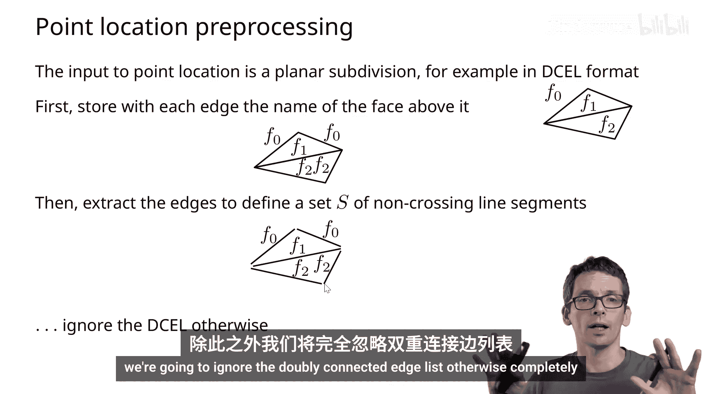