# 【Algorithms Lab】计算几何 ｜ Computational Geometry p06 P06_用于点定位的垂直分解_第2部分-随机增量构建 -BV1Jtn7zSEXD_p6-

Let's construct the vertical decomposition using a randomized incremental construction。

 So what we're going to construct is a vertical decomposition as such so the vertical decomposition of and now we're going to have a set of line segments as input S and a bounding box are。

 but next to the vertical decomposition as such we're going to also construct a search structure where the leaves of the search structure will correspond to the trapezoids and the search structure will actually allow us to do fast point location and we're going to use a randomized incremental construction so the idea is very simple we start where the bounding box。

😊。

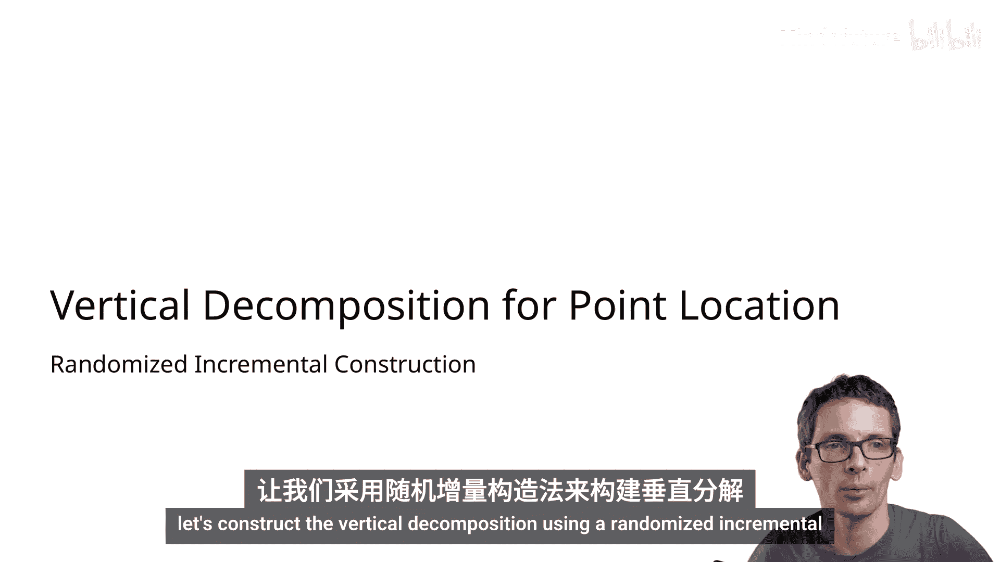

And then we' are just going to insert the segments one by one。

 every time we insert a segment we' are going to update the data structures in particular update the vertical decomposition to again have the correct vertical decomposition。

And adding these one by one， we' are going to do in random order。 Yeah。

 so we insert in random order and we maintain both the vertical decomposition and the search structure。

 So let's have a look at how this will look like。So we' are going to start with a bounding rectangle R。

 so that is our initial verticilicularity decomposition t0 and then after insertion of the I segment we have this verticility decomposition T and next to TI we are going to have D。

 the search structure after inserting I segments and initially d0 simply has one leaf namely the bounding rectangle R let's insert our first segment。

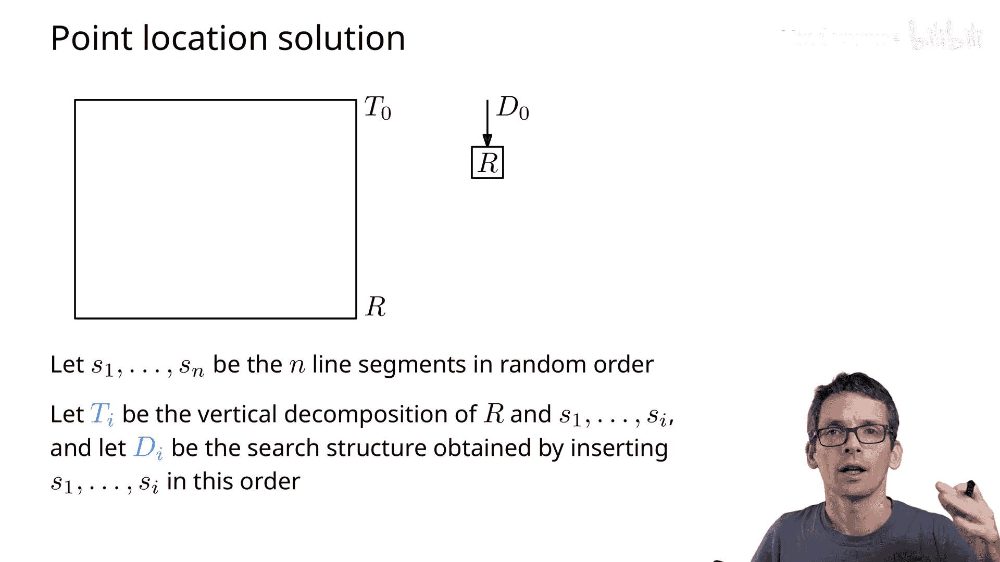

So let's say we insert S1， so here we have S1， S1， we result in four trapezoids， delta 1 to Dlta 4。

And we're going to build a search structure that allows us to find for a given query point。

 which trapezoid it is contained in， and this search structure will have two types of nodes。

 namely X nodes。 So in at an X node， we're going to test whether。

The point that we're querying with is to the left or right of that node。

 so here we have a query point。

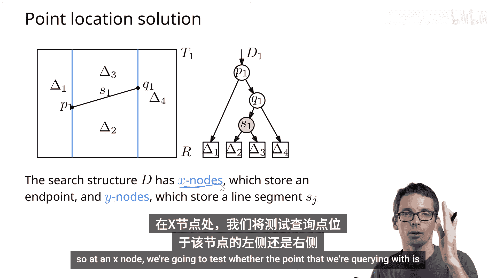

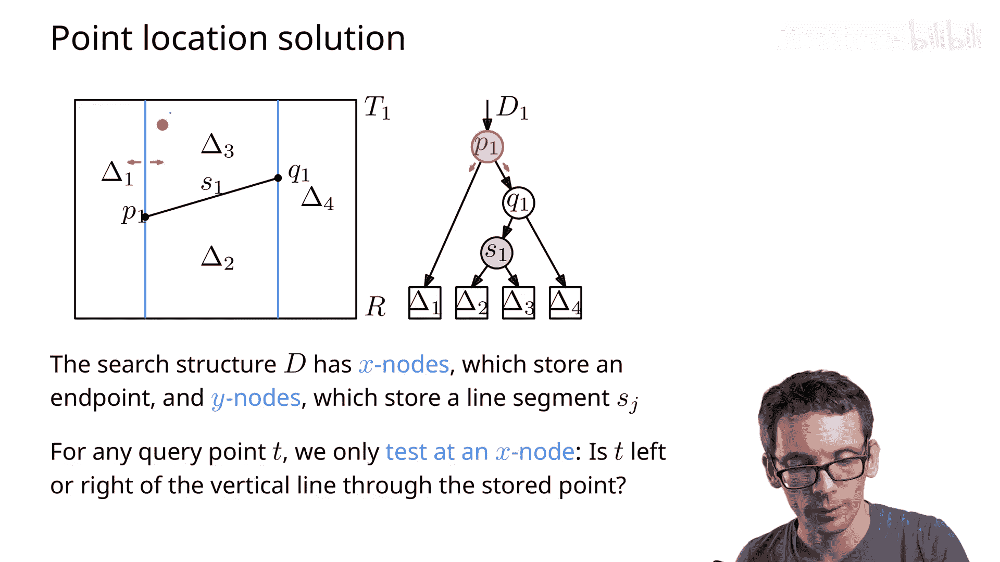

And if， if we have an X node here and the X node here is indexed by vertex of a line segment P1。

Then we're going to decide our to the left or right of P1。 And in this case。

 we're going to the right。 And that would mean that we're going to continue our search here。

 So at the x node， we test left or right， and x node correspond to vertices of line segment for this query point。

 we will see its to the。

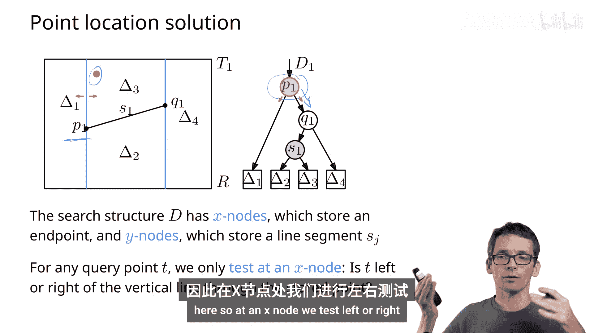

Right of P1。 then we have an x node for Q1。 we see where to the left of Q1 and then we end up at this y node and the y node corresponds to a segment and as a y node we test are we above or below that segment。

 So I first see I am right of this。I'm left of this。

 so I know I'm currently somewhere here now at the node S1 I'm testing am I above or below that segment and when we do this test with a Y node we always already know or we guarantee that at that point we actually know that a query point lies between the two vertical lines through the endpoints of that segment and that is or those are the ingredients that we are using So let's have a look at what happens if we add another segment so let's say we want to add S2。

Here。So let's call that S2。So what happens when we add2。So obviously this will destroy。😊。

Trarapazoids of my previous verticity composition T1。

 that means it will twice this trapezoid and that trapezoid。 So this leaves will disappear。

Here in my structure。And instead， I will need to build something else。😊。

So what I will need to do is I'm going to need to update my veril recomposition。😊。

That will look like this。😊，And then I will have to update the search structure accordingly。

 So here's a small quiz。If you look at which node。Should come here。

So which node will be the left child of S1？Will it be。P2， So an x node with。Index by P2。

Or would it be S2 or Y node， or would it be the phase？Delta 6。It will be a， namely an X node with P2。

So if I'm below， so after querying S1 here， what I will what I know is that I'm in。

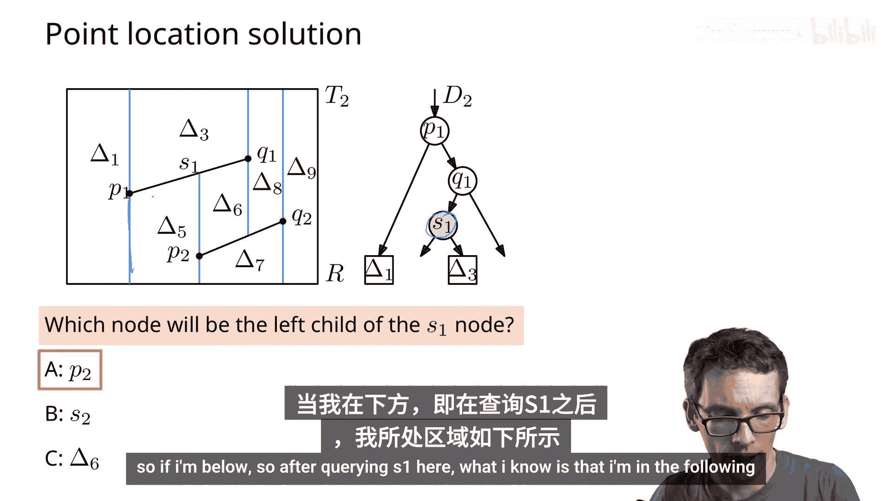

The following region， this。I am in this region。 When I'm in that region。

What I will first want to find out is， am I to the left or white of P2， So am I。Here are there。

So that's why I would have。P2 here。And then when I'm to the left of P 2， I can add。Daelta 5。

 if I'm to the right。Then okay， then I'm in this region here。Then I have to test above or below。S2。

So I will have S2 as node there and then above。Would be Delta 6 below would be Delta。Save。

And likewise， if I'm here so if I'm to the right of Q1。I know I'm here。

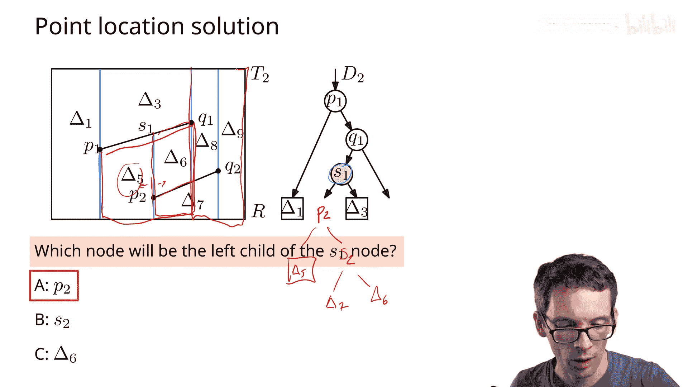

I first need to test I to the left or white of Q2。If I'm to the right， I'm in Delta 9。

 if I'm on the left， I will have to test with S 2， whether I'm above or below S2。

 And then I get end up in either Delta 7 or Delta 8。

 So this is a search structure after inserting S 2。

 What you see here is there are two ways to come to。Delta 7， so to the phase Delta 7。

 so I could either be to the right of Q1 and end up here。

 or I could be to the left of Q1 and end up there。I only want to have one node for that trapezoid。

Which then means that I'm to have two edges pointing towards Delta。

 That also means that the search structure that we have is not a tree because yeah because I have two ingoing edges here。

 So it is an directed acyclic graph。 And that's also why it's called D。

 What we will want to have is we have the vertical decomposition， we have the search structure。

 And then we want to have pointers in between in the vertical decomposition。

 we will also have these pointers between neighboring faces。

 And then for each trapezoid in the vertical decomposition。

 we have a pointer to the corresponding leaf。 Now this allows us to do point location。

 because if I want to do point location。 then so let's do that。 Let's have a point here。

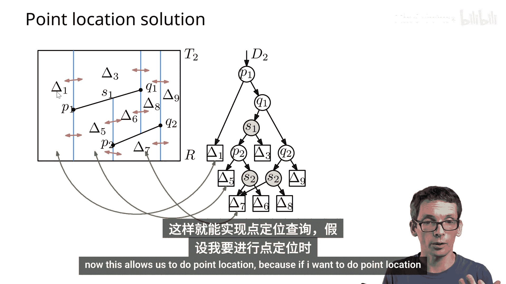

If that's a point。

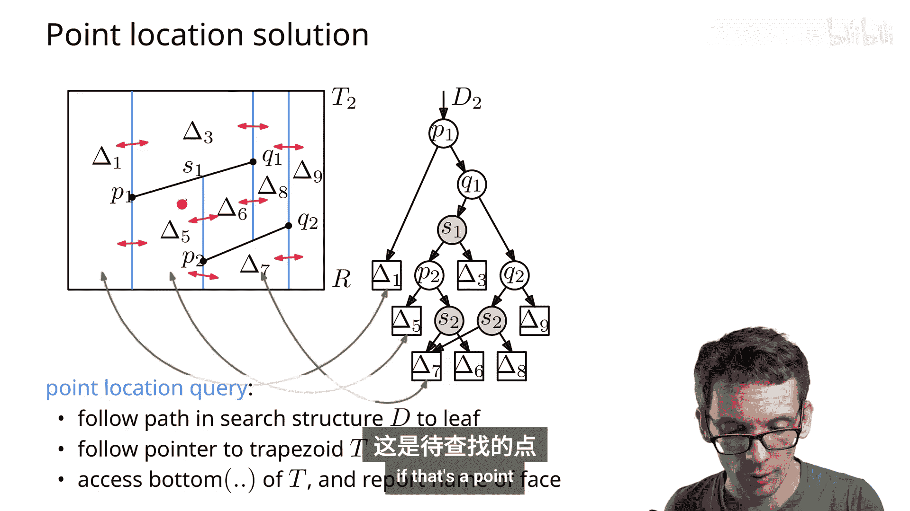

That I want to find。 So first of all， I can， let's assume it is in the bounding box because if it's outside。

 it lies in the outer face。 that's an easy case。 So if it lies in the bounding box。

 I know it makes sense to start searching here。 I will contest to the left or right of P1。

 I can test to the left or right of Q1， I can test above or below。

S1 and below I can test left or white of P2 and this will get me to delta 5 or the leaf is delta 5。

 and then I have a pointer to the actual trapezoid Delta 5 is it is now part of a planar subdivision that trapezoid can tell me which face it belongs to。

So this looks like that。 I have the search pass， I find the trapezoid。

 I then can find the corresponding phase of the planar's subdivision if I want to by going to the edge below and finding that phase。

 Now what we have to think about is how do we update these structures。

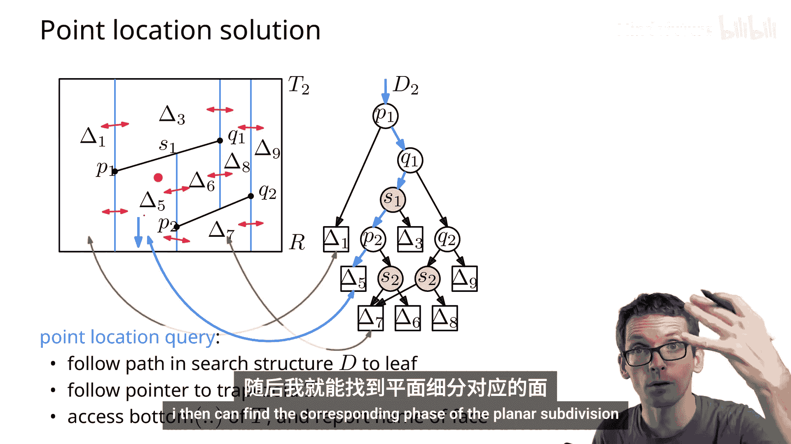

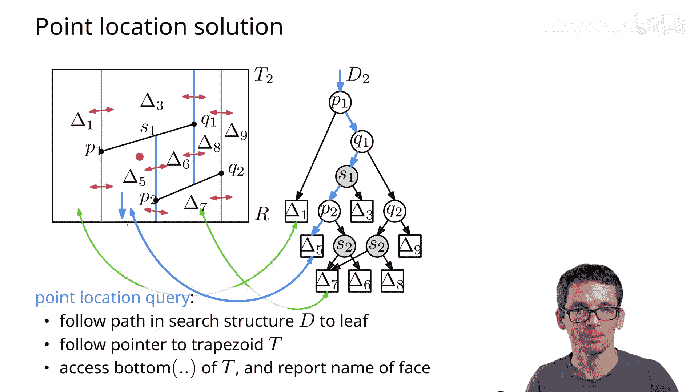

So given delta I -1 and given T I -1， how do we add S I。

 What we're going to look at next is how to update the ver decomposition。

 So how do we go from T -1 to T I。 So I want to add this edge and the。First thing that I do。Is。

I will find the trapezoid that contains the left end point。 How do I do that。

 I can use point location。So using point location， I find the trapezoid containing the left end point。

 from there， I want to find all trapezoid。😊，That are intersected by a segment。😊。

Because those are the trapezoid that I will have to remove and replaced by new trapezoids。

 so how do I find those that is actually easy using the structure that we store with a verticalating composition because we actually do store for every trapezoid。

 the name us。😊。

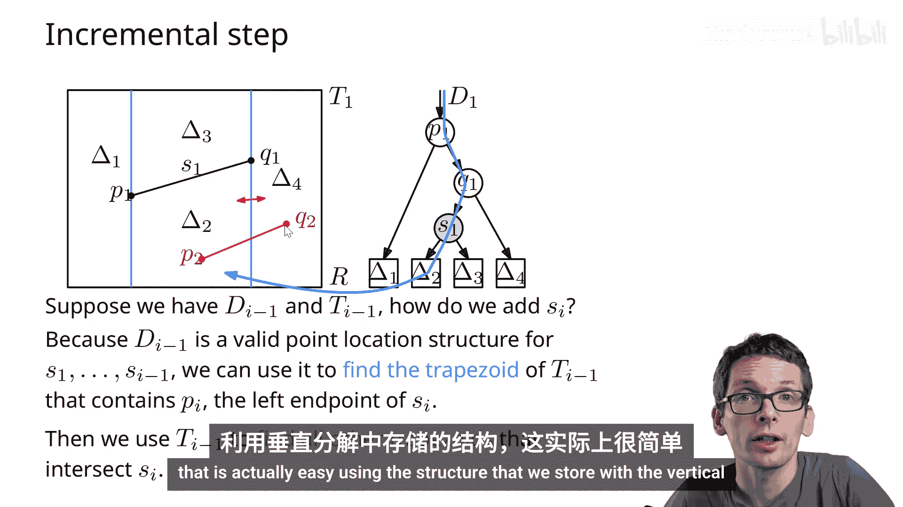

So， if I found。Using the point location data structure， I found this trapezoid。

Then by checking which of the vertical extension is intersected by the edge here。 And note。

 since we were dealing with non crossing edges， this edge can only go through one of the vertical extensions。

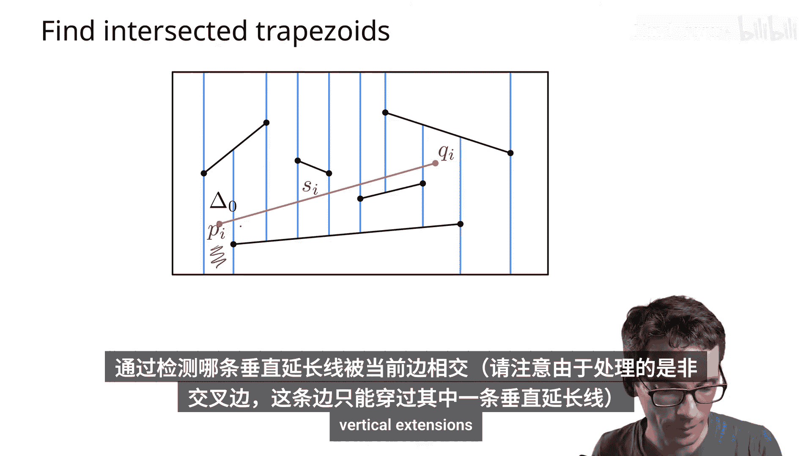

So by finding this。😊，So I'm checking the neighbors by finding this。 I will find from this trapezoid。

 I will find that trapezoid from that trapezoid。 I will find this one， this one， this one。

And so on until I find the trapezoid that contains QI。

 so I find all of these trapezoids and these are the trapezoids that I will want to remove if they are k trapezoids。

 let's say they are K trapezoids that I want to remove。Then this will mean that， I mean。

 each trapezoid I can essentially at most cut in half， except for the first and the last one。

 So this delta0 might kind of be cut in three pieces。Same Delta 7。

 but overall the5 k trapezoidites that I'm going to remove。I'm also creating or K new trapezoids。

 So these need to go out and they would be replaced by this。

 And that's how we update the vertical decomposition。

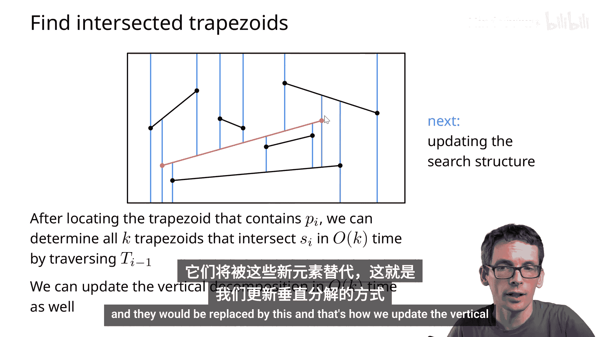

We are in the middle of the randomized incremental construction of the vertical decomposition。

 we've seen how to update the vertical decomposition as such。

 now we need to update the search structure。 So our situation is the following。😊。

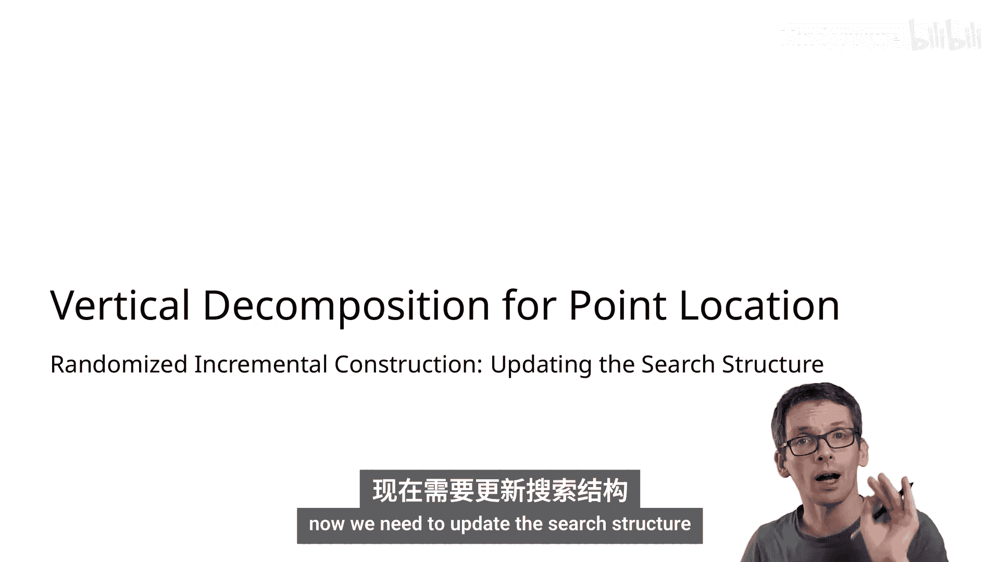

We have the ver decomposition of the first I-1 segments T 1。

 we have the search structure for the first I -1 segments D I1 and now the question is how do we go from D minus1 to D so we know how to update the verticular decomposition as such。

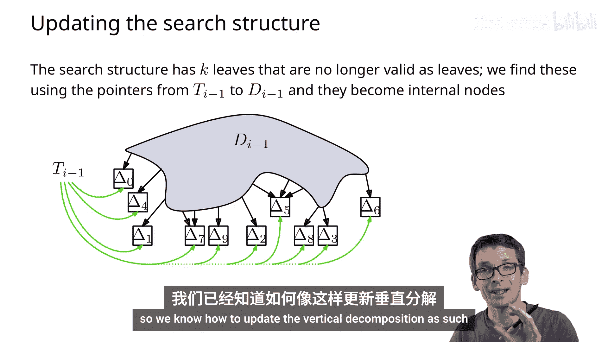

So we know how to go from1 T 1 to T from that， we also know which trapezoids need to be removed。

 which also means that we know which leaves。😊，Of the search structure have to be replaced so we can mark those。

 We can also create new leaves for the new trapezites。

 And now we just have to link this up appropriately。

 And now we are in the situation that this new segment。So we had。

The new segment and essentially it will have two vertical extensions。

 all the trapezoids that are in between for those we need a why note So for those we will have to so only need to decide whether we are above or below。

 So if we had， for instance， a trapezoid previously here that cut through here Now our new segment cuts it into two piece pieces but for we now just have to decide above or below for the very first。

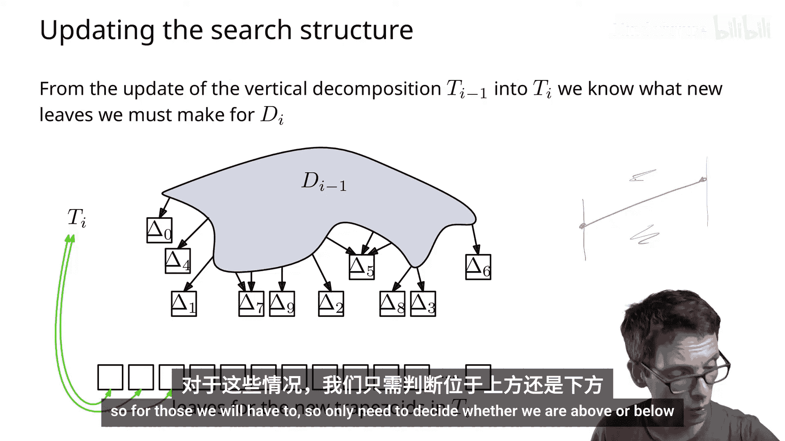

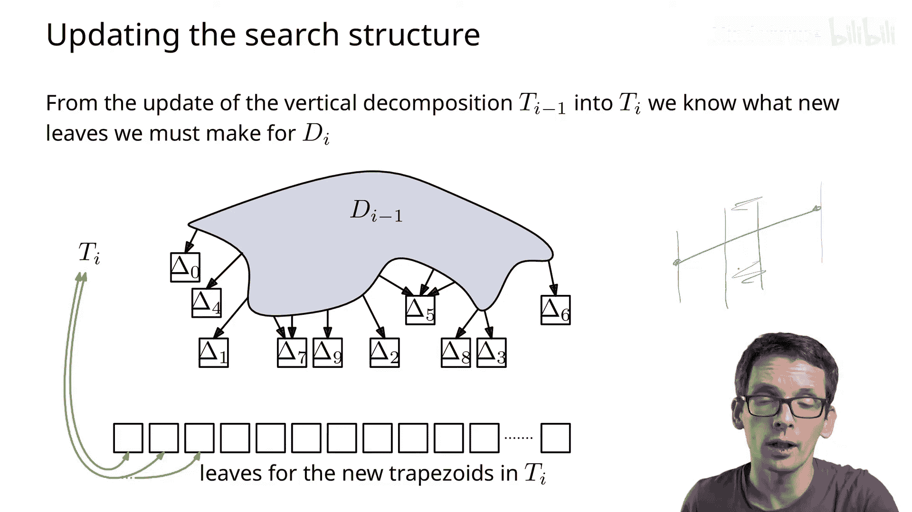

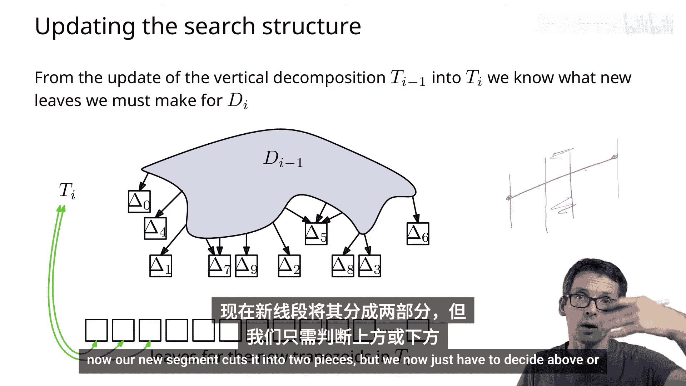

Trapazoid and the very last trapezoid， we will first need to do to do left or right。

 And then not only for the right part or the left part decide above or below。

 So that looks as follows all trapezoids， all old trapezoids。

 except for the last and the first one get a y node。

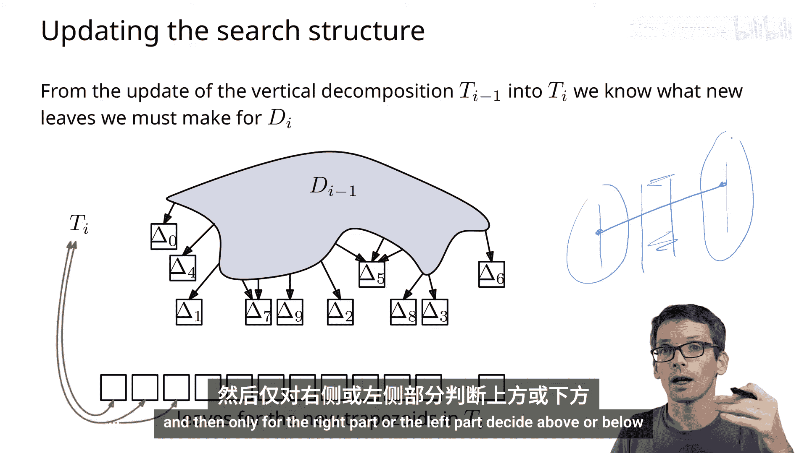

Then the first one So the leftmost one gets。An X node P here。

 and the rightmost one gets an x node namely Q I。 And then this P P I， I mean， if I'm to the left。

 then there's only one trapezoid。 So so then I can link that up to。

The new trapezoid and to the right I will have the segment SI。

 so there will I again will have an SiI node and link it up appropriately to the trapezoid and likewise here for QI。

 the right hand side will link to a trapezoid and the right left hand side will link up to a Y node。

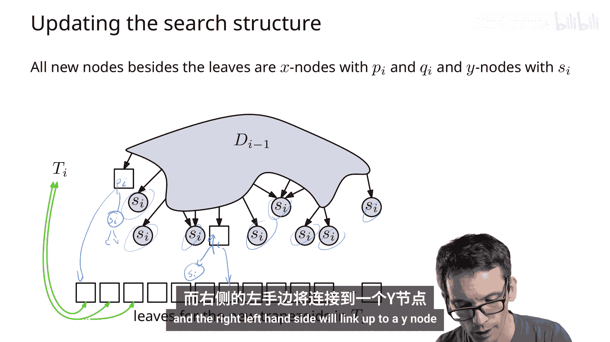

Okay so this is how things now look like and that gives us the update for the search structure。

 So if we are updating ti -1 and T 1 to T and D when the new segment intersects certain number of trappioids K trapezoids of T 1。

 then we are creating oracki new trapezoids in T， we find those。

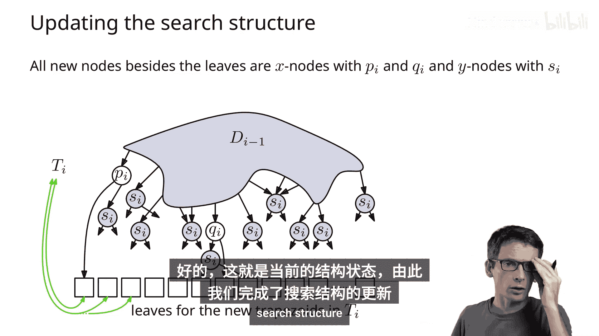

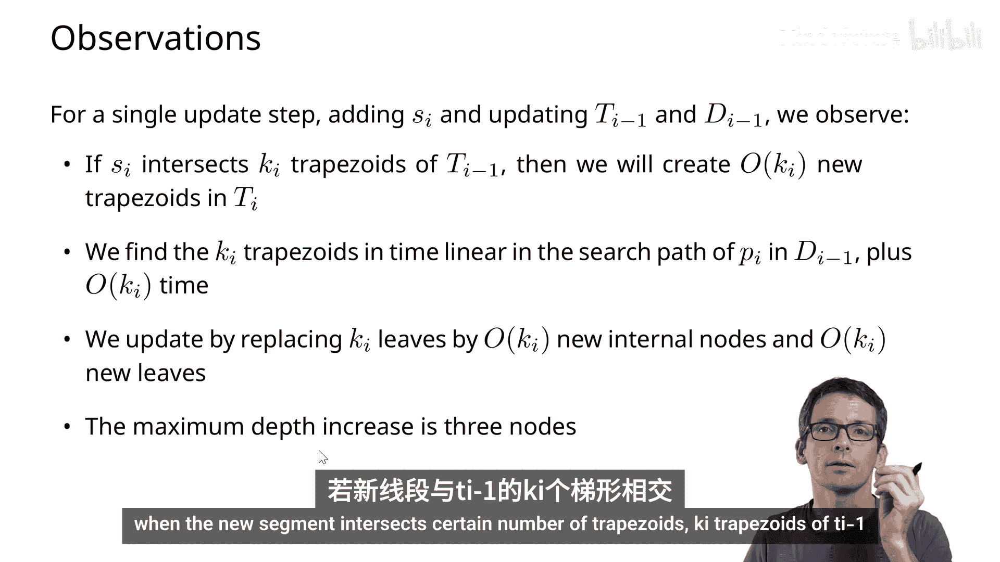

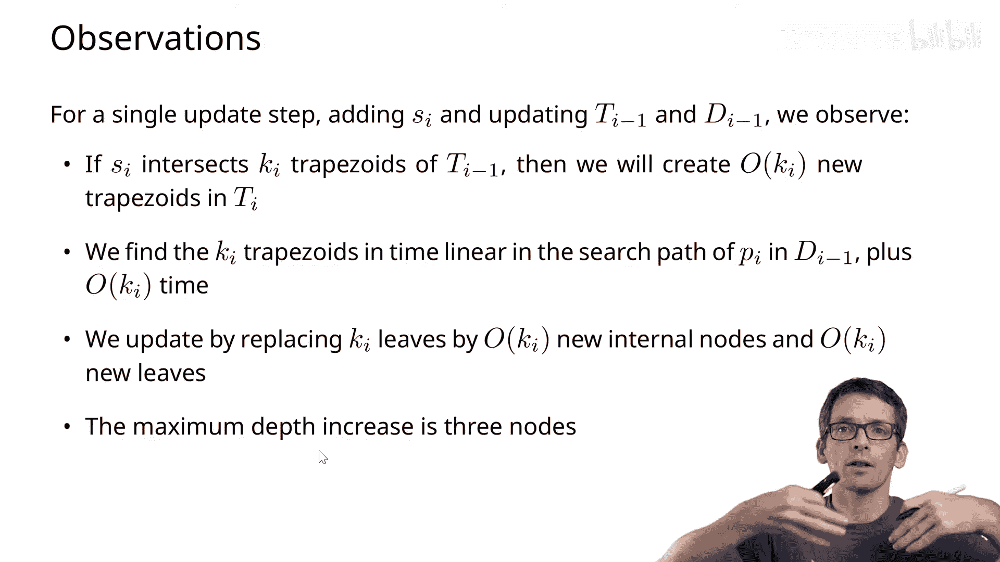

By first starting the search in DI and then linear type in the vertical decomposition。

And then we can update the search structure as described just right now。

 what does that mean for the search structure such how does it increase。

 So in terms of how much deeper it becomes the maximum is by three nodes。

Can we actually get the steps increase in3 so that's our next quiz so in what case does the length of a path indeed increase by three nodes is it a always so every time we update this happens or B only if the new segment is completely in one trapezoid of the old decomposition or C it only happens in degene cases。

😊。

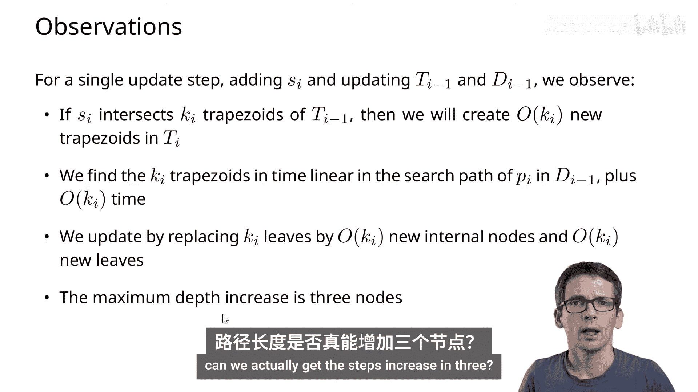

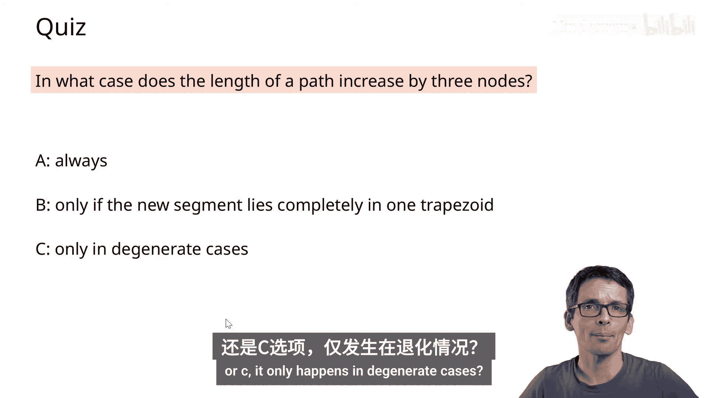

The correct answer is B。 It happens if the new segment is completely contained in one of the old trapezoids and the situation that we have then。

 So we we have an old trapezoid。 This is our old trapezoid。

 So if my new segment is completely inside。 let's call this old trapezoid， let's call that。Data。

So data was previously a leaf。 This is now replaced by the following sequence。

 We first have an x node4 pi。 Then on the left on the left， we just have one new trapezoid。

 On the right， we now need to decide whether I left a right off Q I。Then on the right。

 we just have one propoid， then we have the S here。And then the new trapezoids here。And here。

 so in this case， we have this increase by 1，2，3 node。 But otherwise。

 that does not happen because if it。The segment goes with several topezoids。

These two nodes will not appear in the same search path。 So far。

 we looked at cases where we really have destroyed segments， but an important case。

 in particular in the setting when we come from a planar subdivision。

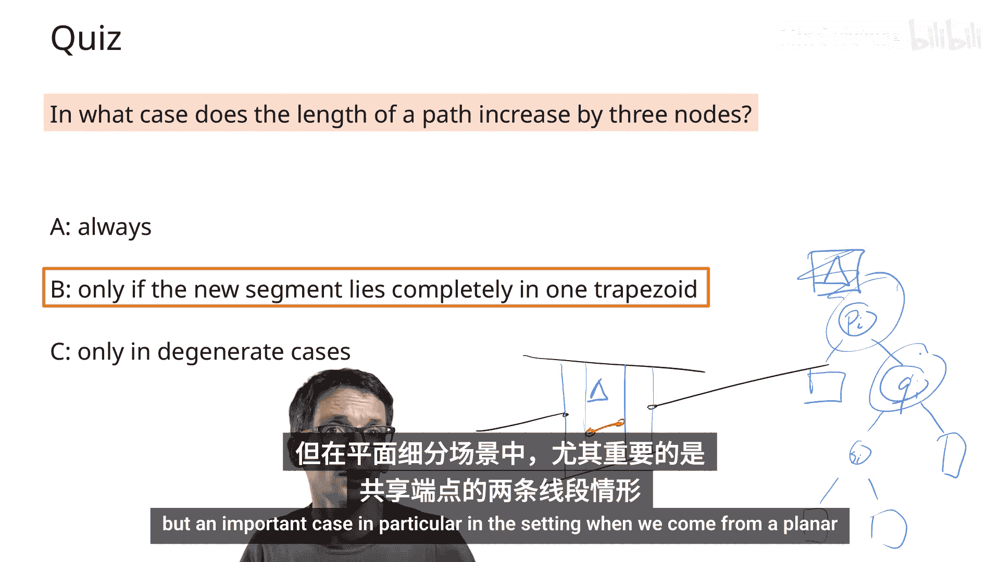

Is the case where we have two segments that share a common endpoint。

 So there we should just note that if we now want to so the red segment。

 S is one that we now want to search for because we want to insert it。

 So if that is the case then we should search for the left endpoint of Si So pi。

 we should search for it in the search structure by slightly searching to the right。 So far so good。

 now we know how to update the vertical decomposition， we know how to update the search structure。

 Now let's before we formally analyze the algorithm。

 let's think about why we actually want to use randomization。

 if we think of the vertical decomposition， we already analyze the complexity of the vertical decomposition and that is linear。

 and that is independent of the insertion order。 So for the vertical decomposition。

 the insertion order does not really matter。 So this is not the reason we're doing randomization。

 The reason we。Randization is because of the search structure。😊。

Because depending on which order we pick for the S， the search structure may look different。

 and it may have different complexity in particular。

 the depth of a search pass might depend on the order that we use for insertion。

 but also the number of nodes might depend on the insertion So let's。

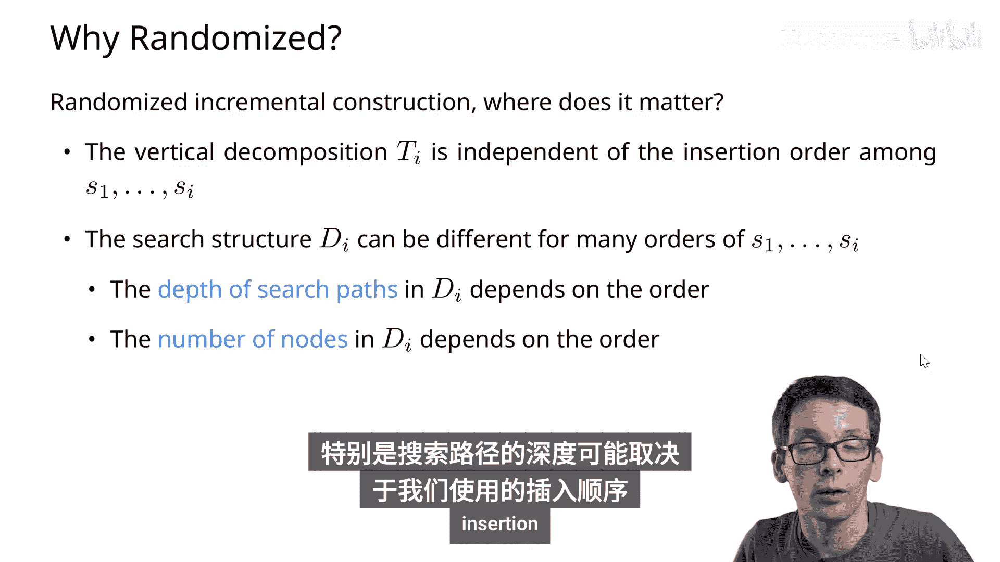

Think about the following questions。If I want to have a particularly long search path。

 So a deep search structure， what set of segments。Would give us that。

And the follow up question will be how can I make the search structure as big as possible， But first。

 how do we get a long path So we get a long path if essentially we already have a long path and we always make that longer。

 meaning the long path leads us to a trapezoid and if it's a new segment is again in that trapezoid the path get even longer。

 So how could this look like could look like it is， So in this setting we are first inserting S1。

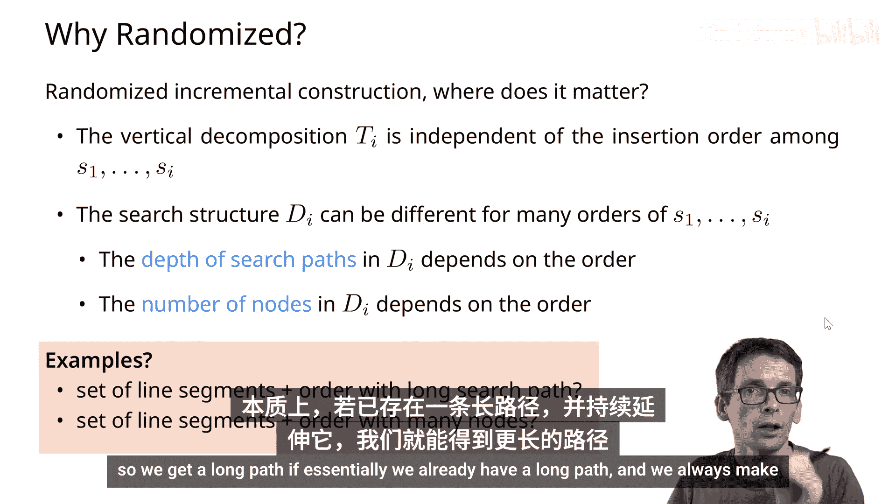

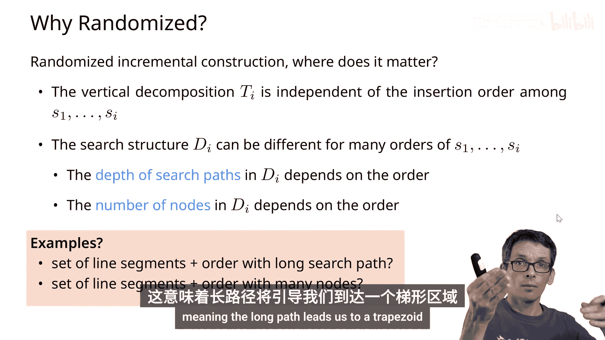

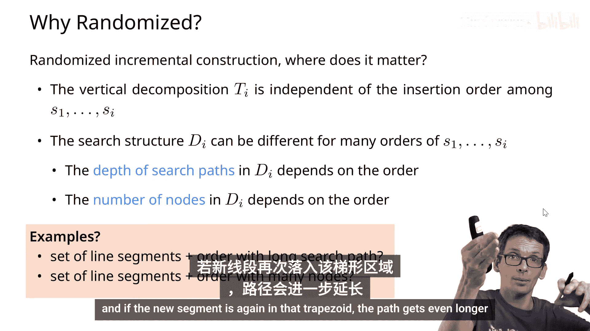

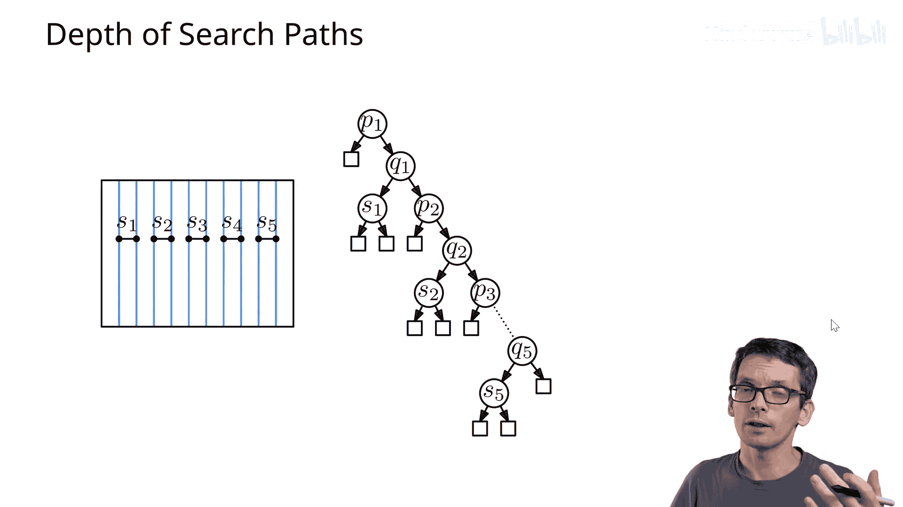

And inserting S1， we have seen the structure many times。Gives us this such structure， in particular。

 the。

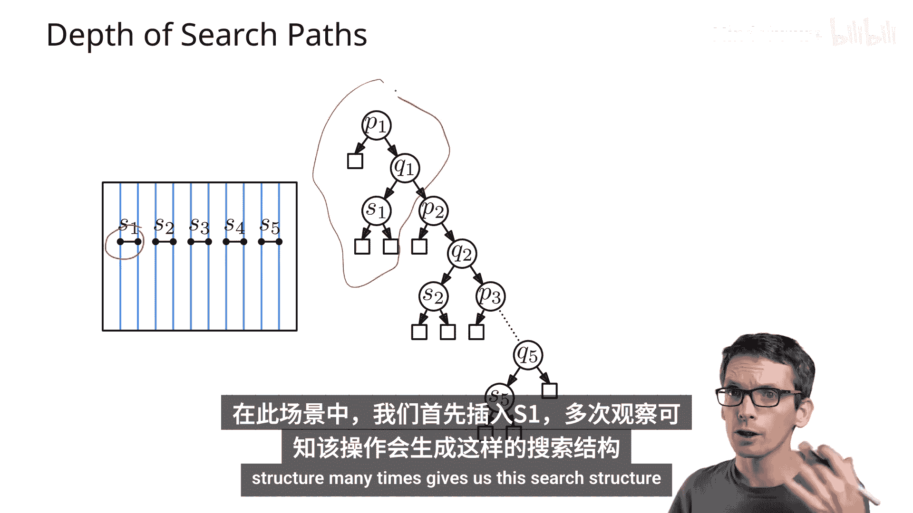

Trap is all that sits here。That corresponds to。What would be here if we now insert。The new。

 the next segment。In that trapezoid， then we get a copy， essentially a copy of this。

 we get a copy of this here。 And then if we insert S3 here， we get a copy here and so on every time。

 So if you look at this now， what we have， we have P1， we have Q1， P2 Q2。

 So we have a search path of length order n。 So we have a linear length search par So in terms of point location。

 that is dramatically bad because it means point location， then would。

For anything that is in that trapezoid down there would take linear time。

 but if we use randomization， so let's mix up the water here a bit。So it's the same segments。

 But now I just picked a different order。 Now you see that the search path will actually not get done。

 So I mean， essentially now in this example， if S1 would be kind of the middle one。

 which is kind of maybe a lucky case， you could say then we get a very balanced。

 So that means the length of the search path depends on the order and hopefully a randomized order can prevent these cases where we get very long search path now about the number of nodes So why could the search structure have large complexity So it could have large complexity if over and over so if I have many trapezoids which by a new segment。

 they all are split and then by the next new segment， there has all split again。

 So how could this look like。 So here's an example we first insert S1 S2 S3 and S4。

 So that gives us lots of long segments here。 So these segments which are by now in my example have disappeared。

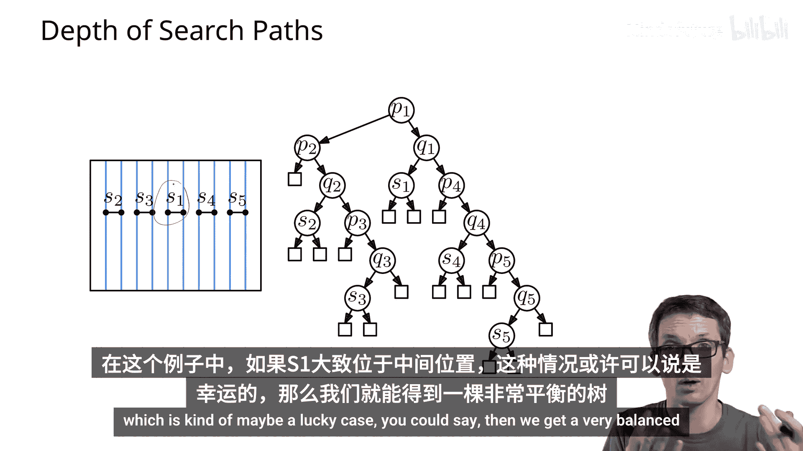

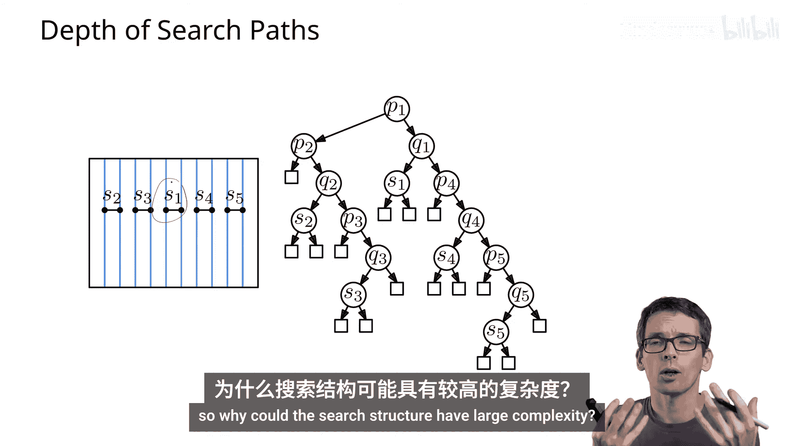

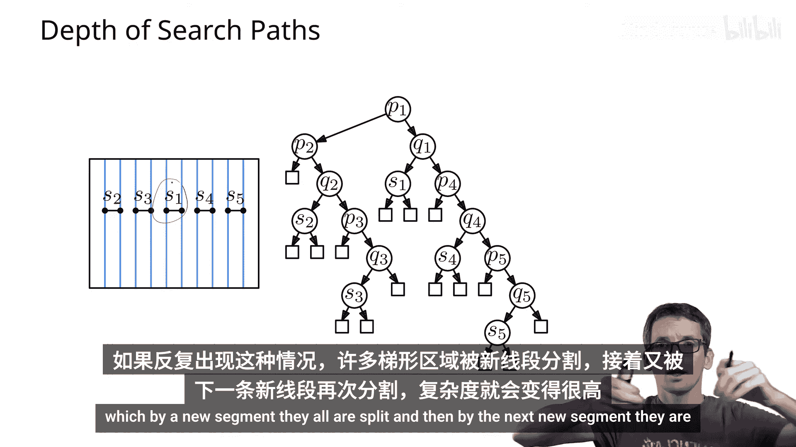

It would all be there。 and then when we insert S5， we cut through all of those trapezoids and they become shorter。

 but still they go down to S5。 So if if I now put in a6 I again cut through all of those and again and again and again meaning that every time I need to remove a linear number of trapezoids and I need to add again a linear number of trapezoids and that means in terms of a search structure every time I'm taking out a linear number of nodes and adding a linear number of nodes so in each step of insertion。

 it's increase as linear let's say linear and I so I get something of order sum of I I goes from one to n so my search structure could actually have quaratic size which is really not something that we want to have and this is exactly what we wanted to prevent when we went away from the s decomposition but also here if I randomize my order there's good hope that the complexity goes down drastically so if I would have an order like this。

😊。

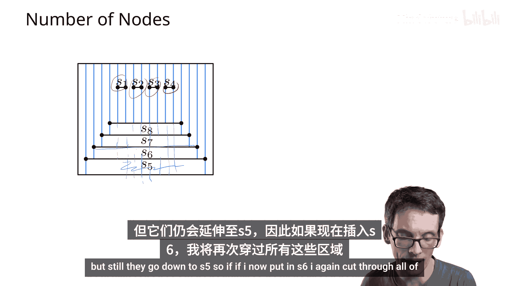

Simply are reversing the order then all of the lower ones actually do not interfere with the previous ones and somewhere in our random order。

 we would hope that we also get a reasonably nice case and we're going to see that this is actually the casebook in the next video where we analyze for the search structure。

 the expected number of notes and the expected depth of the search path。😊。

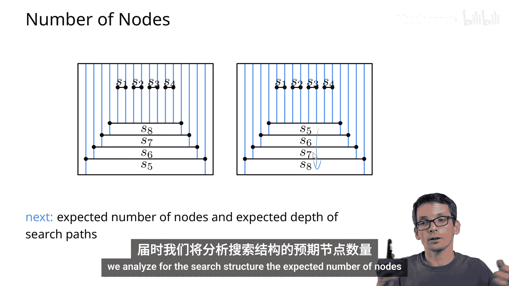