# 【Algorithms Lab】计算几何 ｜ Computational Geometry p08 P08_Voronoi图（Delaunay三角剖分和Voronoi图_第1部分） -BV1Jtn7zSEXD_p8-

Welcome today we' are going to look at two closely related geometric structures。

 namelyvoloid diagrams and delo triangulations in terms of algorithms。

 we will see how to construct a de triangulation using a randomized incremental construction。😊。

So let's start with a motivation， spatial interpolation。😊。

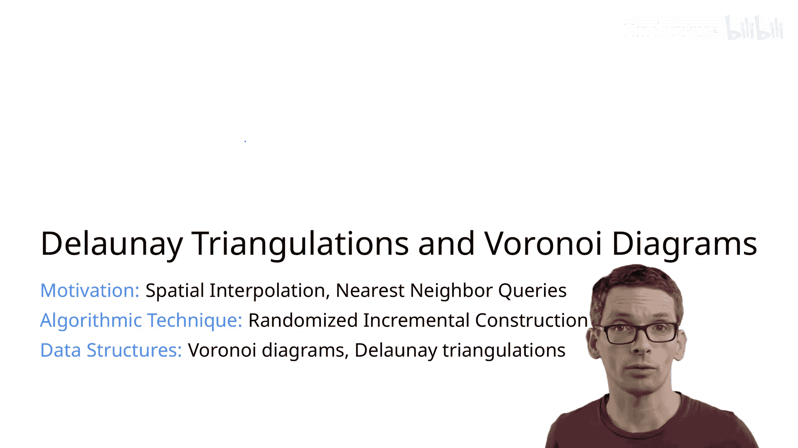

This box up here。Measures air quality in real time。So I can see how the air quality is here。

On my map。I can see this around the city。😊，But what if I'm at a place where there is no box？

This problem is called spatial interpolation。I will explain the spatial interppoulation problem by a different example。

 height interpolation。So you have a lighter data of the surface of the Earth。 that's。

 of course also discrete data， and now you want to have a continuous surface。

So our setting is the following。 We have height measurements， so they have X Y and height。And now。

We want to construct a surface。 So the first thing that we do， we project。These points。

 So now we have points in a plane for。Now we want to decide for every point in the plane。Some height。

So that's the question that spatial interpolation addresses。

 how do I estimate the height at an arbitrary point X Y， so let's say。😊，I am somewhere。he。

What height do I pick？So， one option。Would be to say。Let's see which of my measurements is closest。

So let's say this one is closest。Maybe that's my best guess。

So let's give this point X y the height of that measurement。

So that means I will subdivide my plane into cells， such that within each cell。

Let's say I'm looking at this。Sell here within each cell， if I take any point the closest。

Measurement。Is the same。 So this point has the same closest measurement as this point， namely。This。

没什题。And this subdivision into sales， such that within each cell。

 every point has the same nearest neighbor from the measurements or input points。

 that is actually the Voonoid diagram。And the terrain that we would now get from this that would somehow look like that。

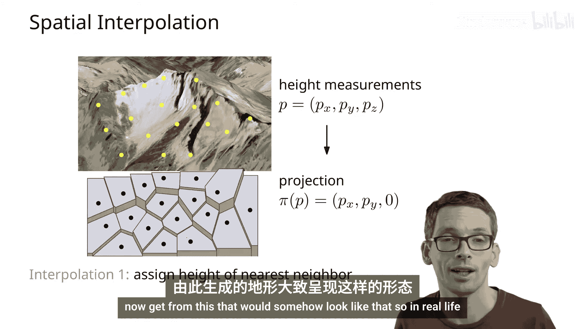

So in real life。bit like this。An alternative， a natural alternative is， of course。

 if I'm between two measurements。Then I would want to interpolate between those two heights on a line。

 I can easily imagine what does it mean to be between two measurements。 But what does that mean if。

I'm in the plane。I mean， then I will be between more than two measurements。

 and I will have to decide which measurements do I use to interpolate from my height。And that。

We can do using triangulations。

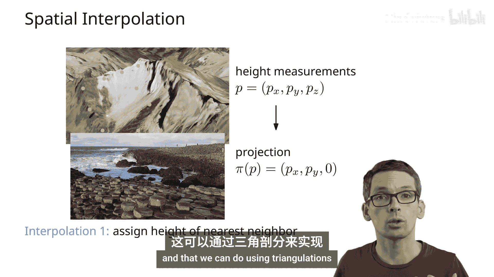

So this could look like that。 So I have my measurements。

 I will build a triangulation on those measurements。 So what does it mean。I add edges。

As long as I can。And the reside will be。A ha division。Enter triangles。

 at least within the convexile of those points。And then for any point in such a triangle。I can take。

The three vertices of that triangle。And interpolate appropriately。 So that might look like this then。

 So I then I get a more continuous terrain。 So that's a motivation of spatial interpolation。

 It motivates on the one hand， looking at void diagrams。 It also motivates looking at triangulations。

 as we would see， in particular， the La triangulations。

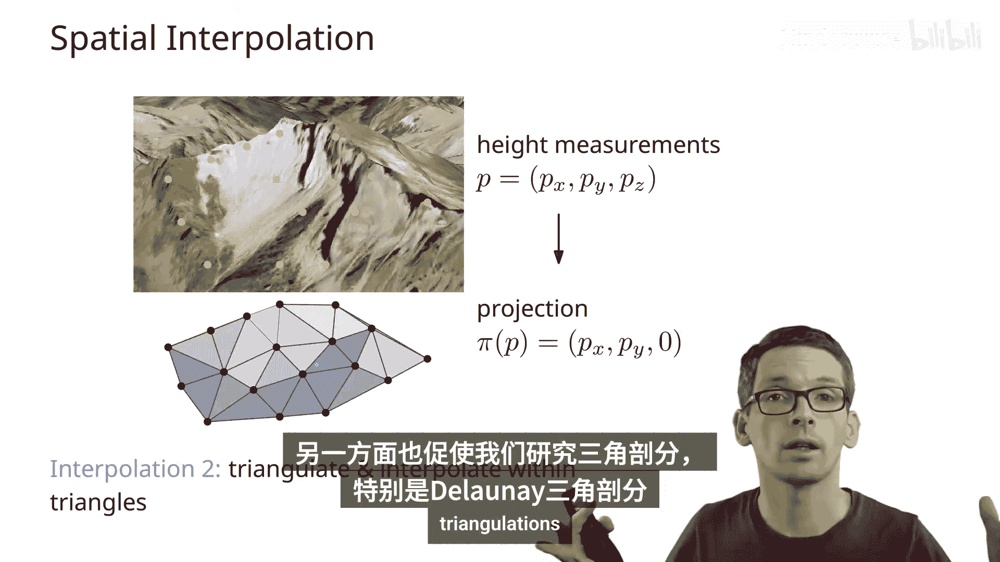

So let's look at vnooid diagrams。 Next， what is a void diagram。

 We motivated vnooid diagrams by spatial interpoulation， particular height interpoulation。

 as shown in this example。

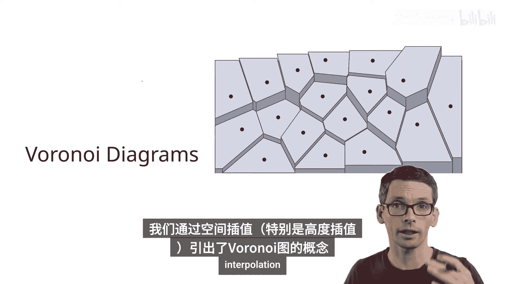

We also have four algorithms in the game framework， Naly in the Con game。

 where red plays against blue and each player conquers the lands that are closest to。

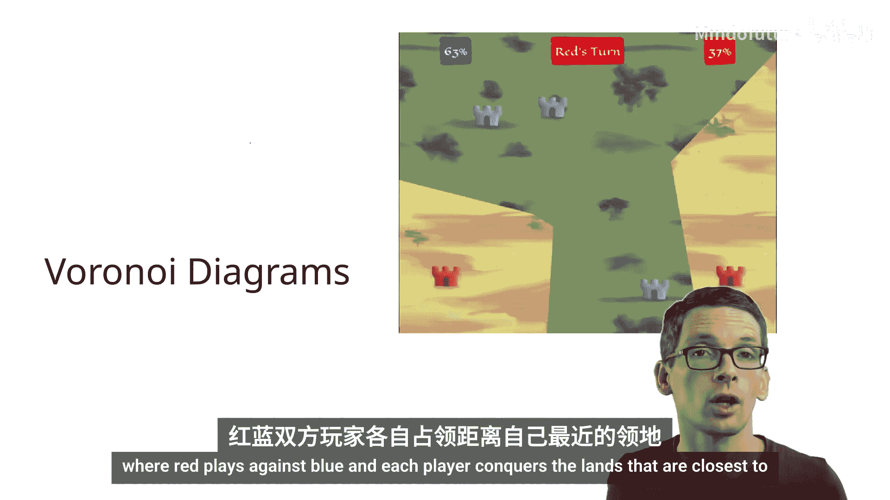

Her are his cass。Here's yet another motivation。 So let's assume I am。Here。

And I want to have ice cream and I want to go to the closest ice cream place。

 then if I would have this beautiful map， then I would immediately know that I want to go here because what we show here is a subdivision。

😊，Of the space such that within each cell。 So here we have a cell within each cell。All points。

Half the same。Closest site from the input sites。And that's avolonoid diagram。

 So once more avoloid diagram on a set of points。

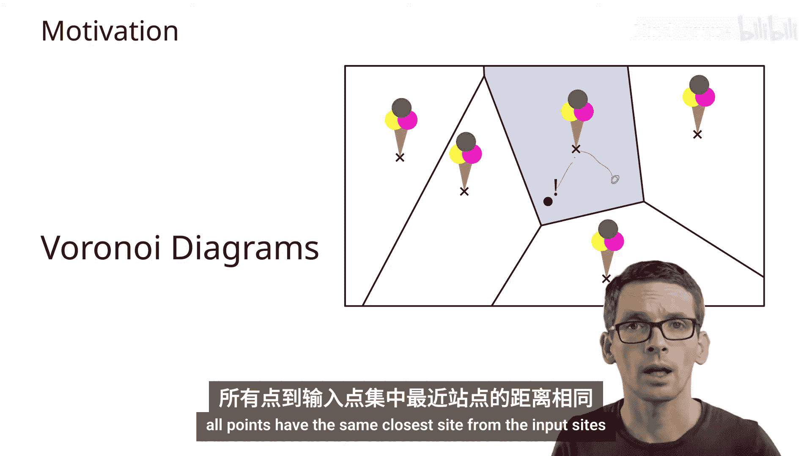

Is a subdivision of the plane， such that。Q is in the cell of P if and only if the distance of Q to Pi is smaller than the distance to any other point。

So let's say this is PI。Here。Then Q。Is in the set of P if the distance to Pi is smaller than the distance to any。

Other point。PJ， it's a data structure a geometric structure with a long history。

 so it's long known for a long time， and now let's have a closer look at how these sales look like。

And we start easy with two points。 So let's say I want to compute thevol diagram I want to see what thevoloid diagram is of two points。

So now for any point， I need to decide is it closer to this point or to that point？I mean。

 obviously everything back here will be closer to that point。

 everything back there closer to that one。So how does this look like essentially this is split at a line name the line of points which have the same distance to P。

😊，Anticute。そう。Somewhere in the middle here， there's obviously a point that it has the same distance to both points。

But also， let's say here， this one has the same distance and on。 and what I get。Is。

A line like this between the two points and on the one side， all points have a closer。

To this point and on the other side to the other point。And this line is a bisector between P and Q。

So the line was the same distance to P， where every point of the same distance to P as to Q。

And this subdivides my plane into two。Half planes。 So if I。Ignore the line。

 I have an open half plane that corresponds to the cell。Of key。

And I have an open half plane corresponding to the set of Q。

So how does this generalize to more points？

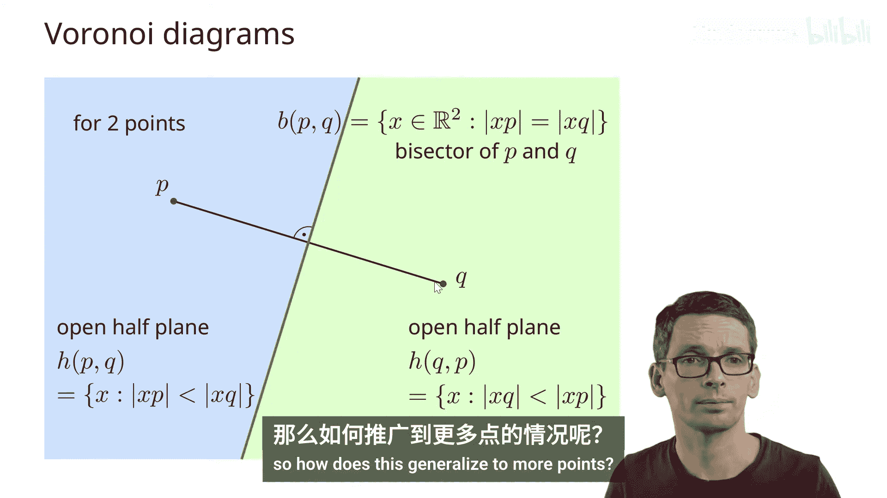

So now I have more points。For any pair of points， I could be again looking at such a bisector。So。

 let's say， I will look。Addd。This bisector between。Those two points。Now。

 locally the vonoidoid diagram might actually look like that。

 but this obviously does not continue forever here。Because at some point， it will， let's say。Hit。

The pi sector between。These two points。And then actually。

 I'm going to continue on the bisector between those two points and so on。

 So the Vono diagram is composed of parts。Of bi sectorctors。

 we want to have a closer look at how this exactly looks。

So it will look like something like like this， this is called thevonoid app now we want to make observations about about this diagram and the structure of this diagram。

 so let's have a first question about the shape of the cells。Name is the following Vono sales convex。

The options are yes， no or only for cells that are bounded so that don't go to infinity。

The correct answer is yes，vonoi sales are convex。This is also true for unpoed sets to take a simple example。

Even if I have the situation。Which is kind of the simplest possible situation。

The half spaces at a half here。Those are convex shapes， they are not convex polygons。

But there are convex in the sense that any two points that I pick here。

 everything in between isn't that say， so let's have a closer look at how cells look like and there we will also see why they are convex。

So here's a small。Example of a volonoid diagram。 And in a voonoid diagram， we have cells。

 So this one' is the cell of P。So how does the sale of P look like or how could I construct it？

So it's a point that is closer to P than to any other point that I can of course also the formulaulators and it's a region。

That is closer to P than to， let's say， P prime intersected with the region that is closer to P than to Pw prime。

And so on。 and that means。So if I do a PR wise， then I get intersection of half spaces。

 I'm looking at P and P double prime。I get this half space here。I'm looking at P and P prime。

 I get this half space here。 I intersect them。 So now I only have。This we left。

I do this with every other point， so with this one now I already have the actual say。

 but maybe there's another point here。Okay， I can， of course， again， draw the bi sectorctor。

 And if it's far away， it will not influence my intersection。The reside。Is thevo noise cell of P。

And as an intersection of convex sets。😊，Because half spaces are convex as intersection of how conx sets。

 this cell is again convex。 We don't only have cells。 We also have edges。

 So let's say for instance this edge here。 So how do edges look like。

 So edges are defined by two points in this case。By P and P prime。

It is a set of all points that have the same distance to P。

And to P prime at a closer to P and p prime than to any other point。

So this is the intersection of the boundary。Of。The v noiseel of P。And of the10 set of P prime。

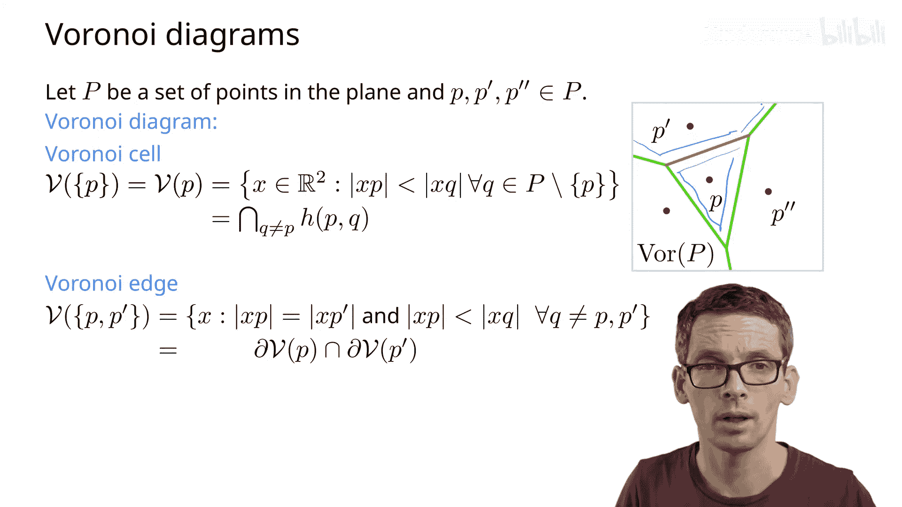

We have to be slightly careful we wanted to say we set closer to P&P prime than to any other point。

Now， if we， for instance， look at this。Vertex here that has also then the same distance to PW prime so that should not be included likewise this point not。

So it's a relative interior of the intersection of boundaries。

 which exactly gives me this edge here without its endpoints。😊。

Those are the edge and then we have vertices。😊，And vertices then are simply intersections of vnoi cell boundaries。

 in this case， of the vnoi cell of P。Of P， double prime and of P prime。So， we have。Sales， edges。

 atices。 in this way， we get a subdivision of the plane。

 It's not a plain a subdivision as we had seen it where everything is bounded because we also have these infinite lines。

 So that's something we have to keep in mind。Very often when we talk about the forn diagram。

 we also simply interpret it as its。As a graph namely the graph of edges and vertices。

 so then we can are looking at it as a graph， but the diagram is a subdivision as such。

But if I want instance ask the question， is the vno diagram connected。

 then I mean this planar graph of the edges and vertices or also called one skeleton of the vonnooid diagram。

Coming to that question， is the Vonoi diagram connected， it is connected。Unless。The points are coar。

 So what does it mean the points will be colonlinear just means they are all on a line and if all points are on one line。

 then I just as the by all of these bisectors are parallel。So they do not connect。

But as soon as I have one point that is not on the same line。Then I get。

A connecteded graph as a vonoid diagram， or more precisely the one skeleton of the vonoid diagram。

Next let's have a look at the complexity of the Vo icon。 so how many edges， vertices and faces。

What sales do we have？How complex can the Volno diagram of endpoint be。

So let's start with a simpler question。Namely。How many sites can one singlevolnoir cell have？

And your options are6 and half or n -1。The correct answer is n minus1。

And the example would be the following， I have one point。And its cell is adjacent。

To the cell of every other point。 And in this way， I get a cell with n -1 sides this。

Could be bad news because if I have NS and each could have complexity。N-1。

 then I could have quaratic complexity， but can that happen。

 I mean can every cell have n minus-1 sides。The answer to this， luckily is no。

So then the question is how many cells， edges and vertices？Can I overall have in my vonorda。

 And to answer this question， we will need Euler's formula。 So what does Euler's formula say。

 It says if I have a plane connected graph， a plane means it's embedded in the plane with straight line edges here。

So if I have such a graph that gives me vertices， edges and faces because I have them betdding。

Then the number of vertices minus the number of edges plus the number of faces is 2。

So in this example， I can count the number of vertices， one，2， three， four5， I take the number five。

I subtract the number of edges。 Let's count edges 1，2，3，4，5，6，7。And then I do plus number of faces。

So how many faces do I have， one， two， three？And out of phase 4。そ。

5 minus-7 plus 4 is indeed2 and that is what Oulolas formula tells us。

 and you can see that if I would now add another edge。Like this， for instance。

 then I'm adding another vertex。😊，And another edge。

 so those cancel out if iPhone find instance had an edge like that。Then I'm not adding new vertices。

But I add a new face， so I have a new face， a new edge that again cancels out。

And as long as I have a connected plane graph， this formula is true。

So we would like to apply that to thevolnooid diagram， with the Vooid diagram。

 we have this problem that we have these infinite edges。So like this one， they don't have a vertex。

So to handle this what we do， we add a dummy vertex， so a vertex you could say at infinity。I mean。

 I can just draw it here。 It doesn't have to be actually at infinity， and I link up。

These edges to that verex。 And now oils formula will still hold。

 So I will have vertices minus edges plus faces is 2。

 I should keep in mind that I added an extra vertex。 So the formula now reads as。

Number vertices of the diagram。Plus1 dummy， minus number of edges plus number of faces。

 and we have one phase for every input vertex。 So that number I know is it。

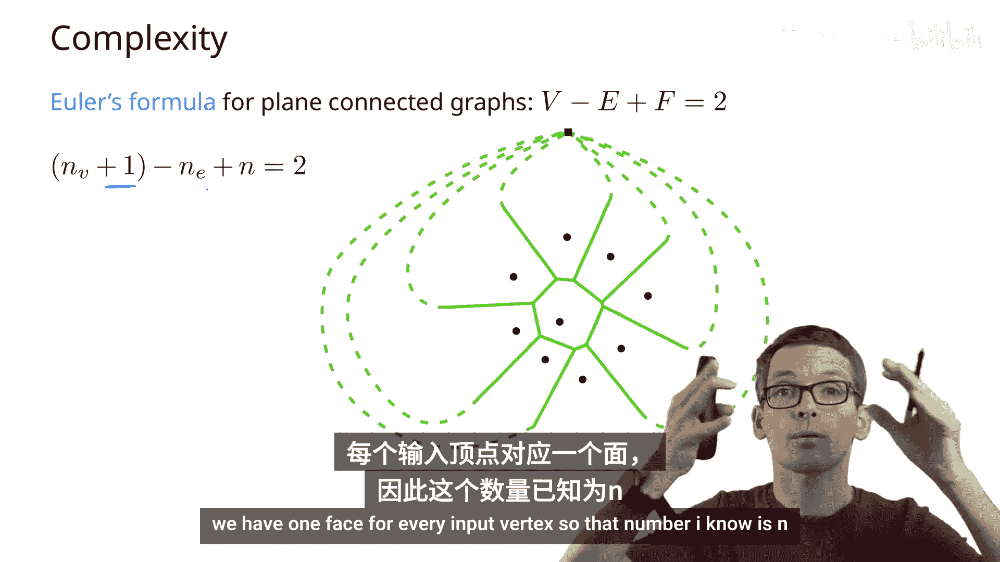

To find more about these numbers what we' are going to use is the so called handshking level。

 what does it mean it gives me a relation between the number of edges and the degrees of the vertices。

So if you have any graph。This hand sha lemma is 2。 And it just says that if you have an edge and you look at the sum of all degrees。

 this edge will contribute。Two to the sum namely to the degree of the one vertex of it and one to the degree of its other vertex。

In this sum of degrees every edge features twice， so the sum of the degrees is two times the number of edges。

Now， what we can use here is that all of the vertices that we have have degree。😊，At least。3。Meaning。

That the sum actually is lower bounded。bye。Okay， we said degree is at least three。

 so I have the sum over threes。As sum of all vertices， this now also includes， I mean。

 this is all vertices of this playing graph， so it also includes this one here。So what I get。

As I get three times。AndV+ one。I'm going to use。oas formula。

And I'm going to use what I derived from the。Handshakeky glor to derive pounds。

On the number of edges and the number of vertices。And I'd suggest you try that with a pen and paper。

 So which of these three sets of inequalities is tight。

Is the number of edges bounded by essentially hence n n times n plus one divide by2。

Add the number of vertices by something similar but divide by 3， Or can I get a much stronger bound？

 I mean， this is a quadratic bound on the number of edges。

 Can I get a linear bound on the number of edges， namely 3 and-6。And for the vertices 2 n minus5。

Or do I even get something。Stronger that the number of faces or cells and the number of edge drills and the number of vertices are all the same。

The quick answer is B。So I get this pound of 3 and-6 on the number of edges。

2 and -5 on the number of vertices。 So how can I get that？ So here I have the N V plus 1。

 Here I have N V plus 1。 So I can plug in。Let me put。These terms over here。

 then I can plug in this part into this equation。So then I have two times N E larger equal。

Three times。What I have on the other side then here。If I now reorder the term， so I have2 and E here。

 I have3 and E here。 So let me subtract2 and E， then I have。Then I have N here。

Then I have a six here， which I want to bring on the to the other side。 So then I have-6。

 and I have a 3-3 n。 So that's the plus3 n。 if I bring it to this side。 So that gives me。

N E is more equal 3 n minus-6。 If I now take this again。And plug it into here。

I can derive that the number of vertices is indeed bounded by 2 n minus5。

 so what we now know about the complexity of avolonoid diagram is the following if I have npoint I have n says I have 3 and minus-6 edge at most I have 2n minus5 vertices at most so much for now aboutvoloid diagrams next we will have a look at the delonate triang。

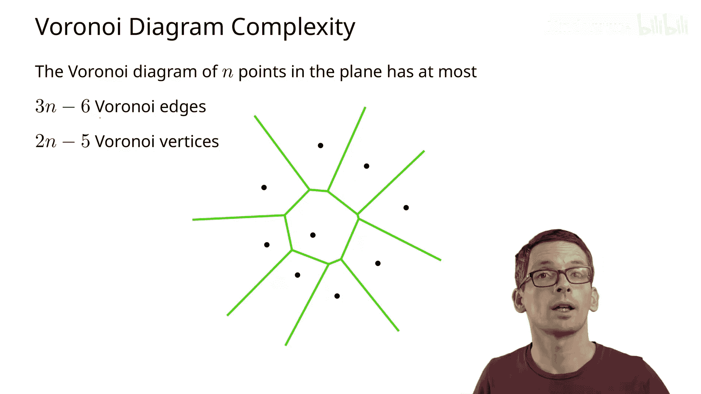