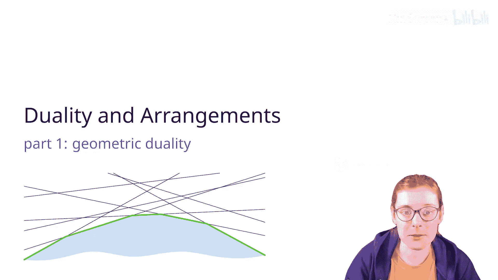
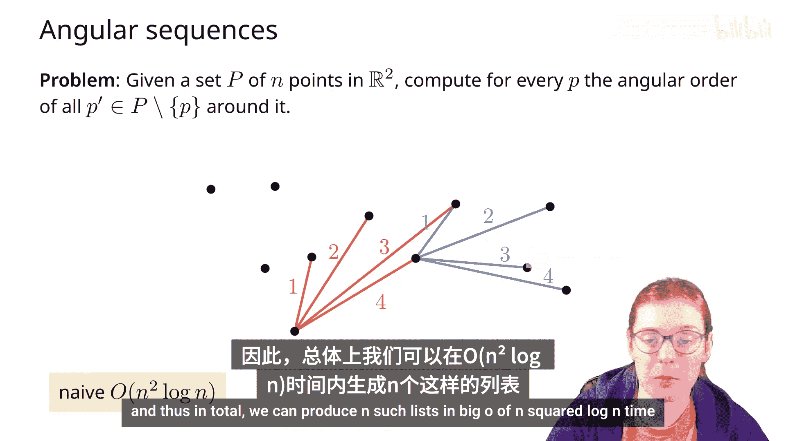
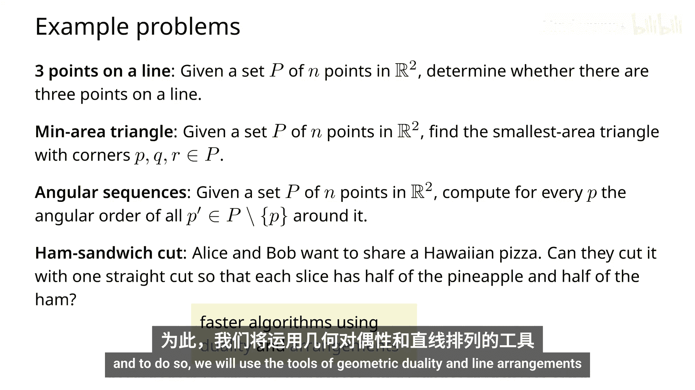
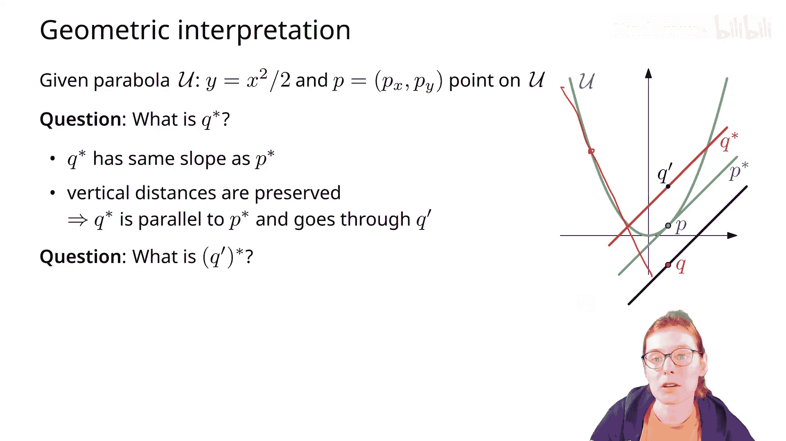
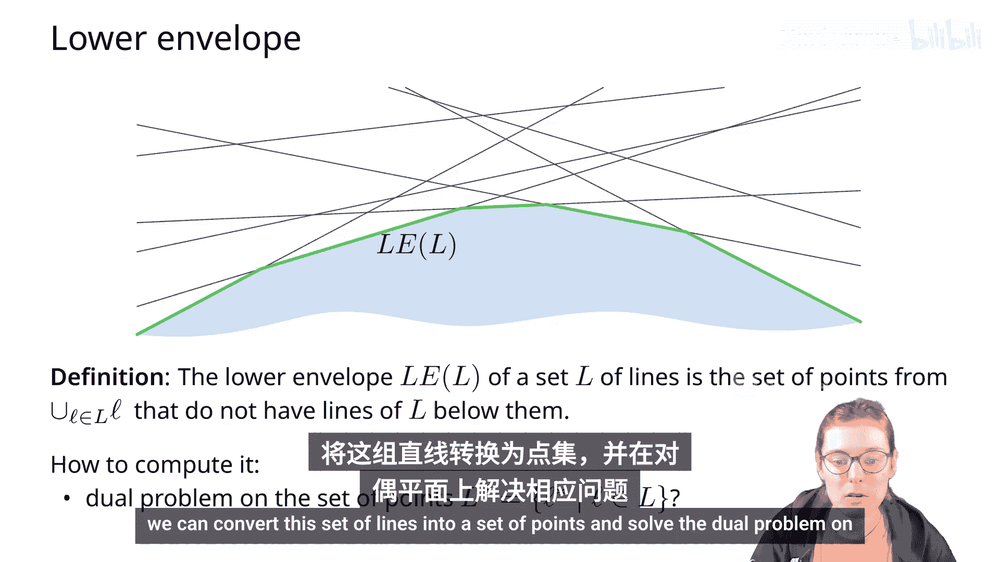
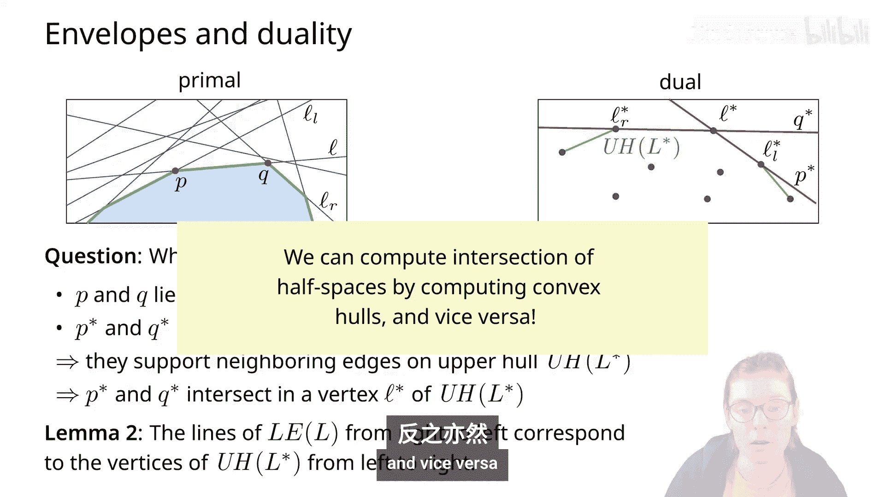
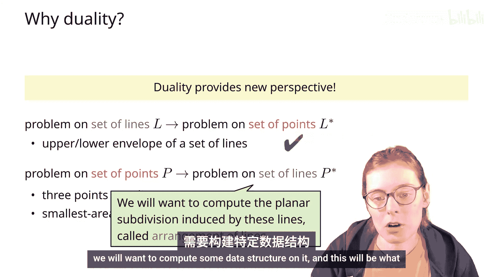

# 【Algorithms Lab】计算几何 ｜ Computational Geometry p10 P10_几何对偶 -BV1Jtn7zSEXD_p10-

Hello， today we will talk about geometric dualology and line arrangements。

 let's start with a few example problems。 The first problem is given a set of points in the plane。

 we want to check whether three points lie on the same line。

AA solution here would be of course to check all triplets of points and if one of them lies on the same line。

 then of course the answer is yes， and the running time of this algorithm would be cubic。

 of course we need to check all triplets of point and for each triplet we can check whether they lie on the same line in constant time。

Next problem Now， instead of checking whether there are three points that lie on the same line。

 we want to find three points P Q and R， which are the corners of the smallest area triangle。Again。

 we can take the same approach as in the previous problem。

 check all triplets of points and maintain the minimum area triangle that we've seen so far。

 the running time of that algorithm would be cubic。Next problem。Again。

 given a set of points in the plane， what we want to compute now is for every point P。

 the angular order of the remaining points around it。

 so we will have and lists of points ordered around each point。For one point。

 we can sort the remaining points by angle around it in n log n time。

 and thus in total we can produce n such lists in big of and square log n time。

And finally， one more problem。Alice and Bob want to share a Hawaiian pizza and we mark pineapple with yellow dots and ham with red dots。

And they want to cut this pizza so that each one of them gets the same number of pineapple pieces and the same number of hemp pieces。

 How can we find such a cut。Well， a na approach here is again， to consider all possible lines。

 which there will be big of and squared of。And check if each of these lines splits the points equally。

So the total running time is again， cubic。

We have considered four problems which we may say have more or less relation one to each other。

 and with a brute force approach， we know how to solve each one of them in cubic or close to cubic running time。

By the end of this lecture， you will know how to solve these problems and many other problems much more efficiently。

And to do so， we will use the tools of geometric dualality and line arrangements。

In this video we will introduce the notion of geometric duality and we will learn about some of its properties we'll start with a plane and a system of coordinates in it x Y and let's consider a0 p in it and just for example。

 let's say that the coordinates of P are2 and1。Then we will construct a dual plane with the system of coordinates。

 let's say， A and B。And in it， we will define a line B equals 2 a minus-1。

 So you see we use the x and y coordinates of the point P to create a dual line P star in the dual plane。

So in general， if our point p has coordinates px and py。

 the dual line that we usually denote with the same label P。

 but with a star next to it will be given by an equation， y equals px times x minus py。Similarly。

 if we are given a line in the original plane or what we call primal plane。

 we can construct using the values of the slope and intercept a dual point in the dual plane。

 the first coordinate of this point will be equal to the slope of the line。

 and the y coordinate of this point will be minus the intercept of the original line。

So this is all there is to the definition of the dual plane and dual points and lines in it。Now。

 let's see what kind of properties we can derive from this definition。By applying the definition。

 we can prove the following properties。 First， the property of self inverse。

 the dual of a dual point is the point itself， and the duall of a dual line is the line itself。

 So if we apply the dual transformation to a given plane twice。

 then we will obtain the same plane and the same objects in it。

The second property is that vertical distances between the points and lines in the primal plane and their dual lines and points in the dual plane are conserved。

Here in the figure we have a line。With the equation y equals mx plus B and its dual point L star with coordinates m and minus B in the dual plane and the point P with coordinates px py in the primal plane and the dual line P star with the equation y equals px times x minus py。

 Now， if we want to measure the vertical distance between the primal point P and the primal line L。

 we need to find the y coordinate of the point on the line。With the same x coordinate as P。

 And then the vertical distance can be found with this expression。

And now if we perform the same operation in the dual plane。

 if we find the point on the line with the same x coordinate as the point L star and find the vertical distance between the two points。

 we will get exactly the same expression as in the primal plane。

The next property is that the relation between the points and lines in the primal plane will flip when we will consider the duals of those points and lines in the dual plane。

 for example， if a point P。Is below line L in the primal plane。

 then the line P star will lie above the point L star in the dual plane。

If a point P would lie on the line L in the primal plane。

 then the line P star would pass through the point L star in the dual plane。

 and similarly if the point P would lie above line L。

 then the line P star would go below the point L star in the dual plane。Finally。

 two more properties if we have lines L1 and L2。Interssect in some point R in the primal plane。

 that means that the corresponding points L1 star and L2 star will lie on the dual line R star。

And if we have three points QR and S calendarline， let's say that they lie on some line L2。

 that means that in the dual plane， the three corresponding lines。

 QR and S will pass through the same point， which will be the dual to the line L2。

All of these properties directly follow from the definition of the dual transform。

And I will leave this as an exercise for you to check by yourself。

From the definitions of dual points and dual lines。

 we can also infer the dual objects of other geometric objects， for example， a line segment。

So let's consider a segment S with two end points P and Q。

And let's figure out what the dual to align segment as would be in the dual plane。

So here I have a segment PQ。And I want to figure out what each of the points lying on the segment between P and Q will be dual to in the dual plane。

Well， by definition， a point P will be dual to some dual line P star and a point Q will be dual。

To align Q star。Furthermore， we said that the lines P star and Q star intersect in a point which is the duall。

To the line on which points P and Q lie in the primal plane。So what does this mean， Where do all。

The points between points， P and Q map。Well， consider any point。字。Between points， P and Q。The dual 2。

 T will be some line。Again， passing through the same point as P star and Q star。

And now if we slide the point T left or right along the segment， we will see that this line dual2 T。

Will be rotating around the common intersection point。So if we move T from point P to point Q。

It will be dual to some line that spans this。So called double wedge。Indeed。

 here we have the alliance P star and Q star and the segment S is dual to the double wedge S star。

And also observe that if we have line L intersecting the segment S in the primal plane。

 then this line L will be dual to some point L star in the dual plane。

 and this point will lie inside the double wedge。 That is the duall to the segment。

Now let's consider this very interesting geometric interpretation of duality。

 which will be helpful when we try to construct dual points and lines by hand。

Consider the parabola x squared over2 and let point p with coordinates P X P Y lie on this parabola。

Take a moment to think about the following question。

 What is the line tangent to the parabola at point P。Well， let's work out the detail。 First。

 we know that the point P lies on the parabola and thus the coordinates。Of the point P。

 satisfy the equation of the problem。Second， we know how to find an equation of a tangent line to a curve going through some point on the curve。

It will be given by the following formula。Its slope is given by the first derivative。Of the curve。

Evaluated at the x coordinate。Of the point。And it's intercept。 We need to compute。

After we simplify this， we will find that the equation。Is P， X times x plus b。Again。

 because this line passes through point P， if we plug in the coordinates of the point P into the equation of the line。

We can derive the value of the intercept。So。The intercept is equal to py minus px squared。

We can now replace P X squared using the first observation we made。And。Find that B equals p。

y minus-2 p，y。Which is simply minus Py。So the line that is tangent to the parabola passing through the point B will have equation y equals px times x。

mininus Py。Notice that this is the equation of the dual line。P star in the dual plane。

 because the slope equals to the first coordinate of Px and the intercept equals to minus the second coordinate of the point P。

Okay， great。 So let's summarize first， the derivative of the parbola at point P is Px。

The intercept is minus bx squared over 2。Thus， the tangent line to the parable passing through the point P is given by the equation px times x minus px squared over 2。

And now if we write down the equation of the dual line of P。

We will find that it is given by this same equation。Okay。

 so P star is tangent to the parabola x squared over2 at point P。Now。

 consider point Q that lies directly below the point P。 What is the dual line Q star to the point Q。

Well， let's see what we can reason about Q star。 Firstly， we know that the x coordinate of Q。

Is the same as the x coordinate of P。So the slope of Q star。Will be the same as of P star。

 Now we need to find its intercept or find the location of the line in some other way。

So which way can we reason about it。Well， we know that the vertical distances between points and lines in the primal plane correspond to the dual lines and points in the dual plane。

 So if we consider the point Q。And the line P star as the objects in the primal plane。

And the line Q star。And the point P as the objects in the dual plane。

 Then we know that the vertical distance will be preserved。

So the vertical distance between Q and p star is the same as the vertical distance between P and Q star。

 and now we need to figure out does the line Q star lie above point p or below point p？And for this。

 we can use the other property that we have shown， which is the relation between points and lines and the primal plane gets swapped between the dual lines and dual points in the dual plane。

 So if Q lies below the line piece star。In the primal plane， then the line Q star。

Will lie above the dual point P in the dual plane。Indeed。Q star has the same slope as P star。

 verticalical distances are preserved， and because of the relations between points and lines are swapped in the dual plane。

 Q star lies above point P。Now， if we consider the point Q prime。

 which is directly above point p that lies on the line Q star， what is the dual to the point Q prime？

Well， by symmetry， we can find that the dual line Q prime star passes through the point Q and again is parallel to the lines P star and Q star。

One final observation that we can make here is that only the points on the parabola。

Will have their dual lines。Passing through them and to find these dual lines。

 we can simply the tangent line to the parabola through the given point。

Now， let's see how we can use dual to solve the problems that we have started with and many other problems。

But before that， let me introduce one more definition。The lower envelope。

Consider any set of lines in the plane。The lower envelope is the set of points from these lines that do not have any other line passing below it。

 so in green here is denoted that lower envelope OD lines and what I'm drawing is that from every point on this lower envelope。

 if I draw a vertical rate downward， it will not intersect any of the lines。Now。

 let's see how we can compute a lower envelope given a set of lines。And of course。

 because we are using duality， let's see if we can convert this set of lines into a set of points and solve the dual problem on that set of points。

So if we have a set of lines in the primal plane， we will have a set of dual points in the dual plane。

Let's answer the question of which lines support the segments of the lower envelope。In particular。

 let's consider some segment with endpoint P and Q。

Assuming that the points P and Q lie on the lower envelope。

 that means that there are no lines from the input set of lines that lie below P and Q。

Now in the dual plane， that means that there are no points lying above the dual lines。

 P star and Q star。Moreover， the point P lies on the line L of the input set of lines that also passes through the point Q。

 but also on some other line。That means that the dual line P star。

Will pass through the point that is dual2 L L star。And some other point due to the other line。

Similarly， line Q star passes through the point L star and some other point that is dual to the line。

That is also passing through the point Q。So now what does this mean that there are no points？

That are dual to the original lines lying above Q star or lying above P star。

 While that means that the lines Q star and P star define the edges of the convex hull around the point set。

And in particular， they define the edges of the upper hu of the set of points that are dual to the set of lines in the primal plane。

The vertex of the upper hall L star corresponds to the line L in the primal plane that passes through the points P and Q。

Thus， we can conclude with the following lema。The lines of the lower hull。

 if we are considering them in the order from right to left。

Willk respond to the vertices of the upper hall。In the order， from left to right。

So we can conclude that we can compute intersection of half spaces。

 which is the lower envelope of a set of lines by computing a convexhu on the dual set of points and vice versa。

Indeed， dual can provide us with a new perspective on how to solve a given problem if we are given a problem on a set of lines L。

 we can convert this problem into a dual problem on a set of points L star and an example of such a problem we have just seen when we want to compute an upper or lower envelope on a set of lines and instead of solving it directly on these lines。

 we convert this problem to have a set of points as the input。

And instead of finding the lower envelope or an upper envelope in the primal plane。

 we find a convexhull， an upper hull or a lower hull in the dual plane。

 And because we already know how to find a convexhull off a set of points。

 we converted the original problem， which we didn't know how to solve to something that we already have a lot of algorithms developed for。

Now let's see if we can make use of the duality transform in the opposite direction。

 if we are given a problem on a set of points， let's see how we can convert this problem into a dual problem on a set of lines and hopefully make some new observations that will give insight into the original problem。

Now， when we will have a problem on a set of lines。

 we will want to compute some data structure on it。

 And this will be what we call an arrangement of lines。

