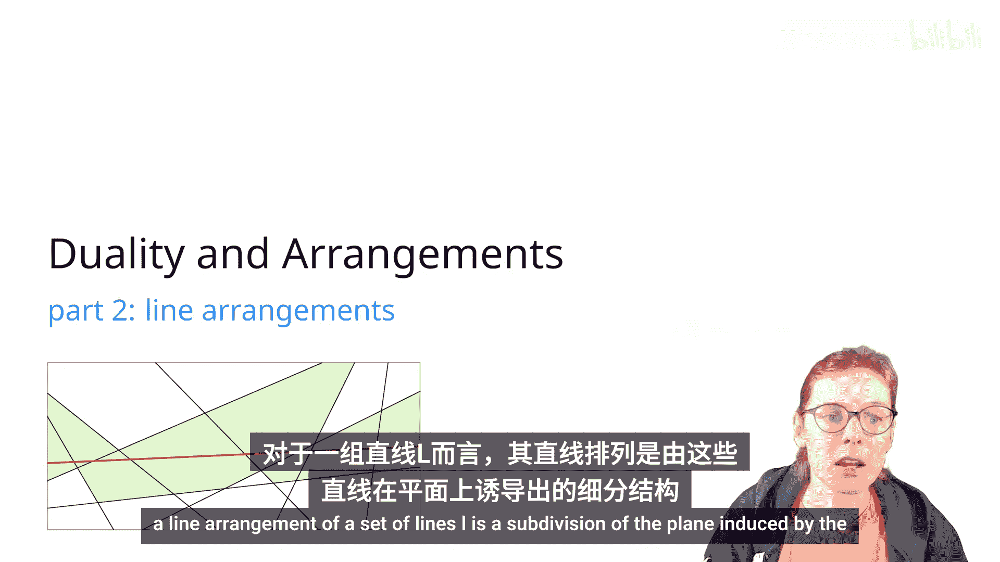
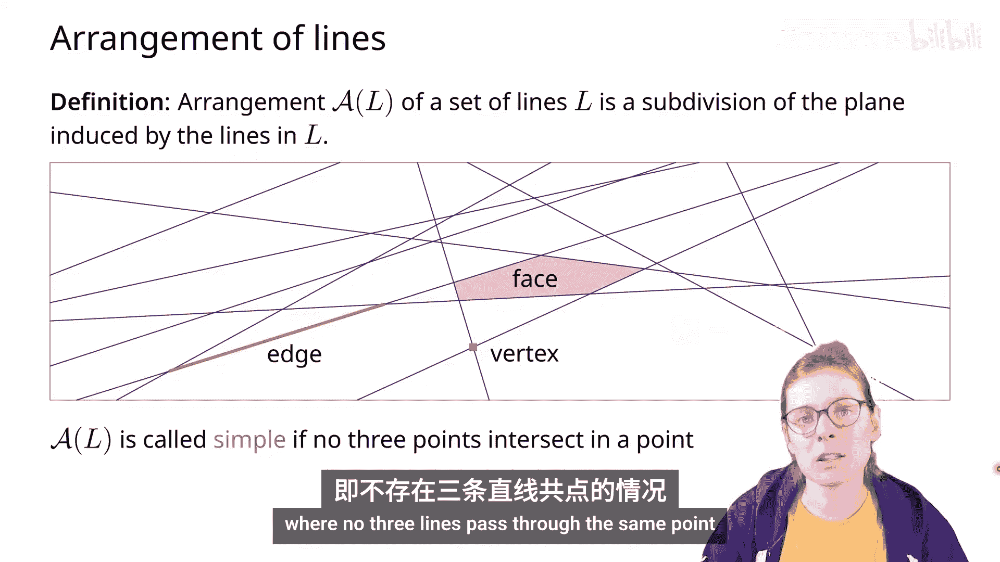
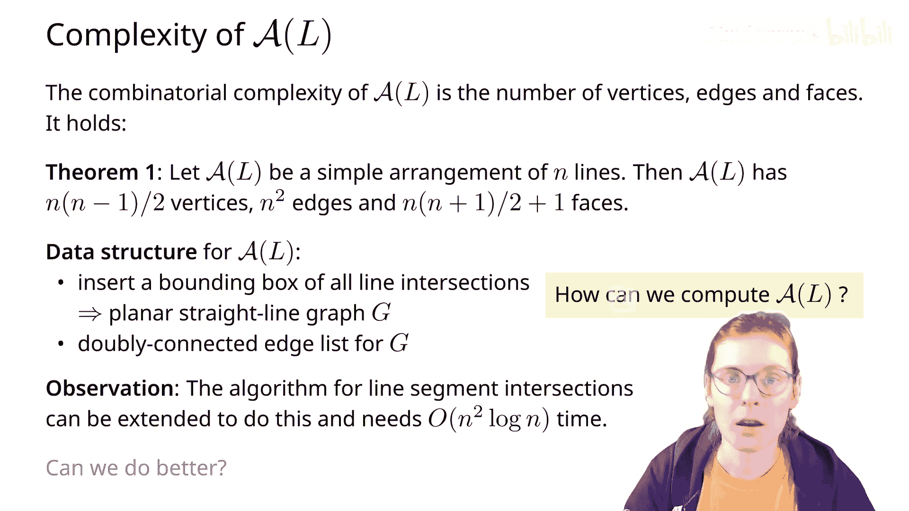
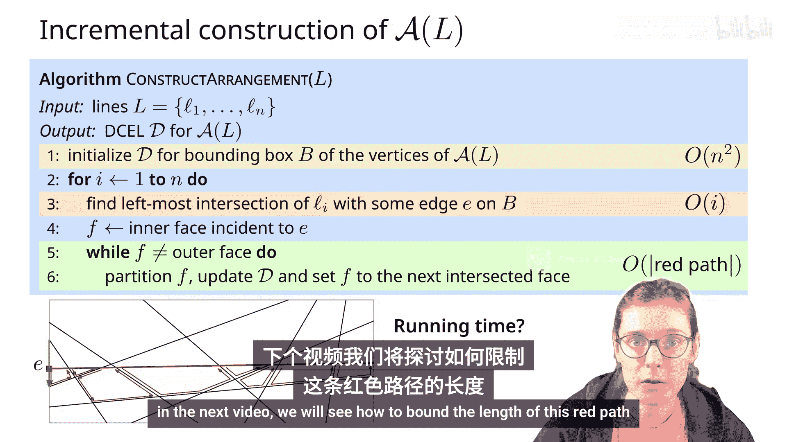
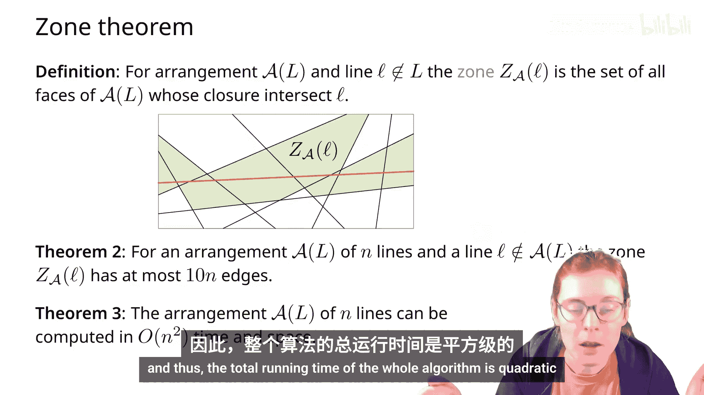
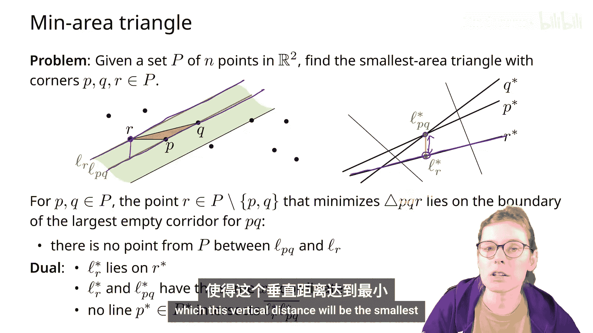
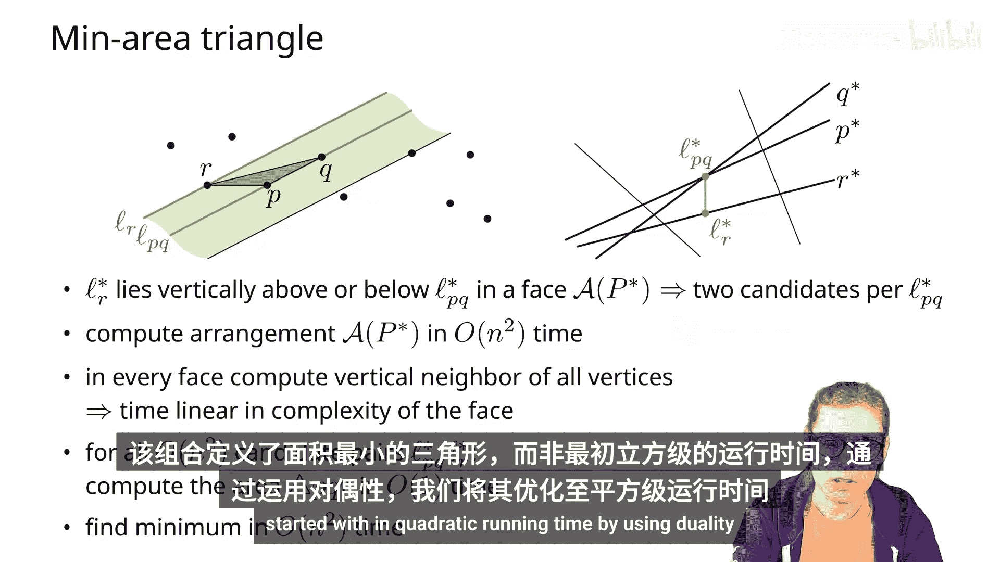
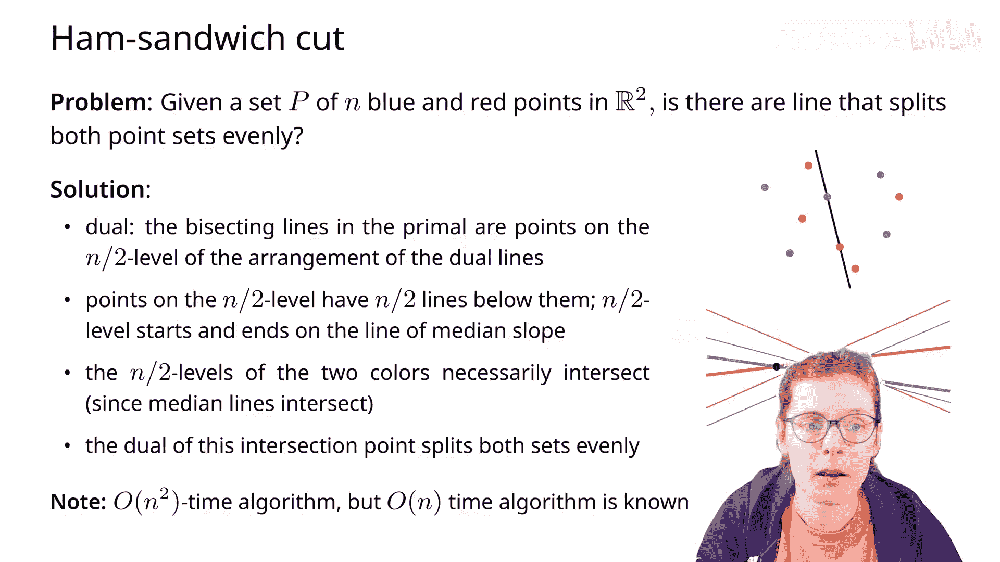
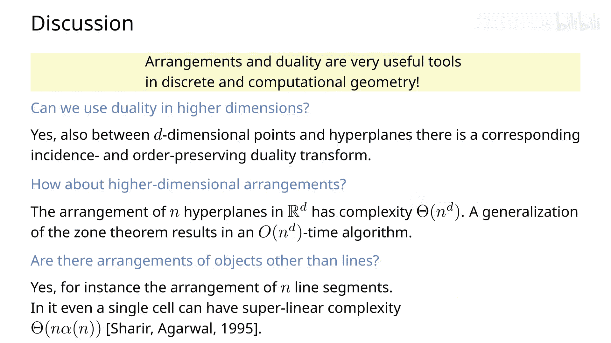

# 【Algorithms Lab】计算几何 ｜ Computational Geometry p11 P11_线排列 -BV1Jtn7zSEXD_p11-

A line arrangement of a set of lines。 L is a subdivision of the plane induced by the lines in L。

It will contain faces， the pieces of the plane that the lines cut the plane into。The edges。

The pieces of lines， which are cut by the other lines crossing。And the vertices。

 the points where the lines intersect。And in general。

 we will consider simple line arrangements where no three lines pass through the same point。

First， let's see how many vertices edges and faces a line arrangement can have。

 so we want to prove the following theorem， a simple line arrangement on a set of n lines will have that many vertices that many edges and that many faces。

 so let's figure out what are those values。Well， we can start with vertices。If we have an。

Lines in the plane， and none of three lines pass through the same vertex。

 Then each vertex is defined by exactly two lines。And thus， there will be n times n minus1。

Over two vertices overall， right， which is the number of pairs of lines in this arrangement。

For the number of edges， we can observe that。Each line。Is intersected by the other and minus1 lines。

And thus， the line itself is cut。Into and pieces。So。We will have。

And squared number of edges in the lane arrangement。And now for the number of phases。

 we can use the order formula。However， we know how to apply Euler's formula to a。Finite planar graph。

 Here we have lines that extend to infinity。Well， luckyily。

 we can insert one extratro vertex and connect all the extensions of lines。To that point。

 instead of extending them to infinity。Now， the oiler's formula is the number of vertices minus the number of edges。

Plus， the number of phases equals 2 can be applied to this new planar graph that we have drawn。

 The number of vertices in this graph is the number of vertices in the original。

Line arrangement plus the one extratro vertex that we haven't heard it。

And the number of edges we have computed before is n squared。

 We did not change the number of edges of the line arrangement by inserting one extra vertex and connecting the line extensions to it。

 and finally the number of phases is what we are trying to find。From this， we can。Find that。

 the number faces。Is and squared。Minus。And squared minus n over 2。Plus， one， and。

After simplifying this expression， we will find that it is。N times n plus1 over2 plus one。Indeed。

 now we can reveal the full theorem statement and a simple line arrangement of n lines has n times n minus1 over 2 vertices and squared edges and n times n plus 1 over 2 plus 1 phases。

Now to represent the line arrangement， we are going to use the Doubly connected edge list data structure。

This data structure describes vertices edges and faces of a planar graph。

 Each edge is represented by a pair of so called half edges。

Each edge E directed from its start vertex to the target vertex has a twin edge that we denote as twin of E。

The face of E will be the face lying to the left of the directed edge。

And we will also be able to refer to the previous edge along the same face。

Coming before E and to the next edge。Going around the same phase after E traversal around each phase will be in the counterclockwise order。

Each vertex will have a pointer to some incident edge outgoing from this vertex。

 and then we will be able to refer to the other outgoing edges by going over the pointers to twins and next edges。

And finally， each face will have pointers to an incident edge。

For each connected component of the boundary of the face， if the face is simple。

 it will be only one outer component， but if the face has holes。

 then in addition to the outer boundary component， it will have also several inner components。

Now that we know how we want to represent a line arrangement as a Doubly connected edge list。

Let's see how we can compute it。Well the first and straightforward observation is that we can apply an algorithm that we already know how to compute in particular we can apply the line intersection algorithm and find the line arrangement in big O and square log n time。

The question that we always ask ourselves is， can we do better？

And indeed， we can。Let's consider the following algorithm。

 We will construct the line arrangement as a doubleub connected edge list。

Using incremental construction。First， we initialize some large bocing box that will contain all the intersections of all the lines。

In the figure below， you can see that this is not the proper bounding box。

 but for the purposes of saving space， I'm going to use that box We're going to insert lines。

Into this box， one by one。 And for each newly inserted line。

 we will update the current data structure。We will do so in the following way。 First。

 we find the leftmost intersection of the newly inserted line L I with some H E on the bounding box。

And then we will traverse the faces that the line L intersects and update the W connected edge list at the new intersections。

The way we're going to do it is。First， we split the edge E into the two half edges and update their twins。

Then we will continue traversing the phase that the line L intersects。

Until the next intersection point。Often edge of the face with the line L。

 we insert this intersection point into the doubleub connected edge list and insert the new edges for the pieces of the line intersecting this face。

And then move on onto the next phase intersected by the line。

 and we keep traversing it until the next intersection with the line L。

After we find the next intersection point， we again update the W connected edge list。

 insert the two half edges for the new piece of the line LI intersected by the face。

And continue with the next phase and so on and so forth until we reach the opposite end of the boundary。

So what is the running time of this algorithm？First， to initialize the bocing box。

 we need to compute all the intersection points and find the minimum and the maximum of x and y coordinates so that we build the box that is large enough to contain all the intersection points。

 and that takes a quadratic time。Next， finding the first intersection of the next inserted line LI into the W connected edge list will take order of I。

 This is because there are of I pieces of the boundary that the previous I minus1 lines split it into。

And finally， the wild loop in lines 5 and 6 takes time proportional to the length of all the edges that we just traversed。

 So the length of the red path。In the next video， we will see how to bound the length of this red pad。

Let's finish analyzing the running time of the incremental construction algorithm for the line arrangement。

 and for that we need to introduce a new definition。For a given line arrangement and some line。

 not from the input set of lines， we define the zone of the line arrangement intersected by line L as all the faces of the line arrangement that the line L intersects。

To illustrate this， consider this line arrangement。

 the red line line L is not part of this line arrangement。

 and now if we highlight all the faces that this red line intersects。

 this is exactly the zone of the line arrangement for the line L。

What we want to know is how many faces are there in the zone and how many edges are there。

 because this will be the upper bound on this red path that we try to bound for the analysis of the running time of the algorithm。

In fact， we will prove the following theorem for a given line arrangement， not necessarily simple。

 and some line that does not belong to the line arrangement。

The zone of this line arrangement intersected by the line L has at most 10 times an0 edges。

To prove this dear， we will again use incremental construction approach。

Assume that line L is horizontal for simplicity。 We will distinguish between the left bounding edges and the right bounding edges for each face。

 The left bounding edges are those which bound the face from the left。

And the right bounding edges of the face will be those that bound the face from the right。

We will only count the left bounding edges， and then by symmetry。

 we will multiply the resulting value by 2 and obtain our final result。 So now。

 given our horizontal line L。We will consider the lines of the arrangement that line L intersects。

 and we will start inserting from scratch all these lines in the order of their intersection with the line L from left to right。

For the base case， when we insert the first edge， we will only have one。Left bounding edge。

And now for each next line that we insert， we will show that it inserts at most five new left bounding edges。

So let's say that this is the line that we have just inserted line L1。

 We need to count how many left bounding edges the line L1 crosses and how many new left bounding edges it creates。

So before we inserted line L1， we had。1。Two left bounding edges。And after inserting L1 in the image。

 we have one，2。3，4。5 left bounding edges。So we have increased the number of left bounding edges by3。

There are a few examples to consider here how the line L1 can insert the previously inserted lines and how many new left bounding edges it can create。

 but over all cases we can prove that。For each newly inserted line。

 we create at most five left boing edges。And for the details of the proof， please refer to the book。

From that， we can conclude that there are at most 5 n left bounding edges。

And by the similarity of the argument， at most five and right bounding edges。So in total。

 a zone of a line arrangement of N lines can contain at most 10 edges。And thus。

 going back to the analysis of the incremental construction algorithm for a line arrangement。

 we can argue that inserting a new line takes linear time in the size of the so far constructed line arrangement。

And thus's the total running time of the whole algorithm is quadratic。

So what we have seen so far is first the definition of doity and we have considered some properties of the doity。

 in particular we have seen that it preserves some important geometric properties between the objects。

Daity provides a new perspective on how to approach new geometric problems。For example。

 if our problem asks us to consider a set of points。

 we instead may choose to convert this problem to a dual plane and consider a set of lines。

And see if this perspective is easier to analyze。And secondly， we have introduced。

Line arrangements and we have seen that overall the arrangement of N lines has quadratic complexity。

 it can also be constructed in quadratic time， and we have seen that the complexity of a zone。

 meaning all the faces that are intersected by a line that is not part of the arrangement is linear。

To finish， let's see how we can now solve the problems that we have started this lecture with。

The first problem was， given a set of points in the plane。

 check whether three points lie on the same line。Now， applying duality。

 we can construct a dual problem where given a set of lines。

 we want to check whether three lines go through the same point。

And the algorithm to check that is simple。 We will incrementally insert each line1 by one into the arrangement。

 and we will stop if we see that three lines pass through the same point。Thus。

 instead of the original cubic running time algorithm， we can convert our original problem。

Into a problem in the dual plane and solve it in quadratic time。

The next problem was to find a triplet of points defining the smallest area triangle。

Let's see if we can make some useful observations here。Consider the smallest area triangle PQR。

 and let's extend the edge PQ to a line。Now， if we draw a line parallel to the line passing through P And Q through the point R。

 then we can observe that this strip between the two lines。Must be empty of other points。

 otherwise the triangle PQR would not have the smallest area。

So there is no point from the set of points P between the lines LPQ and LR。

Now for the dual formulation of the problem， we consider a line arrangement consisting of line's dual to the points in the primal plane。

And their intersection points will be dual to the lines passing through a pair of points in the original primal plane。

Now， the。Point R will be dual to some line or star。

And the line LR passing through our parallel to the line LPQ will be dual to the point LR star that has the same x coordinate as the point LPQ star。

 which is the dual to the line LPQ。Because we know that the vertical distance is preserved。

 the vertical distance between R and the line LpQ will be the same as the vertical distance between the points LR star and LPQ star。

Now to find the smallest area triangle， what we want is to find a triplet of points for which this vertical distance will be the smallest。

So we can formulate the following algorithm。For each intersection point of two lines in the dual plane。

 we want to find the closest vertical point underneath and the closest vertical point above that intersection point。

And find the smallest such distance。So the algorithm would compute the line arrangement in quadratic time。

 and within every phase we compute the vertical neighbor of each vertex the time it takes will be linear in the complexity of each phase。

And finally， out of all the candidate points， we will find the one that minimizes the area。

 and this can be done in quadraticcr time。So again， for a set of points in the plane。

 we can find a triplet of points that define the smallest area triangle instead of the cubic running time that we started with in quadratic running time by using duality。

Finally， the last problem that we considered was the so called ham sandwich cut problem。

Where we are given a set of points in the plane and each point has either of two colors。

 in this case， let's consider red and blue points。And we want to find a line that splits both colors evenly。

It is enough to consider set of lines that pass through two points of the input。

 and as we have quadratic number of candidate lines。

So a solution using duality would be the following。Consider one of the colors。And for simplicity。

 let's assume that there are odd number of points because we're going to draw a line through the point of that color。

 we want to have the even number of remaining points so that they can be split evenly If the number of points is not odd to begin with。

 we can just discard one point。And continue。Now for every slope。

 there will be a line that splits this color evenly。For example， for horizontal lines。

There is a line that passes through the mid point and splits the remaining red points evenly for a vertical line。

 There is another line passing through another mid point that splits the remaining red points evenly。

 and for any。Orientation of the line。 There will be a line passing through the midpoint。

Corresponding to that orientation of the line that splits the remaining red points evenly。

What that means for us is when we consider the dual line arrangement of the lines due to the original points。

 these lines will have colors， red and blue， and each slope in the primal plane corresponds to some x chord in it。

In the dual plane。 So if we start rotating this line counterclockwise。

 this will correspond to moving this coordinate to the right。

And then what does it mean that there is a line？Of a given slope passing through one of the points that splits the remaining points of the same color evenly。

 Well， that means that for a given。😔，Coordinate x， there is。

A point on one of the red lines so that the number of red intersections above the point and below the point will be the same。

And now， when we will be moving this vertical line to the right。

 according to the growth of the X coordinate that corresponds to the rotation of this original line in the primal plane。

 we will sometimes switch to another line。That will contain the mid point that will correspond to the line in the primal plane that splits the other points evenly。

So to conclude with an observation what we want is for each coordinate x。

 we want to find the middle line。That has the same number of lines above and below。

 and this will be so called middle level of a line arrangement， or if we have n input lines。

 this will be the n over two level。The N over2 level is all the points of the line arrangement that have exactly N over two lines below them。

Now we can find this N over2 level for the red lines。And we can find the。

And over two level for the blue lines。These two levels must intersect in some point。

And that point will be the one corresponding to the line in the primal plane that passes through both points of red and blue color and splits the remaining colors evenly。

So to summarize our approach， first， we construct the line arrangement on the lines which are dual to original points。

For each color of the lines， we will find the N over two level。

So there will be the n over2 level for the red lines and n over2 level for the blue lines。

 and then these two levels are guaranteed to intersect and they will intersect in the point that will be dual to the line in the primal plane that will split all the points evenly。

This again， results in the quadratic writing time algorithm。

Note that there is a faster algorithm known for this problem。

 but for our purposes we use it as an illustration of how duality can help construct more efficient algorithms that the first naV approach would imply。

To finish off， let's answer a few final questions。 First， can we use duality in higher dimensions。

 Well， indeed we can， indeed dimensional space we can put in correspondence the dimensional points and hyperplanes。

 and we can derive all the same properties of incidence and order preservation。

How about arrangements in higher dimensions， Well again it is possible we can build an arrangement of n hyperplanes in some d dimensional space and then the complexity of this arrangement would be proportional to the n to the power of D。

A generalization of this zone theorem can also be proven。

 which results in an algorithm that takes big off and to the D running time。And finally。

 can we build arrangements on other objects other than lines？Well， yes， we can， for instance。

 we can build arrangements on sets of segments。In that case， it's。In this case。

 the complexity of the arrangement does not have to be linear anymore and even a single cell。

In such an arrangement can have super linear complexity。

For more details on the arrangement of segments， please refer to the cid paper。

