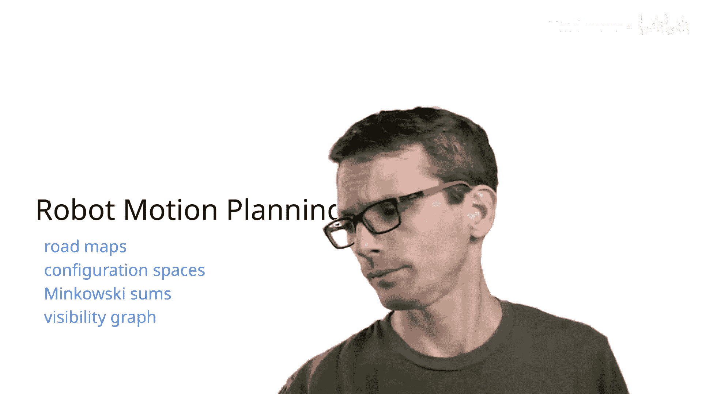
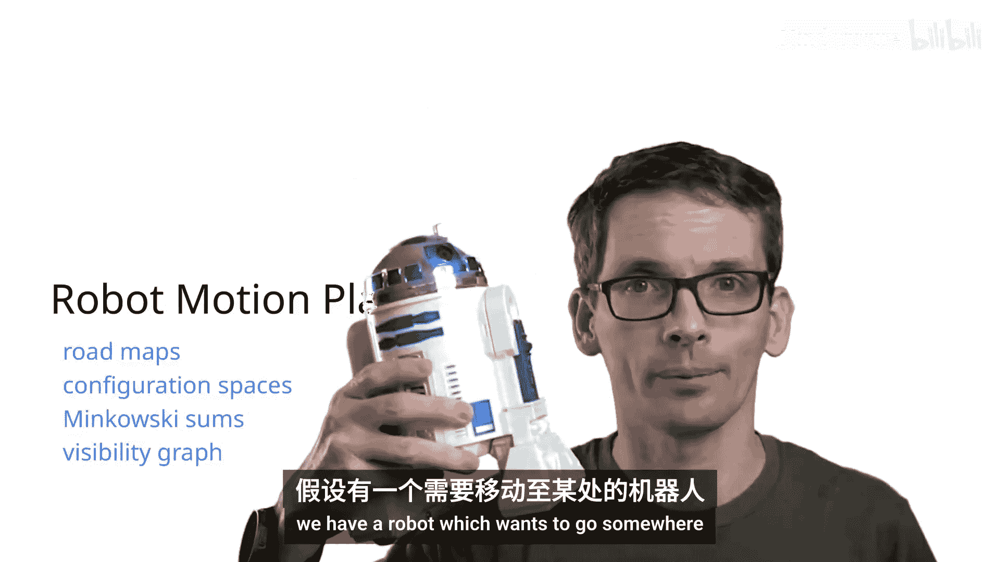
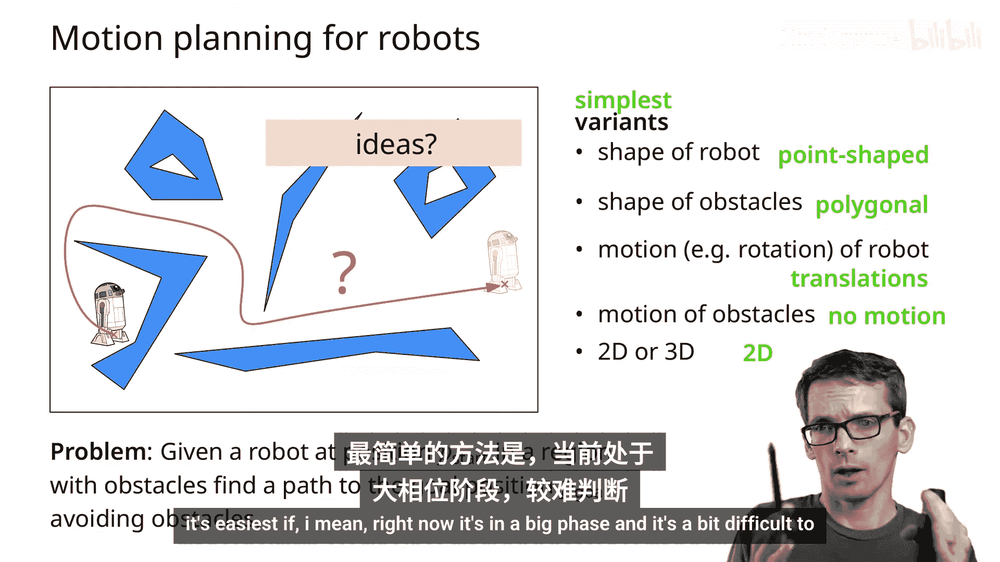
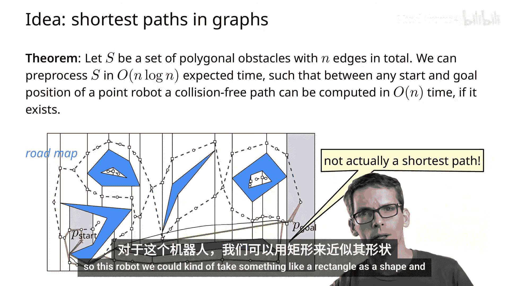
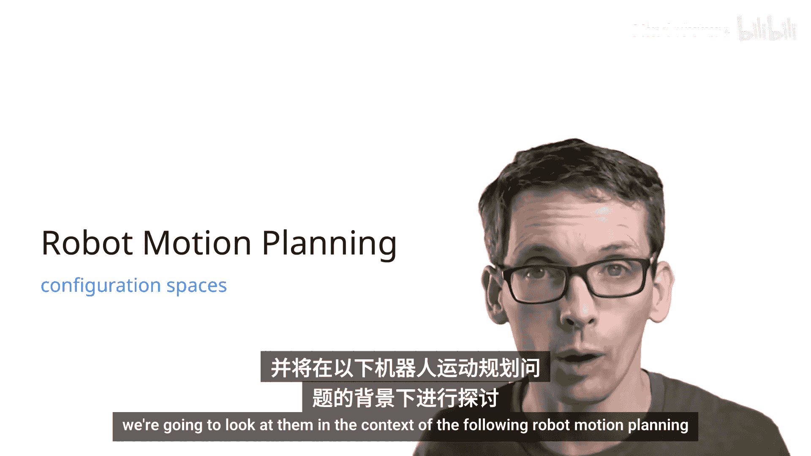
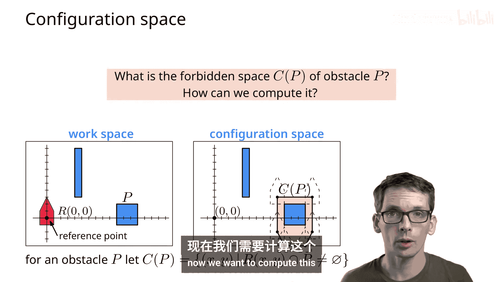

# 【Algorithms Lab】计算几何 ｜ Computational Geometry p12 P12_机器人运动规划-引言_路线图_和配置空间（3部分之1） -BV1Jtn7zSEXD_p12-

Welcome today we're going to look at robot about motion planning。

 two important concepts and roadmaps and configuration spaces and we first have well have a look at those then in terms of computing configuration spaces we're going to look at Kummovski sums and how to compute them and how to compute their union。

And then finally， for shortest pass， we're going to look at visibility graphs and an algorithm for computing the visibility graph。

We have a robot。Which wants to go some。 So that is our problem。

Give a robot with some sta position and we have a region with obstacles。

This robot wants to find a path to the goal position。Avoiding obstacles。Yeah， so for instance。

 a path like this and。For this problem。It's of course。

 important to know what kind of shape the robot has， what kind of shape or obstacles have。

 what kind of motion the robot can do， maybe the obstacles also move。

And then there's also the question of whether we're working in 2D or 3D。

 So very often we can think of 2D movement because let's take this robot here。

The third dimension doesn't really add much as in this robot isn't doing anything with the third dimension。

 so we can really just think of it moving in a two dimensional plane。Okay。

 so simplest variant we could think of as a following， let's say our robot is actually just a point。

Obstacles are polygonal。Otherwise， it would be really boring。

Let's say the robot can only translate that for a point shape robot that doesn't really make a difference later if the robot actually has a shape。

 then it's also relevant whether it rotates， but okay， for now just translates。

And obstacles don't move actually today obstacles will never move in what we are going to talk about obstacles wont move。

 obviously in general， obstacles might move and we are also always looking at the 2D case。Okay。

 so how could we solve this and this is actually a fairly simple setting。

 so with the geometric tools that you already know， you will be able to solve this。😊。

So somehow we we need to kind of make sure that the robot goes around obstacles and for that it's easiest。

I mean， right now it's in a big phase and it's a bit difficult to see what where to move next。

 but the way we can solve this is that we reduce it to our shortest path problem in our graph。

And that is the roadmap that were going to see next。

 So instead of having this robot moving freely in space。

 we're going to construct a graph and then no matter where we want to move it。

 the movement will be on that graph and to compute this graph we're going to use the vertical decomposition。

So compute the vertical decomposition of the obstacle segments and remove everything that is inside of the obstacles。

 Now you have the vertical decomposition of the space as such。 Okay。

 now we still need to have a graph。 What we're going to do is we're going to add one vertex in every face。

 so simply in the middle of the face。And additionally。

 we're going to add a vertex on each vertical extension in the middle of each vertical extension。

Then we're going to connect every phase。With its vertical or with a vertices on its vertical extensions。

And that is a graph that we're going to look at。And such a graph or a graph on which you let the robot navigate that's called a road。

And now what we need to do is just we need to first locate the face so the trapezoid that contains a start。

 we need to locate the trapezoid that contains the goal position。And then the robot simply moves。2。

So let's do that here。 Here was a robot。 This is a vertex of the start。 It moves。

 can move to that start。And okay， eventually， if it manages to find the face or the trapezoid。

 the goal is contained and then it is easy to move to the goal。

And now we just need to have a shortest path in G from。This vertex to that vertex。And for that。

 you can use whatever eye you want to use， for instance。

 so shortest passes here just min in terms of numbers， number of edges for us， so that could be。

 for instance， a bread search that you'll be using there。Here you see as an example。

 or this might be the shortest part。 So you go to the vertex of the face， you go。

via the vertex of a vertical extension， then to the next phase， vertical extension， next phase。

 and so on， and eventually this pass reaches ago。So fast good， is this algorithm？Correct。

So what do we need to answer if we want to know whether the algorithm is correct。

 we need to make sure that if there is a path， we are to find a path and the path that we find that that is actually does not hit any obstacles。

So why does a pass that we are using does not。Hit obstacles。Did think about that brieflying？So。

I mean， from start。To a position in the same trapezoid， trapezoid is a convex object。

I cannot hit anything。Likewise， this vertex and this vertex are both part of the same。

I mean trapezoid， I mean one is on the boundary but still。 and again， the trapezoid is convex。

 so everything in between is also the trapezoid。s so we're fine and the same argument applies。

For anything on this path， indeed， our path does not hit any obstacles。 So if we in particular。

 if we find a path， then actually a path exists and if a path exists。Now let's say do such a proof。

 so let's assume a path exists， let we draw a path that exists or it should have been stayed inside。

Okay。Then I can simply look at。Now let's shortcut it here。

Let's look at the trapezoids traversed by this path。 So let's goes here， here， here here。Here， here。

 here。 Then obviously， there's also a path in my graph that follows simply that sequence of trappisome。

Okay， so I was mis correct。 What is the running time。

 So what is the running time of all this on a scene with obstacles that have overall complexity N。

 is it expected。Of order log n or of order N log n or of order n squared。It is。Of orderura and log n。

 So why is that the case。Let's just have a look at what the running time of the various steps are。

 We compute a vertical decomposition that takes of order and log N。Okay。

 we're moving a segment of in with an obstacle that takes linear time。

Computing the graph based on the vertical decomposition， we can also do in linear time。

 Locating start and goal takes order lock end time。And then finding the shortest path。

 let's say we do a breath first search。Take。Linya。😔，睇。Okay， and as you see。

 the dominating term here is the。And okay。So we have our first result。

 namely if we have polygon obstacles。With overall an edges。

And we can pre processces them in analog log time， such that。

Give a point shape robot that wants to go from start to go。

 we can compute a collision free path in linear time。If it exists。

It is the shortest path in the graph， at least shortest in in whatever。

 let's say we did a bread soer， shortest in terms of number of trapezoids traversed。

 It is not the actual shortest path， as you also see in this example。

 So probably the shortest path here would look something like。

 let's say this path So it would kind of here just。Go around that obstacle and directly to there。

 So this was for point shape robots。Most robotts are not points。

A polygon is already much better to estimate。Kind of the shape of a robot or this robot we could come off。

Take。Something like嘅 rectangle。As the shape？

And we're going to see how to handle that case。Next。

 we're going to look at configuration spaces and we're going to look at them in the context of the following。

Robert motion planning problem。This is what we previously had just that now also the robot。

Has a polygonal shape。Yeah， so you can。If you think again of this robot here。

Its movement is essentially in the plane。And from that perspective， it's essentially。A rectangle。

 So for this robot， we could model it or or take as a shape a rectangle。 The obstacles are also pu。

 we assume。The motion。For the motion， we only allow translations， so in the context of this robot。

 it can move like this right and left。Up and down， it won't rotate。Quotations， we're going to look。

U later。Beyond that， obstacles aren' moving and as we have already seen。

 we are in 2D and we the question is。Can a polygonnal robot move from a star position to a goal position。

 avoiding polygonnal obstacles in between？And for this， we need the concept of configuration spaces。

 So， first of all， we start with the workspace。 The workspace is a space where we actually have the obstacles and the robot。

 So in blue， we have here the obstacles。 They are rectangles or one of them to be specific as square。

 and then the red object here。😊，That is my robot。 So that's a workspace。

 but we're going to look at the problem in a configuration space。 And what does that mean。

 a configuration of a robot is is essentially is a state in which the robot is and the state in our setting because we only have translations。

Is essentially where it currently is。So that describes the position of the robot。 So if， if。

 if initially my robot SAT here。Yeah， and let's say this dot here that's 0 to be precise00。

 because then 2 d。Now I can describe the state of my robot completely by telling you where this black dot has moved。

 So if I tell you this black dot has moved here。And because my robot only translates。

I exactly know where my robot is。I exactly know that it is here。So that's a configuration。

In this context， we want talk about degrees of freedom。

 so what is degrees of freedom that is simply the number of parameters that I need to describe the configuration。

😊，To specify the configuration。 So in this example， we we are in 2D。 we only have translations。

 So as we see。I need two coordinates， so degrees of freedom is2。

If we would have translations and rotations， then I mean it's not enough if I tell you the robotword has moved to here。

 but you also need to know in which direction it is facing this direction that's one more parameter。

 I mean that's an angle， so for translation as rotations degrees of freedom is3。Now。

 if I have translations in 3D， then I can move essentially as in 2D， but I also have the third。Axes。

 so then。The degrees of freedom is3。 and if I have translation， add rotations at 3D。

 so think of a drone。And how many degrees of freedom do we have？

We have essentially for one the translation。 So where is it， that's already three。

And then the number of rotations that we have is I can kind of tilt sidewises sideways。

 I can go like up and down。An。And then I can also have this turning。So that's three more。

 So there we have six degrees of three。 Let's do this as a quiz。Here I have the following robot。

ItSo here it stands on the ground， so that doesn't move。This also is static here。Okay。

 and then you see how it moves can be move beyond that。

So looking at this how many degrees of freedom does it have， two，4， or6？The degrees of freedom。2。

Namely。We have an anger here。We have an angle there。Two degrees of freedom。That's it。

So those are configuration and the degrees of freedom。So now I look at the configuration space。

 and that is essentially a space。 The dimension of that space corresponds to the degrees of freedom。

 So here for translations， we have。2 degrees of freedom。

 We have a two dimensional configuration space。 And that's simply the space of my configurations。

 So here， instead of having a robot at a certain position and a robot at another position。

 we simply have the positions or the configurations。

 If I want to do computations in the configuration space。

 I need to make sure that the obstacle somehow also adhere to the configuration space。😊。

That means I need to make sure to kind of have the obstacles in such a way that if my robot here。

 So if I would go like this。Then this would bump into my obstacle。Therefore。

 I really want to make sure that in the configuration space my obstacles。

 my configuration space obstacles are such that I bump into such an obstacle exactly if in the workspace I would have bumped into one of such obstacles and for that this obstacle needs to be blown up as illustrated here and we have to see still how to compute because now if if I now here have a path。

😊，So this path here， for instance。That will then also be a valid path in my workspace。

So what I want to have is I want to have obstacles in configuration space such that there is a path into the configuration space exactly if there's a path。

😊，In the workspace。And the obstacles and configuration space that is then also called the forbidden space and the space that remains that is called the free space now。

😊，We want to know what the free space is。 so we have to think about what。Does a free space look like？

Okay， it's much easier actually to look at to ask the question。

 how does the forbidden space look like？So the free space as such is simply the complement of the union also forbidden spaces of all obstacles。

Meaneting what。Do we need to have we need to a for an obstacle be able to compute how does the forbidden space or how does a configuration space obstacle look like and then B later we have to be able to take the union of such forbidden spaces and you can somewhat imagine that if I now look at this right obstacle so。

I mean， essentially， intuitively， what I would be doing is I look at this robot。At this point。

 it would bump into the obstacle or this would be actually this is called a semi free location because it the robot can be there。

 but here then also constrained by its movement。By the obstacle。 And here at this point。

 the position officer the robot robot would be here。 And， of course， if I would move it up slightly。

Now I'm still in this setting， I can not move into the further into the obstacle。And so on。

 and if I do this essentially everywhere here。I get this shape and in particular。

 the vertices of this shape you recognize as being where the robot kind of moves from one。

So here had slides along that edge。And then here it continues。 This side now slides along that edge。

So these are a forbidden space of an obstacle。And。Okay， the。

 the mathta or the just the mathematical description of the forbidden space of an obstacle。Is。

It's all the points X y such that a。So the robot for the configuration X Y intersects the obstacle。

 Now we want to computes。

And for this， we're going to look at Minkovsky sums。

