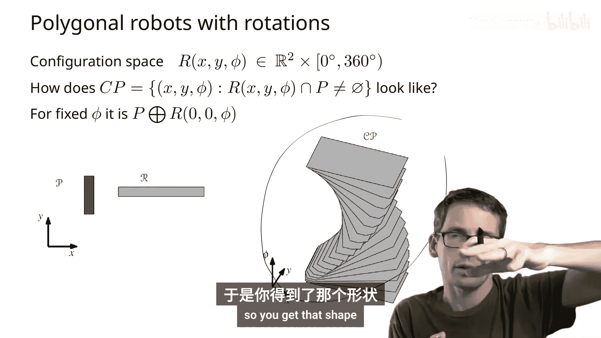
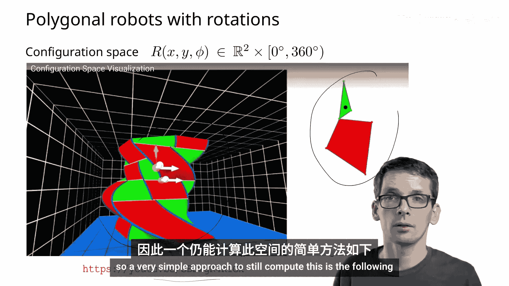
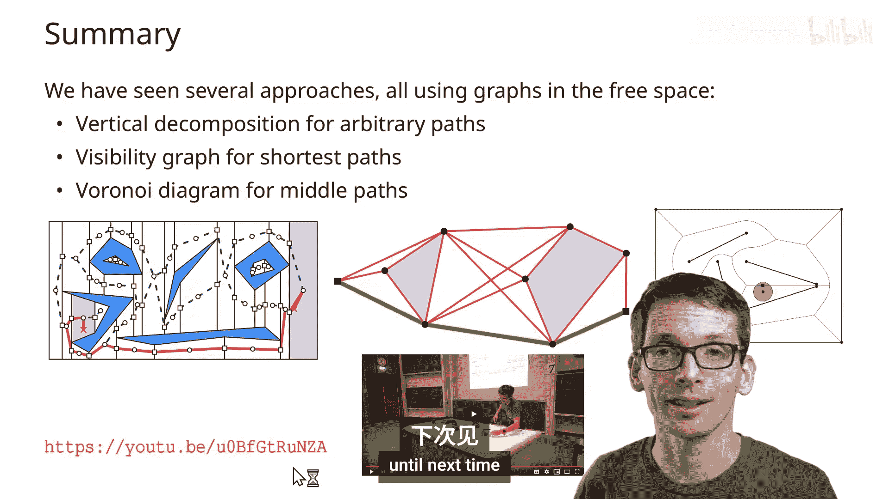

# 【Algorithms Lab】计算几何 ｜ Computational Geometry p14 P14_机器人运动规划-旋转机器人_可见性图（3部分之3） -BV1Jtn7zSEXD_p14-

So next let's have a look at what happens if our robot can translate and rotate。

So here is now the setting。We still have a polygonar robot， polygonar obstacles。

 The robot now can translate and rotate。 So this is our robot。It can now also rotate， and still。

Translate。The obstacles don't move and we're still in 2D。

I will more give you the high level ideas of how to handle this case。

You will see that if we would actually want to handle that case in particular exactly。

It is actually quite complex。 So here's an example where。

We actually would need rotations to be able to move this shape， let's say here's a start。

 here's the end。And the only way to get around this corner is to actually rotate。And likewise。

 the other corners。So here we need rotations if we want to move on start to go。

 What is the configuration space now， the configuration space。 So this is my。This is my robot。

 I can still。Translated in two directions。But I have one more degree of freedom because I can rotate。

So the configuration space is x， Y for the translations and a rotation angle。

 which means it's an R square and then an angle。Now。

 how does the forbidden space of an obstacle look like？

So the easiest way to imagine it is to look at the 2D slices of this forbidden space if you fix the angle。

For a fixed anger， thistress looks like the forbidden space。Of translating robot。

Which is the Minkovsky sum of the obstacle。And they inverted forward。Now。

 if you move in the dimension of the rotations， it means that your robot slightly rotates。And then。

 you get the。Forbidden space of that slightly or the inverted， slightly rotated robot。that obstacle。

 this construction， I mean， if you kind of think of it slice by slice。

 it will look like something like this here。So you get yeah。

 get that shape it's a very nice video that illustrates this and I will provide the link it's also here。

And here that's how such a space might look like。Here， this is an example of of those two。Objects。

 of course， these kind of fairly complicated hydroobic surfaces are difficult to deal with。

So a very simple approach to steel computers is the following， we simply。

Take horizontal slices of the configuration space。And then try to glue those together。

 that means we discretize the space of rotation。 So we have the robot in one direction。

 And then instead of continuously rotating them， the robot， we have a discretized。

If we now want to have the roadmap， what we want to do or what we can do is we compute for each slice。

We compute roadmap， and then we。Connect the slices。Okay，Comp the world mapap。

 we simply use trapez vertical decomposition， and we've seen that to connect two slices。

 We need to do the following。 We're going to compute the overlay of the two slices。

 and then every cell。For every joint cell， which is kind of a set of G minus-1 and let's say this is a set of G。

 So for everything that is in the intersection， I am going to add an edge。😊，From。The one slices。

To the next slide。Meaning between two slices in the in the intersection of two sets。

 for those two sets， I have an edge so that I can move up to the next slice。Yeah， so that's it。

Is this correct？Obviously， as such， not quite。And we might have two types of  errorss。

So first of all， and this is a more dangerous error。The following might happen。

 I might have two slices when the overlay I see in a dissection。But then if I connect them。Actually。

 in between。 so let's say I connected these two because。There's a sentence overlay。

 but the rotation would actually bump into something。So it's free in this。 It's free here。

 but going up， I would bump into an obstacle and that would。Potentially destroy our robot。

So this error we definitely want to avoid and okay， let's talk about that in a moment。

Here's other error that might happen。😊，So first， we had an error where there is no pass。

 or at least that pass doesn't exist。But we thought it was there here we have an arrow where there is a path。

 but because of the discqutization， if if this alpha is not one of the angles that I checked and this robot exactly fits for that alpha。

 then I have no chance of actually fitting my robot through this corridor。😊。

And this is very difficult to avoid if there exactly one angle where it could fit。 I mean。

 then our only chances to actually kind of work with our requirement。

 soon as there has slightly wiggle room， I'll be able to do it with sufficient approximation。Okay。

 but the firstarrow， that one we really want to avoid， so how can we do that？

We can do that by slightly enlarging the robot to。Make sure。That if I'm connecting those slices。

 that then the rover actually fits。So if I make sure if I slightly enlargeen the world a way。

That this part is included then。I would find out that there is an obstacle。

And I would see that in one of the two slices。 So far so good。

That's what I wanted to say about rotations。Yet another question in terms of motion planning。

 let's say I have a robot。I don't want to simply move it between obstacles。

 but always I want to keep the distance to the obstacles as large。😊，As possible。

 meaning if it's moving between two obstacles， it should be really moving in the middle。

For some visitors， let's start with a setting where。Robot and obstacles are discs。

 so my robot is a disc。My obstacle here also at disk and all other obstacles too。

Which of the concepts that we know can we use in this setting？Vertic decompositions。Vonoid diagrams。

 all line arrangements。It is indeed vult diagrams。Because I can simply compute the vennoid diagrams or diagram also obstacles。

And use that to compute my program。Obviously， obstacles so far go discs in our setting。

 so what happens if obstacles aren't disk？We can use the same idea。

 but now we will have to compute the vnooid diagram of line signal。

That somewhat looks like this if I have a line segment， I can still compute a vonnoid diagram。

 so this is the cell of all points that has this line segment as close as line segment。

 so I can still compute a vnoid diagram and the algorithm is in the book and then I can still use thatvolnoid diagram for a movement plan。

This video was mostly about rotations， I also handled one other case namely this middle case。

 middle path case， and now we are going to look at the setting where we actually want to compute shortest path。

We've seen that when we use a vertical decomposition， we don't actually get the shortest path。

And now we're going to see how we can get chartter path using visibility graphs。For this。

 the following lemma or observation is kind of the key。Observation， if I want to。

Find the shortest path from S。20。Then it will be a polygonar curve consisting of， okay。

 it with start as it will enter T and all other vertices or other intermediate vertices。Will be。

Vertices of the obstacles。 How can we see that？ So let's say this is a pass from S to T。

Now get the shortest path。I mean， imagine pulling that。If this is kind of a rope。Fulling it tight。

Then it will at some point touch the obstacles。And eventually look like this。

 So any path that does not use only vertices。Of the obstacles。And of course， T as itself。

I can make it， you could say shorter by pulling or kind of the idea of the proof would be the following。

If， first of all， if the path is not polygonal of it as a curved path， then I can find。

A small corner here， which does not contain a vertex。

 If I now instead make it poly by connecting these directly。

 it will be shorter than that part up there， because the straight。

 the shortest path from this vertex if from this point to that point。Is a straight line， then。

Beyond that。Assume it is pu， but the vertex is not a vertex of the obstacle than I can do。

The same trick， making a troter。 Therefore， this can not have been the shortest path。 Therefore。

 the shortest path has to use。Only vertices are vertices of obstacles。 Okay， so。With this in mind。

What we now essentially just need is we need to have the connection between vertices of obstacles because if I have all of these connections。

And then also connect S and T。Then I know the shortest path would be in that graph。

So let's say I have these polygons， obstacles and the vertex set。Then， okay。

 here we have the vertices。 Then we're going to define the visibility graph as a graph on the vertices。

Of my polygon。And I have an edge， if and only if。Those two points vertices C HL and C HL means that the line segment between those two does not intersect。

Any other。버리리건。Or any particlegon。 So， for instance， there's no edge from here to。

 let's say that one， because here I'm first intersecting that。

Polygon before I can actually reach and this is a weighted graph and the weight of an edge simply the length。

Of the9 segment。 Not with more C means。The edge。Does not intersect。The union。

Where we were taking the polygons as open polygons。

So it's okay if an edge aligns with the boundary of a polygon because these are open shapes。

 And then the graph that we're actually going to consider is a graph where we take。S， or I mean。

 the set that we're going to consider is S and the points S and T。

And then the visibility graph is simply the one where additionally to the edges that we have above。

 we also take all edges from S and T to all the vertices that S and T can see and now。

The shortest path from S to T。Is the shortest path in this graph and that is simply the case because we already know that the shortest path from S T has only vertices of the polygons as intermediate vertices。

Beyond that is polygonnal， and obviously， all the edges are actually edges between vertices that can see each other。

 otherwise they would go through polygon interiors。With this。It's easy。

Or at least conceptually easy to compute out this path。Names in the following way。

 we compute the visibility graph。 we set the weight to the length of the line segment。And then。

 we're going to。Use any shortest path algorithm on that graph。

We have positive weight so we can use D algorithm and find the shortest path from S to T in this way。

So what is the running time of this？So let's let's say n is a number of vertices。

 M is a number of edges in the visibility graph。Okay， we assign weights to address that order M。

We would use tax algorithm to compute chart this pass， that is n log n。Enlock n plus M。So far。

 so good now。The difficult part。Is computing the visibility graph。 Now， I would check for every edge。

Here， where that intersects。And if I find one， Okay， there's no h。 If I find one S here。

 then it's not an visibility graph， meaningan I'm taking n squared。Pierers。Checking it was N edges。

So naively， I would take N cube time。We can do faster do this faster and we can do that actually with a very easy。

Sweep。😔，Line algorithms mostly sleep line type algorithm。So let's say I have a point。

 some point here， let's say this point here。I want to compute all vertices that are visible from that point。

 so that's my scenario I have a point。😊，I have polygons。

 I want to compute every vertex that is visible。So that this one back here is not visible answer。

How fast can I do this？Or the n log n time or n squared time or the n squared log n time。

So what we do here is a rotational sweep。So we start in some direction to a rotational sweep。

 and in this way we can do this in in log n time。 so we have linear number of events need log n time per event。

 this will give us inlock n。We do this for every vertex of obstacles。 We have n of those。

 So this will give us。N squared log n， and that then also dominates our running time so we can compute a shortest collision free pass from S T T and n squared log N time。

 Now， we've computed the visibility graph that would allow us ready to compute the shortest path a point robot。

Start to its goal。 If we now poly robots， we can simply do what we previously did。

 meaning we start with a workspace。 we compute the forbidden spaces or the new union for the forbidden spaces。

Use that， Use a visibility graph then there。And in that way。

Can compute for a convex polygonal translating robot。Of constant complexity。

A shortest path in n squared， lock n time。So what have we seen overall？

We've seen roadmaps and how to compute them using vertical decompositions。We've seen。

Visibility graphs to then compute Tros path。We've also briefly mentioned how to usevono diagrams for middle path that's all for today。

Today， I only showed you。This robot here， which cannot actually move previously in class。

 we demonstrated all of these concepts also using the Epos that we have。There's also a short video。

That shows that so， if you'd like to。Enjoy。H。Beyond that， until next time。

