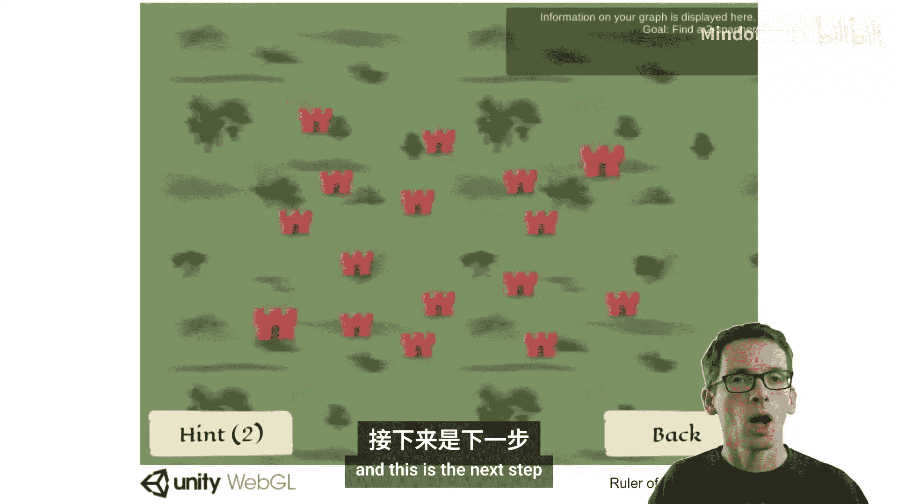
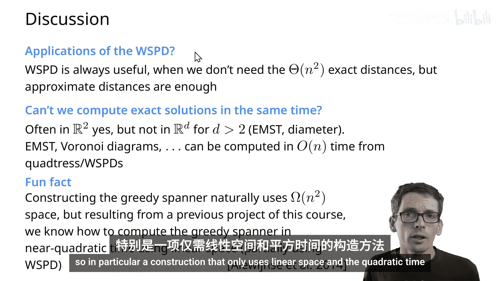

# 【Algorithms Lab】计算几何 ｜ Computational Geometry p15 P16_良好分离对分解和生成树 -BV1Jtn7zSEXD_p15-

Welcome today， let's talk about the way separated pair decomposition。

 So the way separated pair decomposition is a great tool for designing geometric approximation algorithms。

 and our motivation for it today will be geometric spanner。

 So let's look at geometric spanners by example。 So there's a game in the ruler of the plane frameworks or in the connect games as a T spanner game。

 and essentially want to connect the cities such as between any pair of cities There is a path that doesn't make a two large detour。

 So here we need this road to have a short detour。 and we remove the last one to have a fairly compact network。

😊。

So here I'm constructing such a spanner， so once more a graph such that between any pair of points。

 there is a path that doesn't make a too large de and again。

 so this edge functions instance I'm not going to add because I also want a graph to be fairly sparse。

So what I do in this example， I actually always take the look at the next shortest pair。

 see whether that next is necessary to add an edge。 And if it is。

 I do so So here I'm prying a few which are no longer necessaryer because there is already a short path but this one I need and this one I also need otherwise I have to do a large detail and this is the next。

Okay， so that's geometric spellers。😊。

Let's have a closer look at this motivation。 So here the problem that we were considering we have a set of cities。

 we want to build a new street network and we want to make this network not too large and large in the example that we just saw was in terms of road length。

 often enough we do it in terms of number of roads so here if I want to connect the cities。

 I mean the simplest graph to connect the cities is the or at least the smallest is would be the Euclidean minimum spanning tree。

 So if I now want to have a short detour between any pair of points then what we see here is that we have a problem namely。

😊，These two here。These two cities are fairly close。

 but if I want to travel between them and the network， I will have to go like this。

So there are points that are very close but have a large distance in the graph。

 so the ingredient minimum spanning tree is not a good choice for a spanner。Now， of course。

 you can say。😊，I know the perfect banner， namely the complete graph。 So here， indeed。

 between any pair of points， I have。A very short path。 I mean， I don't do any detailtour。

 but the problem， of course， is that I use a lot of edges。

So what we would like to have for a complete graph as if I have n cities。

 I have n order n squared edges and what we would like to have is more something like a linear number of edges。

😊，And that's idea of sparse teas spinner。 So what does is a sparse tea spinner。

 So sparse simply stands for。The fact that it should have a linear number of edges。

 or graph is sparse if we have a linear number of edges。

The T here stands for how much de2 we allow us。So the graph that you see here that would。

Be a T spanner for， for instance， T is， let's say 2。

Because for any pair of points that I might be looking at here， let's say this one and that one。

There is a path。And this is。Less than twice this。Length between the two node。Yn。

The one down here or the two points down here。So this is a path。This is less than two times as long。

So this would be a T spanner for T S 2， probably also T spanner for some T smaller of it， too。Okay。

 where do Sps occur？One application is when we want to bid。

A network which allows fast routing typical setting is ad hoc or sensor networks。

 so imagine you have these smart sensors， you want to have a network so that you can move data or communicate fast within the network。

 then you will want to build some kind of topology and a spanner might be a good choice。

Spanners are also simply a good tool for geometric algorithmms design if you are in a setting where you need to represent all pairs of the distances between air all pairs of points。

Because a geo expander gives you a compact representation of all of those distances。I mean。

 if you need all these distances， but you have a sparse tea spanner。

 then you have a linear size representation that in which you can then hopefully quickly find out what the distance is that you're interested in。

Okay now let's formally define what we mean by a T spanner and we're looking at the geometric setting。

 so what we have is a set of points P in the Eucidean plane or more generally in Euclidean space or in possibly in de dimensionional Euclidean space。

And a tea spanner would approximate the following graph， the Euclidean， the complete Euclidean。Graph。

 so what is the the Euclidean graph， I， as， as vertices， I have the my points， and I have。

An edge between any pair of points。And the important part now is that the weight of that edge。

Is simply the distance between those two points。 So here are U and V and the weight of this edge as simply the Euclidean length of that。

Edge。And on this。Complete Euclidean graph。 we would now like to build。Of spanner of linear size。

So as's a goal， we have this complete graph。So the graph in black here。Of course。

 also including the red edges。 And we would like to have a sparse graph meaning a。

A linear sized graph， Line terms of edges。Such that the shortest path approximates the weight in the complete graph。

And the red graph here， depending on what how well you want to approximate would be an example for that and how well we want to approximate that we express with this T。

So we say that a weighted graph G。On that vertex set is a T spanner。If。嗯。It has a stretch factor。

 or a dilation。Of umost T。 So T is a value。Larger equal 1。

 and the graph has dilation T or has a stretch factor of T， if for any。Per of points。

 the distance in the graph。Is。Bounded by T times the Eucreanith。

And the graph distance should approximate the distances also in the way that the Euclidean distance is smaller equal as the graph disk。

Which you automatically get if as edge weights， you take the distances between the points。

And once more here， deta G in this case refers to the shortest length of the shortest pass from x to y and G。

So that is a teaspo。So for every pair of point。The distance of the wealth。Should be at most， T times。

The Euclideanists。Here's a small quiz。You see this graph and that what is the smallest T？

For which this graph is a teaspanner。And your options are square out of two。2。

And square root of2 plus one。And the correct answer here is square root of 2 plus1。

 Why is that the case。So let's have a look。So we have let's see。We have this pair of points。

Let's say this distance is one。嗯。Then this distance is also one。 Of course， we have a square here。

And this distance is squared of 2。Because this is a diagonal in this square。So the graph is。

 and this is also， So this path is the shortest path from here to there。

The length of that pass would be one plus square of2。Compared。To the Ekiidan length。

This is 1 plus squared of2。And in this graph， this is also the worst case。So for instance。

 if you take this pair here。Then I can go here and here。And。And that actually gives you a detour of。

 So if this length is one。Or， modular we scale。 if this is one。

Then this is one divided by square root of2 and one divided by square root half。Qhu。😔。

So that's two times square root of 2。 So for this one， this de2our is square root of 2。But。

We interested in the worst case， and that's one plus square。So that is what a teas spanner is。

 but how can we compute tea spanners？I， I would recommend pausing the video and just for yourself。

 Think about， okay， what are good ways to。Compute， tea spanners。Let me show you some common。Ideas。

 and for each of these ideas， there are many different。Concrete tea spanner constructions。

So the first one， which we already saw when doing the game， was a greedy spin。😊。

So the idea of the greedy construction is the following。I。Add edges。Well， I look at pairs of points。

sorted by distance because the closest payoff points。

Seems to make sense to definitely add an edge there。Although it might not be necessary。

 and then I take the next pair in terms of distance or this。ItMaybe the next closest pair。

And I look at， is there already a path that is short enough， I mean， these were not connected。

 So there wasn't。 And then the next pair might be。I guess this one maybe。

And then the next pair might be this one here。But here this of course， depends on my T。

 here already see that there is a path。Which might be short enough。 and if it's short enough。

 I'm not going to add that edge。And so on。 So that's the idea of the greedy spanner construction。

It is fairly。Expensive in terms of storage， because between if I want to pre compute all of those distances and sort them。

 So I am computing， precomputing all the distances between pairs of points and sort them。

 then I already need quadraratic space。 And then also every time I。Ask myself， should I be adding。

 Should I be adding this edge。The way I can check that is to compute the current shortest pass between here and there。

But that， again， is an expensive computation。 So this is a very nice spanner。

 actually has very good properties。But it is fairly expensive to compute。

Next class of spanners are cone based spanners。 so here the idea is that if I want to go from A to B and there's at least some edge that goes more or less in that direction。

 then I can follow that edge and from there again find an edge more less in that direction and to be able to do that for every point so let's say I take this point I subdivide the space。

And。A number of cones。 and the more cones。Lower my T will be。

 And for every cone I connect to the closest。 So I would do this at And now， okay。

 now you need to tell me which one is closer。Let me just guess。で。And I now do this for every。Point。

 so let's say this point here。I take a cone。Like this。In every。Or set of cones like this。 And every。

In every cone I connect to the closest answer。So those are combbase spanners and the last class I want to talk about spanners that use distance approximation。

So the idea here is， let's say these two points seen from back here。fairly close。Cza。

So the distance between these two points relative to the distance between。That point up there。

At those points。So the distance between those two is fairly small。

 so I will definitely only need one edge from up here to one of those。And so on。

 And that's the idea of distance approximation and that idea of well separated of a well separated pair decomposition。

 So let's have a closer look at that next。 So what is a well separated pair de compositionposition。😊。

Let's start by defining。What a where separated path。

So we have two points sets A and B and we call them well separated。

 essentially if the distance between A and B is large relative to the distances in A and relative to the distances in B。

😊，How do we formalize this？We say that A and P are S well separated。

 If I can cover A by a disk and B by a disk and。I'm want to have this of the same size。

And they have radius R， let's say。And I can place these disks such that the distance between the disks is at least s times R。

 So then these two points sets are set to be S where separated。

And you can imagine if I want to if my input is one。 set。

Then the idea of a well separated pair in composition is to cover all distances that occur by well separated pairs。

 So， for instance， in a， there are， I mean， A's a appointed as such。

 And then some of the distances of the points in A。

 I can cover by this well separated pair A prime and B point here。 So again， I can cover。

These two points sets a prime B prime， each by a disk of a certain radius are prime。

 and the distance between these two disk discs is more than s times R prime。

 So that's a well separated pair。Let's first make some observations here。

 So one being S well separated is a monotone property in the sense that if I have a smaller S prime。

 So if。Appear as S were separated of an S prime smaller than S then。

The pairs also as prime well separate。Orそ if。A and B are both just for a single point。

 then so two points are always as well separated because I can take arbitrary small disks。Okay。

 so that's a well separated pair。 What is a well separated pie de compositionposition For this first。

 we need a definition， namely a definition to for essentially saying all pairs of points。

So this notation here， a cos B。Deote all pairs of points with  one point in A and one point in B。

 excluding points。That are both in a。And B。So what do we want to have now。

 We want to have a small data structure that approximate or。PIY distances and aps it。And。

The data structure that should do this for us is the S well separated pair decomposition。

So the S well separated pairiccomposition。😊，Covers essentially all pairs by a small set of S。

Where separated peerce。 So what we want to have is。We would have a set of pairs。Such that， okay it。

All the A INPI should be， of course。Point in subset of P。If I have an AI and a BI。

 so a specific pair， then there should be no point that is in AI and B。

 otherwise it would be also difficult to separate them。I want to have that the union of my peers。

 the union of my peers should cover all。Pearers of poet。And for any pair of point， points and P。H。

There should be a pair where this pair of points occurs。

And all of these pairs should be as were separated。Let's see an example。

 So here I have a point set 1，2，3，4，5，6，7，8 points， so。嗯。I have。28 pairs of points。

So I want to approximate 28。Distances。And now， for suitable S。嗯。This is S square beed peal position。

So let me， let me briefly show what what I I depicted here。 So for instance。

I put those two points in a pair in a， let's call this a1， those three points and B1。

And this is as well separated for suitable S。Likewise， this could be also be two。

And it's well separated from a to。In here， these are difficult to separate， so I need to have。

 let's say。Just a singleton A3 and a singleton B3。A singleton A for a singleton， B for and so on。

 And in that that way， I get this list of pairs。A1， B1。A to B to。Ands on。

 And every for any edge here。 So let me pick any pair here。 There's also a pair。

In my well period composition。 So for this example， those two are actually covered by A1， B1。Okay。

 do now we define what a S separate padic composition is。The first question is。

 does I always exist one and of course， there is always one namely the complete graph。

Gives us as well separate period position， but that's， of course， not what we wanted to have。

 We that。Wanted to have fewer than a quaratic number of edges。So we ought now have a sre。

S well separated padic composition small。 So when we talk about size。

 what we mean So what do we mean by size， size means the number of pairs。 So I have A1 B1， A2。

 B2 and so on and the number of pairs that I need that I call the size of the S well separated padic composition position。

And what we would like to have is linear size， and this linear factor will， of course， depend on S。

But given an S， I want to have it。Construction that gives me a linear sized。

 well separated period composition。Okay， just to check this concept once more。

Let's say this is my point set。And the exact distances don't matter that much here。

 let's say this is one，3， and9。I want to have a two。We separate p composition。

 so S law should be true。And my question is， how many pairs do you need。A 3， B4 C，5 or D 6。

So the number of pairs that we need is。3い。So the total number of pairs of distances are four points。

So the total number of pairs of distances would be 1，2，3。For。5ve。6。So I mean。

 six could be a valid answer， but the question is how many do I need at least？😊。

And I can get the following way to period composition position。そう。These two。I just have this pair A1。

B1。So those are difficult to separate so that I just take the singles。

 but now I can group those two points， let's call them A2。And make this one be true。And this is A3。

And that is beastly。And I've covered。This specific set of points with three pairs。

We want to now come closer to constructing a wealth position and for the construction。

 we will use qua trees。 So let me briefly。Remind you of what a quadre is。So I have a set of points。

And I。Subdivide my space by always splitting， so by first covering it by a big square。

And then always splitting the space into four smaller squares。And at the same time。

 I built this tree structure where。The root corresponds to a big square， the children。

Corspond to the four smaller squares。And I will curcifully continue this construction。

 until in every square。There's only one point left。And that's a quari。

Just to already get some intuition， why do we talk about quads here， Because to some extent。

 this allows us to。Eventually build a went peic composition position， because if I kind of take。

 I mean， I can take notes of this tree or。The square corresponds to a node in this tree。

This square corresponds node in the tree。And I can try to find squares in the tree that are fairly far apart and put those into the SV separated pericom。

We do that more precisely later。 First， we need one more tool and that is compressed quaries。

So a compress qua is simply a qua where。If I have。Simply a path。Of degree1 nodes。In the。

Interior of the quaray。 So I mean， you can think of this， actually。So here in my qua。

 I would first have to split into4。Then split into4 again。Then， split into4 again。

Then split into four again， and only now get different。Get different。嗯。

Squares for for these two points here。So the idea is that if I have a path。In my qua。

 that does not separate any points， I'm compressing that。So I'm removing unnecessary nodes。

So here the compressed qua looks like that。We don't want to go into detail about compressed quaries only。

Aspect of them that we want to have and why mentioning them。

Is that you can construct for a points set。Of size N， a compressed qua in size order n。logg n。

And this will be useful to express how fast we can compute retro separate padic composition positionss。

 because if we use quaries， then if you remember kind of a regular qua we could have arbitrary size。

Simply because these two points could be very close。And therefore need arbitrary construction time。

 And that is what we want to avoid。 Comed Qua allows us to。

Get a running time that only depends on it。Okay， one more。

The aspect of quaries that we will need is representatives， and that also levels。So， we。Have here。

For nodie in my qua， the foreign concept， first of all。With each U， I have a point set， P。

 which is simply the points within。The square of that point。 So sigma u is。

Is a square corresponding to U and then。I look at the point set within that square。

 So this isn't here simply the points set containing P。And now are we presentative。Ass a following。

 So for any leave as a representative， I take simply the point that。Is in that leaf。

 if it's a non empty leaf， otherwise I take the empty set， I define it as being the empty set。

So here there are three non empty leaves。This one here which is U and then the representative is simply P。

 and then I have Q and R here。And then， for inner node。I simply take。

An arbitrary representative of one of the chin。 So here， for instance， I can pick between。

For this square here， I can pick between Q and R。 So let's say I take Q。For。

Everything here I can pick between this representative Q and this representative of that square here P。

Pick one opportunitybit gives me P。And those are representatives， those we are going to use later。我子。

And then。We need one more concept， and that is the level of a point of of a node。

 So the level course is。The level in the within the tree。If the tree would be uncompressed。

Except for for leaves， we' are going to set the level to infinity。So here in this example。

So this is U is a leaf， so the level of that will be simply infinity。The level of the top node is 0。

The level of。This square here。Will be， I mean， if you think about it。Everything is zero。

This one has level  one。These have level 2， so that's level3。

So this is essentially how far down you need to go on the tree just for leaves we said it to infinity。

 so we now know what a appropriate painting composition is。😊。

I've covered some preliminaries concerning quad trees。Now。

 let's jump into actually constructing well temper padtycoms using quaries。 And again。

 the intuition will be that I'm going to look。Add nodes， pairs of nodes in the qua。

And try to find such pairs that are well separate。 Let's directly jump into the construction of a well separated pad composition。

So here you already see the complete algorithm， it's a recurssive algorithm， it's very simple。

Let me show to you line by line。So it works on a qua tree。And so U and V are qua notes。

 And initially， Sos a recur of algorithms。 So we will start at the route。 And So initially。

 U and V were both be。Actually， the root。And then we recurse downwards。 T is our qua。 Okay。

 and S is a， we want to have an S when separated the composition So S is parameter。Of that。

Now we want to have a way separated pairing composition of our point set。

 and in in terms of the recursion， if I'm already at node U and V somewhere down， so let's say。

This is you。And this is V just to have an example。Then I want to have a well separate painting composition。

😊，Between points。P U and the points PV。 So there are some trivial cases to exclude。The first is。

If one of the two node has no representative， meaning it's empty。 So if， if， for instance。

I'm taking that one， there's nothing to report。 So reporting the empty set。おいと。

If you and V are the same， leaf。There's nothing to do， because it。And U and V I just have one point。

 but the same point， so there's nothing to do。 So if they are the same leaf， again。

 I don't want to anything。Now， if I have two。Notes where the points at P U and P V are well separate。

 so。It's a。I can draw our discs here， and they are fairly far apart。Then I will want to report。

That way is a pair to pair that can represent it simply as a pair of quari notes， U V。Otherwise。

 let's say I have。U and V are the two points that are not well separated。 What do we do？So。

 let's assume。You is a note with a larger。Lever。Meaning U is a larger square。

 or it might be same size or the fine。If that's not the case。

 so that's what we're handling in line for。 if U is further down the tree， meaning that V is larger。

 we're going to switch the roads。😊，So after line4， the square of U is at least as large as a square of V。

 and because they are not well separated， what we do is simply we now going to split the larger square。

 so we are going to split the square of U。 So we're going to the children。😊，Of you。

 And now wecursively compute wealthic compositions。哦。The children you are with me。

And going to take are we going to take their union。And in the description I always said square。

 but of course it also works in high dimensions and you have cubes and split them into smaller cubes and so on。

So that's our setting。Let's do this by example。 So we start with U and V both being the root。

 Now he is shown as a big red square and a big blue square。

Now we're going to split and say the blue square that's my you。

Right now U and V are not when separated， I mean they are the same square。So I'm going to split U。

Andju。For smaller squares。 So right now， still U and V are not well separate because because you use a subset of V so。

In each of these cases， I will need to split further， so let's， for instance， look at this case here。

You was a blue one。V also the red one。Now V is larger， so in particular the level of v is smaller。

 V has level 0， U has level1， so I'm going to exchange the rules。So now。

The blue one will be V and the red one will correspond to you， and we're going to split。You。Meaning。

 I'm going to split it in four。 So here I'm in this case of the same leaf。

So I don't need to report anything。Here I'm in the setting。Where。I'm going need to ask myself。

Our P UL P VV will separate。For that， I need to construct a disc。That covers。

P U and a disk that covers PV。 The discs will have the same size。

 so this could look like that to construct these disks quickly。

 what we're going to do is simply we' are going to take the disk that goes the through the corners of the square of the larger。

嗯。呃센。And then we're going to take a same size disc around the other。Pos it。So， here。This is。

The disk that I get if I simply cover the whole square。

 so I'm ignoring that I could actually make it smaller by if I just want to cover the points。

And I'll need to take the same radius。ほあ。Points at two。 and I just place it on top of it like this。

 And now those two disks， obviously， I mean， they're even intersecting。

So I cannot place S times I in between。 So this is not well separated。

 At least I didn't identify it as well separated。 So now I'm going to split。The larger one。

Or actually， I'm going to do it based on level。 and because。This one has Le infinity。

 I'm going to split the other one。And now， for instance， this is S well separated。 again。

 you see I'm taking simply the disk around that square。😊。

And placing a disk of same radius around that point。It is as we separated。So。

I'm going to report this fair。And I'm going to report it。 So So this， this is my pay as such。

 I'm going to represent it simply as。A pair of qua notes。 So this node。あだ。And then I continue。

 So for instance， A and D， they are both singletons， so then I get arbitrary small square discs。

 They are definitely well separated。And then this is my complete list。 So some remarks here。

 the first is。Okay， my initial qua is simply on the whole point that or the root of the tree。

 So that's。Let's use you。Then this notation is a bit。Needs to be taken with care。

What does it mean to take the union here， So you should set up the algorithm in such a way that you do not。

Call the same pair of squares twice。 That seems like somewhat obvious。

 But at least as I described it， it would be very natural to。Get you I and U J。

And then at some other point， U J and U I。So you should only recro on one of those two。

 because otherwise you will find pairs twice if I have a pair of leaves。

 if one of them doesn't contain a point， then we find anyway， and if they both contain points。😊。

Because pairs of singles are always well separated。 They are always as well separated， in particular。

 meaning that。Our becausecur of algorithm because it always goes down the tree。

 eventually we reach leaves so this algorithm actually always terminates。 Obviously。

 we want to actually prove something about the running time， but at least it terminate。

And the output。We are going to represent as pairs of quarterly notes。

 This will also allow us to get a compact representation， So it could be， for instance， I mean。

 if I would actually list the AIs and Bs as sets of points， then these lists could get very large。

But I'm simply reporting every pair by two quarterly notes or every pair I can represent。

Who is a constant amount of starch。Okay， so this gives us a well separated particlecom position。😊。

One question about the decomposition is it minimal for the given S？And the possible answers are yes。

Because well vague composition for S is unique or B yes。😊，Because no matter。

 no matter which S well political position to take。They it has the same size。Or see no。

 not necessarily。And answer a here is C。This might not be optimal， in particular。

 if you think about the discs that we picked。We did not。

Take any effort in making them smaller to fit the points set。 We simply cover the squares。

 So this is not necessarily optimal， but it also doesn't have to be optimal as long as it's small enough for our purpose。

But for that， we have to look at how big does this where pettic composition directly get。😊。

We've seen an algorithm for constructing a well separated ta composition。😊。

Let's now look at how large the resulting decomposition is。😊，That is。

 what is the size of the retro be composition that we get and how fast can we construct it？

And this is what I want to show here。G points that in D dimension Euclidean space and the parameter S。

😊，We can compute the S well separated pair opposition in time order analog n plus S to the D types n and S to the D types N here also corresponds to the worst case。

Number of pairs So the size of the well separated painting opposition。

If we know how large the weight of per pair decomposition is the running time。😊。

Is is very simple to get。 So en log n is simply the time for computing a compressed qua tree。

 And then from the compressed qua tree， the running time is an actually simply。

Proportional to the size of the decomposition。 So if we can out that by S to the D times。

 And we also get this one a time so。The size is what we're going to focus on。

And I will give a proof sketch of this。Also making a simplifying assumption that I can focus。

On the most important。Arguments and leave out some technicalities， and the assumption will be。

We're going to assume that we have an uncompressed quad tree， and we're going to assume that it has。

Liva size。That makes our life easier。So we want to bounce the size of the decomposition and the size essentially。

 I mean， it corresponds to or can be bound by how often do I。Wecursively call the algorithm。

And what were specifically going to count is how often in the algorithm。Do I go to the recursion？

 So how often do I go into the eighth case？ So here wants more algorithm。So it's cursive。

In these fe two cases。That that are my terminal calls because yeah I simply report something。

But my question is how often do I go into the edge case because that's where I have my recursive cards。

And any pair has to come from because of court。 So four times this number essentially gives us an also bound on the number of pairs。

 So how often do we go into the S case， That's what we're going to bound。

 and we're going to use a charging argument。So every time we're going to go into the S case。

 we're going to make a node responsible for that and the node that we're going to make responsible for that is this node V。

 so the node that is not split。😊，So node V sits there and tells you to split。

 then we make V responsible。😊，We make v pay， and with。Check how often does V need to pay。

 So it's a charging argument。With charge。Every non terminalminal call to the square that is not split。

 And the claim is that any square in this way is charged at most S to the D。

 So in two dimensions S squared times， and that then immediately gives us this bound of S to the D types n because we have n nodes that can be responsible for splitting。

Each of those is responsible at most sity times， So overall eity times n。Okay。

 so let's have a look at such a case。 So let's say。UV is an example of a non terminalminal call。

 where V is。One， the square was a smaller side leg。

 so that will be the one responsible for splitting U。U and V can also have the same side links。

 but V is the one that is not split。So。Let's make some observations。 So we are the setting that。

 okay， U V。For U V， we go into the recur of calls， so they are not separate。Otherwise。Pen。

We would have stopped。So what。Does that mean。It means that we can bounce a distance。

Between U and V relative to the size of U and V。 and that will be the core of our argument。

 We're going to see that U cannot be too far away of v relative to the size of those squares。

 And then there's only a certain number of squares that then can be at that distance。

 and that will give us about。Okay， for this， we want to look at the following drawing。 So we have。V。

 let's say this is a raius of the resulting disk RV。 So what we have for about RV。AV。Is。Essentially。

 so in in two dimensions， this would be。X divided by square of 2 in， in general。

 D dimensions the squared of D。Divided by 2 times x。

 So the diameter of this disk is squared of d times x the radius is this divided by 2。Now。

 if I also look at areU。How large can I you be。So are U so U is split because of V and we always split the larger square。

 So what does that mean， It means that actually the difference between U and V in terms of size in terms of side length is at most a factor2。

😊，Because otherwise， we would have earlier split the larger square of the two。

Meaning that I use at most two times。啊V。Meaning that it's utmost squared of t times x。So。

 we know that these。That UV or the points sets of UnV are not well separated。

Meaning that the disks between them。So this distance here。Is at most。S times。The larger radius。

Which is bounded by。So this is a larger amount of the larger wages。

 So it's bounded by S times squared of D times X。 So that's what I want to have in the drawing here already。

The distance between the disks is at most s times squared of d times x。Okay。

 now I want to say something about。The distance between the centre of you。At the center of V。

Because then I will argue， okay， there can be at most that number of squares with a center inside a certain radius。

So what is the distance between the center of U and V at most， So that is this distance here plus。

The wages。At most the wages of V。 So that's plus。This value here。 So I take this。Plus， this。

 And then here to the centre I have at most this distance here。

So all of these have squared of d times x squared of D times x squared of d times x。

So I have skirt of D times x times。One half。S。And one。I can bounce this。

 so here we are assuming that S is at least one。😊，So this is。Small equald S。 This is small equald S。

 So a very rough bound here is3 times squared of D。Times X。

So I know that the distance between the centers。 and I'm going to。Call this now， RV。This way is RV。

 we know。That the U to be split by V has to be， has to have its center within this variousdius big R V。

Now I just need to count how many squares can I have within that radius。So， this radius is。

So there's this factor x， which is this factor x。And then I have this three time。 essentially。

 if you think of D as a constant constant times x。 So if you imagine。I have a square of side links x。

And now I have a disc off side length， let's say， And I'm worth saying its constant solid。

 let's say 10 times X。How many squares can I fit into this disk？

It's clear that this will be some kind of constant。And the argument that we're using here。

 I will go into a little bit more detail on the next slide。

 but this is simply a packing argument will tell us that there can be at most S to G times。

As to the D squares。Within that disc and height dimensions within that ball。

And to make this packing argument more precise。 So let's assume I have some ball of weight。

I have none。 I have pairwise this join qua results cells， which all have side links at most X。

 Then the question is， how many of these can I fit into the spoil B and the argument or the the what I claim here is that the number of。

Sales or squares also cells that can fit。Is roughly。

Is proportionate to the wages divided by x to the T。そです numberバ。The idea is。To sketch it is。

 first of all， let's think of this qua tree and this boy。 So on I have a quad tree。

 I have my boy placed somewhere。And now I wanted to bound the number of squares intersected。

Destroyed squares。Of course， if I make the squares as small as possible， I get as many as possible。

 So to get an upper bound。It's enough to look at this case where all of the squares have sidelings。

 exactly X。So this is a setting。 I have a poll。 I have now， actually。A grid of cells。

 I want to know how many of those cells are dissected。So， if you think of。

If you think of the smaller square here， which is has side length。The side length is two times。

 I can ask how many。Squares。Does this。 So， So this is this square。

 Everything that is intersect by the board is also intersected by the squares。

 So I can ask how many squares does。This smaller square sec。

I can look at this dimension by dimension， so。How many in this direction。

 how many squares can I be intersecting， and this will exactly give me per dimension one plus。

Two outivide bags。And then I simply multipl this up by dimension， gives me2。The D。

And that now apply to our setting。So in our setting。

 we were looking at this three times squared root of D。嗯。Times。X sized。B。So if you look at this here。

So that's now the radius。 I get a times 2。I divide by x。I round this up， I add one。Oh。

 I was as missing here。I'll go to the deve。Then the dominating term here is S。That so。

The radioius was R three times was bound by three times squared of DSSX。TheX goes away。

This is just a constant， but S dominates。As to the years bound that we get。

And that bound our complexity。Now we will bring all of this back to an initial motivation namely we're going to construct a spanner using a wellale separated pad decomposition。

We now have a way separate peedtic compositionposition。 Let's use it to construct a T spanner。

 So what was a T spanner， We wanted to approximate the complete Euclidean graph。

 So we have a point that。The complete Euclidean graph。Has an edge between any pair of points。

 and the weight is the Euclidean distance。 And now we want to have an approximation the sense。That。

We want to have a smaller graph， for instance， this red graph here。

In such a way that the shortest path in that graph are not much longer than the Eucreidean distances。

 specifically。Forgivenive tea， A tea spanner。Is a graph where the shortest path between any pair of nodes X and Y is at most T times the Euclideian distance。

And I'll give him a way separately peic composition。

There's a very simple construction to get a spanner， and that is the following。

For every we separated pair， I simply take an edge。More specifically。

 everywhere temperature pair corresponds to a pair of quarterly node。

These quarter node notes have representatives。And we take an edge between those two represent。

So we take the graph。With edges X， Y， where x is a representative of a qua node U。

 Y is a representative of a quarter node v。I will do this for any pairs。

 You weight separated pairs U V。Just as a reminder， what was a representative。

 essentially an arbitraryrbitrarily chosen point within that square。

 but it's important that this choice is consistent meaning。The following。 So if I have a leaf。

Leve contains only one point。 I take that as a representative。And or if a leaf is empty。

 I don't have a representative。 And for internal notes， I just take one。

Of the representatives of the children。 And that choice is arbitrary。

Let's have a look at how this looks like。 So here on the left。

 we have a website heading composition on the right， we have the resulting graph。 So for any。Per。

Let's say this is a representative of of that upper set。 This is a representative of that lower set。

I add that h。Likewise。For this one here。 So the representative of that notice is is this vertex。

 or that point we already said here， let's say that is a， I mean， that's only point here。

 So it's also a representative。 I take an it。 and so on。

 And this is where I get the graph to the right。 And my claim is this is。A spanner。 It's a T spanner。

 but obviously， the T will depend on my S。So I have S where separated pair composition parameter S T spanner as a parameter T。

 so these need to relate。And as I will show next， if you choose S to be this quantity here in terms of T。

Then。If I take an s square separate betting opposition， the result in graph will be a T spanner。

 and we prove this by induction。 We prove that this by induction on the distances between pairs of points。

 So think of this as looking at the pairs of points in increasing distances。

 So let's say I have such a pair of points。 So let's say I have x。

Y now I want to prove that there's a path between x and y in the graph。

 such that the length of that path is at most t times the euclidedan distance between x and y。

And I will prove this by explicitly constructing such a path。😊，In the following way， so x and Y。

 there will be in some well separated pair。So what we're going to do is we're going to go。 So x is。

 let's say， in the set P。P U with re P U， small P U， y。I have PV。

 so we have the red separated pair Uv， and we have the representative， small P U， small PV。

I'm going to analyze the length of the path that I get if I take the path in within the graph from x to P U。

 Okay， then P U， P V， there's simply an edge， and then the graph from P V to y。

 So what we get is that the graph distance between x and Y is bounded by。The graph。

Distance between X and P。Then。Simp to the length of that edge， which is。The Euclidean distance。Plus。

 then the graph distance to get from。PV。To why。So far so good。

Now we have the following by the choice of S。 we in particular also know that S。

 no matter what T is is larger than 2。So why am I saying this。

 because it means that within these discs， I can apply induction hypothesis because the distance between x and P。

 So if this disc has radius R， the distance between x and P is at most2 are。

Compare that to the distance between the two disk。 That would be at least s times R。

 So if two is smaller than S， the distance between the disks。

Is larger than a distance inside the disk， meaning this distances inside the disk are in particular smaller than the distance between。

X and Y， which has to be at least as times are。 App induction hypothesis gives me here that this is bounded by T times the Eucreidean distance between x and P U。

Then I have this term here again。And then here I have the Euclidean distance between。Y and PV。Now。

 I want to express this in terms of R thanau。 So this here。

 So they are the x and P U are in this disc。 So this can be bounded by2 R。

 likewise Y and PV can be bounded by 2 R。 So what do I do with P U minus PV。So it's a bit tricky。

 but can be done。We can use triagon inequality for this。

So I want to have an upper bound on the distance between P and PV。So by trying inality。

 this is bounded by the distance and this is now Euclan distance from P to x x to y。Y to PV。

So I can replace this term here。Bye。The Eucraideian distance form。PU to x， which is2 R。

Eucleidean distance from x to y， which is simply Eucidean distance from x to y。

 plus Euclidean distance from y to B V。 That's again，2 R。So let's add all of this up。😊。

This now gives me， so I have two R here，2 R here。 that's4 R。I have two R T，2 R T here。 so that's。

4 r times T。And then I have the distance between x and y。Okay， I will still need to。

 so I can first simplify this to。4 times T plus 1。But now I still have this R that I want to get a rid of。

Now， to do this， after we set R in relation to x minus y。 And what we can use here is that， I mean。

 x and y are in this well separated pair。 So what I have actually is that。

The distance between x and y。Is at least S times R。Or if I want to replace R。

R is smaller equal x minus y。Or the distance in x and Y divided press。 Let's plug this in。

Then what we get is the following， I have four times distance between x and y。Divided by S times。

T plus one。Plus。The distance between。X and y。Let's。Now， plug in。S啊 actual S。This will mean that。

This four cancels with this4。 This T plus 1 cancels with this t plus 1。

 What I half here is remaining for S 1 divided by t -1 and1 divided by S。 So this will become。Qi。😔。

-1。 Now I have the distant between x and y times t -1 plus this distance。

So this one cancels with this term。 So now I have left T times disks between x and y y。

 This is exactly what I wanted to show。 So we are done。

 This concludes the induction step and the proof。Good。

 so we now know we have a tea spellner if we choose S like this。

Let's set this into use by picking a specific T。 name is the following。 Let's ask us。What we need。2。

Get a tea of。1 plus apps。So this is a very common setting。 So essentially。

 if you want to do a one plus or to epsilon approximation of the complete graph or of the distances in the complete graph。

 we were going to set T to1 plus eil。So how do I need to choose S for this？

Do I need to choose it as a constant specifically for。Do I need to choose it as。

Of order1 divided by epsilon or of order1 divided by epsilon through the D。

So what I'm going to need to do is I'm going to need to set。

S to something of order1 divide by epsilon。 Because then if you look at what happens here， I mean。

 if I。Pg in。This tea up here。So this gives me one plus epsilon。 I mean。

 there' is two plus epsilon for small Epsilon。 That's essentially true。 But here， the T。

If I have one plus Epsilon， essentially this cancels， and I just have epsilon here。

So I have the epsilon。挡的呀，吃大注受瓜皮。So the S will be of or1 divide by Epsilon and what does that mean then if I actually use this for constructing a one plus epsilon spanner。

 then I will get a spanner of size n divide by epsilon to the D because。

The veric composition at the b expand size S to the D times。And。So if。S is1 divided by epsilon。

 This gives me a epsilon，1 divided by epsilon to the D and the construction time is as we know it and here once more。

 the derivation。 But this is essentially what we shall already briefly discussed if I simply plug all of this in。

Then。This is exactly what we get。So， this is M。And divided by epsilon 2。Good。

 and in terms of the algorithm， I mean， what we were doing is we construct the qua tree that takes all unlocklock entire time。

 We construct weight of great pad composition。That checks。

From the qua that takes additional of n divide by epsilon to the D time and then the spanner again or of n to the divide by epsilon to the D time。

 and that gives us what we want it to have。Just a few more remarks。

So what else can the weather pay painting composition be used for， I mean， essentially。

 always when we want to。Approximate the。Quratic number of distances between pairs of point by some small graph。

 So generally it is useful actually for geometric approximation algorithms。No。In many settings。

 we can compute actually using the wayap period composition is not faster than computing the actual object that we want to compute。

 So for instance， in 2D， I can use this to compute an approximate。😊，Euclideium minimum spending pre。

 but I can also simply compute it Euclide minimum span pre or Inogen time。 but in higher dimensions。

 this is very useful。😊，And there are very interesting kind of connections between。

Wed separate compositions on the one hand， the tris on the other。

 And that kind of gives me some kind of equival between lots of different data structures， which is。

 to some extent， somewhat surprising， given that。I mean。

 a well separate pairiccomposition I compute from a qua tree。

 a quad looks very different from a delayant triangulation。

 but still computationally they are actually very closely relate。😊，And one last fun fact。

Its the following。So concerning the greedity spanner。

 So the greedity spanner So in a previous iteration of the cross， the cross projects were about。

Spner。And actually， from that time， there are many new resultss about the Greeky spanners。😊，So。

 in particular。嗯。A construction that only uses linear space and the aquadtic time that's all for today。

