# 【Algorithms Lab】计算几何 ｜ Computational Geometry p17 P18_范围搜索 -BV1Jtn7zSEXD_p17-

The topic of the next two lectures is range and windowing queries。Let's start with an example。

Consider a database that stores some information about a group of employees， and for example。

 we store their age and their salary。One may ask to find all the employees with age between a certain range and with a certain range of the salaries。

If we plot all the employees on the coordinate system。

 one axis showing the date of birth and the other axis showing the salary。

Then this kind of question results in so called rectangular range query。

Each employee is represented with a point and all the employees that fall within a given rectangle are those that we are looking for to report。

There are mainly two reasons to design data structures。

 The first reason is to create a data structure that will allow us access data conveniently。

 for example， we use the Doubly connected edge list data structure to represent a line arrangement so that we can navigate over the faces and the edges and the vertices of the arrangement easily。

The second reason to develop data structures is to prepare data to be able to answer future questions really fast。

Like the range query， we want to process all the information we know about the employees so that later we can really quickly answer which of the employees fall within the given range of the birth dates and the given range of the salaries。

The next two lectures are going to be about the second type of data structures。Again。

 the goal is to preprocess a given data so that later on we can query this data much more fast than if we would compute the answer from scratch。

As usual， let's start with a simpler version of one dimensional version of the problem that we are looking to solve。

 In this case， the1 D range query problem。So given a set of end points on the real line。

 we want to be able to answer the one dimensional rank query efficiently。

 which is we want to report all the points that fall within a given query interval。

So the points are known in advance， we want to preprocess them。

But the query ranges are not known in advance。We want to make a data structure that for any range answers the question of which points fall into this range quickly。

A solution to such a problem normally consists of the following three parts。 First， we want。

 of course， to design the data structure。Secondly， we need to develop the query algorithm that answers the question given the data structure that we have designed。

And finally， we need the algorithm to build this data structure， given the input。In this case。

 set of points。In some cases， when data may vary， we also may want an update algorithm that will update the data structure when new points appear or when some points disappear。

So which of these parts are more important to concentrate on when designing a solution？Well。

 for the data structure part， we are interested in the storage requirement how much space this data structure takes。

For the query algorithm， we are interested in how fast the query runs。

 so the running time of the query algorithm。Similarly for the construction algorithm。

 we are interested in how fast we can construct such a data structure。And finally， of course。

 for the update algorithm， we're interested in the running time of the update process。

Which factor of these is more important depends on the specific application。

 and that is why we can design multiple query data structures that will answer the same question but give you a tradeoff between maybe storage or the running time of the query。

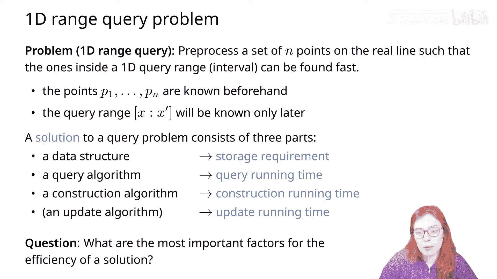

To solve the one dimensional range query problem， we can use a balanced binary search tree that storess the points in its leaves。

Then to report all the points that fall within a given range。

 we can perform the search for the one end of the range。For the second end of the range。

And report all the leaves that fall in this interval between the first point and the last point found。

In gray here we highlight all the notes that the search algorithms touched and in black we highlight all the leaves that fall in between these two search paths that we need to report。

The first and the easy question here is what is the space requirement of this data structure and we already know that a balanced binary research tree takes linear space。

We also know how fast we can build a balanced binary search tree。

 so the interesting question here is how long does a query algorithm take？

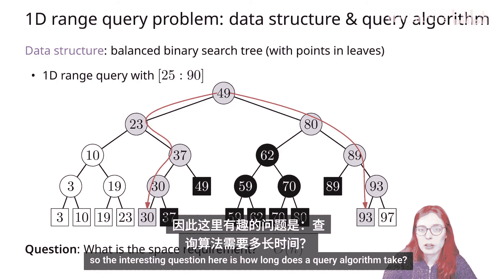

Again， when we executed the query， we had three types of nodes in the tree， the white notes。

 the node that we never visited by the query。The gray notes were the notes on the search paths of the query and the black notes the notes that light in between of the two search paths。

When we touch a black node， we know that it will lead to an answer that we need to output。

 but when we were on a gray node， it was unclear if this gray note can leave to an answer or not。

So to analyze the running time of the query algorithm。

 we need to analyze the amount of work that we do for white notes， gray notes， and black notes。

A white note is never visited， so there is no work performed for white notes。For the gray node。

 we use the query range bound to decide how to proceed。

We can decide to prune a sub tree of a child consisting of white notess。

We can decide to report a complete subre of a child consisting of black nodes。

 and we continue to one of the children left or right。

 depending on which of them lies on the search path。And finally， in black notes。

 we simply traverse them and report all the leaves。

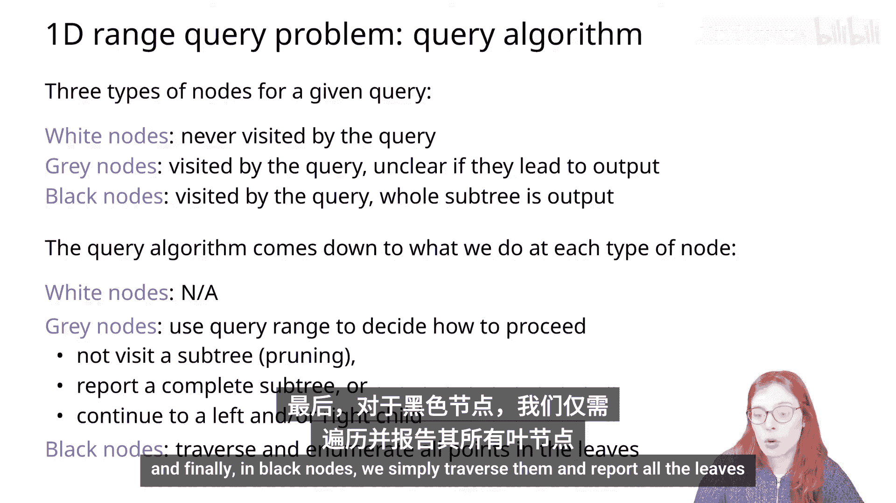

Let's consider another example， we have the same search tree here。

 but now let's perform a query with another range。With the range between 61 and 90。

 we search for the value 61。 We search for the value 90。And for a while。

 these two search paths may follow the same route at some point。

 though they will split in this example， they split in the node with value 80。

 One of the searches the search 461 turns left goes into the left child and the other one goes into the right child。

 So this node where the two search paths split is called the split node。

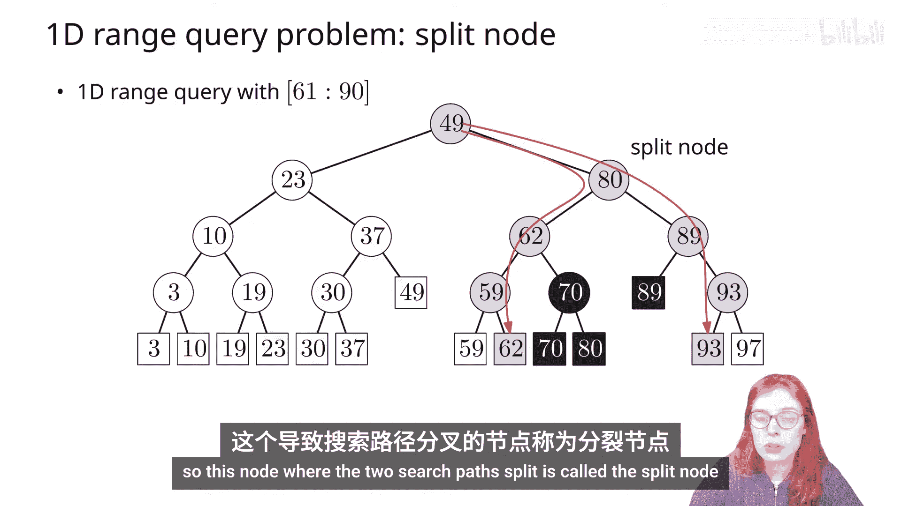

Then we can give the following su quote for the query algorithm。 First， we find the split node。

Following the two search paths， until they diverge。Next， we check if the split node is a leaf。

Then the two search pads follow the same branch from root all the way to that leaf。

We simply need to check if that leaf needs to be reported if it falls inside the range or not。

And we're done。If the split node is not a leaf， it is some internal node， then we do the following。

For the left child of the split node， let's call it V。 we do the following operation in a loop。

Until V is not a leaf， we check if the value stored in the node is greater or equal to the left bound of the range。

 here the range is given by x and x prime。If the left end of the range is less or equal to the value stored in the node。

Then we will recur to the left chat。 But before we want to report the sub tree rooted at the right child of V。

And then we recurse into the left child。And else， if the left end of the range is greater than the value stored in E。

 then we simply break hers into the right child。Here we implicitly prune the subre rooted at the left child。

 So the subre that fully consists of white nodes。Finally， when we reach a leaf。

 when V becomes a leaf， we check if it needs to be reported and if so， do so。

And then repeat the same procedure for the right end of the range for the value x prime。

But reporting the subies rooted at the left children。

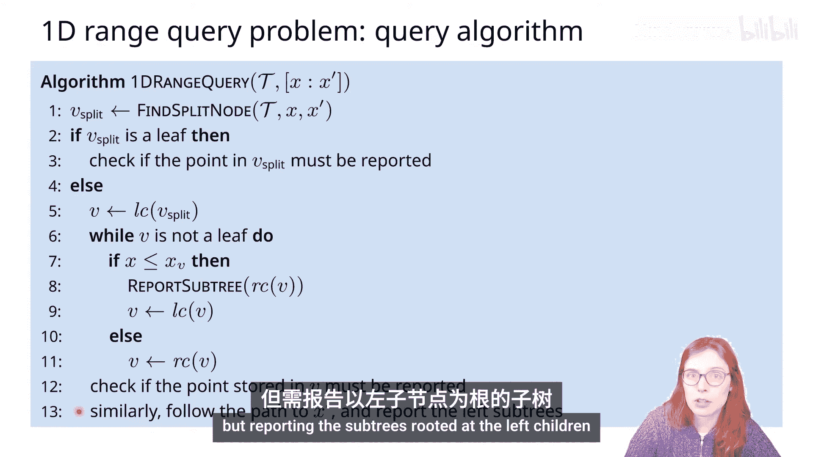

We can now formally analyze the running time of this algorithm All we need to do is count how many nodes of different types we how much work in each node we perform Again。

 the white notes are never visited and so we don't spend any time。The gray notes。

 those that land the search paths， are visible， but it is unclear if they lead to a point that needs to be reported or not。

And black notes are simply those that the whole sub tree needs to be reported。

So the number of gray nodes will depend on n， the number of input points。

And the number of black nodes will depend on k the output size。

So here we will give the running time in terms of n the size of the input， but also in terms of k。

 the size of the output。The gray nodes only appear on two search paths， and if our tree is balanced。

 we know that the number of gray nodes will be logarithmic。And for the number of black node。

 we can observe the following。 if a sub tree has M leaves， then it has M-1 internal nodes。

 That's a simple observation。 And that means that if we report。M leaves。

 then we visit the linear number in M of other black nodes。

So if case the number of points that we report， then we visit O of K black notes。

The time we spent in each gray or black node is constant。

 So the total running time of the query algorithm is big O log n plus K。

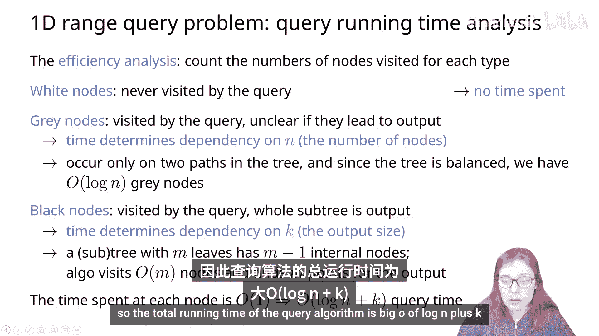

As mentioned earlier， the pre processingcessing time。

 the time it takes to construct the given data structure。

In our case is N log n if we need to store the points or is linear if the points are given to us already in the sorted order。

So finally， we can conclude that a set of endpoints on the real line can be preprocessed in big of n log n time into a data structure of linear size so that the one dimensional range queries can be answered in big of log n plus k time where k is the number of answers reported。

Now let's consider the two dimensional range query problem。

 given endpoint in a two dimensional plane， we want to report all the points that fall into a two dimensional query range。

 which is an access aligned box。Some of the data structures that can solve this question that you may have heard about are quad trees and Kd trees。

 quad trees are usually good in practice， but not in the worst case scenario。

 and Kd trees will give a query running time proportional to this query root of the number of points。

Our goal today is to develop a data structure that will give a faster query running time。

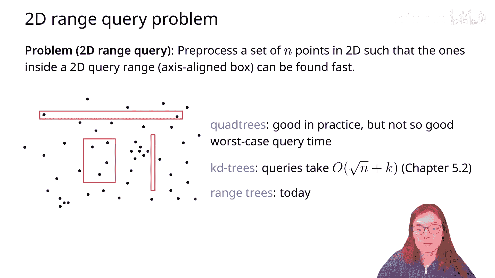

To design a data structure for a two dimensional range query。

 let's start with a data structure for the one dimensional range query that we have already developed。

We have our binary search trees with the points stored in the lease。

A useful observation here is that all the points that we report lie in the subtes rooted at these black nodes that are the topmost nodes strictly in between the two search paths。

 so in this example we have two black subre and all the black leaves that we report lie in the union of those subtre。

How many highest roots of the black subties are there。

 well because they're limited to li in between two search paths and at each level we have at most two nodes。

 then we get that there is a logarithmic number of black trees。

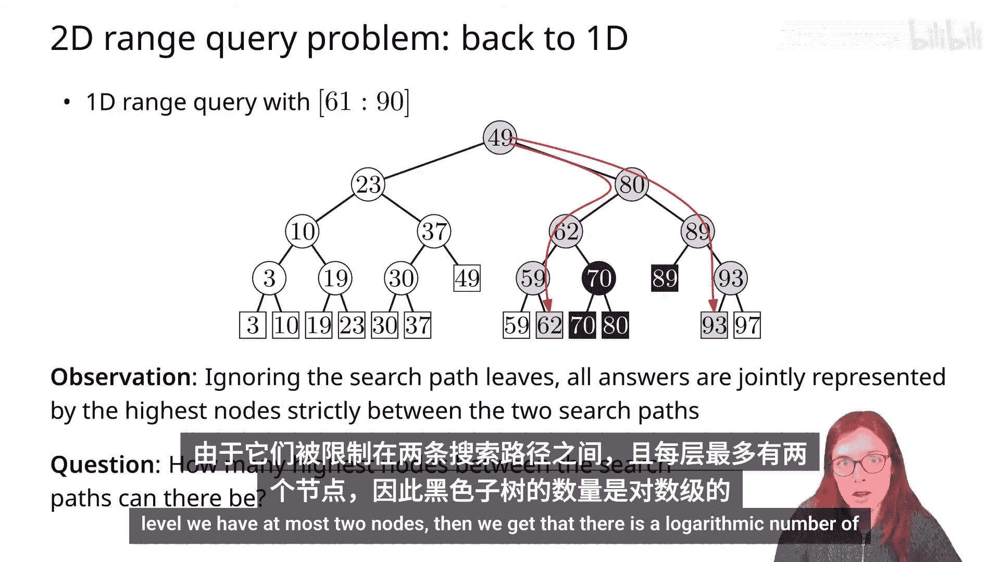

So for any one dimensional range query， we can identify a logarithmic number of nodes that together represent all answers to a one dimensional range query。

This implies that for a two dimensional range query。

 we can identify a logarithmic number of nodes that together represent all points that have the correct first coordinate。

So if we build the binary search tree on the first coordinate。

We can have a representation of all the points that fall within a given range of the first coordinate of the X coordinate。

 and now instead of reporting all of them， we need to figure out how to filter out the points with the Y coordinate lying outside of the range of interest。

If we simply check for each black leaf if it falls inside the range or not， this will be too slow。

 we may spend a linear amount of time in the number of black nodes and not report anything We need to do something smarter and what we do is we're going to store an additional data structure that will be referred from that highest black note。

So we will have an auxiliary data structure which will contain all the same points that form the leaves of the given subre。

And make it easier for us to search on the Y coordinate。

We can again use the one dimensional range query structure， but now sorted by the Y coordinate。

And of course， now we need to have such an auxiliary data structure attached to each internal node to be able to answer all queries that are possible。

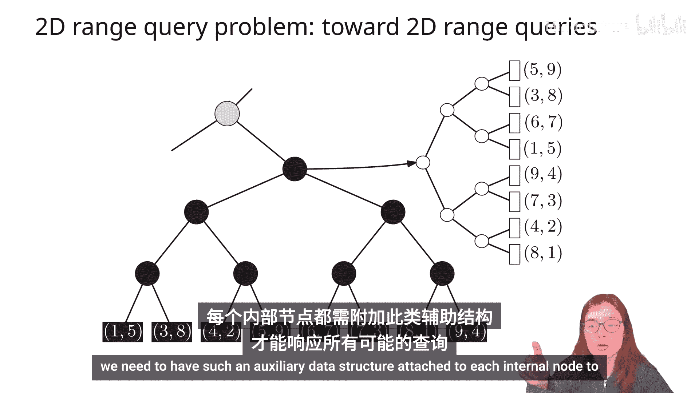

So the data structure for the two dimensional range query problem will consist of a binary search tree on X coordinate。

Where every internal node has a pointer to an associated structure that stores the same points of the sub tree rooted at that node。

 but these points are now sorted by their Y coordinate。How much space does this data structure take。

 it's no longer linear because we store each point multiple times once in the main tree and also in the associated structures。

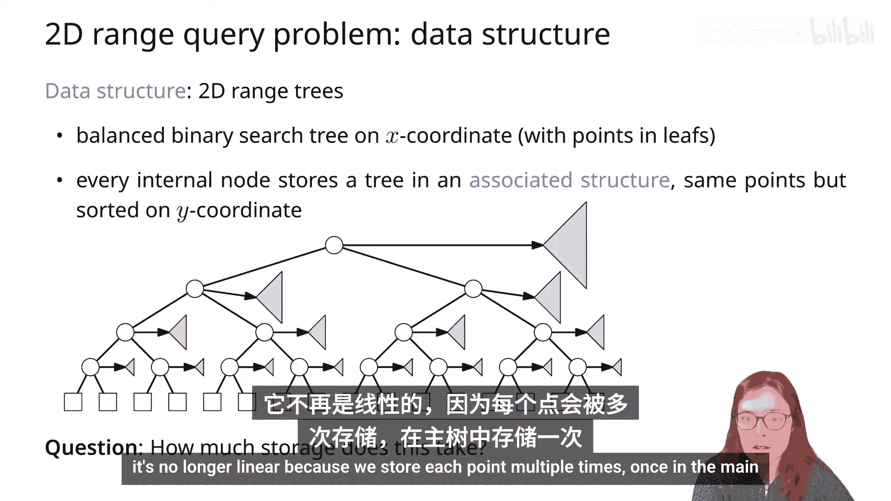

There are two ways of analyzing the storage requirements of such a data structure。First is by level。

 in each level， each point can be stored only once。 if it's a leaf of the main structure。

 it is stored only there。 if it's an internal node。

 then that point is stored in the associated data structure。

 but not in any of the associated structures at the same level。

 so in one level we store a linear number of points。The second way of analyzing this is by a point。

For any point， it will only be stored in the main tree or in associated structures of all the internal nodes on the path from that point to the root。

So each point is stored at most logarithimate number of times。

These both arguments give the total storage requirements of Big O and Lagan。

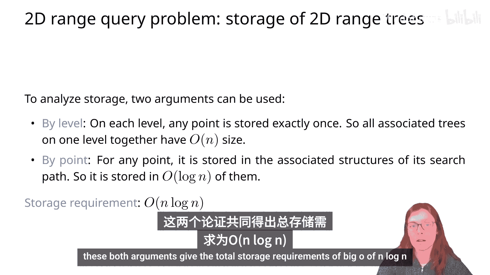

Now， the construction algorithm of the two dimension range  tree is the following。

For a given set of points， we construct the associated structure。

 a binary search tree on white coordinates， and we store all the points in the leaves。

 so not just white coordinates， but the whole points。Next。

 if the point set only consists of one point， then we create a leaf。

 we store that point in that leaf and make it point to the created associated structure。

And if P contains more than one point， then we split the set of points by the median x coordinate into the two sets P left and P right。

And we make two recursive calls to the algorithm on the P left and P right sets。

They will return the nodes V left and V right， then we create a node V storing the median value of the X coordinates。

 we make V left， its left child， we make V right， its right child。

 and we make the associated data structure， the associated structure of V， and finally we return V。

So this recursive algorithm will construct a two dimensional R tree on the input set of points。

Let's now analyze its running time， creating nodes and pointers takes constant time。

 creating the associated structure takes time big of n log n if n is the size of the input。

Splitting this set of points into two subsets takes linear time。

And let's denote the two recursive callss as taking the time2 T of n over2。

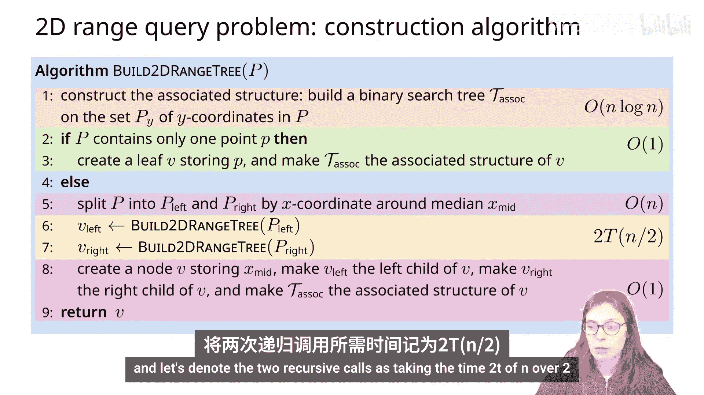

So the running time of the construction algorithm is given by the following recursive formula。

The running time T of n equals 2 times t of n over 2 plus big of n La n。

Which solves to N log squared of n。Question that we always ask is， can we do better。

Let's think how we can optimize this construction algorithm。

Well the bottleneck here is the creation of the associated data structures that take of N log N。

 This is because we need to sort the points by y coordinate each time we create a data structure。

 So what if we don't need to sort by y coordinate every time we call to the algorithm。

 but instead we presort the points on y coordinate。

 and whenever we split the points set into P left and P right。

 we maintain this order by y coordinate。

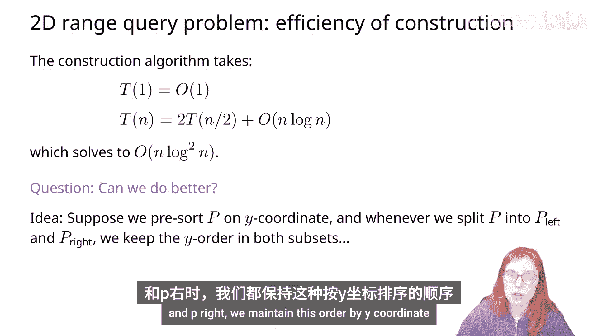

Then we augment the same algorithm with a pre sorting step of the point set by y coordinate。

 and that takes time big of L again。 and then if we have points in the order sorted by y coordinate。

 then creating the associated data structure takes linear time。

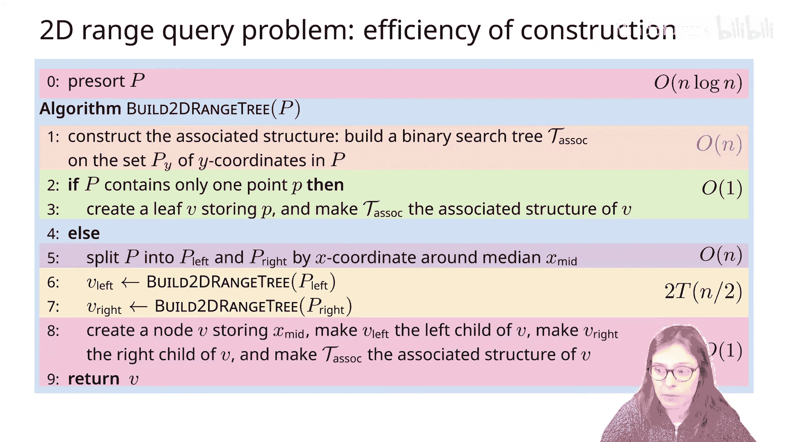

So now the recursive formula is the following T of n equals2 T of n over 2 plus big of of n。

 which solves to big of n log n， and given that presorting also takes big of n log n time。

 we get that the total running time of such construction algorithm is big of n log n。

Let's now discuss the query algorithm on the two dimensional range trees First we want to answer how the queries are performed and while doing so let's keep in mind that we need to make sure that all answers that need to be reported are found and that we don't report the same answer more than once。

Here we have a representation of the two dimensional range query problem。On the left hand side。

 we have the two search paths in the top level data structure with all the trees that need to be reported highlighted in gray and on the right hand side we show that the same point B is stored。

In the tree at each level， on the path， from it to the root。So if we need to report a point P。

 then we want to report it only once and we will do it at the highest level that this point occurs。

Thus， if a point P is stored somewhere in this tree。

And here is the path from it to the highest black node whose sub contains this point P。

 This point P will be stored in the associated data structure at each internal node on that path。

 and thus， we can simply report P When we are processing the highest black node by querying its associated data structure。

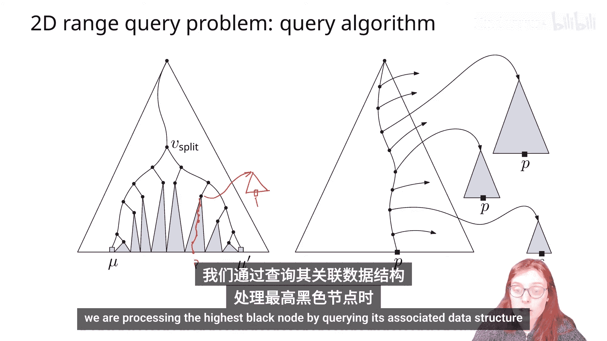

Here is the two dimensional range query algorithm， the input is our two dimensional range tree and the two dimensions of the range query by x coordinate and by y coordinate。

The pseudo code is almost exactly the same as the one dimensional range query with the only difference that in line8。

 instead of simply reporting all the nodes in the subree rooted at the right child of the node V。

 we now call on to the one dimensional range query and the associated data structure of the right child of V using the Y coordinate range as the one dimensional range value。

In this call， all the points of the subre rooted at the right child whose white coordinates are in the given range will be reported。

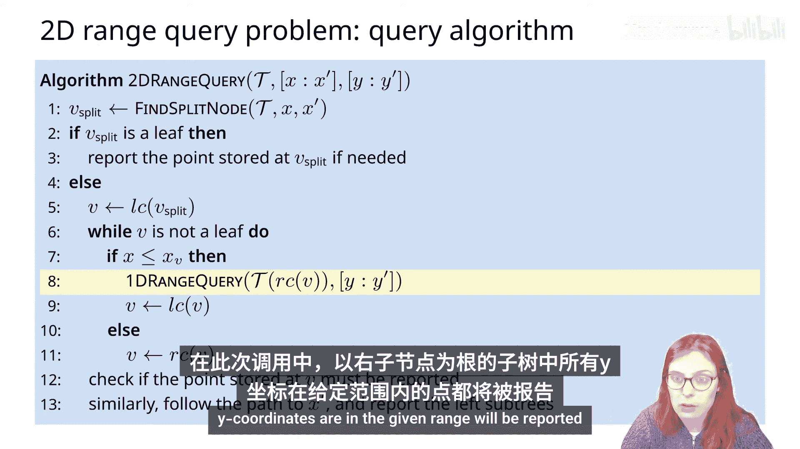

Now， what is the running time of the query algorithm？

It depends on how many one dimensional queries to the associated structures we make。

 So how many queries are there and how much time does each one of them take。Well again。

 there will be the logarithmic number of nodes on the search paths。

 and there will be a logarithmic number of the roots of the black trees on which we will call the one dimensional range query。

So we perform a one dimensional range query in logithic number of associated structures。

The total query running time is then big off log N。

 the number of times we call on the one dimension range query times the query time。

 and the query time is given by big off log M plus K prime where M is the number of nodes stored in the associated structure and K prime is the number of nodes reported。

Or we can rewrite this as a sum of all highest black nodes of big O of log。And V plus K V。

 where N V and K V are the number of nodes， and the number of points reported for the given black node。

And all the K v will add up2 k。 the number of points reported in total。

Let's see what this running time results in。Again， we can count the number of gray and black notes。

The number of gray nodes is logarithmic in the original data structure and also logarithmic。

For each associated data structure。There are big off log and of associated structures， and thus。

 the number of gray nodes。Is big O or flux squared and in total。The number of black nodes。

Its still big O of k。The number of notes that are reported。So to summarize。

 the number of gray nodes is big O of log squared n。

 and the number of black nodes is big O of k if k is the number of points being reported。

This results in the total query time of big O log squared n plus key。

So now we know how to preprocess end points in the plane in big of and log n time into a data structure of big of and log n size so that a two dimensional range query can be answered in big of log squared n plus K time where K is the number of reported points。

The trade off between the two dimensional range tree and for example。

 a Kd tree is in the size and in the query running time。

 a Kd tree has linear storage size but has a slower query running time。

So if the priority of your application is the size。

 you may choose to use a Kd tree rather than a two dimensional range tree， on the other hand。

 if you value more the speed of the queries，Then you may opt for the two dimensional range trees。

Similarly to how we constructed a two dimensional range tree using a one dimensionsal range tree as the base。

 we can construct higher dimensional range trees， so a D dimensional range tree will have a one dimensional range tree as the base as the main tree and each of the internal nodes will have a d minus one dimensional range tree as the associated structure。

So the main tree will store points on their first coordinates and the associated d minus1 dimensional range trees will store the points by the remaining d minus1 coordinates。

The storage of a de dimensional range tree can be evaluated by the following recursive inequality。

 A one dimensional range tree takes linear space。A D dimensionional tree on one point takes constant size。

 so these will give the base case for the recursion and the D dimensional range tree on endpoint will require at most two de dimensional range trees and the point set split into half so an n over two points plus the size of the one associated structure。

 which is a d minus1 dimensional range tree。This recursion solves。

To big of n log to the power D -1 of n。So a D dimensional range tree requires big O and lock to the G minus1 and storage。

Using a similar approach， we can estimate the number of gray nodes that are touched by a query algorithm。

In a one dimensional range tree on and points， the number of gray nodes is or of order log N。

On the D dimensional range query built on one point， the number of gray nodes is constant。

And on the de dimensional range tree built on endpoints。

 the number of gray nodes is at most two times log of n。

 So the node that lie on the two search paths。Plus。

 the two log n times the time it takes to query a D-1 dimensional branch tree。

 which is the associated structure。 The two log n is the maximum number of the highest black node on which we do this。

And which we do this call to the D1 dimensional associated range trees。

This solves to the number of gray nodes touched by a query on a D dimensional range tree to be big O of log to the D of n。

So we can conclude with the following result a set of n points in D dimensions can be preprocessed in big of n log to the d minus1 time into a data structure of big of n to the log d minus1 n size so that the hyper recectangle range query can be answered in big of log to the DN plus K time where K is the number of reported points。

In this video we are going to learn about a very intrinsicic technique called fractional cascading that will help us improve the query time of a two dimensionsal range tree and also of the de dimensionsional range trees by a factor of log of n。

 so in two dimensions instead of big of log square then。

 the running time of the query will become big of log n。

Consider a little bit different problem for now that will help us illustrate the idea behind fractional cascading。

 let us have a collection of sets as12 SM。The first set S1 has n values。

And each next set is a subset of the previous， So S2 is the subset of S1。

 S3 is the subset of S2 and so on。And the question we want to answer is given a query number x。

 we want to report the smallest value from each of the set that is greater than x。

Which is to report the successor of x in each of the sets。

If we build binary search trees on each of the sets。

 then we can simply search for the given query value in algorithm time in each set。

But we can do better with only one search in a tree。

If we maintain pointers between the corresponding values between the sets， for example。

 for each value that appears in S1 and in S2， we're going to store a pointer from the value stored in S1 to the value in S2。

And if the value appears in S1， but not in S2， then we create a pointer to the successor of that value in S2。

 So in this example，2 does not occur in S 2。 So it will have a pointer to the value 3。

 which is the successor of two and3 appears in S 2。 So between every pair of sets。

 we create these pointers， between the values that appear in both sets。

 it's simply the pointer to the same value。 And for the values that no longer appear in the next set。

 we store the pointer to the successor of that value in that set。

 These pointers will help us answer the query much more efficiently。

 We no longer need all these binary search trees on the sets as 2 and so on。 and to answer the query。

Report the successor of a given query value within each set。

 We first perform a binary search on S1 and then follow the pointers to each of the next sets reporting the value that we visit。

This will result in reporting the smallest value greater than the query value within each of the given sets。

So to summarize， we are given a sequence of sets where each next set is a subset of the previous。

And we want to answer a query for a given value x to report the smallest value within each set that is greater or equal to x。

By using the developed idea， we can answer this query in big of log n plus M time instead of the big of M times log n time。

Now， suppose instead of reporting the successor of a given value。

 we want to answer the range query on each of the M sets。

And we're hoping that we can get a query of the running time of big O log n plus m plus k。

 where case the total number of reported points， M is the number of sets and n is the number of values in Z S1。

Here is the same structure with the binary search tree on set as one and with the pointers between the values between sets。

We will simply add the pointers from smaller to larger values in the sorted order within each set。

Now， to answer a range query within each set， we are going to search for the left and point of the range。

And within each set， linearly report all the points that fall in the given range。In the next set。

 we again start with the smallest value that is greater than the left end point of our range and linearly report all the values that fall in the given range。

In this way， we answer the range query for all M sets and the query time takes only one binary search and the rest is linear in the number of sets and in the number of values that need to be reported。

Now we apply this idea on the associated structure of a two dimensional range tree。

 so instead of building one dimensional binary search trees on each level of the associated structure。

We will replace the bottom search trees by these subsets with pointers between different levels connecting the predecessors and successors。

To schematically visualize what we are doing is each of the associated search trees。

 except for the root one。We replace simply with a sorted list of points sorted by Y coordinate。

We will create these pointers from previous level to the next level between these sets。 note that。

The list that is stored in the associated structure of a child of a node is a subset of all the points that are stored at the parent。

 so if we select， for example， any branch of a tree here I'm going to select the leftmost branch。

 then the points that are stored in the associated structures are exactly forming the sequence of sets this is set as one。

 and each next set is a subset of the previous set。Between each two sets。

 we're going to create these pointers between the same values or between a value and its successor in the next set。

So now， when we traverse the main tree， we can， in parallel。

 traverse the underlying structure of associated。3 under the top level and distorted lists at the all other levels interconnected by these pointers。

Let's build a specific example。 We start with a binary search tree and the first coordinate of a set of points。

On the set of y coordinates on the top level， we will build a binary search tree。

 but at each next level， we are going to maintain the subset of the Y coordinates。

In the sorted order， in the sorted list。And use the pointers between the levels to connect each value to itself in the next level if it exists or to the successor of that value in the next level if the value does not exist in the next level。

Of course， within each value we want to remember the original point and not only the Y coordinate。

So again， here， the sets corresponding to the leftmost branch will be the top set S1。

 the subset of the left child， the subset of the left grandchild。

 and so on until we reach the leftmost leaf。Let's not consider an example of a query， for example。

 we want to search for the range between 4 and 58 on the x coordinate and between 9 and 65 on the Y coordinate。

The same as before we start by searching for the left end point and the right end point of the X range in the main binary search tree。

 and while doing so in parallel， we will be searching on the Y range。

In the underlying associated structure。

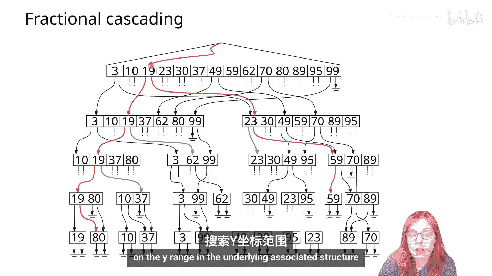

So the lowest value of the y range was 19， we will search 419 in the top binary search tree。

But for each next level traversed， we will use the pointers between the levels to move on to the same value in the next level or to the successor of the given value in the next level if that value does not appear in that subset。

When our range query will want to report all the points within a given sub tree that fall in the range of the Y coordinates。

 then we simply traverse the corresponding list from the leftmost point linearly along the list。

 reporting all the corresponding points whose Y coordinates fit into the Y range。

So let's say that these lists correspond。Do the black trees that need to be reported。

Then for each of them we are traversing it from left to right。

 so let's consider this example because it's more interesting。

 The value 23 is the successor of the left end point of the y range 19。

 so from this point we will linearly move through the set until the first point that falls outside of the range that we' are searching for and for each point whose y coordinate fits in this range we will report the corresponding point。

Here， of course we will also need to check the leaves of the two search paths if they fall into the query range or not。

So instead of doing a 1D range query on the associated structure of the highest black notes V in the main tree。

We will find the position of the first point with the minimum y coordinate that fits into the range that needs to be reported。

 and then we will traverse this list linearly and report each point that fits into the range。Thus。

 we reduce the number of gray nodes from log squared then because we would perform a 1D range query in log n trees。

 to big O of log n in total because we perform only one one dimensional range query and the remaining traveral of the structure takes constant time per level plus the time it takes to report all the points that need to be reported。

So a set of end points in the dimensions can be preprocessed in big o of log to the d minus1 n time into a data structure of o of n times log to the d minus1 n size so that any range query can be answered in big O of log to the d minus1 n plus k time。

 where k is the number of reported points。Note here that now we reduced the power of this log in the query running time by 1 from D to g minus1。

As usual， if our input is degenerate， in particular。

 if we have multiple points with the same x or y coordinate。

 then we need to be careful about using this fractional cascading technique。

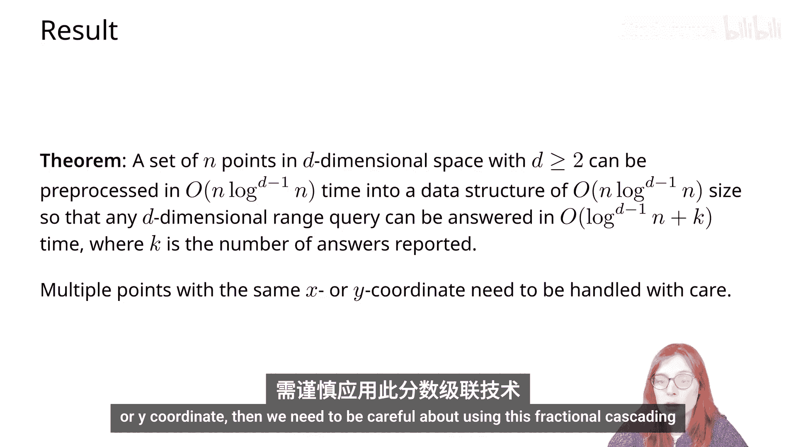