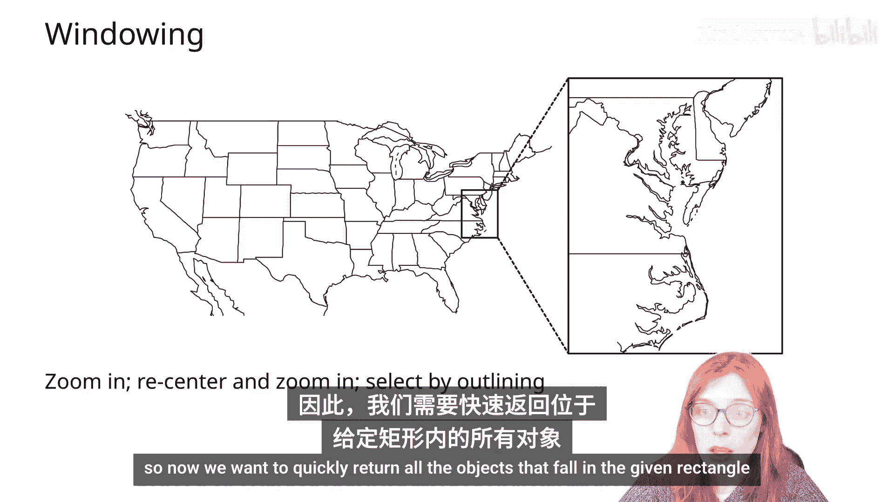
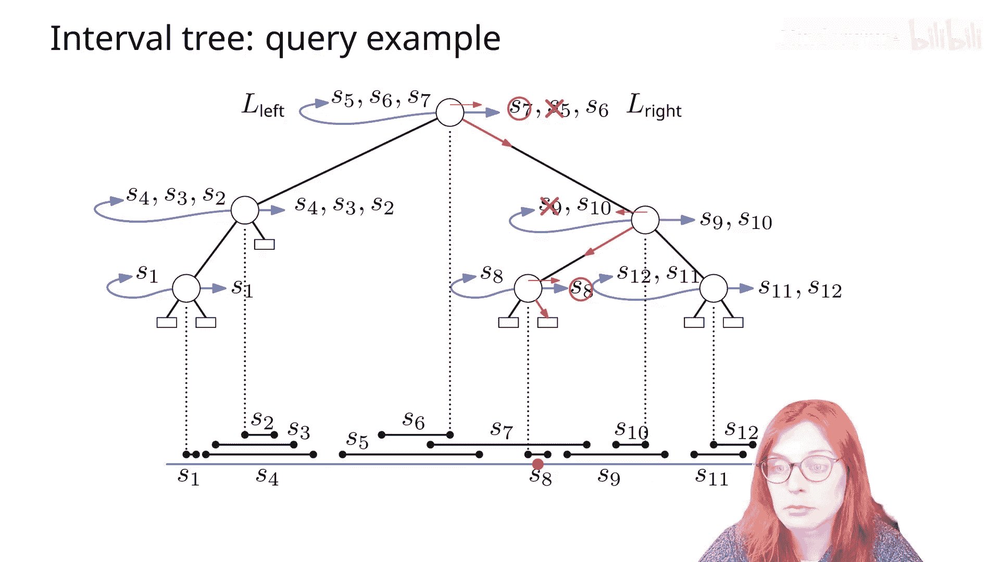
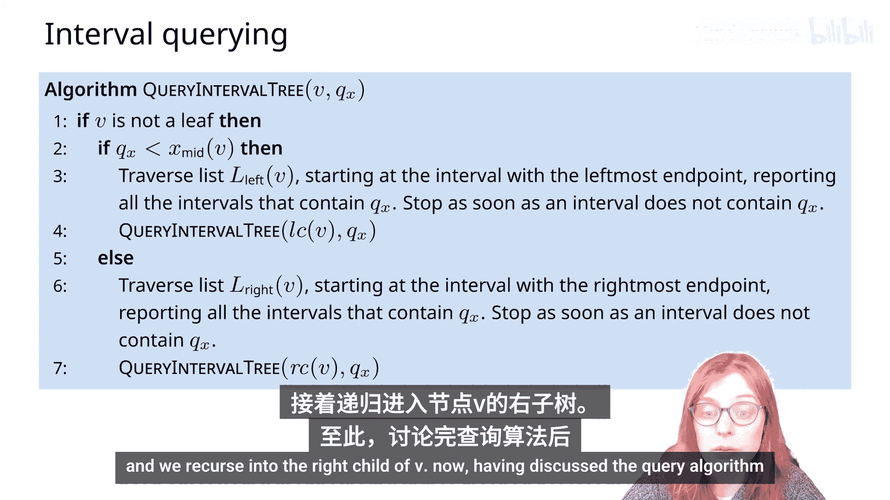
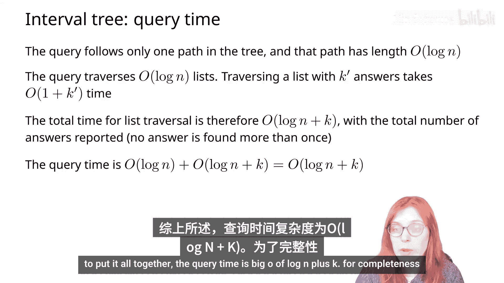
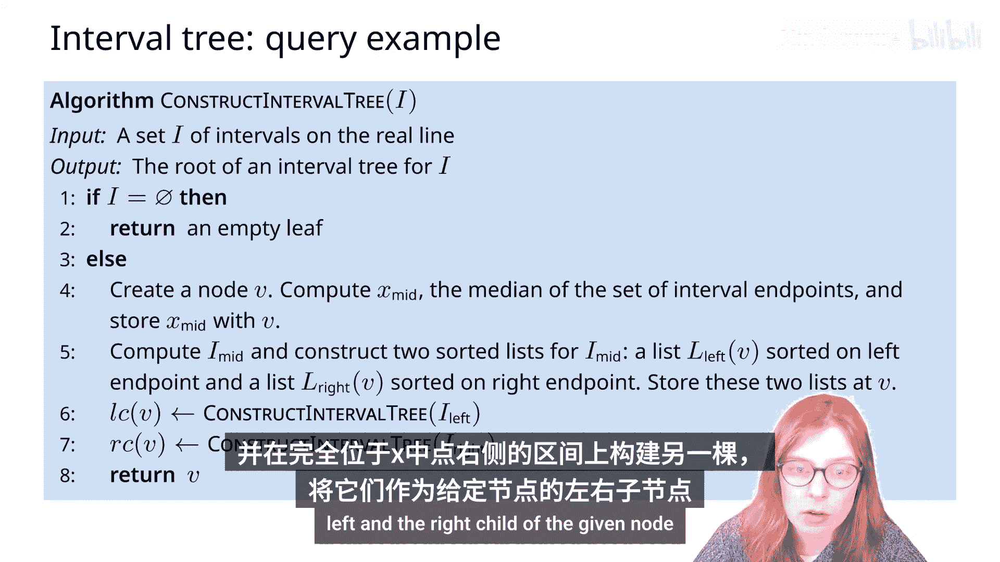
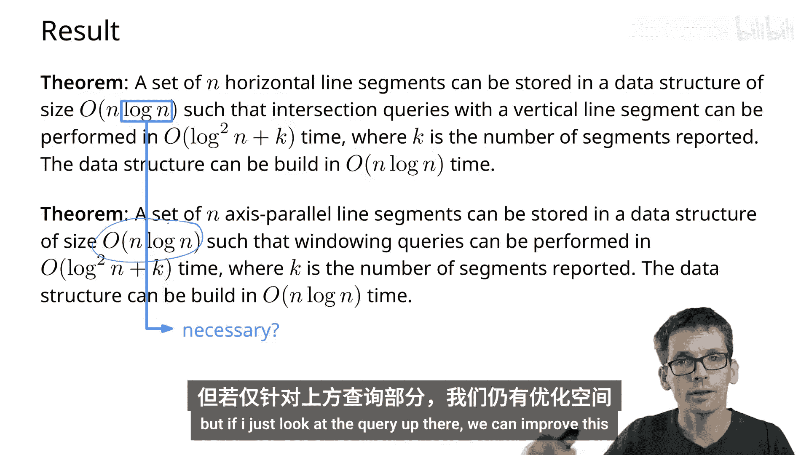

# 【Algorithms Lab】计算几何 ｜ Computational Geometry p18 P19_窗口查询1_3-区间树 -BV1Jtn7zSEXD_p18-

嗯。We now will consider different kind of query problems。

 specifically these problems will be called window inqueries for example。

 we have a global depiction of some map and we are interested in zooming into part of it。

So now we want to quickly return all the objects that fall in a given rectangle。

To begin with， we're going to restrict ourselves two segments of fixed orientations， for example。

 only vertical or horizontal or maybe diagonal。Even though limiting。

 this setting still finds its applications， for example， in circuit design。

So let's formulate the question， given a set of N access parallel line segments。

 we want to preprocess them into some data structure so that the segments that intersect a given query rectangle can be reported efficiently。

If we look carefully at this image， we will see all the types of intersections that a segment can have with the rectangle。

 it can completely lie inside the rectangle， it can intersect the boundary of a rectangle and have one end point lie inside of the rectangle。

 It can completely cross the rectangle and have both of its endpoint lie outside We will also need to be careful about these edge cases where the segments intersect the boundary of the rectangle。

So essentially， we have two types of intersections， one。

 the segments whose one end point or both end points lie inside of the rectangle。

 end segments with both end points lying outside of the rectangles。

 The segments of the second type intersect the boundary twice。

So now we will modify the format of the question instead of storing the segments and searching by a rectangle。

 we are going to store the endpoints of the segments and query with the rectangle and we will store the segments and query with the left and the bottom side of the rectangle This will guarantee that we report all the segments that intersect a given query rectangle。

Note that we already know how to store points and query down with the rectangle。

 so now we need to design a data structure to store segments with a query that is a vertical or a horizontal segment itself。

 and we want to report all the segments stored in the data structure that intersect the given query segment。

Note that the same segment can have its endpoint inside the rectangle and also intersect the left or the bottom side of the rectangle。

 That means that sometimes we will report the same segment more than once。

So how often will we report the same segment。Well， indeed。

 the worst case is that we report the same segment twice。To summarize our discussion so far。

 instead of storing the segments and querying them with the rectangle。

 we will split the problem into two parts in the first part we will store the endpoints of the segments and query them with the rectangle that we know how to do using a2Dring tree。

And in the second part， we will store the segments and we will query them with the left side and the bottom side of the query rectangle。

 and we will report all the segments from the data structure that intersect these two segments。

Our goal is to store a set of vertical and horizontal segments and query them with a vertical or horizontal segment。

 returning all the segments stored in the data structure that intersect the given query segment。

We will further simplify the problem and we will develop a data structure to store only horizontal line segments and query them with a vertical segment。

 or only store vertical segments and query them with a horizontal segment for this， of course。

 we can use the same data structure。One more simplification so far。

 instead of querying with a vertical segment， we will query with a vertical line and return all the horizontal segments that intersect a given vertical line。

Note that now the Y coordinates of the segments do not play any role。

 the problem becomes essentially one dimensional。The problem that we obtain now is the following。

 given a set of intervals on the real line， we want to preprocess them into a data structure so that we can efficiently answer which ones of them contain a given query point。

For example， in the image below， the two red segments need to be reported because they contain the query point。

The data structure that we will use here is called the interval tree。

 and the way we will build it is the following。We have two n and points of the n intervals。

We will split the intervals by the immediate value of the x coordinate among these two n end points of all the intervals。

We will have three sets of intervals。The intervals in the set I left are those that lie fully to the left of the split value X。

Similarly， the intervals I write are those that completely lie to the right of x and the intervals I met。

Will be the intervals that contain or intersect the given value X。

So now we can define the interval tree using the following recursive definition。

 the interval tree on a set of intervals I will have a root node that contains the median value x among all the two and end points of the intervals。

And it will store all the intervals that are intersected by that value X。

 The left child of V will be an interval tree on the intervals that lie fully to the left of the value X and the right child of V will be the interval tree that contains all the intervals that lie fully to the right of the value X。

Now， the question that we need to answer here is how to store the intervals that intersect the given value x。

Suppose we store these intervals in Iid in the note somehow。

And let's consider what happens when we will run a query。

Let's say the query point will lie to the left of x。

Observe that because all the intervals in Iid intersect the value X。

 That means that their left end point have values less than x and their right end point。

Will have a value that is larger than x。So if this is our query value。

And we know that it lies to the left of X。 We only need to compare that query value against the left end points of the intervals stored in the given node。

Similarly， if the query point would be larger than x。

 then we need to compare it against the right end of the intervals。

So a solution that will allow us to report the intervals intersecting the given query point Q efficiently is is to make tool lists。

 store the intervals by their left end points in the order from left to right and store the same intervals by their right end points from right to left in the second list。

We will use both lists as associated structures with the given node view。Let's consider an example。

 Here is our interval tree。The root note。Storees this value X， and as x intersects three intervals。

 S 5 as 6 and a 7， these three intervals will be stored within the node B。

Each of the intervals appears once in the left list。

 sorted by their left end points from left to right。And in the right list。

 sorted by their right end points from right to left。Similarly， for any subre for a given value x。

The intervals that are intersected by that value X are stored in the associated tool lists sorted by their left end points and the right end points。

To analyze the search requirements of this data structure。

 we can observe that each interval is stored only within one node。

 and then it appears within two lists。And because there is a linear number of nodes in the tree overall。

 the total storage requirement is linear。Now let's consider an example of a querying。

 supposeose that we are searching the integral tree by the value of this red dot Q。

We start with the root。And because the query point lies to the right of the value stored in the root。

 we are going to check all the intervals stored in the right list associated with the root。

We will linearly traverse this list， and report。All the segments that contain the query point。

 as soon as we reach a segment that does not contain the query point。

 we may stop traversing the list and move on to the right child of the root。In the next note。

 we repeat the procedure for this particular example。

 the query point now lies to the left of the value stored within the node。

 so we will compare the value of the query point against the left end points of the intervals stored in the left list associated with the node。

Here the first interval does not contain the query point。

 so we do not continue searching the list and continue to the left child of the node。Finally。

 this child contains only one interval because its value intersects only one interval not stored in the tree。

 so far。 The query lies to the right of the value stored within the note。

 So we check if the intervals stored in the right list contain the given point and we report them。

Finally， we reach a leaf which is a null， and we terminate the query algorithm。

So to summarize， the query of an interval tree will be given by the following pseudocode。

We query a given node V with a query value Q x。 If V is not a leaf。

 then we check if the query lies to the left or to the right of the value stored in the node V。

 if it lies to the left， then we traverse the left list associated with the node v。

 and we report all the intervals as long as they contain the query value Qx。

 we stop as soon as we reach the first interval that does not contain the value Qx and then we continue into the left child of V。

 and otherwise if the query value Q x lies to the right of the value stored within the node。

 we similarly traverse the right list， storing the intervals and report all the intervals that contain the query value QX and we stop as soon。

we reached the first interval that does not contain QX。And we recur into the right child of we。

Now， having discussed the query algorithm， please answer the following question。

What is the running time of the query algorithm of an interval tree。Indeed。

 the query follows only one search path in the tree and because the tree is balanced。

 the length of this path is logarithmic。For each node。

 the query traverses an associated list to that node， so it traverses logithic number of lists。

And for each list that it traverses， it reports some number k prime of intervals that contain the given query point。

 so traversing a list takes big of1 plus K prime time。Of course， the sum of all k primes adds to k。

 the total number of intervals reported， so the total number of all list traversals and reporting the intervals is big O of log n plus k。

 so to put it all together the query time is big O of log n plus k。

For completeness， let's also consider the pseudocode for the construction algorithm of the interval tree。

 We start with the set I of all the intervals。And we return the root of an interval tree built on the set I。

If the set eye is empty， then we create the empty leaf， the null leaf。And return it。

On the other hand， if I is not empty， we do the following。 We create the corresponding node V。

 We compute the median value x mid of all the2 n end points of the intervals in the set I。

 We compute all the intervals that contain the value x mid。And we construct two lists，1。

 the intervals sorted by the left and point from left to right。 And second。

 the same intervals sorted on the right end point from right to left。

 And we store both of these lists with the node V。We build two interval trees on the intervals that lie completely to the left of X mid and on the intervals that lie completely to the right of X mid。

And make them the left and the right child of the given note。 Finally， we return the note we。

To summarize， we can build an interval tree on a set of n intervals。

The tree uses linear storage and can be built in big O n log n time。

 and the query running time is big O log n plus K， where K is the number of intervals that are reported。

We now know what an interval tree is， but we don't know yet how to use it for window inquiries。

 so let's get started。😊，This is what we want to do。😊。

We want to query a set of horizontal line segments with a vertical segment such that we can report all segments intersected by that vertical segment and that will help us with window inquiries if the input are horizontal and vertical line segments。

😊，So this is what we want to have。😊，This is what we have。Givenivem horizontal segments。

 I can find all the segments that intersect a given vertical line。

 and for that we can use interval trees because this is essentially a 1D problem if I just look at the x coordinate。

😊，Okay， so what do we need to do now？So let's say we use an interval tree on the x coordinates。Then。

We need to do something new to handle the Y coordinates。

 So and that's very typical for range and window inquiries and generally these types of data structures。

We need to see how we combine different data structures。 What do we take as main data structure。

 What do we do take as an associated data structure。

 The main data structure now is an intervalry and we have to think about okay。

 what's are associated data structure Okay， let's have a look。

 Here's an intervalry and horizontal line segments。

 Let's say this is my query Now the intervalry as such gives me here at that node the segments S 5 S 6 S 7 and I go through those。

In that order。So that in particular means that in this case， the interval here such would give me S5。

 s S6 and S7。😊，That means a list that I'm storing here。😊。

That list is no longer suitable because I have no way to access S7。😊。

Without getting also S 6 and S 5。 so what？Can we do。So one way to see。

That we want to have S7 is the following。The left endpoint of S7 is in this range here。😊。

And now you could also wonder， okay， is this just a matter of looking at the right y range。

 So could I just check which of the segments are this y range， That is not quite the case。

 So here's just another example。 So here， it makes this a bit bigger even。

So if it would be like that， then S9 would be in the y range， but it's too short。😊，So it's really。

 okay， let's make a chart again。 It's really that we can find the segments that are intersected by finding the segments that have their left end point in this gray range。

 which is。Allide vectorant。So this is very much or where it looks like rangequeries。

 Let's just have one more example before we actually do rangequeries here， if that's my query。

 then I'm going to the right in the tree and the rectangle I'm interested in is this。😊。

But all of these are range queries， 2 d rangequeries， So what can we do。

 we simply store the endpoint of these intervalverts。😊，In a 2D range tree。And then。

When I'm accessing this node here。And I have a query， let's say this one on this 2 d range tree。

 I simply find the segments that have an endpoint in this interval。

 and we can put everything in one tree because all of the right endpoints are here。

 all of the left endpoints are to the left， so I cannot by accident find the wrong endpoint。😊，Okay。

 and that's it main data structure inory。😊，Associated data structure at 2D range 3。

And what do we do now instead when we do our query。

 instead of what we previously did that add this node， we accessed the if we went to the left。

 the left list and when we went to the right， the right list。

 what we do instead is we perform a range query in the corresponding region。😊。

And now this might look a bit strange because this is not actually a rectangle。 but the side here。

 you could say is that mine is infinity。 But in terms of rangequeries。

 that actually just makes the query a bit easier because we don't need to search for both boundaries of the range。

 only for in this example， the right boundary and the other one is completed to the left。

 That is a setting。Once more。objectsjects are horizontal line segments。

The query object is a vertical line segment。 The query is。Report all segments。

 input objects S I that intersect my query segment。

 The data structure is an intervalry with associated data structure a2 range tree and now let's think about how much space does this need the inry as such if you we ignore all of those range trees that takes linear space。

And now remember that a 2 d range tree took space N log n for endpoint。Now， instead of one tree。

 we have lots of trees。And so on， any endpoint is just in one of those trees。

 Let's say this is a number of segments here and one。

 this is a number of segments here and two and so on。

 if I sum up all of these sizes of the range trees， I will get a sum of the type N I lock N I。

And if the sum of the N。That is N。And then， this sums up to。En log in。Yeah， you could say。

 to some extent， the worst case is if everything is one tree。

 then I get end and if I have lots of small trees， for instance。

 then actually I would get less storage。😊，Okay so that's what we have。

 we need to store up to a linear number of range trees， they overall store2 end points。

So the overall storage will be O of M log n。Let's think about queries。 So if I query， I will。

Move to the tree， let's say like this。😊，And then each time I visit a node， let's say this node。

 I need to do a 2D range query。So I'm doing 2D range queries on lock and node。Meeting， I do。

Or a lock and rangequeries。Each range query， if I use fractional cascading。

 will take order log n plus。And then the number of nodes reported in that node， let's call that K I。

So I get log n times log n， that's the log n squared here and all of these K together sum up to my overall k。

And that's how we use interval trees for windway queries。One more question。😊。

How much time does it take to construct this data structure？诶。Order n log n time， B， order N。

 log square n time or C order n squared time。All of this takes order and look and time。Why。

 because constructing an interval tree takes order and lock and time。

 and then I need to build all of these small range trees。

Building a range tree on end nodes takes order inlock n time。 Again， if I sum all of this app。

 I will get order Nlock n。 So to sum up our resides for。Window andquer is using interval trees。

Given a set of n horizontal line segments I can build a data structure it will have size order log n。

 such that given a vertical line segment as a query。

 I can find F all the segments intersecting this in order log squared n plus k time。😊。

And constructing this data structure I can do in order and log in。Time。

If I now use this for window inquiries， then recall that this was for the segments that intersect the boundary of my window inquiry。

Additionally， I can have segments that are completely inside。 and for those。

 I do need to also to arrange query。 So the overall result is that if I have。

N axis aligned line segments and so far we talked about horizontal line segments but we can also build the same data structure for vertical line segments for horizontal queries。

 so for n axis aligned line segments we can build a data structure of size or unlocklock n such that we can perform in time order a log squared n plus K timer query with an axis aligned rectangle such that we can report all segments that intersect this rectangle。

😊，And we can build all of this in order in log n time because we can build the intervalt tree with the 2D range trees in order and log n time and then the 2D range trees which we use for the segments that are completely inside the rectangle。

 I can also build those on order and log n time。So far， so good。

We will want to see one more small improvement in the next video。And that is the following。

Here our data structure uses Endlock in space。This。We would like to improve。Let me say， overall。

The endO end down here， we will not be able to avoid because the range trees need all the endo n space。

 but if I just look at the query up there， we can improve this and we're going to see how to do that next。

