# 【Algorithms Lab】计算几何 ｜ Computational Geometry p19 P20_窗口查询2_3-优先搜索树 -BV1Jtn7zSEXD_p19-

Let's have a look at a simple and intuitive data structure， priority search trees。

 so why are we looking at priority search trees， our motivation is the following？

We've done orthogonal range searching and normally we search with a reactant。Now。If one side。

 you could say， is that infinity？As in the examples that you've seen seen here， so we have one。One。

 two， three sides， but the fourth side is open。Then we can still just handle it like a orthogonal range。

Cary。But。We can actually get a better data structure for this setting。

 So that's a questionnaire for three sided range queries。

 Can we solve those more efficiently than four sided range queries。😊。

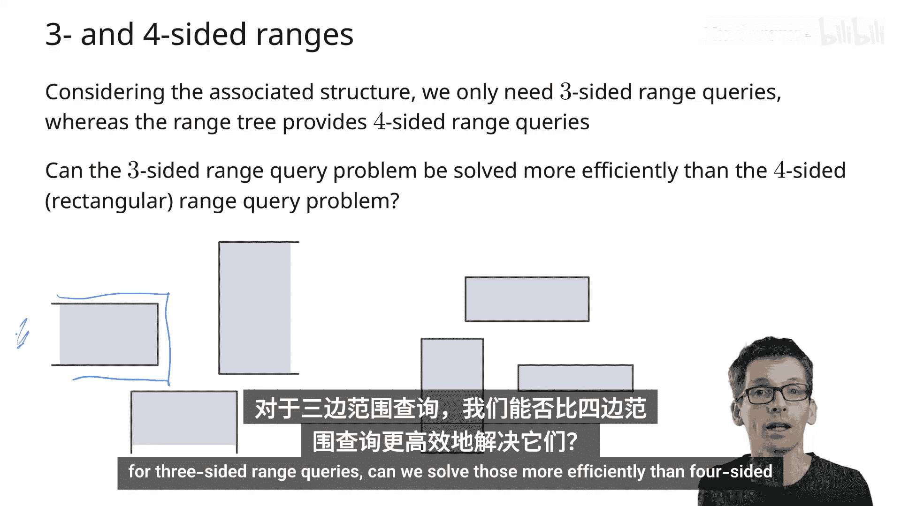

Our motivation here was for the windowwing data structure where we had these three sided queries when we were querying with this vertical segment。

 where we had to find all points， all endpoints of horizontal segments in this three sided query。😊。

Okay， and for these types of queries， we can use a very simple data structure and that is a priority search tree。

😊。

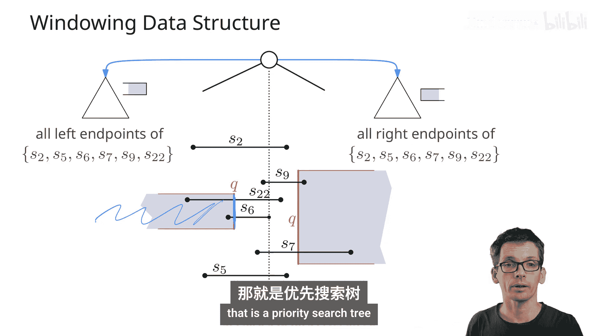

So what a priority strategy is is essentially the combination of a heap。😊，And a binary search tree。

Okay， so just as a reminder， what is a heap， a heap is。Nearly complete。Binary， tree。

With the he property， here， the mint he property， meaning that。A node。

Is always the key of a node is smaller equal the key of its children。Now。

 if you think of the1 D version of three sided queries。 So let's say one dimensional range query。

 which is one sided in the sense that I want to find， let's say all numbers that are。

Smaller equal than 4。This I can solve with a heap。OrMore precisely， with a min heap。

In the following way， I simply start at the route。😊，If that is smaller equal 4。

 I report it and wecursively go to the sub。So I see then here the two， I report， goes do the subre。

 I see the two three report， go to the subrees。 Okay， so here's just the 9。

 I can stop 2 is also larger than 4。 I can stop。 Here's a7 it's larger than 4。

 so I can also stop here。This is now now I'm done with the recursion on the left tree。

 I go to the right tree。 The four is。嗯。Smaller equal4。 So I go there。This one should also be gray。

I visit that， see that it's larger than 4。 I visit the6。 I see that it's larger than4。 and I'm done。

 Okay， so4er。😊，1 D1 sided query。 I can use a heap。Now we want to do 2 D，3 sided queries。

 and for the other dimension， I use。A binary， or I use a heap as a binary tree。

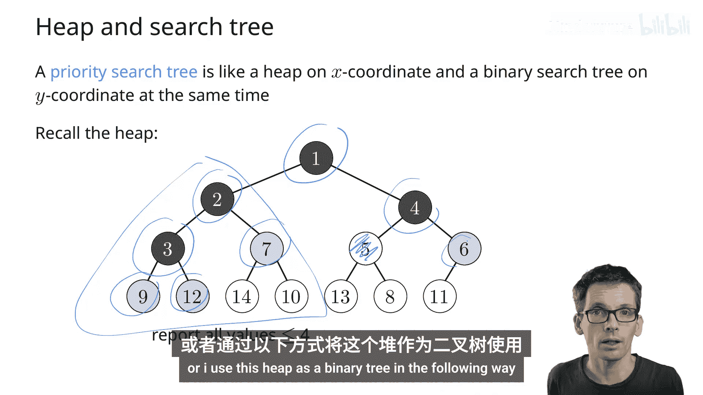

In the following way。If。I have a point set like here， I point set what I'm going to do。

 I'm going to store two pieces of information at the root。One is， I'm going to store the point with。

The smallest x coordinate。 So this way， if I have a three sided queries， I will see that point first。

So I am storing the point with the smallest x coordinate and then for the remaining points。

 I find the median with regard to the y coordinate。😊，So let's see that is here。And then。

Store that at this node and recur。So now in this sub here in the right sub I'm going to store all points that are above the media in the left sub。

 I'm going to store all points that are below the media excluding my point P min because that point at this point I've already handled。

And with this， we can very easily now do our query， so this is how this could look like。😊。

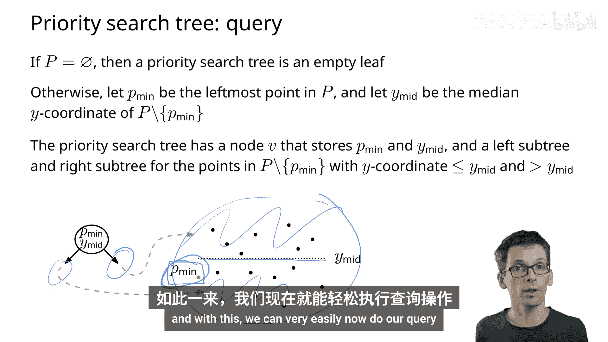

Leftmost point P1 is stored here。Then。Recursively I have a tree above a tree below。

 if you look at the tree below below the leftmost point is P3。

 so that is the root of the next tree and here we have the median so that splits the points below this line according to the y coordinate at the median。

 if you look at the points above。The left most point， if so P1 is already here。

 so the left most point of the remaining point is P4。

 So I'm going to stop P4 here and then again split at the medium y chd。

If I now have a three sided range query and it has to point to the left。Then I can do the following。

Essentially。I am doing what I described with a heap。Kind of my one sided query。 And additionally。

 with a binary search tree， I'm doing a 1 D range query。Orドバイ coordinates。Now， remember。

 how does a 1D range query work？So I want the range query。 I first had to find the split node。

 So here the split node P1 is already there is a split node in our example。 and then I find。

This lower boundary。 I find that in my binary search tree。 So now I'm looking at y。

 So the lower boundary is below。This median， it above that median。

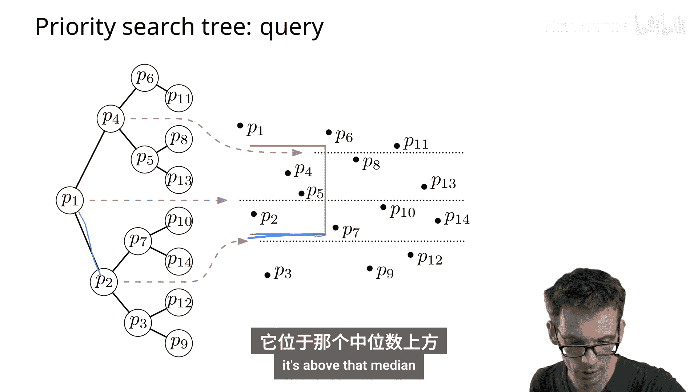

And let's say we are below here again， likewise， the top boundary is above this median here。Above。

The next median。L is。So that's my 1 D range query on where I'm query。With this intervalvert here。

 you could say。With this interval。

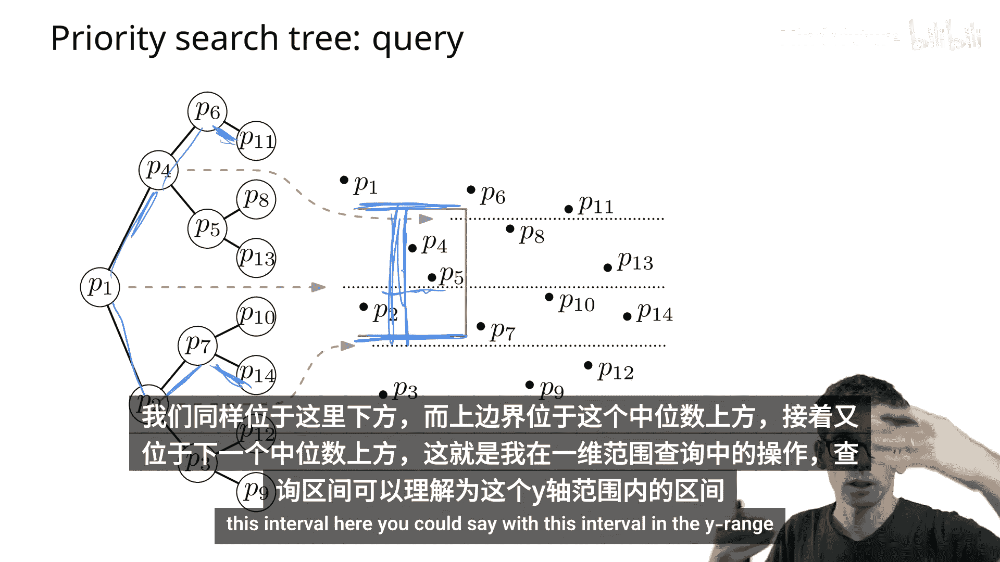

In the right range。And now what I just need to do is within that range。

 I need to find the points that are。To the left。Oh， this proud we。And I can do this。 Okay。

 I will have these two paths but I need to check and then I just go into the trees inside。

 so here I just have this tree inside and that tree inside and there I just go deep enough so that I know that as soon as I see a point that is to the right here。

I can stop。 Okay， let's do this by example， I start at P1。

I will go left and right for my Y range query P2。I go to P 2。 Now I go。

 I see this medium is below my boundary。 So I go here and then。It's Ago， here is。 This is my。

Lower boundary in my 1y range。And then I start exploring also the t inside， which is in this case。

 P 10。 So note that what is happening here。 I mean， I could have seen that P 7 is already too far。

On this side。 But in terms of the eyes what I'm actually doing， I find this lower path。For this。

 And then I go into all of the sub treeses。 So that means。

I also go into this sub here and also this path here， I follow to the end。

 so that's why I'm also going here。You could save a little bit here。

But this keeps the algorithm simpler。And okay， now I do the same on the other side， I go to P 4， P6。

 P11， so that's kind of the path in my 1 d range query。😊，And then I need to go into the subrees。

 so I go into the subre as P5 P5 is still to the left。

 so that means I have to also go to the children P8 and P13。

 so if now there would be more nodes back here because P8 is already to the right I could have stopped。

Okay， and of all the nodes that I explored， I check whether they're inside or not。 and in this case。

 these black node， those are inside， the gray node。

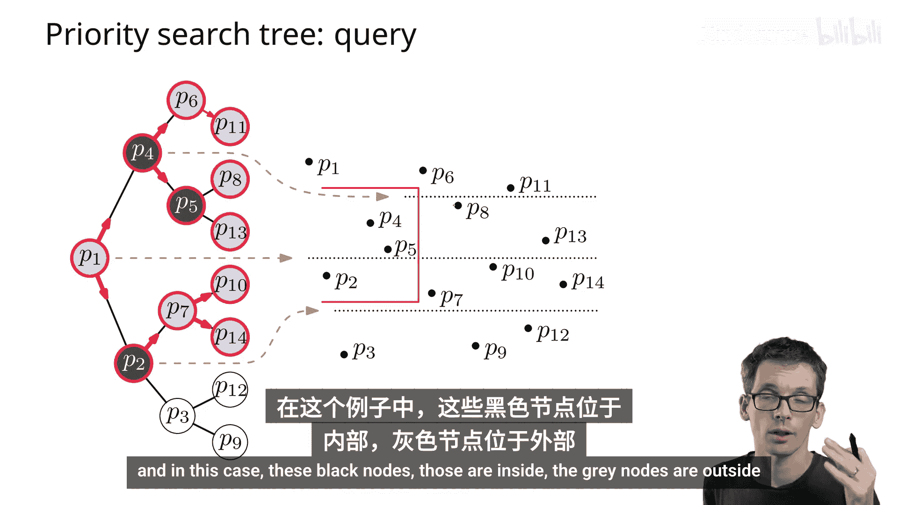

Out， but I checked them on the white notes。 I never visited。 So once more。

 how does this look like impo code。I'm cr my tree。With a threesided range。

I first do a 1 D range query searching for the lower and the upper boundary of my range again in a R D range tree。

 essentially I have one path until I hit the split node and then it will diverge。

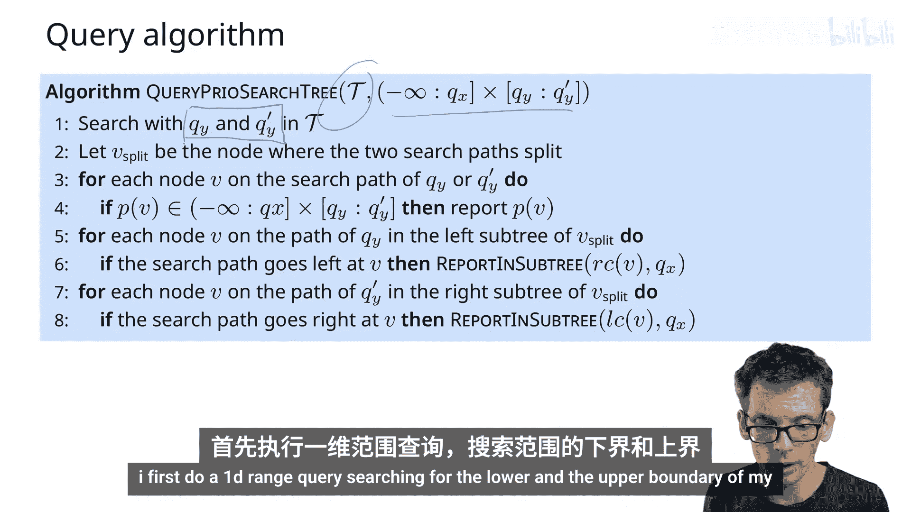

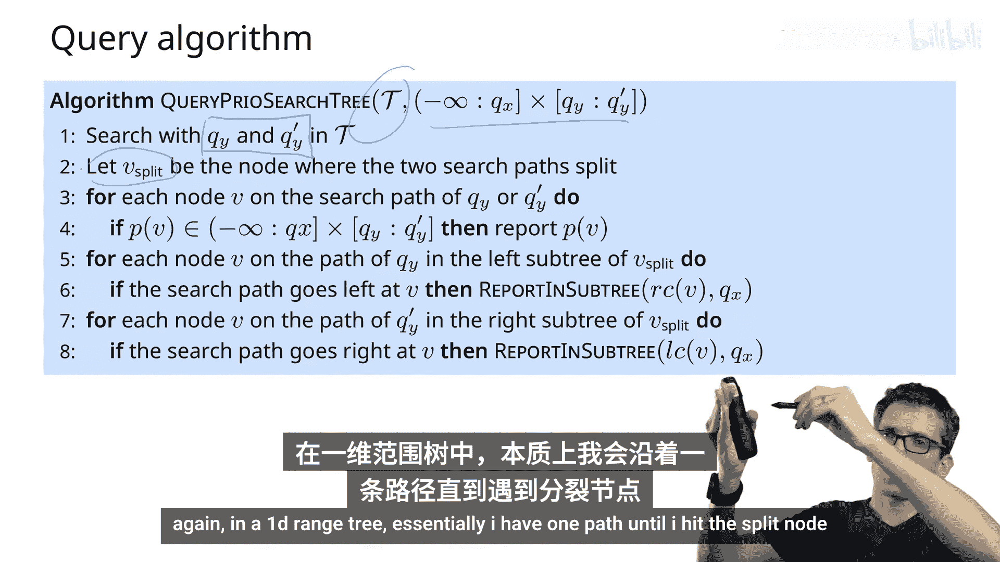

And what I do along the search path is the following。 So if I have trees in between， though I have。

 I'm going。So you have to think over the now from looking from here。 So if I go right。

I need to look at on the lower path， I have to go into the left sub and on the upper path。

 if I go left， I go to the right sub and then I need to report。Whatever is in that suri。

Or more precisely whatever is in that stui， which is。To the left of the right boundary of my right。

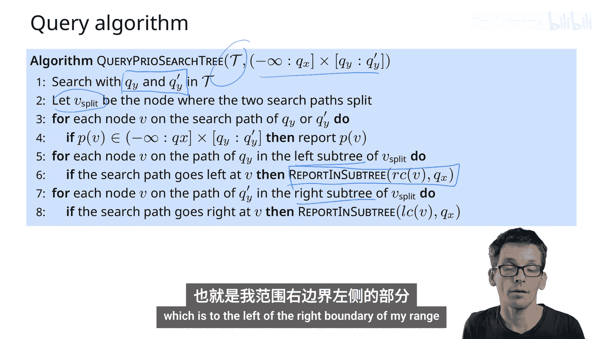

So in terms of these black， conque and white notes， as we've seen them for range curving。😊。

This will look look like this。 I first do a search for the up and lower boundary in my。

One dimensional range tree for the y coordinate。 So I get this path here。On this path here。

 I'm in this way， visiting lock in。Or a lock and notes。And then in between。

 I go into the subre and call report in Subre and then report in Subre there I really just not use my heap or my priority search tree as a heap as we've previously seen so that means if I see something that I report I need to recur。

 but if I see something that I don't want to report I can stop。And in this way。

 I can make sure that the number of gray nodes in these subrees is bounded by two times the number of black node。

 I can I will stop on every gray node has a black parents on terms of a charging argument。

 I charge two at most two gray nodes to a black node， and that's how I get this inequality。

And once more， how does a report in sub 3 work that simply does the following I check。

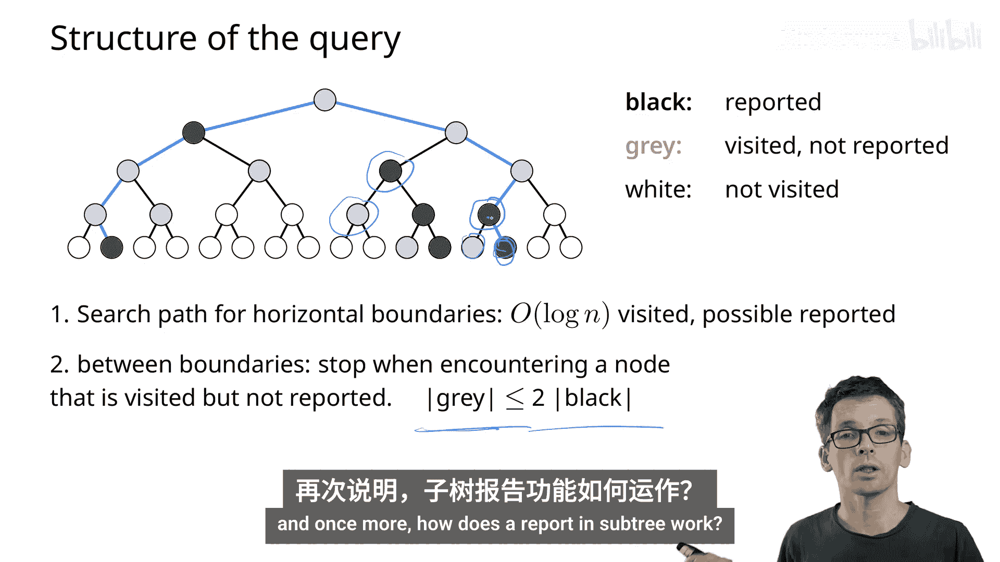

Whether the x coordinate of the point that I that's in that sub， whether that is。

Smaller equal my query x corner of the right boundary。I at this point， know that if。

It's in terms of x fine， then it's also in terms of the y coordinates in my range。

So then I report the point and then I also recursively go into the subrees。😊。

And if the point is on the wrongng side。I was a pistolol。

I already argued gray nodesbound by two times the number of black nodes。

 this protein would over take order。Essentially order K time。

 I here write 1 plus k because even if there' is nothing to report， this will take constant time。

 So order 1 plus K means at least constant， but beyond that order K。

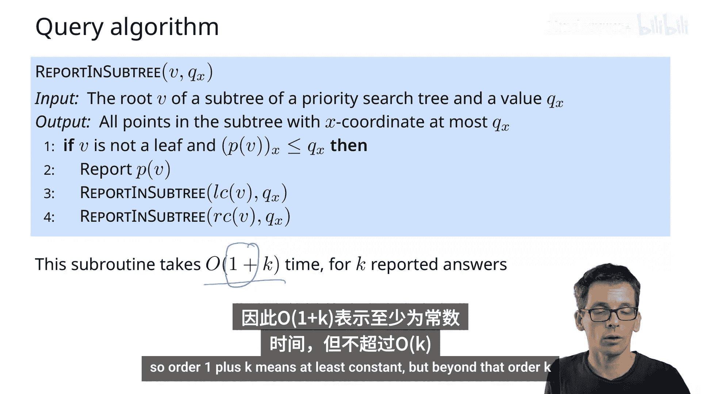

I visit on the search path。So on this path and that path， log and node。On each note。

 I spent constant time。Outside of those search path， nothing is visited。

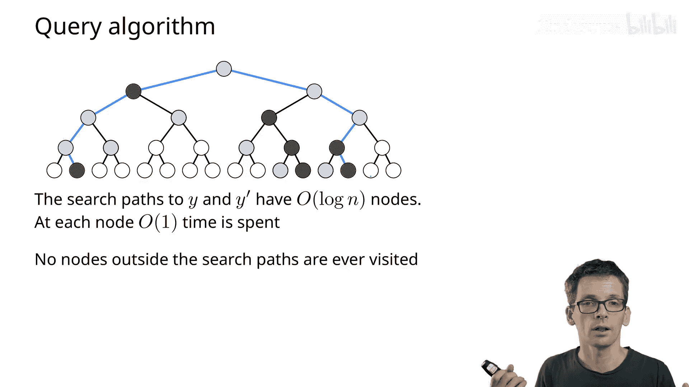

And then within the suies inside， I spent order 1 plus。Number of notes reported time。

 So this is 1 I do at most lock n time。 So this overall will give me a lock n， and this will sum to。

The number of points reported overall。 So the total query time is。Order log N plus K。To sum up？

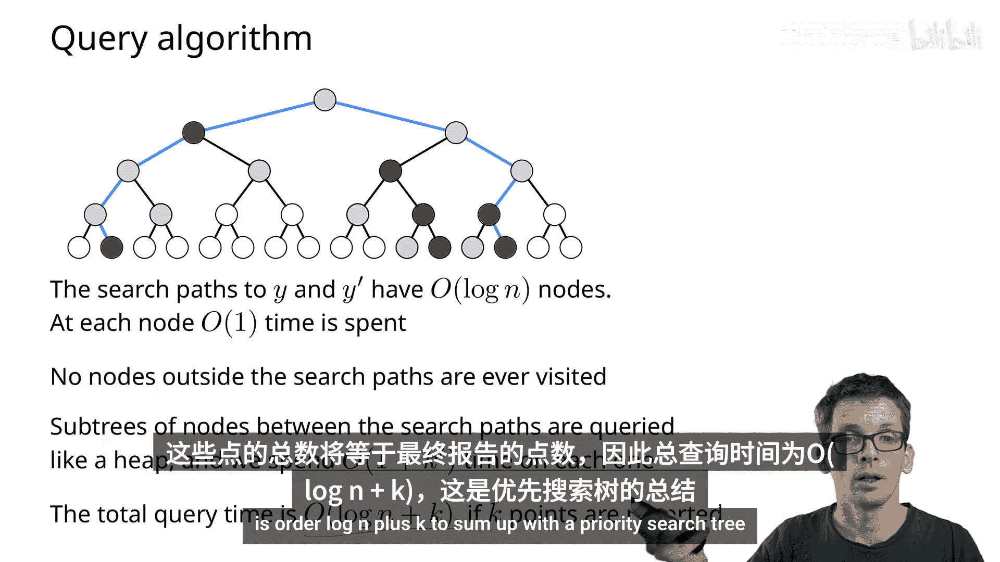

With a prior to search tree。On a set of endpoints。I can answer queries。

 three saved sided range queries in order lock in plus K time。And the storage。

Will be linear because I simply， this is simply a hip or binary research stream。

Both simply use linear storage and I can construct all of this in order unlock and time。I mean。

 you just need to find the point was the smallest。X coordinate， you can do that in linear time。

 find the median， you can do that in linear time。 and then recur。 So the recursion。

 So just to check the running time， the recursion for the running time。

 This is the standard recurst that you've already seen many times for mergerch sort and and whatever which solves to order in log n。

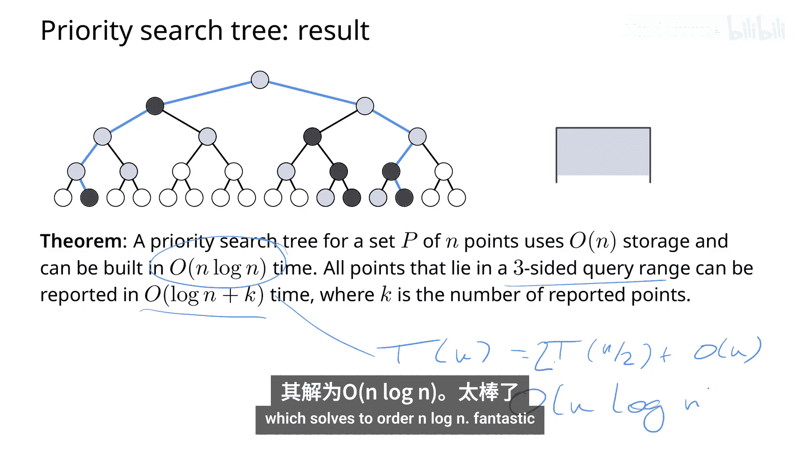

Fantastic。To， if I'm。Using this for， cring a vertical。Line segment。

So I'm using this in the following way， I have an intervalver tree。

And then as associated data structure prior to search。

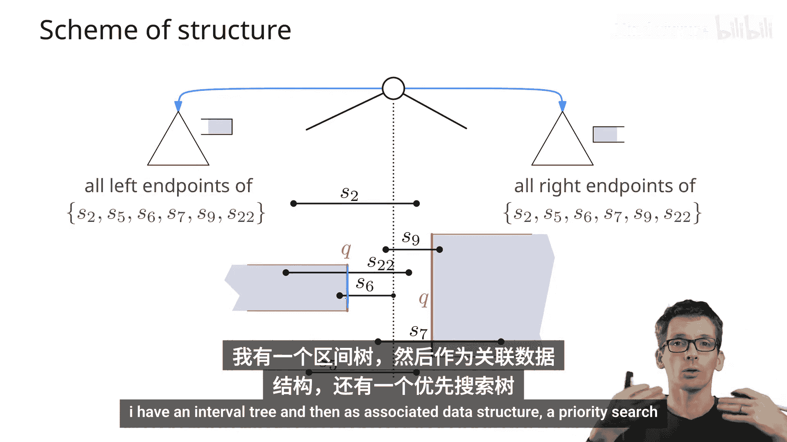

What is the storage requirement and what is the query time of this structure？Is it。

 I know we have four options。Linear storage or log n plus k queries or is it linear storage log squared n plus K queries and log n storage log n plus K queries。

Enlock N storage， log squared n plus K start。And again， this is not just priority search tree。

 but it's an intervalver tree with priority search trees as associated data structure。😊。

So we now only need linear storage。Because my priority search trees take linear space。

 So I have lots of these priority search trees。 but overall， they store two end points。

And each of them has linear storage in terms of a number of points stored。

 so overall I get linear storage。The paradigm is not faster than before， because we still go through。

Lock n nodes and then in each node we have lock query time of log n plus k。

 so that gives me or KI for the number of reported points at that node。

 so that gives me overall order log squared n plus K query time。

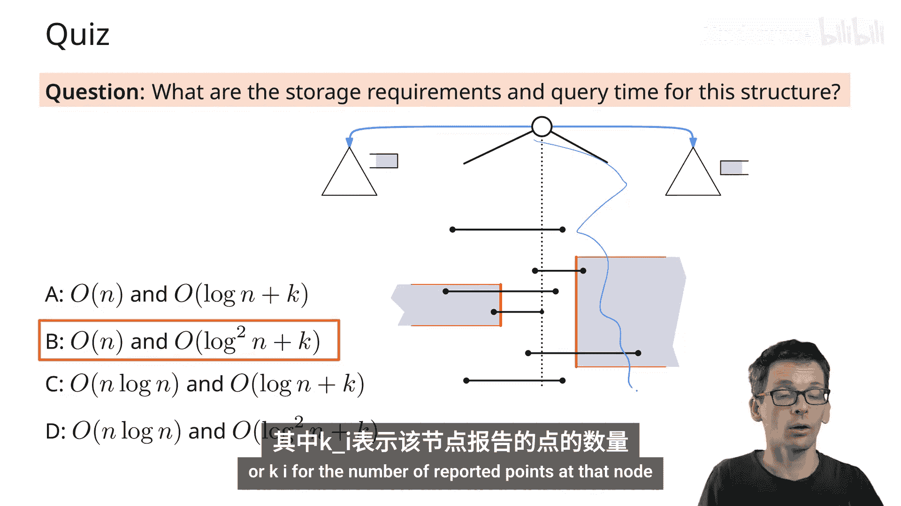

So that's what we have for the query problem of given and horizontal line segments。

 I want to query with a vertical line segment。😊，Linear storage， lock sweat and plus query query time。

This will not help us。

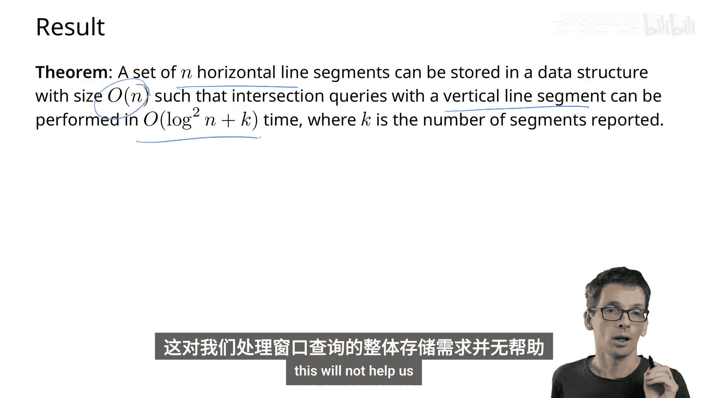

With an overall storage of what we need for the window inqueries， because for the window inquiries。

 we also still need these range trees for the segments that are completely within our query。嗯。Window。

 so that means overall， we will still need order unlock n space because of the range trees that we use there。

 but at least this other part we were able to improve。So far， what we've seen。

Is with horizontal and vertical segments。And then the query is a。Axxiite rectangle。

Now what we want to do next is arbitrary non intersecting segments。😊。

And query with of access aligned query window and find the segments that intersect that window。

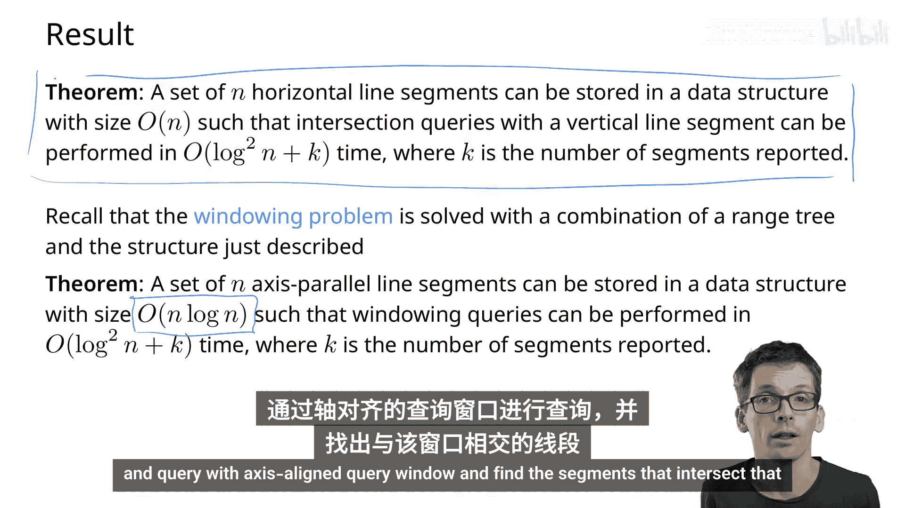