# 【Algorithms Lab】计算几何 ｜ Computational Geometry p20 P21_窗口查询3_3-线段树 -BV1Jtn7zSEXD_p20-

So now we want to solve window inquiries for arbitrary non intersecting segments。

Before we see a solution for this， let's first explore what we can do with what we have so far and see why that actually does not solve the problem。

😊，But once more， what is our problem？We've given now an arbitrary non crossing line segments。

 as you see here。And we want to prepo them such that give them。A query access a line query rectangle。

 we can report all segments intersecting that rectangle。😊，This one here。

 but also the one that's inside this one and that one。Again。

 we have two cases if an endpoint lies inside。Then we can simply could simply use a range tree。

But we have to now handle those。Where both endpoints。Lie outside。For instance。This one。

So how could we do this？If you want to reduce it to the version with access aligned segments。

 one idea could be to instead of storing the segments to store the bounding boxes of the segments。

 This would look like this here。

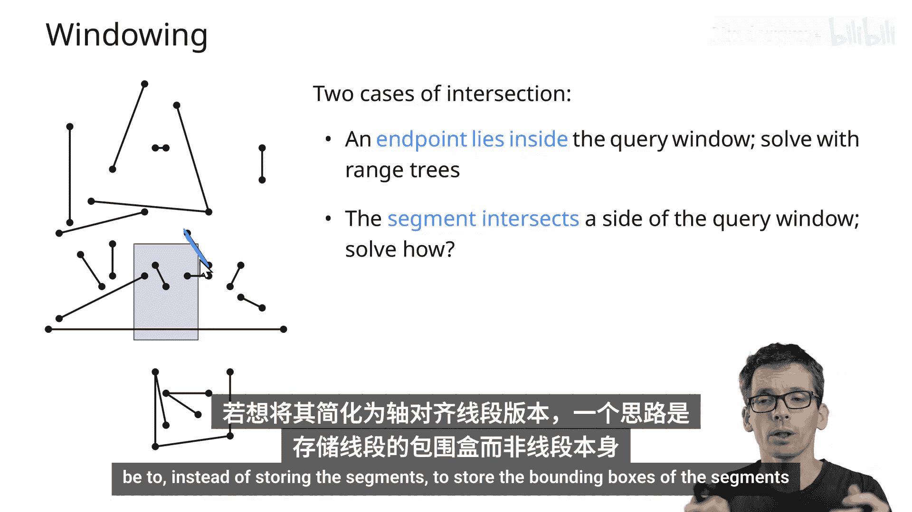

The bounding boxes are access aligned。I could throw them into my data structure that I constructed for access All segments on intervalver tree where a proprietary search tree as associated data structure。

This will not work。 So why will this not work， What is the main problem with this approach。A。

We might have segments。That actually do not intersect the query rectangle。

 but their bounding box does， so that means we will not get an output。Sensitive query type。과？

We might have segments that actually don't have a bounding box。Oh， there had too many bounding boxes。

This one hopefully was not too difficult。 The problem here is that we could have bounding boxes that dissect my query like this one here。

But the segment does not intersect my query。That means in my query I will find that segment and then I still need to check whether that's actually intersecting。

 but in this way and this kind of demonstrates kind of a worst case setting I could I might need to check a linear number of segments in this way which all don't intersect。

😊，So， that moves my log squared n plus K to actually log squared n plus n。 So linear query time。

 even if nothing is interesting。 And okay， a vertical segment has a。De generate bounding box。

 but that wouldn't be the problem。And the number of pounding boxes is also not an issue here。Good。

So what is our current problem of interest， I mean。Want to solve the window inquiry problem。

 but the problem that we are really interested in is。Finding these segments that intersect。

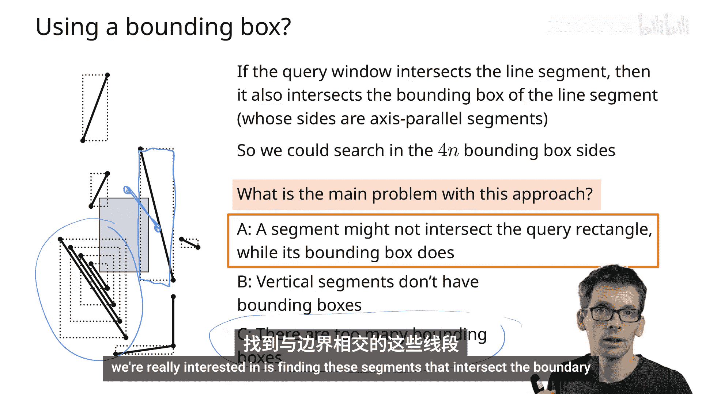

The boundary， I can reduce this to the following query problem。 I have an arbitrary。Line segments。

 non crossing line segments。 And now I'm querying with her。Vertical segment。

 I want to find all report oil segments dissecting that vertical segment。

This is essentially the reduction that we previously have seen for X aligned segments just that it's now for arbitrary segments。

So let's see whether we could use a solution for that we have for。Access alignedied segment。

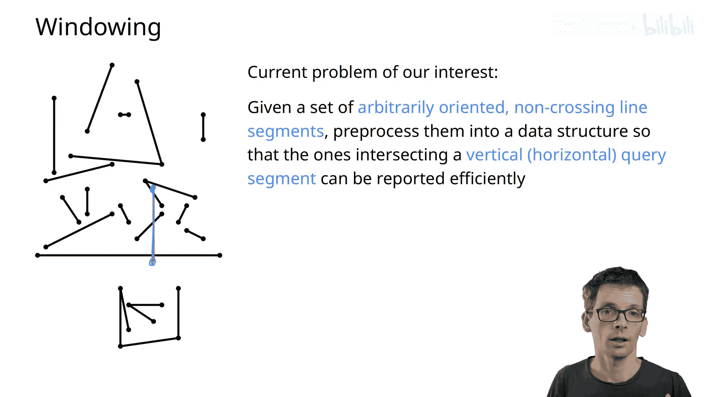

So can we use interval trees？So for interval trees。

 what we relied on is that the segments that intersect。😊。

The boundary actually have an endpoint in here。And in that way。

 we could build a 2Dh tree or priority search tree on the endpoints and find the ones。That have。

The endpoint in that region。Here we have the problem that despite， so here's an example。

Despite having an endpoint in that region。A segment。That I would store at theus note。

 so here I'm storing everything。Dsecting this vertical line。 So despite having an input in here。

 I do not necessarily。It dissects this boundary。So that's why intervalvertries won't work here。

We will next see an alternative to interries segmentries。In 1 D。

 they will solve the same problem with intervalries even less efficiently。

 but we can use them then afterwards as a main structure or the window inquiries to actually solve this problem。

 We' are going to get to know segmentries。

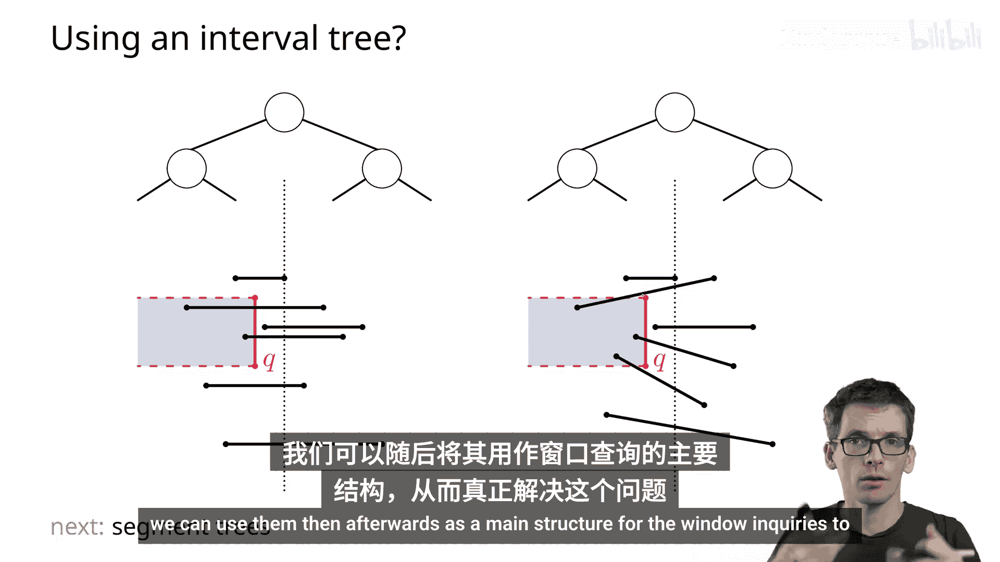

And segmentaries are an example of the los approach。

Which kind of abstractly speaking means we're taking a solution space and dividing it into regions such that in every region。

 the solution is the same。And this is kind of the los approach for the following problem。

Namely interval querying， that is we have all this 1D setting of set of intervalts and we're going to have a query point。

Here's my query point。And I want。Report all intervals that contain that credit point。

We've seen intervalries to solve this problem， but now we're going to see an alternative。Approach。

And that is segmentaries。 And the idea is this los approach of essentially dividing the solution space into regions etctera within each region。

 the answer is the same。 So what does that mean， it means， for instance， that as long as I'm。Between。

 let's say， this point here。And that point there。So no matter where my query lies in this interval here。

The answer， in terms of which。Intervals are intersected， name this one here， will always be the same。

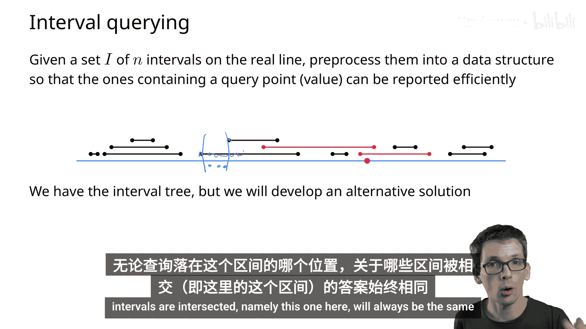

And that's。The local approach。So here we see that we're subdividing a solution space。

 which is here that just the one dimensional space。

 I query we will be somewhere in this one dimensional space I'm subdividing this one dimensional space into regions such that within each region。

 the answer is the same。And that means I get this region。

To the left or minus infinity to the first point。 we will do this， not including the first point。

 and then we'll have a special region just for that first point。

And then between the first two points and so on。And these intervals will be called elementementate。

So now I've split my space into these regions that within each region we know what the answer is。😊。

And this can be now very easily be turned into a data structure by building a binary search tree on top of this。

 So how does this look like。

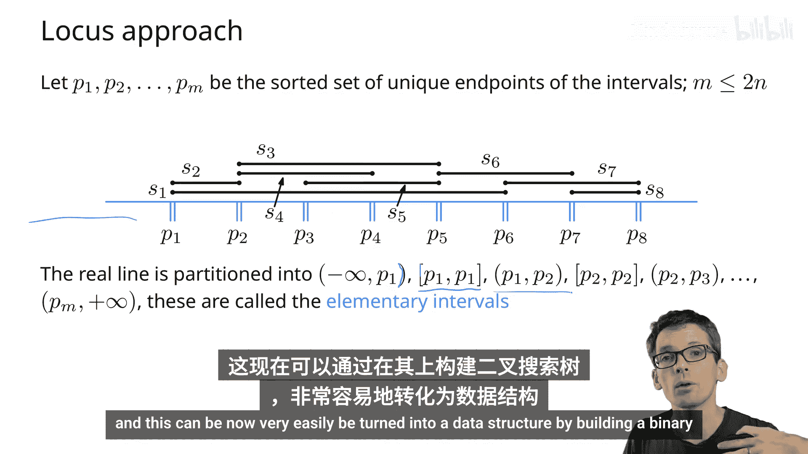

Here we go。 We have these。Regions， so here's my first one just up to the first point and so on。

And then all these regions， I build my binary search tree。Now I can do the following。

 So let's say I have a， I now have a point， and I I can very simply query。

To find the region that contains it so now here between whatever P4 and P5。If I now store。

With this leaf here。

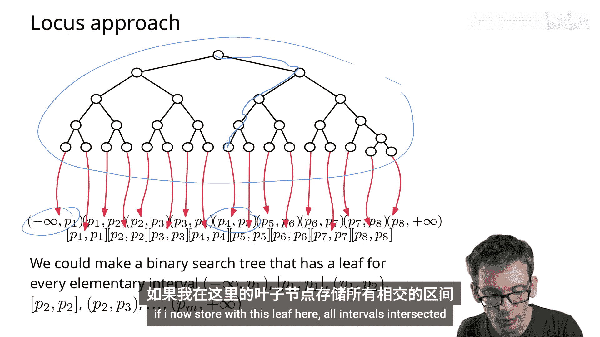

All intervals intersected。

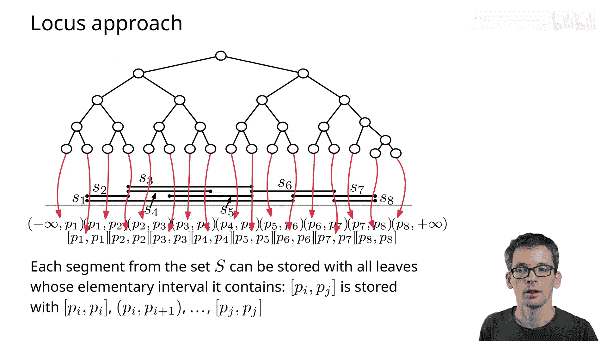

Yeah， so with every leaf is this one， I'm going to store this interval and that interval。

Then I can very easily answer my queries。 if I get a point and I want to know which segments are dissected。

😊，Then， I can simply。Let's say， let's say I have a point somewhere。😔，Here。😔。

Then I would first search for that point。And then if here I've stored those intervals。

 I can report them。This is not yet a segmentary， but let's see how far we got so far。And for this。

 let's think about。What is the storage that I need for this and what is the query time？

So here are some options。Linear storage or a lock n plus K query time。

N log n storage and log squared n plus K query time or n squared storage and order log n plus K query。

Sos the correct answer C？Cery time is perfect。😊，Or our log n plus time that we need to report。

 But in terms of storage， this is somewhat catastrophic。We need cry storage。

And why do we need quaratic storage Because in the worst case？I am sting the same interval at many。

 many knot。So you can imagine if I have if half of my intervals are simply very long。

And then let's say half are kind of short。Then at all of these intermediate nodes。

 I'm going to stop all of those intervals， all of the long intervals。😊，And that will be two exp。

How can we avoid this？We're going to use the following observation。

So the leaves here correspond to certain intervals， the elementary intervals。So the interview are I。

Let do seat down here。

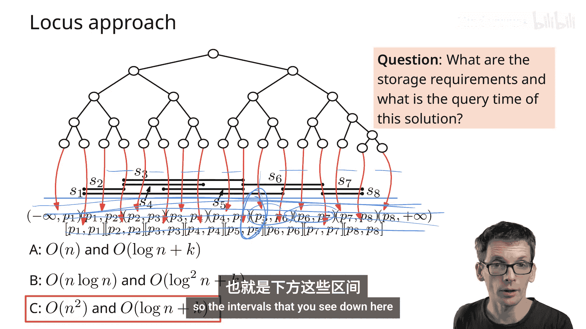

But every internal node also corresponds to an interval。

 namely simply the union of the intervals of the leaves of that node。 So for instance。

 this internal node here， the leaves are Pi to pi plus 1。The point B I plus  one and so on。

 So this internal node simply corresponds to the union of those。

So every internal node has an interval too we've seen the locus approach and how applying it naively gives us quaratic storage。

 and now we're going to see how to improve upon this in terms of storage and the idea that we had to improve was to make use that internal nodes in the spine which we also have an interval associated with it。

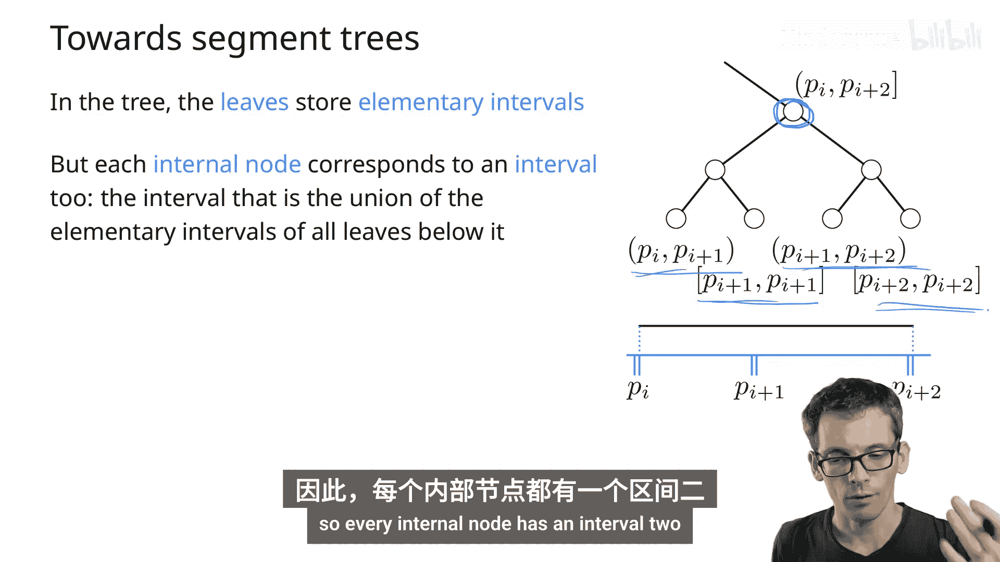

And this is already indicated here。😊，Every node V has an interval that is associated with it。

 for instance， for this node here， I have the interval from p6 to infinity。

 and that is simply the union。😊，Of the intervalvert。off。It's leafs。

 the leaves we have the elementary interval。And then if I look at the leaves of the sub here。

 take the union of those elementary interval， I would get p p6 to infinity， or for this note here。

 I would get2 to p4。And so on。And now the very simple ideas are following。😊。

We want to avoid quaratic storage and we do so by storing segments as high up as possible。

So previously， if you think of how previously a query worked， when I went here。😊，I。Would report all？

Segments that cover that elementary interval。So what I'm going to do now instead is I'm going to store a segment at the node such that。

The interval of that node is covered by that segment， so no matter where in that interval I am。

 I'm going to stop that segment。😊。

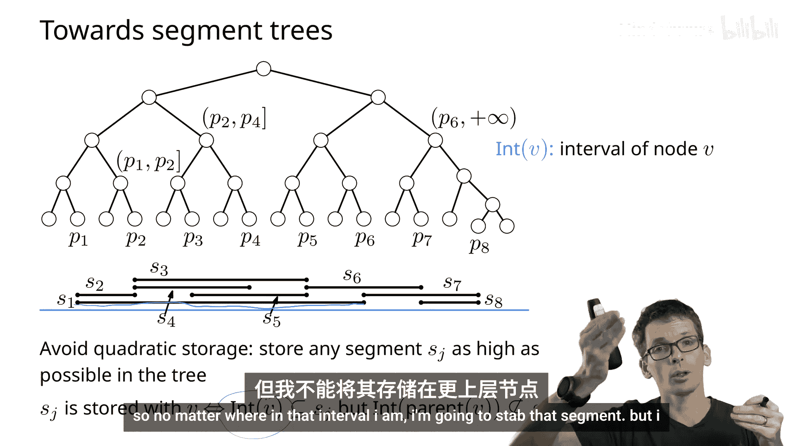

But。I cannot store it further up。 That means I'm cannot store it as the parent， because the parent。

 the interval of the parent is not。

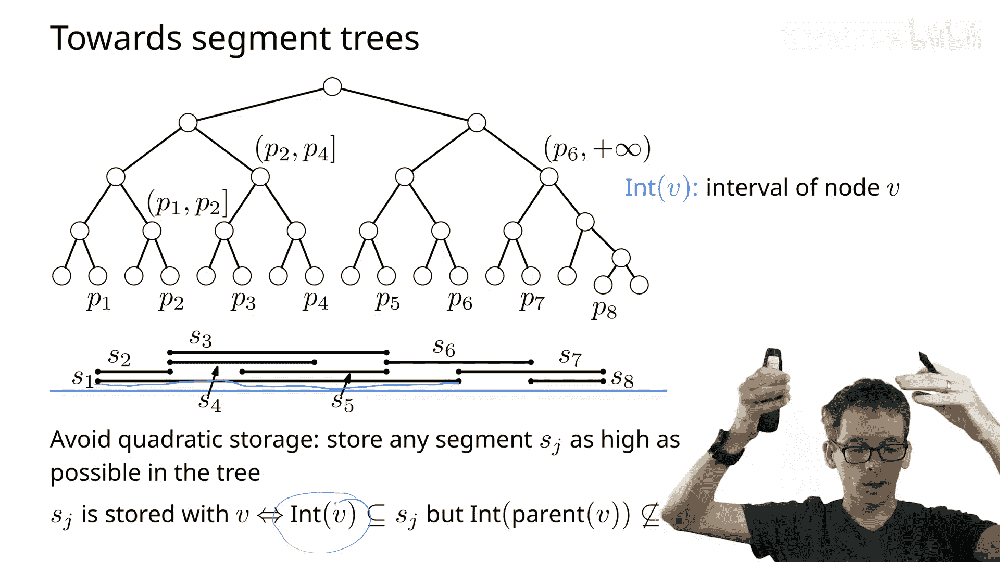

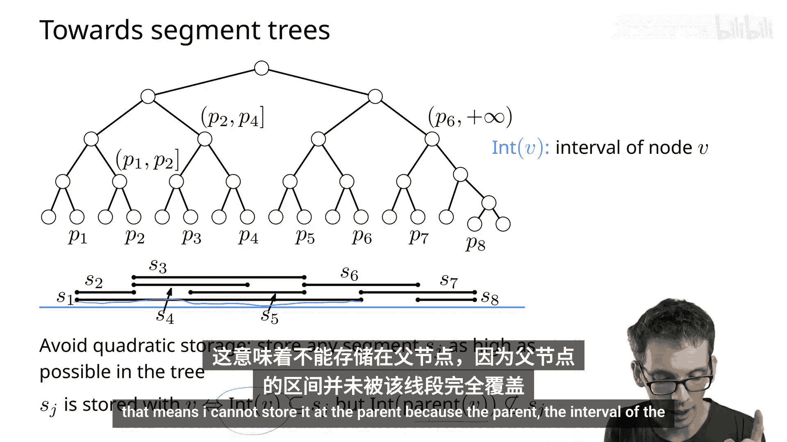

Completely covered by the same。

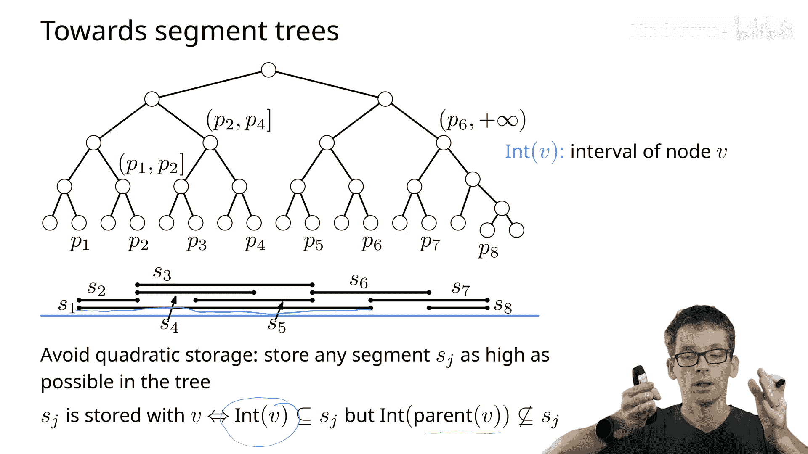

And， of course， this can be true。 So given a segment， this can be true for many nodes in the tree。

 and we have to see how many that actually is。 But let's first have an example。

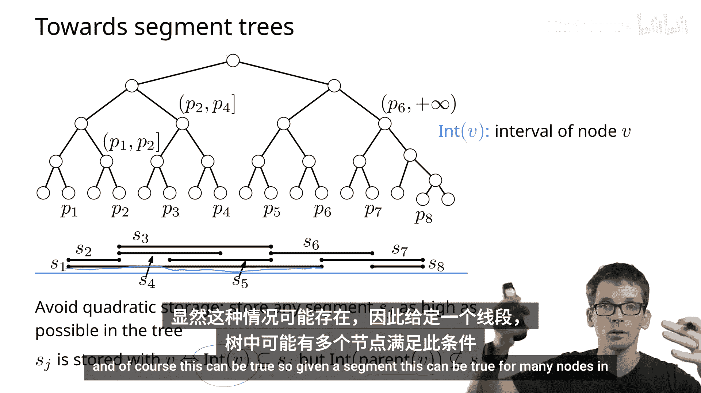

So let's say I'm looking at。Yes， Jay。Now， S J completely covers。The intervalvert from P。To P plus 2。

And that is the interval corresponding to this node。 And that's why I could store at that node if。😊。

The intervalvene does not cover also the parent。 So the parent here is this node。

 The intervalvert of that parent， which includes things from that subweet over here goes。

Over up to Pi -2。 So SJ does not cover this completely。 Otherwise it would have to be that long。

 So I cannot store S J here。 so that's not possible。 So I'm going to store at this node。

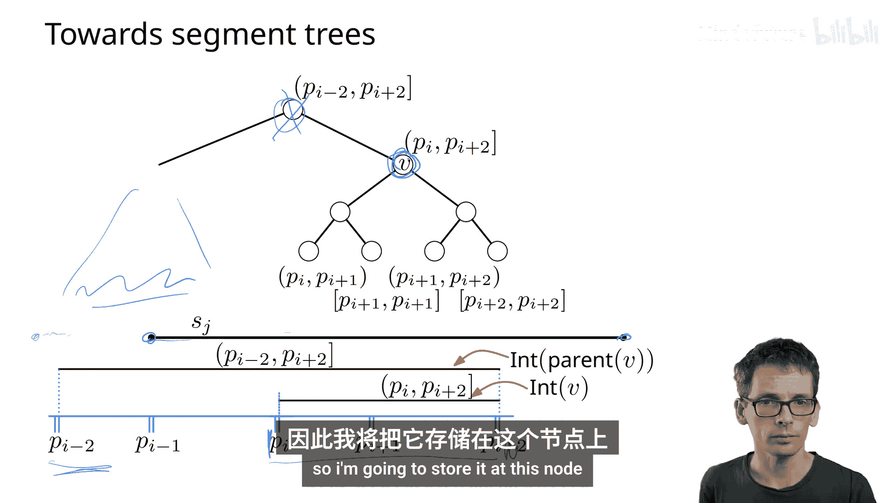

And now we can define what a segment tree is， namely a segment tree is simply a balanced binary search tree。

😊，On the elementary intervalverse。And so for every node I look at。😊，The elementary intervals。

I look at all segments that cover all of those interval elementary intervals and those I'm going to store at that note。

 so the canononica subset。Our node is a subset of segments such that the interval is completely covered。

 but。If I would go to the parent of that node， that the interval of that parent is not completely covered by that segment。

And again， S1， if I look at S1， it is stored at all of these nodes。 And the reason is that here。

 if I would go to the parent。 I mean， this parent includes infinity also。

 S1 does not cover everything down to or minus infinity down to minus infinity， same here， same here。

And here， actually， then。Again， this one also includes up to infinity。

 so also that parent will not be covered by that thing。

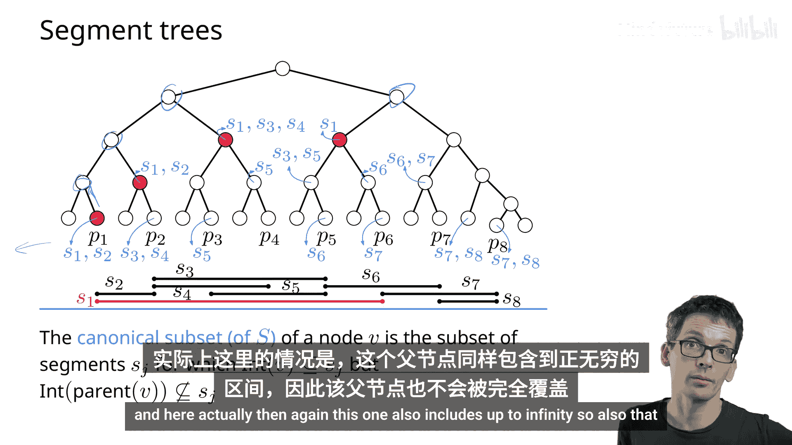

Okay， and that also already answers the following question。

 why don't I store any segments on the leftmost and rightmost parts as we see？

I I didn't indicate any segments here， and the reason is that here I include my infinity and infinity。

And now with this data structures， queries are actually super simple。😊，Because if I want to。

 if I query with a point somewhere， I will simply search for a point in the tree。

 and while I'm doing the search， I'm kind of collecting intervals by collecting I'm collecting segments and all of those segments are intersected by that point。

So for our query point Q， we follow the path。😊，2。The leaves are correspondpons to the elementary interval that contains that point。

 and we report all segments that we see on the way to。When we visit a node。

 we don't have to do anything complicated anymore， we can just report all of those things。

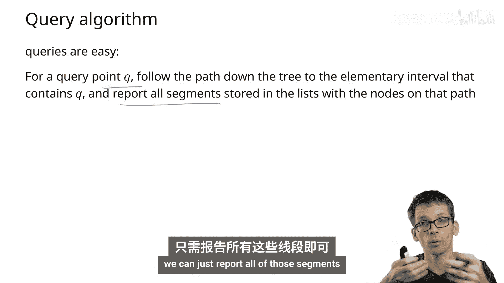

Here's an example。If I'm searching for that point， this is my path。

 I pick up all the segments on the way as 1 S 3 S 5。 And as you see， as one。S 5， F3。

 those are also the ones that areected。 Second example。I'm searching for this point here。

Why going down， I pick up all of the segments that are stored at the node， and in this case。

 it would be S1， S2， S3 and S4。So what is the query time？The query just goes through lock n node。

 so I will spend order lock n time to go down that path。

 and then for each node I report the segments。That are stored there。

 that I can simply do then in constant time per segment。Report it。

 so I will get a query time of order log n plus K。Now we did all of this to improve the storage。

 So how bad can the storage actually get？For that。Before answering that question。

 let's make the following observation。

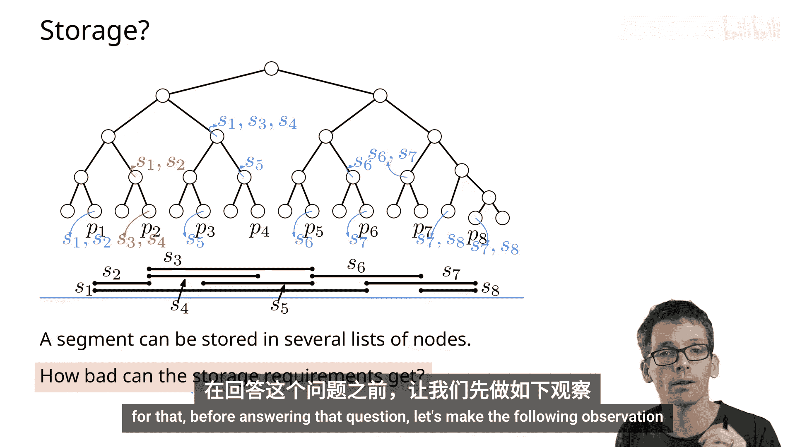

Let's assume。This is one level of my tree of my binary search tree。And each of these notes stores。

So each of the three nodes。Sttors a certain segment。Now this。Actually leads to a contradiction。

 because if you look at the middle of these nodes。 So V2， in this case。

 and if you look at the parent of V 2。So actually， it has to be to the left of V1 and to the right of V3。

Being to the left of V1 means that this endpoint of the segment is definitely still left of you。

And being to the right of V3 means that this right endpoint of the segment is definitely still to the right of you。

 meaning that segment includes also the parent node completely meaning。

That there's no reason to store SiI here。Because I could have started at the。

And this leads to the following observation per level that most two nodes storing a given segment。

Now， back to a question， how bad can the storage get？Linear order n log n or order n squared。

The correct answer is order M log N。 So why is that the case。Because。I'm storing every segment。

Per lever at most two times。I have log N levels。So every segment can be stored at most two times log n times。

So every segment two times n is still order log n， so every segment is stored at most order log n times。

I have n segments， so this adds up to overall storing n。😊，Ls of length， and。落嘅。

The tree main tree is such the binary search tree， I mean it's a binary search tree it has linear space。

 so the overall storage is dominated by these lists。😊，Which overall。

 because every segment might be stored lock n times。Have。😔，Total length， order and log n。

And that's what we get in terms of storage。Okay， so what do we have so far。

 so far we solved this 1 d problem of interval stabbing now with segmentaries and what we've seen is that we needed n log n storage。

 we could do queries and order log n plus K time。 This can be constructed in order n log n time。

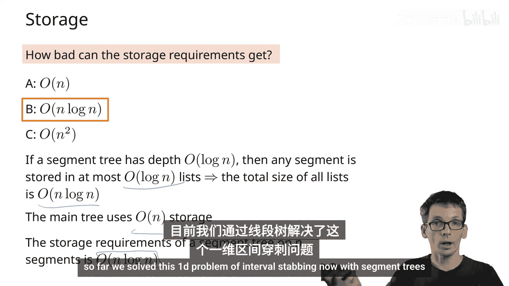

And。The nice thing now is that the queries are very simple because for any query。😊。

I can simply report everything。That is in the nodes that are in the search path of that query point。

So now we solved this  one knee problem again。Actually， we solved it less efficiently。Then。

Interral trees， because interval trees didn't need this login factor， we do need this。

But the reason we did this is because this now allows us to solve。

The problem of window inquiries was arbitrary on intersecting line segments。

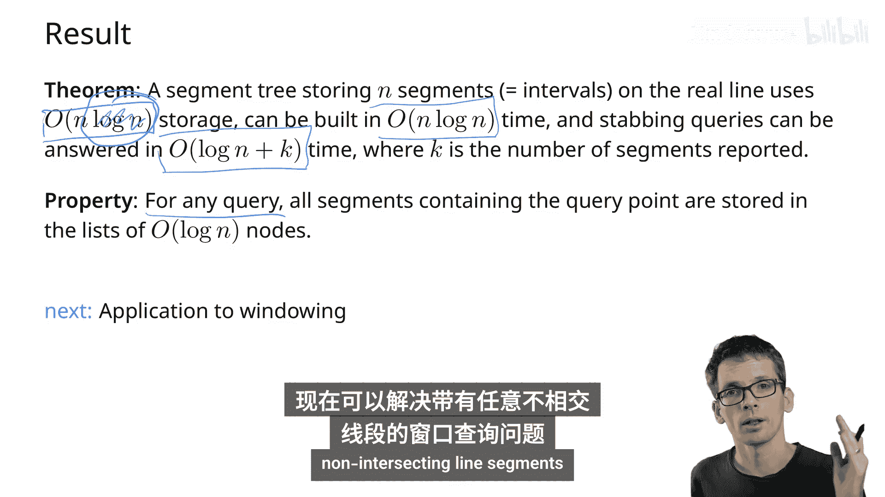

And that's what we're going to do next。 So what's the problem that we're looking at？

We have arbitr oriented non crossing line segments。 those are the black segments here。

 we want to solve a window inquiry with。An axis aligned rectangle。

And this we can solve by first finding everything that is completely。In。😡。

The rectangle and then finding everything that intersects the boundary of my query rectangle。

 and this can be reduced to the following problem。I have this input I'm carrying with a vertical segment。

 I want to report everything that intersects this vertical segment。

 and then we can do the same with horizontal segment。And 비달。And。In preparation。

 what we've seen are segmentaries。So the main data structure here will be segmentaries。

 and then we just have to think about what do we use as associated data structure。

 So that's our setting here。

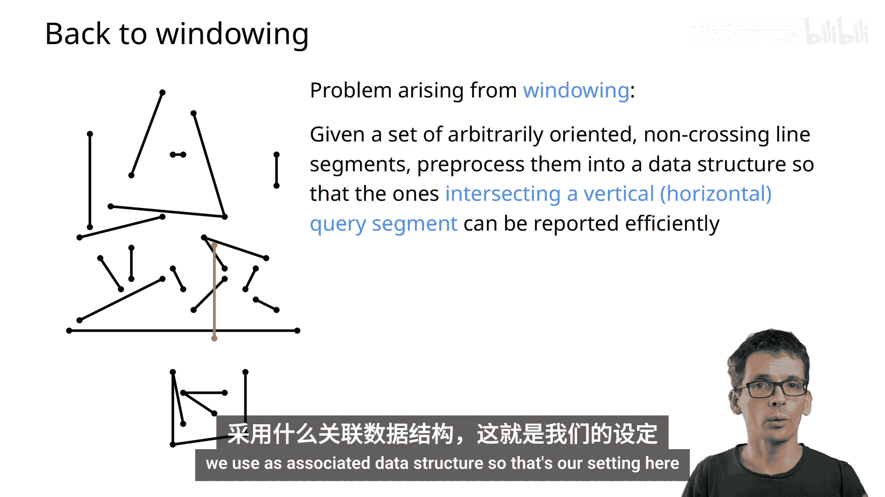

We have。segmentsegments。2D segments。Now， we。Essentially project them into 1 D space and build a 1 D segment3。

Or stated differently， we built a 1D segmentary。On the x coordinate of the segments。And now。

 we need to。Think about what do we what can we use as associated。Data structure。So。

If you think of what we get from this 1D space， in terms of elementary interval that kind of looks like this。

 where the space is split into these vertical slabs。

What does it mean that I'm storing a segment at a certain note。

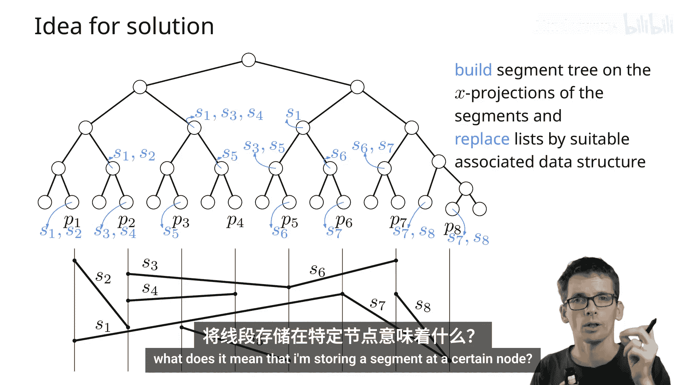

So a note now corresponds to a vertical slab。So I have a node。

 let's say average is node V and let's say this is。This is its vertical sb。Then at that node。

 I store all。😊，Segment。That。Completely cover that slab and that cannot be stored further up in my tree。

So for example， this SJ here。Andm。That does not cover this interval completely。

 So that wouldn't be stored here。 That would be stored。啊三。Noed further down the tree。But here。

 for instance， let's have a look at at the setting here if you look。Had。This note here。

And this node corresponds。To this range here。Then what I'm storing here are exactly the segments that completely cover this range。

So that S 3， S 4， S1， they completely go。From here to here。 And I cannot store them first up。

 So here I cannot store them here because this includes something that。

None of these is completely covered。Just to illustrate that also here， so S5 for instance。

 does not cover this interval completely， so it's not stored at that node it will be stored somewhere further down。

As you see in this example。What does that mean， It means that if I look at the nodes at the segments start at that node。

Then， there is a where defined。Why order on them， Because I completely cover that。

So they completely cover that vertical slab and they cut my vertical slab into pieces。

So one piece here here ands on， and between these segments on that vertical slab。

 I have a well defined wire order。This I can now make use of in the following way if I now have a query segment。

😊。

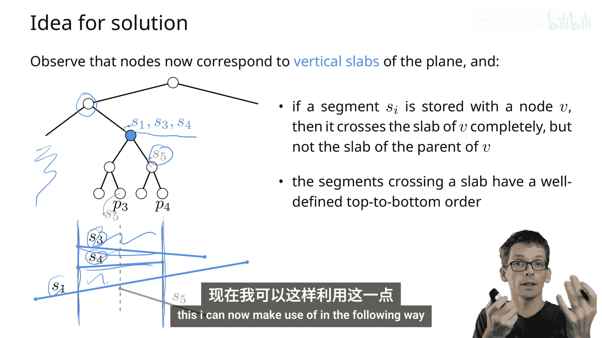

And let's say that query segment。😊，I'm going down my segment3。 So for any note that I'm visiting。

 I get a vertical slab that contains。😊。

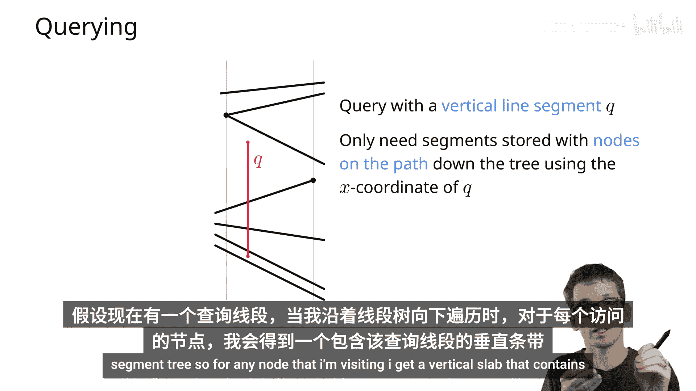

This query segment。😊，So I know my query segment is in this vertical slab。😊，Now。

 I want to find the segments that I intersected because I have a well defined。

W order to find the segments that are intersected， What I can do is now I build on this。Sap。

And all the segments that completely cover the slab or the canonical ones to be more precise。

Appine research。As this binary we searched tree。Which， I mean。

 a binary research tree is also a 1 d range tree。Now。

 this binary search tree will allow me to find everything。That isn't dissected。By thisす。

And I'm using this simply like like I use a 10 range tree， I search for this point。

I searched for that point， I report port。Everything in between。Okay， so far so good。

That solves our problem。Main data structure segment3， associated data structures。

Bine research trees or state differently runy range trees。Now， if you look at this combination。off。

Segmentry and binary such tree。What is a query time。That， I overall get。Is it aura。L n plus k。

 or is it or a log squared n plus k。Keep in mind I was asking about the overall query time。

And that is log square and Pasque。 So within each of these。Trees。TheSo I have 1 d range3。

 so within each of these the query time is order lock n。Plus k。But then in my segmentary。

 I'm visiting lock N。Not， so I'm visiting or I'm query lock n of those trees。So this is this log n。

 So I am might applying log n with log n。

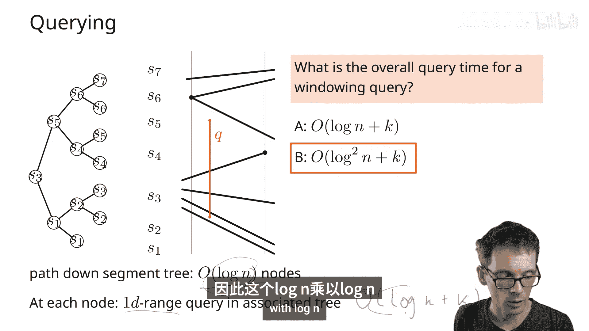

And then plus reporting。 So to sum up what our data structure is。As data structure for querying。

Line segments， arbitrary line segments non crossing with a vertical query segment。

 we use a segment tree as main data structure， binary we search trees or state differently 1 d range trees as associated data structures。

In the associated data structures I use a bottom to top order in the main data structure I use X order。

 and this will give me a query time of log squared n plus k。And the storage。

Remains order n log so order n log n is a storage of a segment tree in a segment tree as such in a 1D segmentary I was simply storing with every node a bunch of intervals now instead I'm storing a binary search tree but as the binary search tree also as linear storage so that will not change my storage and overall it remains order in log n。

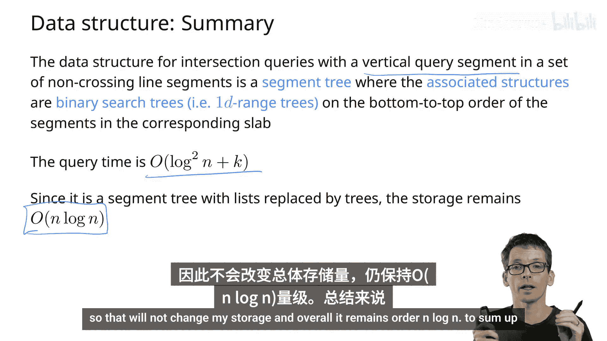

To三。U。This result。 So if I have non crossing line segments。

 I can build this data structure auto in log in space and。L square n plus K query time。

 And if I now applies this to window in queries， then I have to combine build this for vertical segments。

 I will have to build this for horizontal segments。

 I will have to build a range tree to find the segments that are completely within my range and all of this。

😊，Each of these data structures only requires auto inin storage。Each of these data structures。Oh。

 let's say。The worst， the dominating term here is log squared n plus K。And that is the same。

My over oil query time for window inquiries。To sum up。They complete。嗯。

Lecture about range searching and window inquiry searching here。 you have a big overview of。

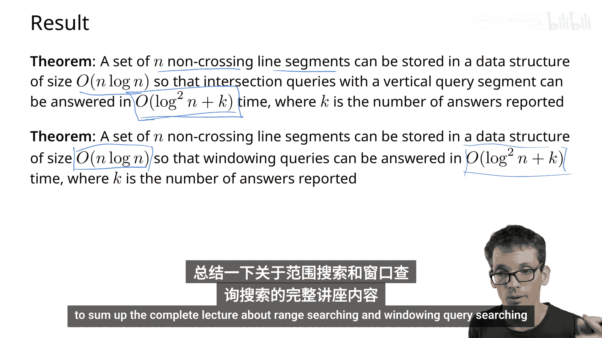

Wnge searching data structures， then interval star data structures， then。

Data structures that solve parts of windowing queries and then windowing query data structures。

And if you now want to kind of build your own data structure， it's useful to kind of look at， okay。

 what， what are my objects， What's the query I want to achieve。

 And then you can piece these things together to get your query time， storage requirements。

 pre processing。 So in particular。What you very often will need to do is combine these data structures。

 So think about， okay， if I use this as a main data structure， this is associated data structure。

 Does that solve my problem。 And then based on this combination。

 what do I get in terms of query time， storage and prepro。 And that's all for today。

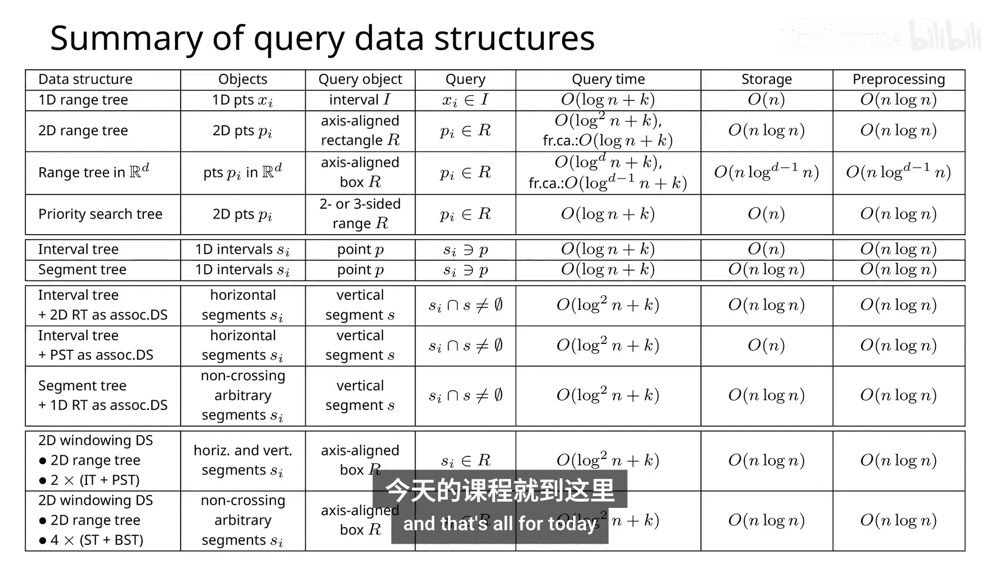