# 【Algorithms Lab】计算几何 ｜ Computational Geometry p21 P22_四叉树_平衡四叉树_和网格化 -BV1Jtn7zSEXD_p21-

Today we'll talk about a new data structure called quadries and its application to Meshing let's start as usual with an application here we have an image of a circuit board and a distribution of heat emission when this board is some under stress。

From engineering point of view， it would be very useful to simulate such a heat emission map given a design of a circuit board before actually producing it。

To simulate such a heat emission map， we can use finite element method。

We can use the finite element method by partitioning the board into small pieces and estimating the distribution of heat within each piece using some numerical methods。

 a finer mesh will lead to better approximation and a coarser mesh will lead to faster computation。

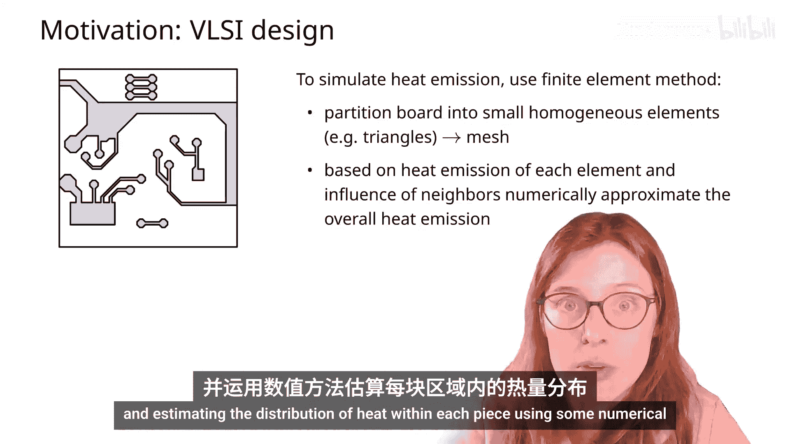

Finally， if the mesh pieces or elements are compact。

 that will lead to faster convergence of numerical methods。

So the goal for today will be to develop methods of building a mesh given the design of， for example。

 a circuit board。We will want to build a non-uniform mesh which will be finer close to the boundaries of the objects of our interest。

 and it will be coarser far away from the boundaries so that we can save on computation time and we want the mesh to consist of wellshaped elements in this particular case we will be working with triangles。

The triangles should not be too thin so that we can get a reasonable convergence time。

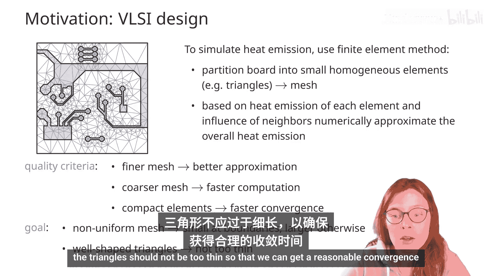

Let's formalize the problem that we will consider today。

We will restrict our consideration to objects that can be described with boundaries consisting of segments of limited number of orientations in particular we will consider alinear polygons and we will assume that their vertices are given with integer coordinates and the polygons are placed in a square of a large enough site in particular we will take the site of the square to be some power of two。

Our goal will be to construct a triangular mesh on this input with the following properties。First。

 the mass should be conforming。You need to adjacent triangles。

 need to share the whole edge between them。The example in the figure is a nonconforming mesh because。

 for example， this triangle。And it's adjacent triangle。On top。

 do not share the whole edge between them， they are only sharing part of their site。Secondly。

 the mesh should respect the input that means that the edges of the triangles that we get should not intersect the edges of the polygons。

And finally we want the mesh to be well shaped， we will restrict the angles of the triangles to be between 45 degrees and 90 degrees。

And finally， we are interested in constructing a non uniform mesh that has smaller triangles closer to the polygons and larger triangles further away from the boundaries of the polygons。

A uniform mesh will simply have too many triangles to make computation efficient。

Let's discuss the following question to achieve our goal。

 do we need to introduce time points in our construction。

 meaning that do we need to create new vertices of the mesh？

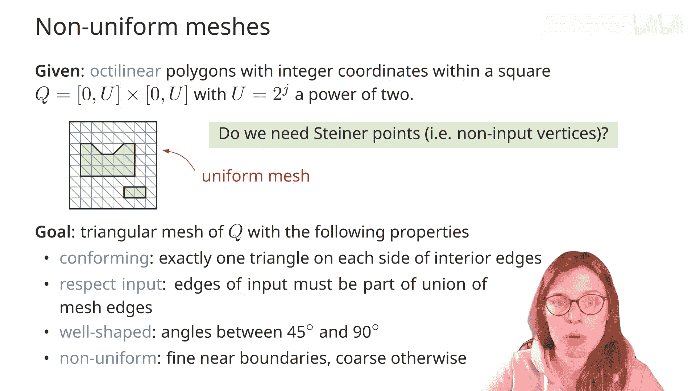

Let's start with the well shaped property and let's consider the following task。

 given the input we will want to find a triangulation that maximizes the smallest angle。

So please solve the following exercises we're given an input polygon within a square and we want to find a mesh that does not use Ster points。

 meaning that we want to triangulate the interior and the exterior of the polygon here such that the smallest angle is maximized have you constructed a triangulation that looks something like this。

Even though we try to maximize the smallest angles。

 still we have some triangles with pretty small angles here。

 so indeed without introducing Steer points or new vertices。

 we cannot guarantee that triangles will have nice shape。Without standard points。

 our triangles may have very small angles， but with standard points we can get a very nice well shaped mesh。

 Furthermoremore， we can even get a well shaped and non uniform mesh。

Here compare the uniform mesh on the left versus non uniform mesh on the right。

 where on the left we have more than 500 triangles， and on the right we only have 52 triangles。

As you can see here on the right， the closer we are to the boundary of the polygon。

 the smaller the triangles get。

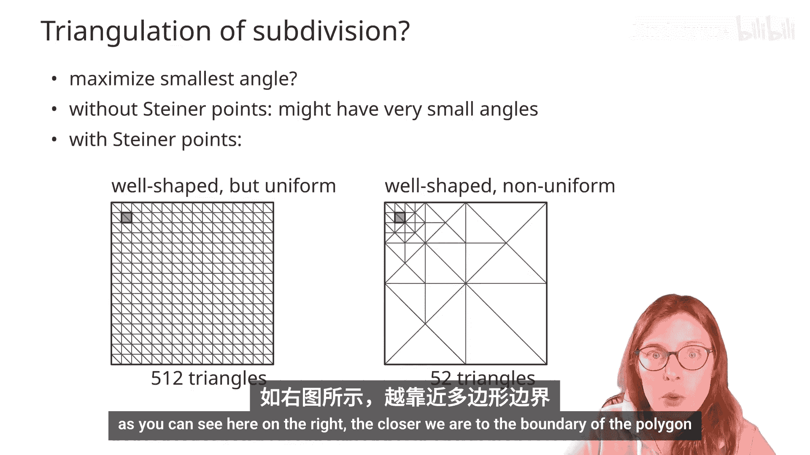

For our method of constructing nice meshes we will use quad trees quad trees can not only be applied to mesh but also to a variety of different applications。

 for example， in maps they are used to smoothly navigate between different zoom levels。

You can explore how Google Maps uses quad trees by following the link below to the map Tr。

So let's define this very useful data structure。To build a qua tree on a square。

 we will iteratively partition the square into smaller and smaller squares。

And a corresponding quad tree will be a rooted tree in which every interior node will have four children corresponding to the four quadrants that we get when we split a square into four pieces。

Every node in the tree will correspond to a square in the partition。

The parents will correspond to larger squares and the children in the tree will correspond to the smaller squares。

When we will be talking about the partitioning of the square。

 we will use the terminology of subdivision， we will have edges。

 vertices and faces of the subdivision， but we will also talk about sites。

 when we will be talking about the boundaries of the squares and we will learn to traverse the partition by moving between neighboring squares。

 note that the squares can be neighbors even though in the tree the corresponding nodes will lie at different levels。

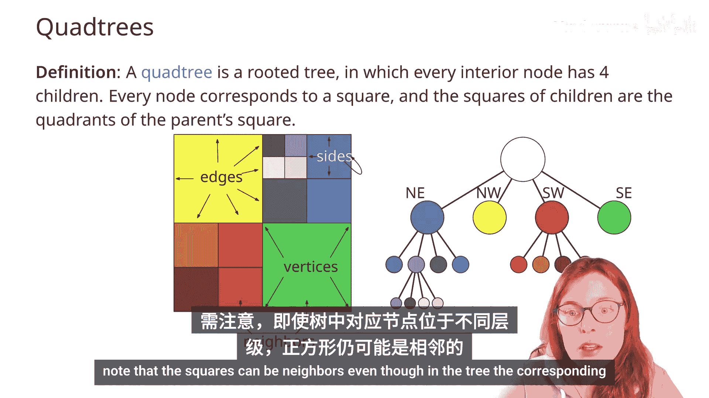

Formerally， for a point set P in a square Q， the quad tree can be defined with the following recursive definition。

 if the set P consists of one point or is empty， then the quad tree corresponding to the square is a leaf storing that point set either one point or zero point。

And if the point set consists of more than one point。

 then we will partition it into four smaller squares The quad tree in this case is a root with four children corresponding to the four smaller squares which we will denote corresponding to the directions northeast west and south the point set will be partitioned by these squares into four subsets。

 For example， all the points of set P that lie inside the northeastern square will go into the set P northeast。

Note that by definition， if a point lies exactly on the boundary between two squares。

 then it will be assigned to the left square or to the bottom square。

Let's build a qua tree for this example。We start with a square that has more than one point in it。

So the quadric corresponding to this point set will be a root with four children where each child will be a smaller square。

Now two of the squares are empty and thus by definition there will be the leaves in the tree。

 but the other two squares again have more than one point each and they will be partitioned further。

 so we will make the corresponding notes in the tree parents each having four children。

On the northeast each square now has either zero or exactly one point。

 so all the smaller squares will correspond to a leaf， on the other hand on the southwest。

 we have three squares with zero or one point in them which will correspond to a leaf。

 but there is one square that needs to be subdivided further。

And that the corresponding node in the tree will get four children。

We will repeat this process until each of the smaller squares has exactly zero or one point。

So the tree on the right is a qua tree corresponding to the point set and the square subdivision on the left。

Please find this exercise in the following page and construct a quad tree for the given point set remember by definition if a point falls on the boundary between two squared。

 then it will be assigned to the left or bottom squareoo here。

Have you obtained this part of the square and the tree。If yes， great job， if not。

 compare your solution to the one that you see on the screen。

The recursive definition of the quad tree that we introduced in the previous video directly leads to an algorithm for constructing a quad tree。

Let's develop some properties of quad tree and we will start with considering the depth of a quad tree。

Let's consider the following question， if we know that a quad tree has n node， what can be its depth？

We can prove the following lemma if parameter C denotes the smallest distance between a pair of points on which we build the quad tree。

 and s is the size of the original square， then the depth of a quad tree built on that point set for that square is at most log of s over C plus 3/ hs。

The proof of thelemma is the following， we start with a square of size s。

And let's assume that it has some level I， meaning that its depth is higher than I。

If there is a square at level I， its side length will be s divided by 2 to the I。

Right at the zero level， the length of this square is s。

 so this corresponds to s divided by2 to the power of zero。At the first level of the tree。

 we split the square into four， so the side of each square is s over 2 at each next level we subdivide the squares into four。

 meaning that we reduce the side of the square by 2。Now， within a square at depth I。

 if there are two points， the maximum distance between these two points can be at most square root of two times the side of the square。

So if the depth of this square with two points in it is I。

 the distance between the two points in the square needs to be at least c by the assumption of dilemma。

 and that means that the diagonal of the square needs to be greater or equal to C。

If we solve this inequality for I， we get that I is at most logarithm of s over C plus12。

And because the assumption was that this was an internal node with a square with two points in it。

 the height of the quad tree will be at most logarithm of s over C plus3/ hals， so one more。

Now we know how to limit the depth of the tree， if D is the depth of the resulting quad tree that is built on a point set consisting of end points。

 then it will have big O D plus1 times n nodes and can be constructed in the same big O D plus1 times n time。

The proof of this is the following note that we can find the relation between the number of leaves in the quad tree and the number of inner nodes。

Because when we are splitting a square， we are replacing a leaf with an inner node and four new leaves。

 that means that we are adding one inner node and three leaves。

 so we get the relation that the number of leaves in the tree will be one plus three times the number of inner nodes。

And because all inner nodes correspond to squares that needed to be split。

 meaning those squares contained at least two points each， then at each level of the tree。

 we can have at most and squares corresponding to inner nodes。From these two observations。

 we can conclude that if D is the depth of the resulting quad3。

 then we will have the order of D plus1 times n nodes in total。

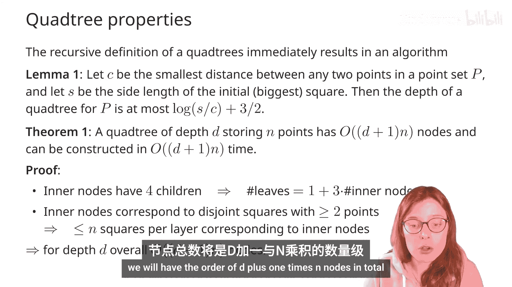

Let's now discuss how to traverse the quadri subdivision， given a node V in the quad tree。

 we will see how to find its neighbors we will do this on the example of finding the North neighbor。

Consider the sew code， given the note V of the quad3 T。

We will find the deepest node v prime at the same level as v or higher than V so that the square corresponding to v prime is the north neighbor of the square corresponding to node V。

The algorithm is the following， we check if V is the root of the tree。

 then the root has no north neighbor and we return null。

 otherwise let pi be the parent of V in the tree。Now。

 if we is the southwestern or southeastern child of that parent pie。

 then we simply return the northwestern or correspondingly northeastern child of that parent pie that is。

If this is the parent pie。And the node V。Corresponded to Southwestern square。

 then we simply need to return the Northwestern child of P。And similarly。

 if we correspond to southeastern child of P， then we simply need to return the Northeastern child of PI。

On the other hand， if we was not the Southwestern or southeastern child of Pi。

As presented here in the example， this is the。Square pi。

Then we recursively find the north neighbor of the parent pie。

Here this will be the North neighbor mu of the node pi。If mu does not exist， if it returns no。

 or if mu is a leaf itself， then we simply return mu。

 or else depending on whether V was northwestern or northeastern child of pi。

 we return southwestern or southeastern child of mu。

The following theorem shows the analysis of the running time of this algorithm。

If our quad tree has depth G， then a neighbor in any direction of a node V can be found in big O D plus one time。

To prove this theorem， we can observe that the depth of the recursion is order D plus one。

 we are only moving up the tree when calling the recursion and the cost per each recursive step is constant。

Thus indeed， the running time of traversing the quadri subdivision by moving between neighbors can be done in order of the depth of the quad tree。

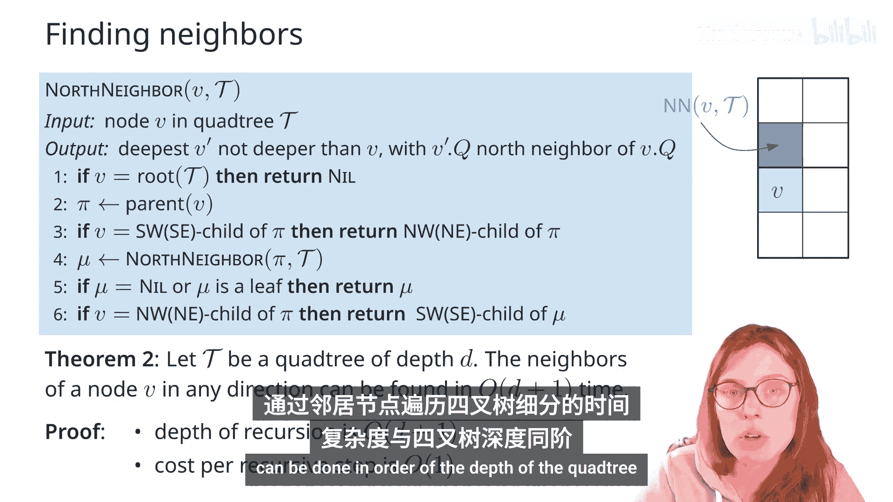

A qua tree is called balance， if any two node corresponding to neighboring squares differ by most one in depth。

This is an example of an unbalanced quad tree， we see that there are two neighboring squares。

Whose corresponding notes will lie adapt further apart than one？To make this quad tree ball。

 we can subdivide some of the squares until all neighboring squares differ in size by u most two。

 meaning that their corresponding node lie in neighboring levels of the tree。

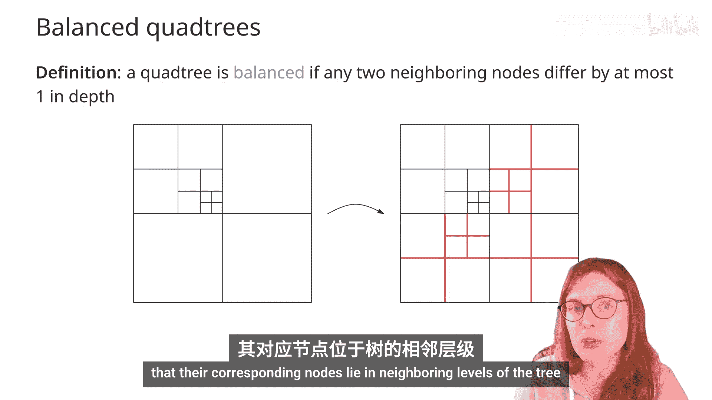

Consider the following algorithm to balance a quad tree。The input is a quad3 T。

 and the output is a balanced quad3 T。We define a list L and put all the leaves of the tree in it while this list is not empty。

 we do the following， we take any leaf from L。If this leaf is too large。

 then we partition it into four quadrants and add four leaves to the tree。

 and we insert the four new leaves into L。After that。

 if any neighbors of the old square are too large， then we also insert them into L。

So we repeat this operation of subdividing the leaves until this list L is empty。When we are done。

 we return the balanced quad treat T。

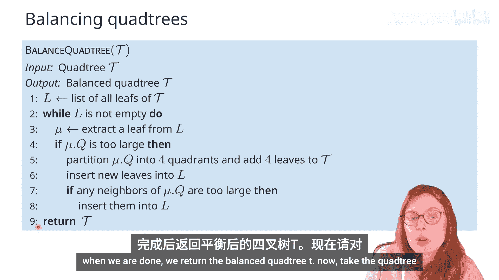

Now take the quadtry that you built in the previous exercise and balance it。

This is what you should have gotten as a result。

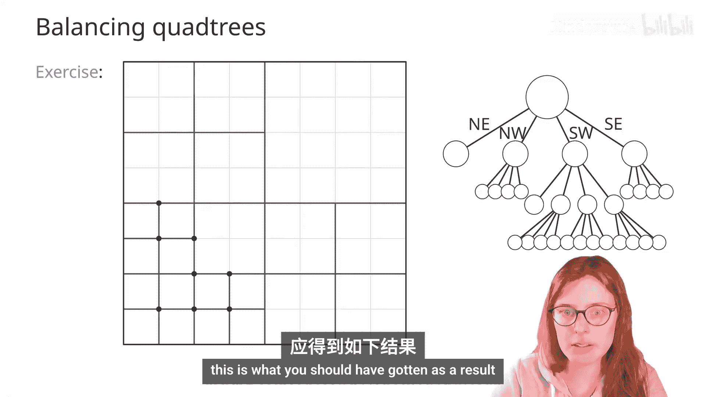

Going back to the algorithm。How exactly are we deciding if a square is too large and if it needs to be subdivided？

Or if the neighbors of a square are too large and they needed to be added to the list to consider it later。

Well， if the node of the tree are in the same level or into adjacent levels。

 then their corresponding squares differ in size by at most two， but if the nodes lie further apart。

 not in the neighboring levels， then as we mentioned earlier。

 they corresponding squares will differ in their size by more than factor of two。

 and this is exactly how we will determine if a square andq is too large。

 if it has a neighbor of the size smaller than Q by more than a factor of two。

 and similarly if any of the neighbors after subdividing Q into four quadrants are too large。

 meaning any of the new squares are too small compared to the size of the older squares。

We will add them to the list L。How many squares can we add by this balancing operation。

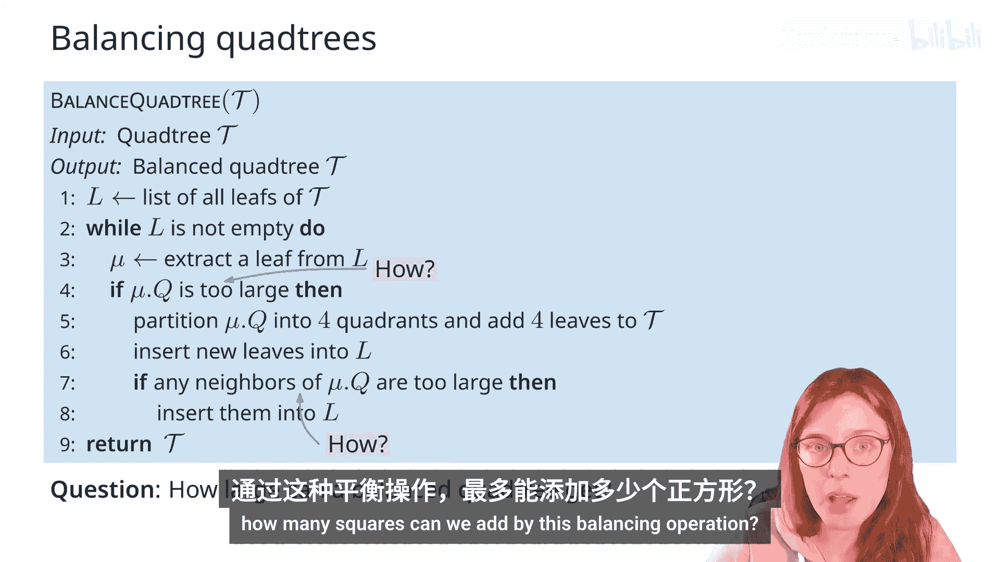

Well， in fact， we will show that given a quad tree with M nodes。

 we can balance it and obtain a balanced quad tree that will have an order of M nodes and it can be constructed in order D plus1 times M time where D is the depth of the original tree。

To prove this， we are going to make the following observation。

While balancing the quad3 T will split its squares at most 8 m times。 Why is that。

We will base our analysis on considering the old versus new squares。

 the old squares are the squares of the original quadri T and the new squares are the squares that we have introduced during the balancing operation。

Consider a square sigma that gets split in the balancing operation。

 We will consider its eight neighbors。 So the squares that lie on the same level or above。

We will claim that if Sigma had to be split， one of its eight neighbors will be an old square。

 meaning the square that existed in the original quadre。We will prove this claim by contradiction。

 assume that there are square sigma that are split that do not have old neighbors。

 all their neighbors are new。Then we will consider the smallest such sigma。

Among all of the sigmas that violate this assumption that one of their eight neighbors is old。

 we will take the smallest sigma。And derive to a contradiction by finding that there must have been even smaller signal with this property。

Assume that sigma is the smallest size square that was split。

With all eight neighbors around it being the new neighbors。

 and let's consider the square sigma prime。Which is the reason for the sigma to get split。

Meaning that sigma prime was split itself into the smaller quadrants and forced sigma to get split。

Because all the eight neighbors surrounding Sigma by assumption are new。

Than the parent of sigma prime is new。 and that sigma prime itself is new。

 All these squares appeared during the balancing process and now observe that these squares surrounding sigma prime。

Are all new。Because they are or they are contained in the squares which are neighbors of Sigma and all these squares are new by assumption。

That means that sigma cannot be the smallest square with all neighbors being new。

 there is an even smaller square sigma prime that has all its neighbors new。Thus。

 our assumption is not correct， and if any square gets split， one of its neighbors must remain old。

That means that we can use a charging argument and charge each split to an old neighbor。

Each old neighbor will get at most eight splits from the neighbors on the same level。

And that means that at most， there can be 8 m splits。And now for the running time of the algorithm。

 when we are performing splits， we are searching among the neighbors of every node considered and this we know can be done in order D plus1 time。

 so if we are performing order M splits， order D plus1 times each。

 the total running time is order of D plus1 times M。Observe that some quad trees can be rather empty。

 They can contain very few points， even though they have a lot of layers。 For example。

 as in the figure。To save the space that is used up here for storing the empty squares。

 we could be using so called compressed quad trees。

What we're doing here is we're compressing the paths that consist of empty nodes。

So this would lead to a linear size data structure。

 We are not going to consider compressed quadries here further though。

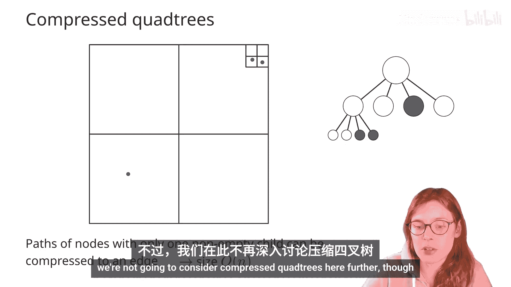

Let's go back to the meshing problem， recall that we are given a set of attilinear polygons with integer coordinates inside a square whose size is some power of two。

 and our goal is to build a triangangleular mesh that is conforming。

 meaning that adjacent triangles share complete edges。The mesh respects the input。

 the edges of these triangles do not intersect the boundaries of the input polygons。

The mesh is well shaped， we want all triangles to have angles 45 degrees or 90 degrees。

And the mesh is non uniform。 We want it to be more fine around the polygons and more coarse。

 the further away from the boundaries of the polygons we get。

We will use quad trees as a base of building such a mesh。

So far we have learned how to build quadries onset of points here the input are polygons。

 what do we need to adapt to make quaries work here？Well。

 let's partition squares until either theyre empty or they're of unit size。

When we reach squares of small size， the polygons because they are ocallinear can intersect a square either going along the diagonal in the interior or they can have a common edge with the square or even a common point for all of these squares we will say that the polygons intersect those squares。

 so a square will be empty， if none of the points of the square belong to the polygons。

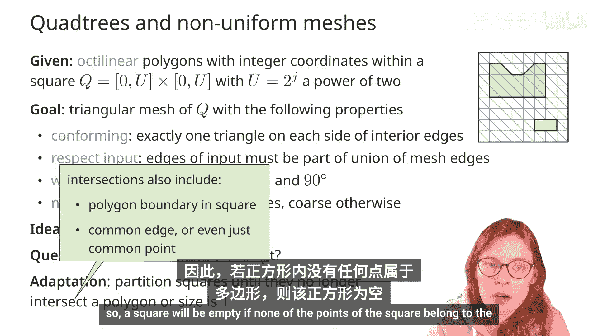

Let's consider this example we are givenoctilinear polygons in the square with integer coordinates。

 we will start by subdividing the square into smaller and smaller squares until we reach either completely empty squares or until we get to unit size squares。

This is the result in quary that we will continue working with。Observe that when we are done。

 if a polygon intersects the interior of a square， then it intersects along one of the diagonals of the square。

Now that we have this quad tree subdivision on top of the polygons。

 how do we get a mesh out of these squares？The first and naive approach would be simply splitting each square along a diagonal。

But then we will obtain a nonconing mesh。 there will be some adjacent triangles that do not completely share the whole edge between them。

Maybe then we can add vertices for each vertex of the square。

 Now we're getting triangles whose angles are too small。

The solution to the question of how to get a valid mesh here is to first balance the quad tree。

 and then we will add Ster points inside the squares if necessary。So first。

 we will balance the quad tree。And then we will either split these squares along the diagonals。

Or if a square has adjacent smaller squares， we will add a thinner vertex in the middle of the face and connect it to all the vertices of the adjacent squares。

 like here in the figure below。

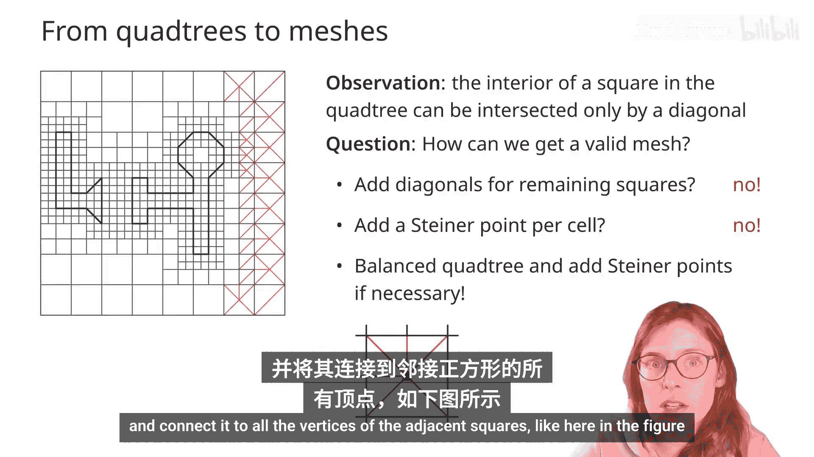

Let's formalize this algorithm in the following pseudocode。

We start with a balanced quad3 T and the corresponding quad tree subdivision of the square Q。

And we will output a triangulation of T。We start with a doubly connected elist representation of the quadri subdivision and for each phase of it。

 if it is a unit square and its interior is intersected by one of the polygons。

 recall that this polygon will intersect the square along its diagonal。

 then we'll add this diagonal to a corresponding triangulation。

And if a square is not intersected along a diagonal by a polygon。

 then let's consider the vertices of the adjacent squares。

If they don't split any of the squares edges， then we'll simply add a diagonal。

And otherwise we'll add a Ste point in the middle of the face and connect it to all the vertices of the square and also to the midpoints of the sides that are split by a vertex of adjacent squares。

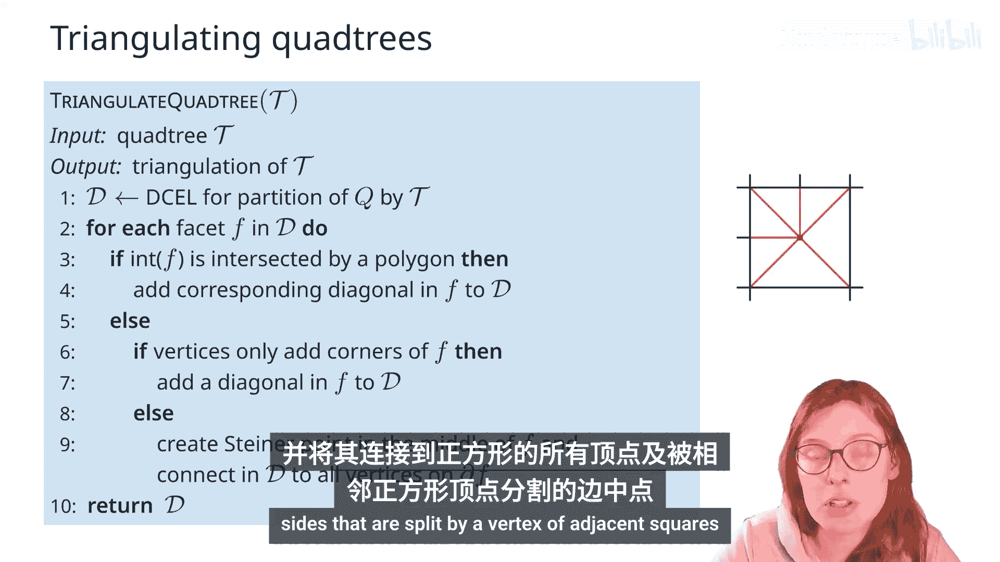

Finally， the algorithm to create a mesh starting with a set of octlinear polygons in the square with integer coordinates。

We do the following。 First， we create a qua tree on the input。

We balanced this quad tree and finally we triangangleulate the balanced quad tree。

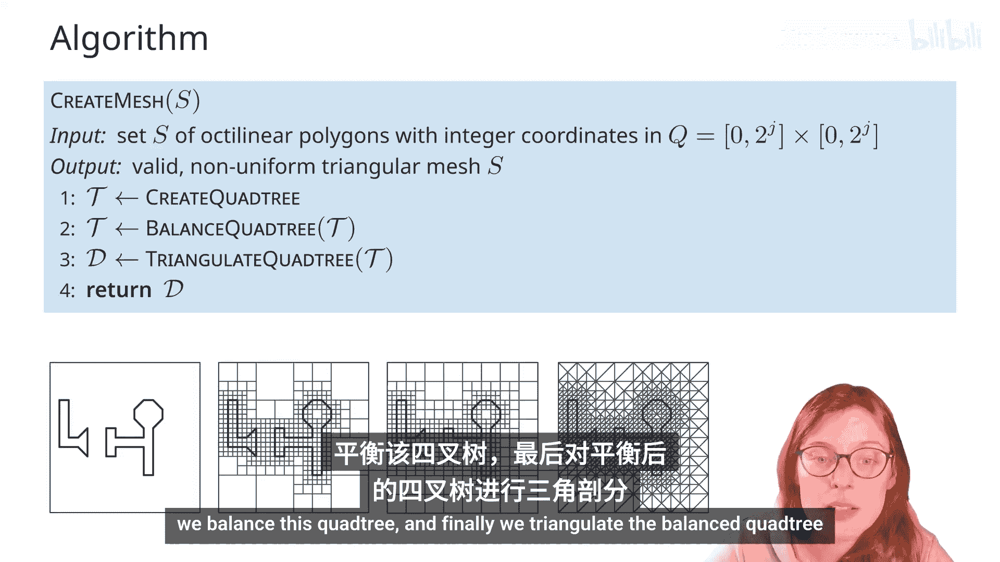

Build a quiet tree for this input polygon in the square。Balance it and then build a triangulation。

Compare your solution to the one in the screen。To summarize our meshing approach。

 we conclude with the following theorem， given a set of digital polygonal objects in a square of size U on a squared grid。

We can build a nonunformed triangular mesh on these set of objects that will be conforming well shaped and will respect the input the number of triangles inside a mesh will be of order P of S log of U where P of S is the total perimeter of all the objects and the mesh can be constructed in order of P of S time log squared U time。

To prove the theor first， we analyze the size of the mesh。

We'll start by counting the number of units squares that intersect the boundary of the polygons。

We observe that each unit of the perimeter of a polygonal object is adjacent to only a constant number of unit squares。

That means that the number of units squares intersected by the polygonal objects is proportion to the perimeter of these objects。

 but the same would be true for a coarser grid at any level of the qua tree。

 so because the depth of the qua tree is logarithmic in the size of the original square u。

 we get that the size of the qua tree is proportional to the perimeter of the polygons times the log of U。

This gives us the number of triangles in the final mesh。And for the construction time。

 building a quad tree takes linear time in the size of the quad tree。

 the balancing procedure adds an extra log factor to the running time。

And the final triangulation step can be done in time linear in the size of the quad tree。

This gives us a mesh with the number of triangles of order of p of s times log of U。

 and it can be constructed in time of order p of S times log squared of U。

We conclude today's topic of quad trees and meshing with some discussion questions First。

 they mentioned earlier compressed quad trees can there be computed and updated efficiently In fact。

 yes， those will be called skip quad trees they will have linear complexity and will support the update and search operations in logarithmic time。

 refer to the cited paper for further details。Today。

 we've mentioned two applications for using quadries。 Are there any other applications。Well。

 as mentioned earlier， quadries are really widely applicable and they find their used in the range of applications from computer graphics to JS systems。

 and even in geometric algorithms， they are often used to build approximation algorithms。Finally。

 our standard question， can this be generalized to higher dimensions。And indeed。

 quad trees are very easy to generalize to higher dimensions in three dimensions。

 they would be calledoct trees， because now each cube will be subdivided into eight smaller cubes。

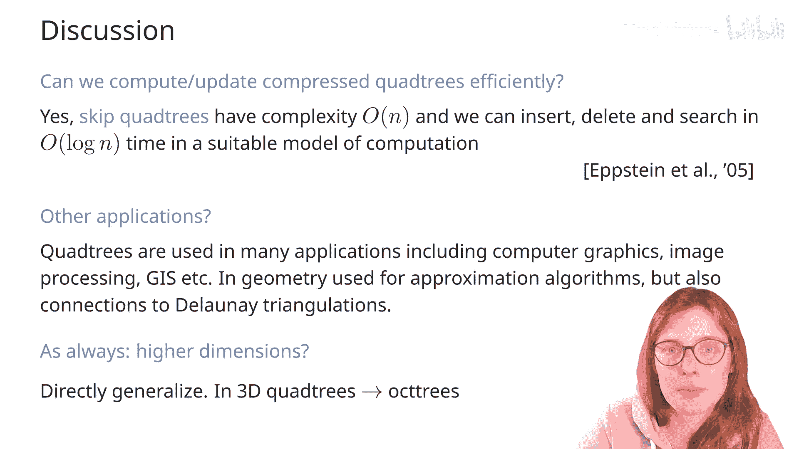