# 【Algorithms Lab】计算几何 ｜ Computational Geometry p22 P23_几何算法-超越理论 -BV1Jtn7zSEXD_p22-

The topic of today's lecture is algorithm Engine。

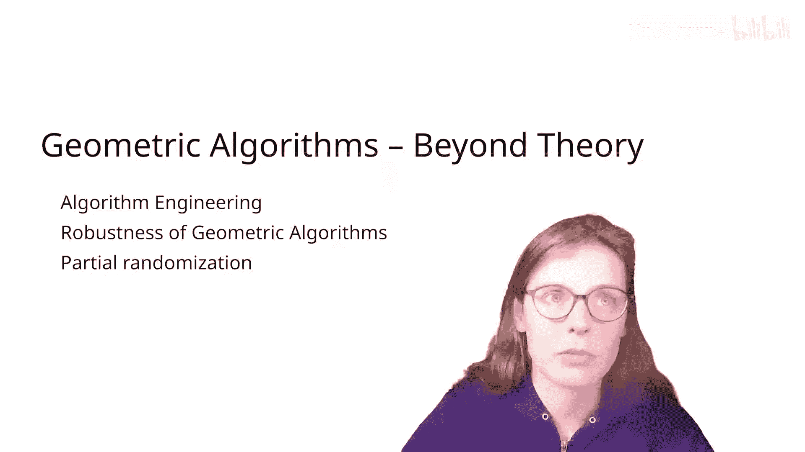

Let's start with an example。We know how to compute a convex hall of a given set of points。

 but let's consider one more algorithm。 And this time we will use incremental construction to build a convex hall。

 We start with some three points， initializing a convex hall and process the remaining points in arbitrary order。

For each next point R， we check if it lies outside of the so far computed convex all， and if it does。

 we replace the edges of the convexhu visible from R by the two tangent edges drawn from R to the boundary of the conx all。

In the example on the right， R sees the two orange segments and these get replaced by the two tangent green edges。

After processing all points， we should end up with a correct conxile。Is this indeed the case Well。

 if we compute the edges of the convex hall visible from R correctly and we compute the tangent edges correctly。

 then theoretically this algorithm is correct。But in practice， this algorithm can sometimes fail。

For example， we may find that some points are left outside of a conx hole。How can this happen？Well。

 this is the topic of today's lecture。

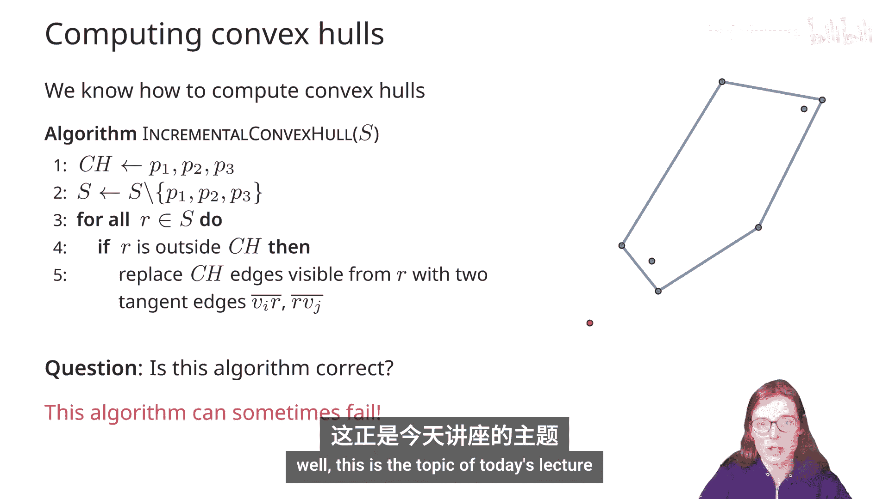

In theory， there is no difference between theory and practice。

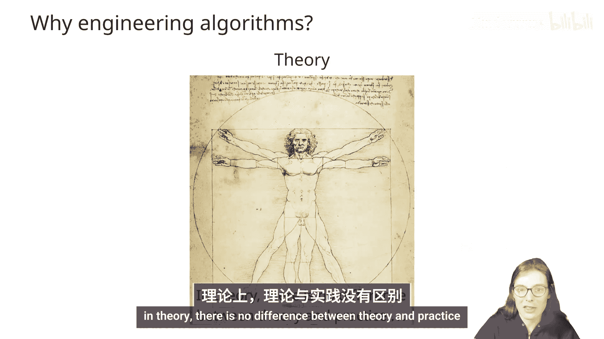

But in practice， there is。When we design algorithms。

 we operate with number types such as natural numbers or real numbers in practice these numbers have certain representation in the computer memory。

When we analyze the running time， we often only pay attention to the asymptootics。In reality。

 seconds count。When designing algorithms in class， we often stop at an abstract algorithm description。

And we also often assume general position to make the description of the algorithm easier。

When implementing the same algorithm， we often may encounter non trivial challenges and often our implementations can contain errors。

Furthermore， when designing an algorithm， we don't often bother ourselves with。

The amount of memory the algorithm will use in particular。

 a common assumption is that accessing any of the values computed so far does not cost us anything。

Of course， in practice， we have to deal with memory hierarchy and the of accessing data。Finally。

 when analyzing algorithms， we assume that elementary operations take constant time。In reality。

 different operations take different times， and they are often executed in parallel by instruction pipeing。

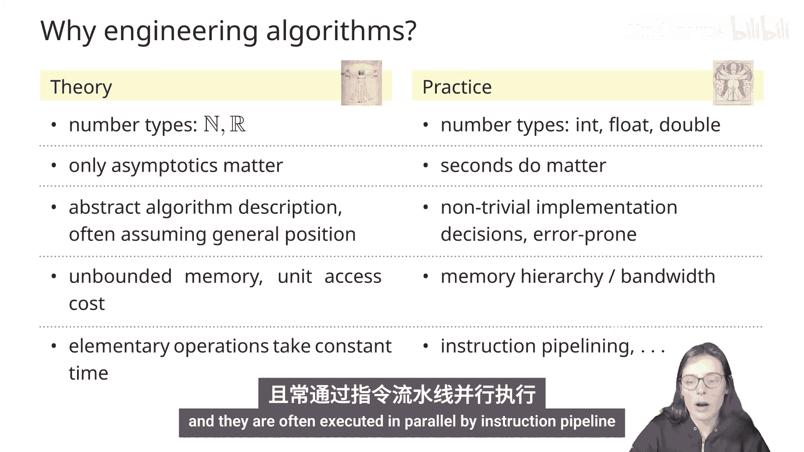

Today we're going to cover some of the aspects of the difference in designing algorithms in theory and implementing them in practice。

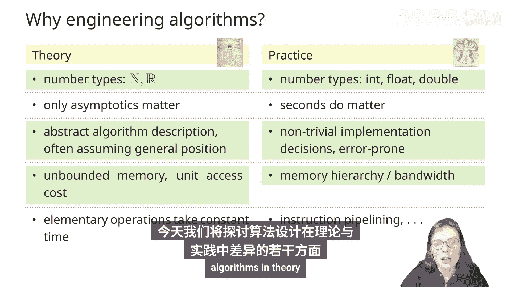

In the slide you can see a schematic representation of an algorithm engineering cycle。

 we start with algorithm design after we have developed an algorithm， we analyze it theoretically。

In this class， often the process ends here， but in reality you will want to move on to implementing this algorithm。

Finally， after implementing an algorithm， we of course want to test it and maybe analyze it experimentally。

In doing so we may observe some properties of， for example， input data that comes from real life。

 and this can give us insight on how to refine our analysis of the algorithm。

We may also encounter some bottlenecks or get some ideas for heurically improving the performance of our o and then we will want to go back to reimplement it。

Finally， we may also develop some deeper insights and move all the way to the beginning of the process and change the design of our algorithm。

Repeating this cycle several times iteratively， we can converge on a good solution to a given problem。

In the following， we will cover some of the techniques for converting a theoretical algorithm design into a practical implementation。

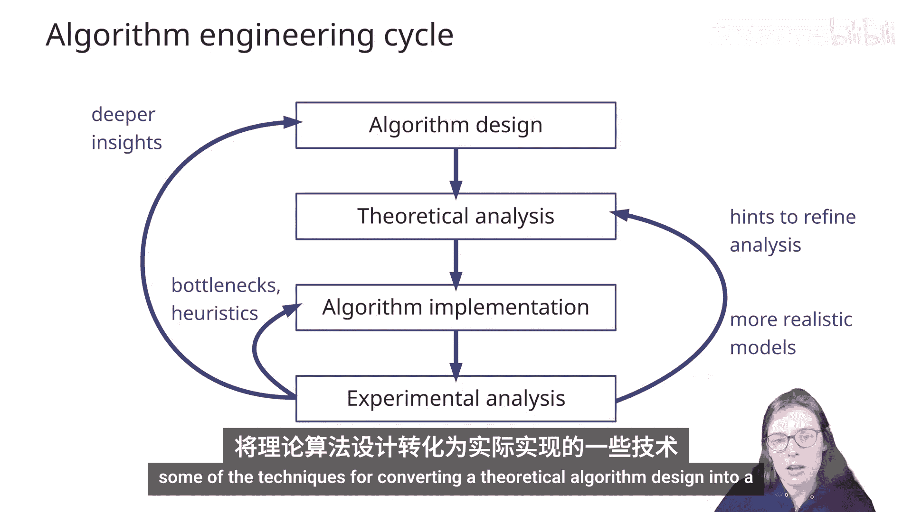

Let's come back to the incremental conxile algorithm from the previous video and see what can go wrong here in practice。

First， let's consider the following question， what does it mean that point R sees some edge DI V+ one of the convex Hu？

Well， if the direction of the edge V D+1 is in the country clockwise order of traversing the convex hall boundary。

 then if the three points V D+1 and R make a right turn，Then we can say that R sees the edge。Okay。

 so now how can we test if three points in a given order are making a right turn？

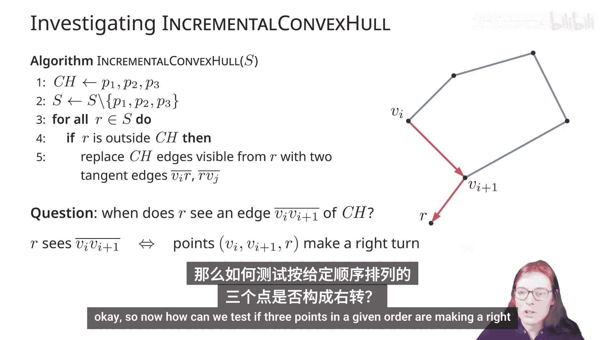

Let's define an orientation function that takes3 point pq and R and it returns plus1。

 if r lies to the left of the directed edge Pq， minus1 if R lies to the right of the directed edge Pq and0 if the three points R colonline。

 for example， on the bottom R lies to the right of the directed edge Pq and thus the orientation of Pq and R will return minus1 in this case。

To compute this orientation function， we can check the sign of the determinant of the following matrix。

Which can be furthermore simplified to the following expression。

So now we know how to implement the orientation test that we need to make the incremental convicx hall algorithm work。

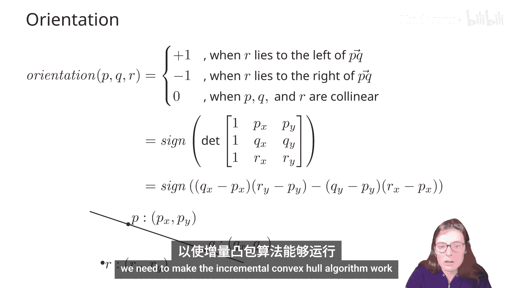

Let's now discuss how numbers are represented in a computer memory and in particular we're going to look at how floating point numbers are represented。

 You may have seen this before， but。Let's remind ourselves。

A floating point number will be stored in some number of bits。

 The first bit S will you know the sign of the number。 The next E bits will represent the exponent。

And the final Mbits will represent the Matisa。There are two ways how this sine exponent value and Monteisa value can be put together to represent a floating point number。

The first one is called a normalized representation in that case。

 the floating point number is given by this expression。

Here notice J is the number of bits representing the exponent。

There is also a denormalized representation of a number。

 the difference with a normalized representation is we have this value zero before the floating point。

A computer can recognize when a number is stored using denormalized representation by checking when all the bits of the exponent are zero。

 if the exponent does not consist of all zeros or does not consist of all ones。

 then it's a normalized representation of a floating point number Finally the exponent with all bits set to one is reserved for special number representation such as infinity a none and others。

The two standard floating point number times that you can often encounter in many programming languages are a float and a double。

In the table， you can see the range of the values that they can represent in their normalized and denormalized representation。

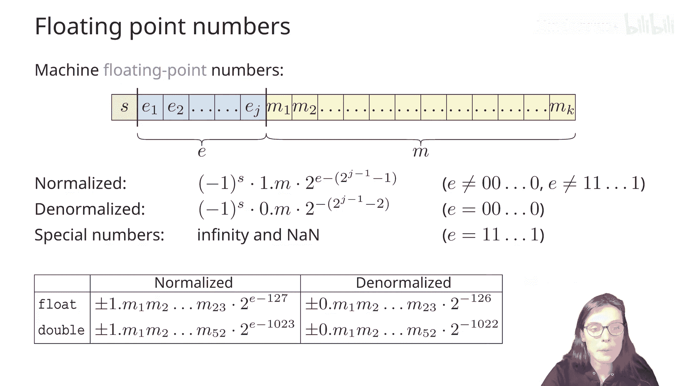

Let's consider a small example， we are going to define a new number type that we will call a very short float。

Both its exponent and Menisa have three bits of capacity。

 and thus they both can take values from zero to seven。

When the exponent is in the range from one to six， this corresponds to the normalized representation of a very short float and when it's zero。

 it's the denormalized representation。Now let's answer the following question。

 what is the smallest strictly positive normalized number that it is possible to encode using the very short float？

Well， we need to choose the smallest value of the Manisa possible and the smallest value of the exponent that still corresponds to a normalized representation of a number。

That means that the smallest strictly positive normalizedist number is given by the mentia equal to 0 and the exponent equal to 1。

 putting this together we will get that the smallest positive normalized number is1。

0 times2 to the power 1 minus 3， which is 1 over 4。Okay， so indeed。

 025 is the smallest strictly positive normalized number。What is the next smallest。

 normalized number？Well， let's repeat this exercise。

And the next smallest normalizedist number will be given by M equals1， and E equals1 as well。

Putting this together， we will obtain that the next smallest number is given by 1。001 times。

2 to the minus2。Okay。And indeed， the next smallest normalizedist number is 0。28125。

We may continue this process for the next few values。

 and we will find that on the interval between 2 to the power minus 2 and 2 to the power minus1。

The very short float number type can represent numbers with the increment of2 to the minus 5。

On the next interval between two to the minus1 and one。

 the increment between the neighboring values is 2 to the minus4。Finally。

 the decormalized numbers fall into the interval between minus 2 to the power minus 2 and 2 to the power minus 2。

 and again the increment between the neighboring values is 2 to the minus5。

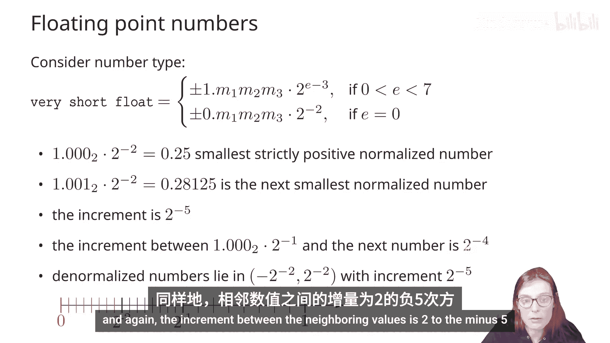

Now answer the following question， we're still considering the same very short float number type。

What is the result of summation of 4 plus 025 using this very short float？

Surprisingly the result that you get is four， the second sumit is simply too small to bring the total sum to the next value after four that is possible to represent in the very short float number。

These types of rounding errors can cause a lot of problems when implementing geometric algorithms。

Now let's get back to the orientation test， consider three points P Q and R。

We're going to plot a value of the orientation test on p prime Q andR。

 where we define p prime as p plus u times delta x and v times delta y where delta x and delta y are the smallest increments possible between two adjacent floating point numbers。

 and U and V are in the range from 0 to 255。So the plot will give us 256 points along the x coordinate and 256 points along the Y coordinate。

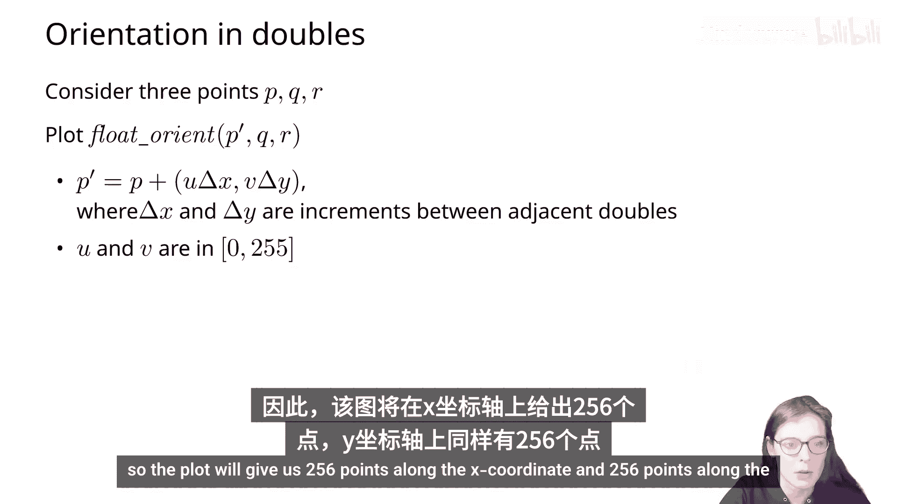

If we set the coordinates of P to be 0。5 and 0。5。Q12 and 12 and R 24 and 24 Then the following plot shows the values that you can get from testing the orientation on the points。

 P prime， Q and R。As you can see here， we cannot only get the value0。

 meaning that the three points are clear when in fact they are not。

 but we can also get a false positive and a false negative。We can get orientation。

 tell us that the points are forming a right turn where in fact they are forming a left turn and vice versa for another triive point。

 we get a different pattern and still we have full positive false negatives and we can get the result of the three points colonline when they are not。

Here's yet another example with very interesting patterns in it。

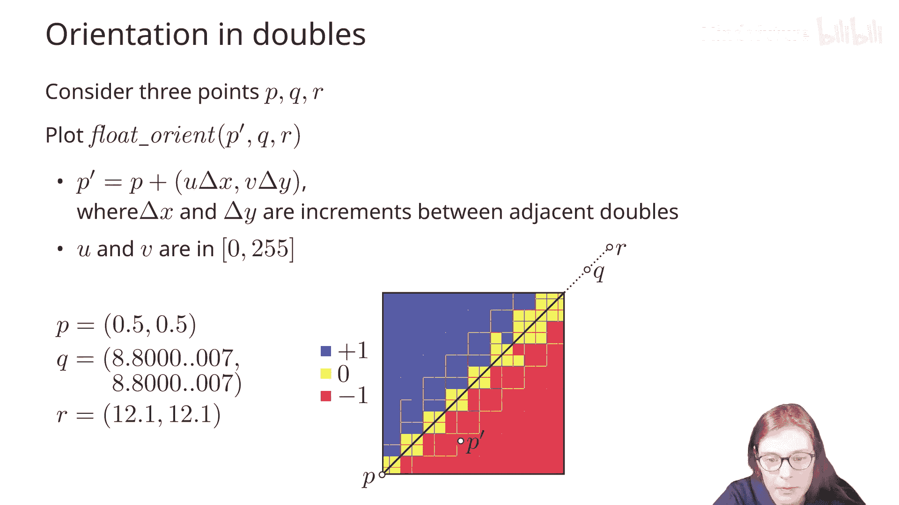

So now let's see what exactly can go wrong in the incremental con algorithm。

For the specific details and the exact coordinate values of the points。

 refer to the paper by Keepner at all。Consider the following set of points。

 P2 and P3 are very close together， but yet there are different points。We start with placing P1。

 P2 and P3 onto the convex hole。And next for the point before。

 we checked whether it forms a right angle for the three edges of the conxhull。

As a result of performing the orientation test for all edges。

 we can actually get that P4 does not see any of the edges of the current con all。And thus。

 when we finish running the algorithm， before we'll be left outside of the Conx hub。

The problem that occurs here is that a point outside of a convex hall does not see any edge。And thus。

 we are left with an incorrect solution。Other failures may occur when， for example。

 a point on the inside of the economicshull is evaluated to CN edge。In this case。

 we're going to get a nonconvicx polygon as a solution。

Another example is when a point that is outside of a conxhull is evaluated to see all the edges。

In this case， depending on the implementation， we may end up in an infinite loop or a crash。

Yet another failure may occur when a point outside of a complexx hall isva to see a noncontiguous set of edges。

Then we may end up with a nonconx solution or even with a self intersecting chain as an answer。

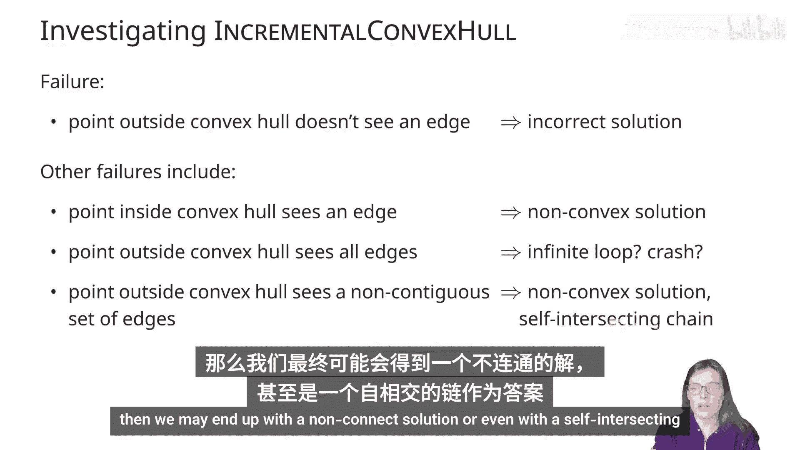

When designing geometric algorithms， we rely on geometric predicants。

A geometric predicate is a sign of a polynomial evaluated un given input， for example。

 orientation tests we have just covered is a predicate。

It takes three points as an input and returns a sign of a polynomial on their coordinates。

Another example of a geometric predicate is an in circle test。Given four points， A， B， C and D。

 it returns one if D lies inside a circle going through the points A B and C， minus1。

 if it lies outside of the circle and zero， if it lies on the circle going through the three points。

Can you think of other examples of geometric predict？In fact。

 many predicates simply reduce to the orientation test， either in two or higher dimensions。

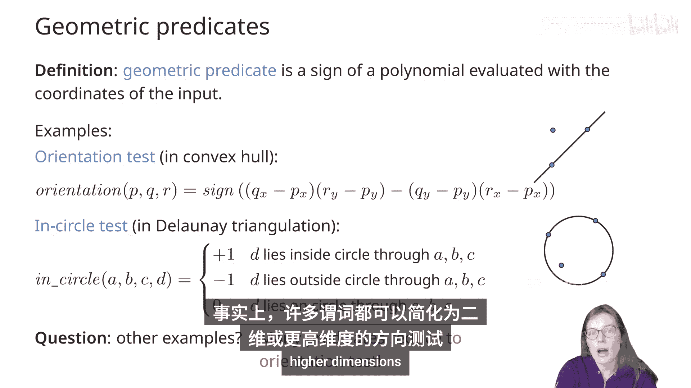

For example， even the insert circle test can be reduced to the orientation test in the three dimensions。

The way the reduction goes is for the given three points， A， B and C。

 we construct three points in three dimensions， we call them a hat， B hat and C hat。

 the first two coordinates are equal to the coordinates of the original point。

 and the third coordinate is the sum of the squares of the first two coordinate。

This operation sort of lifts the points onto a parabolooid。

Then at fourth point D will lie inside of the circle going through the points A， B。

 and C if its lifted version D hat lies below the plane H going through the points A hat。

 B hat and C hat。And。D lies outside of the circle if。Its lifted version G hatt lies above the plane。

Similarly to the orientation test， the in circlecle test can again be written as a sign of a determinant。

 but now of a 4 by4 matrix。To avoid rounding errors in implementations of geometric algorithms。

 we can either evaluate prediccateates exactly or we can use predicate filtering to make sure that the answer that we get。

When evaluating a predicate corresponds to the true value。In the first case。

 when we evaluate the predicates， constructions themselves do not have to be exact。For example。

 when we compute intersections of some objects such as lines or circles。

 we do not need to compute the coordinates of the intersection points exactly。

 but we still want to make sure that we evaluate predicates exactly。

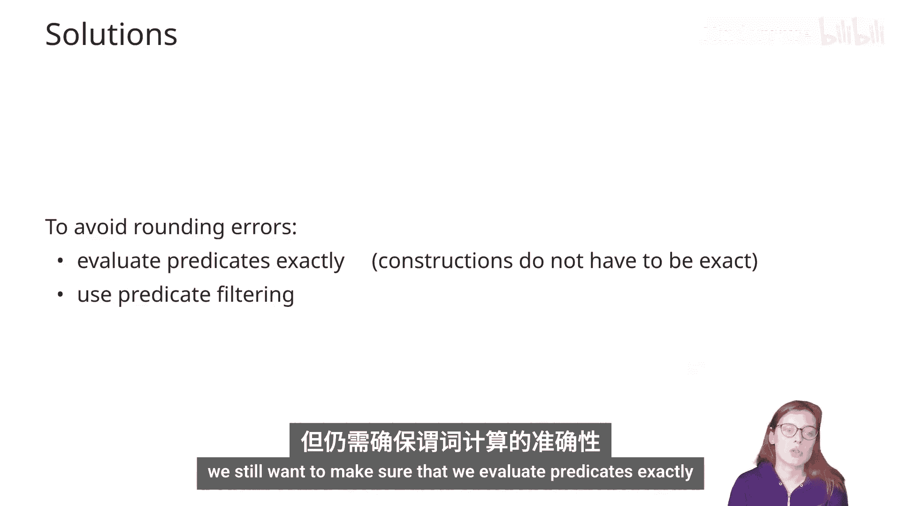

First， let's talk about filtering。 Our goal is to get the correct sign of an expression E。

 We want to get minus1 when e is negative plus1， when it is positive and0， if it is0。

Consider the following pseudo code。We start with evaluating E using our floating point numbers。

If the value that we get is greater than some air threshold。Then we return one。

If the negation of this value is greater than the error bound， then we return minus1。And otherwise。

 we increase the precision of our computation and we repeat。Of course， in this way。

 we will never return zero and at some point we may need to switch to an exact arithmetic。

So now let's discuss how we can evaluate predicates exactly。

We have to resort to the use of exact arithmetic that means that we cannot limit the space to store the values of the coordinates that we get。

 we will have to use a flexible number representation that will use as much space as needed。

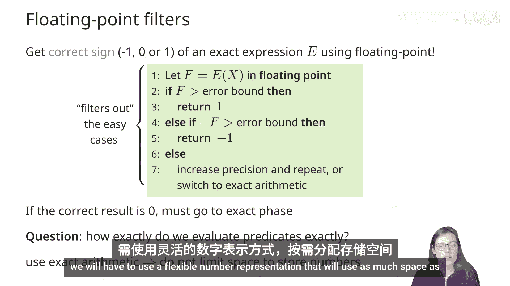

When our preddiicates return zero， that means that we are dealing with a degenerate case。For example。

 we may have three points lying on the same line or four points co circle。

If our input contains degenerate cases， we need to carefully design our algorithms to deal with them。

But there is another option that often works well in practice。Before solving our algorithm。

 we randomly perturbed our input to get rid of these degenerencies。

We need to make sure that the perturbation that we're applying to our input does not change any of the geometric traits。

 and for that we can use a perturbation that is very close to the input。

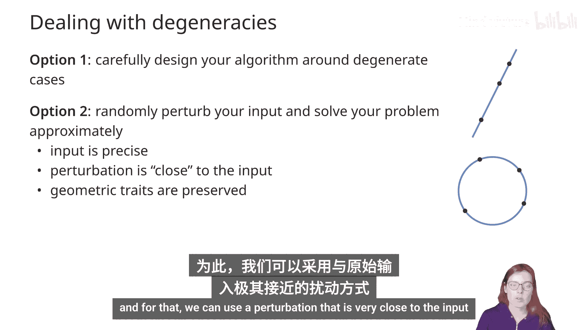

Let's summarize our discussion of robustness issues。First。

 we often have a tradeoff between using exact arithmetic versus the speed of the algorithm。

It is often sufficient to evaluate prediicates exactly。

 but not build our geometric constructions exactly。In general。

 robustness in geometric algorithm is very difficult to achieve。But luckily。

 there exist libraries that take care of these issues for us。

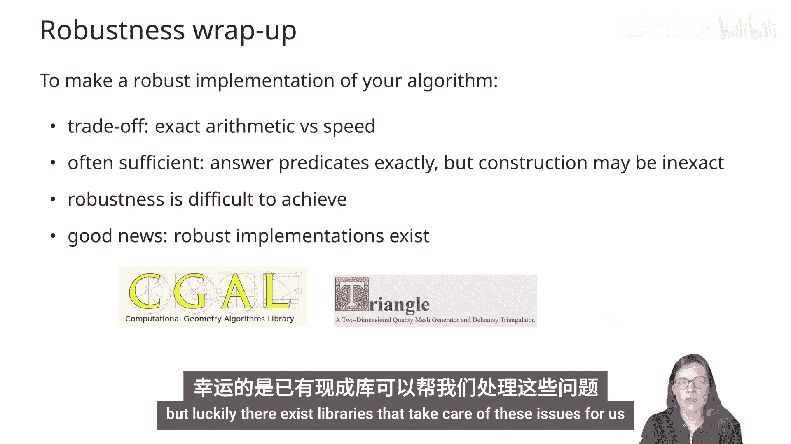

Now， going back to the algorithm engineering cycle。

 we are more prepared to deal with the algorithm implementation step。Now。

 suppose that we have a robust implementation of the randomized incremental construction algorithm of the vertical decomposition that we learned in the previous lecture。

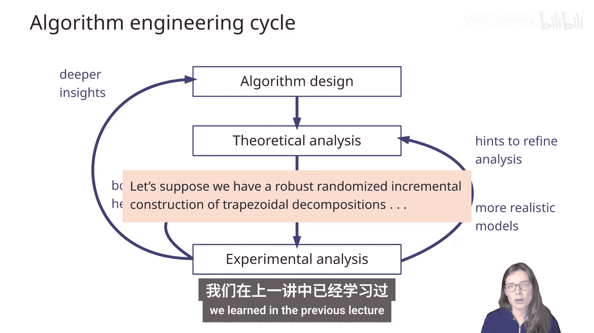

Ci and Amenta in their paper have observed the following weird behavior of an implementation of such a randomized incremental construction on the right hand side。

 you can see a schematic representation of the running time that they get。

 depending on the size of the input。The running time was growing slowly for the initial range。

 and then at some point it started shooting upwards almost vertically。So what went wrong here？

The answer is thing due to random memory access。It occurs when the virtual memory of a computer gets overused。

 and each next operation takes longer time because we're waiting for the data to be loaded from the hard drive。

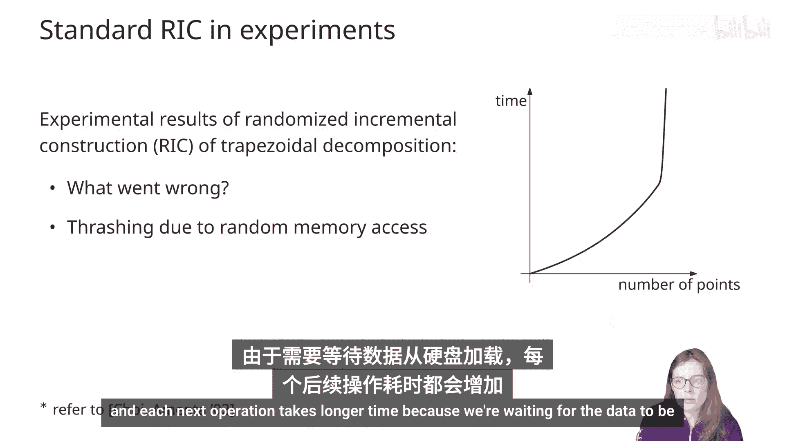

In particular， randomized incremental construction are prone to such failures。

If you have a large data， it is better to access it sequentially rather than in a random order。

 So what is the solution here not to randomize our algorithms， Well， in theory。

 randomization works really well， it results in simple algorithm。

 which give us a very good running time。A middle ground here is a partial randomized incremental construction。

Here we get the best out of both worlds， we get the randomization from the theoretical algorithm design。

 and we get enough of locality of data to not overuse the virtual memory。

So let's design a partial randomized incremental construction to build a vertical decomposition of a given set of segments。

The way we're going to approach this is we're going to split the computation into rounds。

Starting from the end， from the last round， we're going to assign each segment to that round with probability12。

Thus around a half of segments will be assigned to the last round in our example we will end up with five rounds and the fifth round gets all the red segments。

Out of all the remaining segments， again， we're going to flip a coin and with probability12。

 each segment gets assigned to the previous round to round number four。

Thus about half of the remaining segments get assigned to the round four。

We repeat this procedure as long as we have unassigned segments。

So in this example we indeed end up with five rounds， the first round contains only one segment。

 the purple segment， round number two contains two segments。

 and each of the following rounds they contain more and more segments。From round to round。

 the segments are chosen in random order within each round we're going to process the segments in the order that benefits locality of information。

So the order in which we process the segments within each round is not random。Now。

 when we start building the vertical decomposition， we start with all the segments in round one。

 in this case with one purple segment。After we were done。

 we're going to move to round two and insert the two segments that were assigned to round two。Next。

 we insert the segments in the third round。Forththroned。And fifth round。And we're done。To reiterate。

 in searching the segments within each round is not random。

 but is chosen specifically in order not to cause us problems with accessing the large amount of data。

Despiteite of this approach in constructing the vertical decomposition in rounds。

 and in the last round， half of the segments get inserted not in random order。

 but in some specific order， still we can get a running time that asymptotically matches the same running time from the randomized incremental construction algorithm。

The way we're going to prove this theorem is we're going to compare the probabilities in this approach to the probabilities that we got in the standard randomized algorithm。

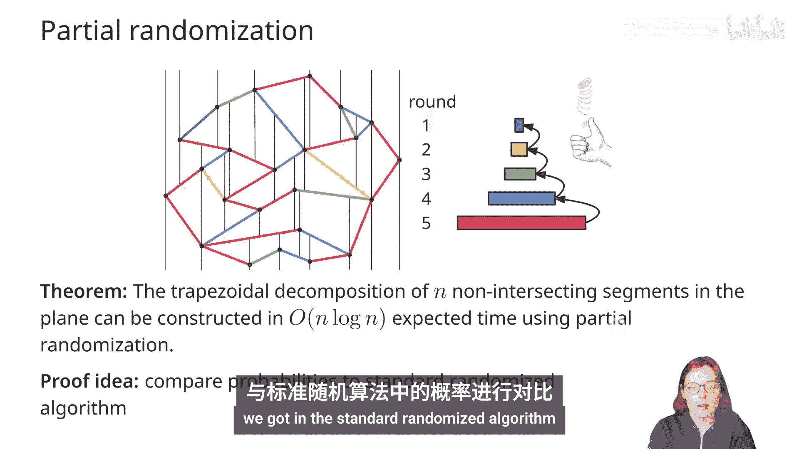

We will prove the theem using the following lemma。For a given trapezoid delta。

 the probability that it occurs in the construction of the partial randomized incremental construction is at most 16 times the probability of this trapezoid occurring in a standard randomized incremental construction algorithm。

Consider the example on the right， the trapezard Dlta is defined by at most four segments。

 which we will call triggers。For Delta to occur in the construction。

 all the trigger segments must be inserted into the construction before any of the stoppers。

 which are shown in red。Sttoppers are the segments that intersect Delta。

 and thus if any other stopper is inserted before the last trigger。

 Delta never occurs in the construction。The probability of trapezzooid delta occurring in the partial randomized incremental construction is at most the probability of all the triggers occurring in round I or before。

 for some round I and all the stoppers occurring in round I or after。

Let's consider closer why exactly that is。Let's consider the timeline of inserting the segments in the construction one by one。

Let's say this was phase one。This was phase 2。 This was phase 3， and so on。Let this be phase I。

And let all the triggers。Ocurring。In。Or before round I。All the stoppers。Will occur in。

Or after round I。And we will require one stopper to occur in round I so that we are not double counting when we're going to consider delta appearing in the following phase I+1。

So now why is this the upper bound， well there may be a permutation of segments within round I where a stopper occurs before a trigger and thus delta never occurs。

 and that is why the probability of delta occurring in the partial randomized incremental construction is upper bounded by this probability。

So let us formalize this， let TI denote the event that all triggers of delta appear in the round I or before。

And let SiI denote the event that the first stopper of deelta appears in round I。Okay。

 then we can rewrite the probability above as the probability of the union over I of S and T。

 which is for any round I， all triggers must appear in round I or before and the first stopper needs to appear in the round I and not earlier。

So now we can take the union outside of the probability and replace it with a sum。

That is because the events， S I N T I are disjoined from other events。SJ and TJ。Next。

 we can rewrite the probability of SI and TI occurring at the same time as the product of the probabilities of SI and the probability of TI occurring。

 and that is because the events SI and TI are independent。Finally。

 we're going to bound the probability of T occurring by 16 times the probability of T minus1 occurring from above。

Why can we do so， We are going to use the following trick。 First。

 we are rewriting the probability of Ti -1 as the probability of T。-1 and T。Why can we do that， Well。

 given that the triggers of Delta appear in round i minus1 or before。

Interssecting this event with the event of all triggers occurring in the round I or before does not expand the scope of the events。

Now we can rewrite the probability of T minus1 and T using the conditional probability。

So it equals to probability of T minus1 occurring， given that T is true times the probability of T et。

And now we're going to bound the conditional probability of T minus1 occurring given that TI is true by1 over 2 to the power4 from below。

Why is that Well let's consider the way we were constructing the phases and how we were placing the segments in those phases we were going backwards from the last round to the first round and the fact that TI is true means that all the trigger segments。

Did not fall into any of the rounds I plus1 or or later they were not selected in round I plus1 or late。

 Now， given that all triggers were present when we were selecting the segments for the round I。

 each of them had a probability of1 half of ending up being selected for round I。

 if any of them would be selected for round I， then the event T I minus-1 would be false So T I minus1 is true。

 if all trigger segments survive the selection phase for round I。

And because there are at most four triggers， the probability of event T minus1。

 given that event T is true， is at least1 over2 to the4。

And that gives us exactly that the probability of TI can be bounded from above by 16 times the probability of T minus1。

Finally， using the same operations backwards， we can rewrite this expression as 16 times the probability of the union over I of events SI and T minus1 happening at the same time。

And that is exactly the 16 times the probability of all the triggers occurring in round i minus1 or before。

And the first stopper occurring in round I and now considering the permutation in which the segments were inserted into the construction。

 we can see that in this way we're under counting the number of permutations where trapezoid delta can occur。

 indeed， a trapezoid delta can occur， if one of the stoppers appears in round I minus-1。

 but because we're limiting the first stopper to appear in round I in this way we're under counting the number of events where delta would occur。

And then we can upper bound this value by 16 times the probability of delta occurring in the standard randomized incremental construction。

 so finally we have proven dilemma that the probability of deelta occurring in the partial randomized incremental construction is at most 16 times the probability of it occurring in the randomized incremental construction。

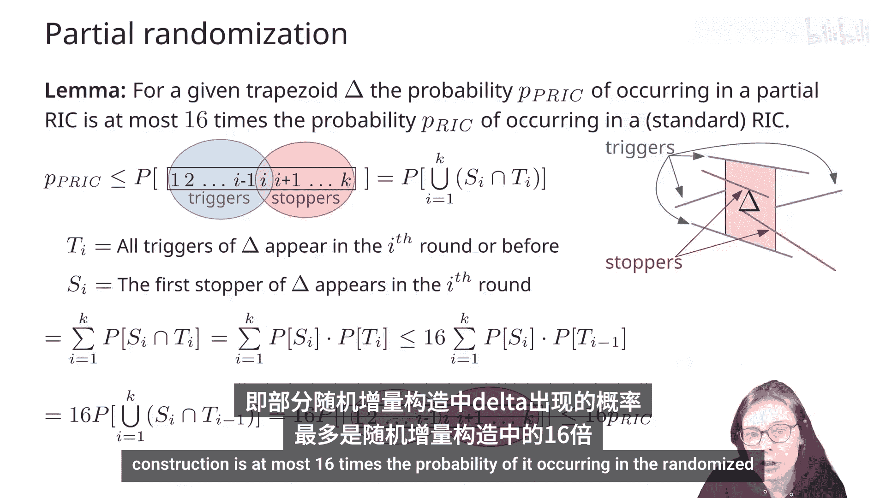

And now using the smma。We can prove the following theorem that the trapezoidal decomposition of N non interterssecting segments in the plane can be constructed in big of analog loggan expected time using partial randomization。

The proof of this theorem will be analogous to the proof from the previous lecture。

To summarize what we've learned today， implementation of algorithms。

 running experiments and theory go well together。Producing robust implementations is challenging。

 but luckily there are enough of tools， there libraries that we can use to help us in our software engineering。

And finally， performing experimental analysis is crucial because it can lead to unexpected findings that will allow us to improve not only the implementation aspects of the algorithm。

 but to develop new theoretical results。

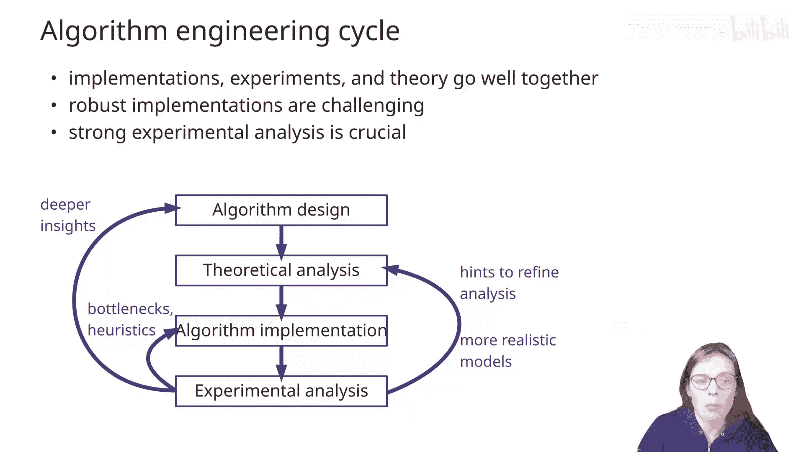

For the good practices of performing experimental analysis， refer to the guide written by Johnson。

To summarize his points。When designing experimental analysis。

 we should try to perform newsworth experiments， place the work in a general context of the scientific area。

 use efficient implementations and use general testbeds to compare our experiment with those of others。

 we can use well designed experiments to back up claims about performance of our algorithms。

 but it is important when designing and experimental analysis。

 to ensure that others can reproduce your results， and also they can compare the results to our。

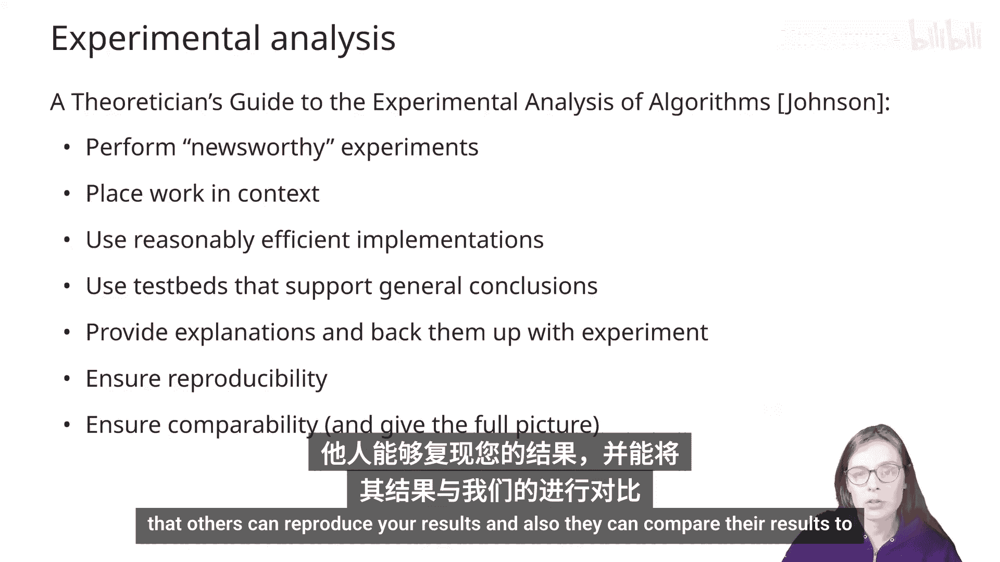