# 001：课程概述 🎯

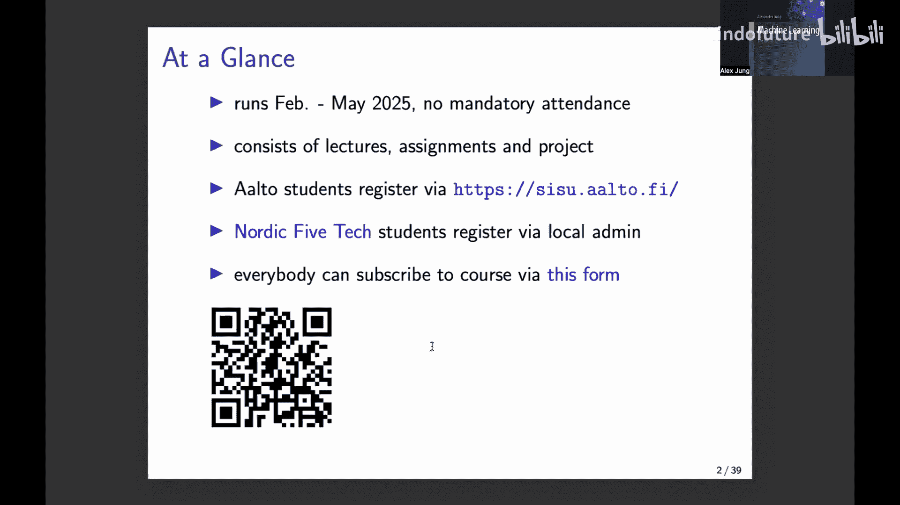

在本节课中，我们将学习阿尔托大学联邦学习课程（CS-E4740）的总体介绍。课程主讲人是Alexander Youngung副教授。我们将了解课程的基本信息、先修要求、学习目标、课程结构、评分方式以及联邦学习的初步概念。

---

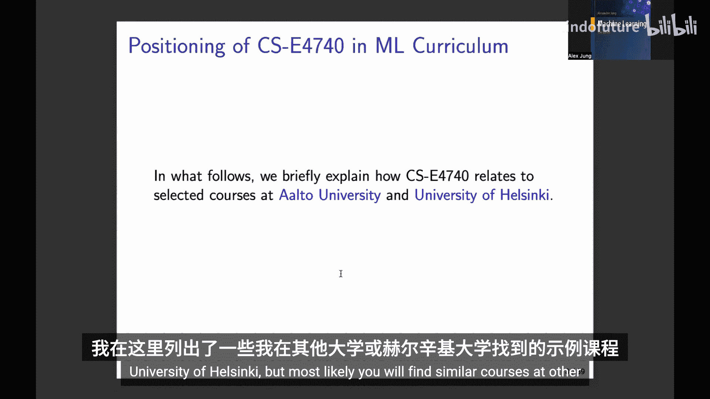

## 课程基本信息

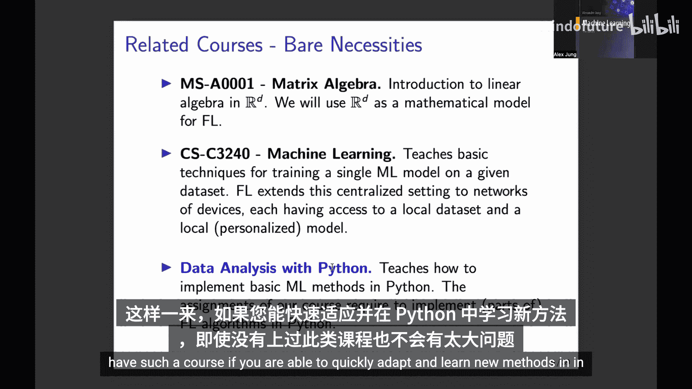

本课程名为“联邦学习”，将于2025年2月至5月期间进行。课程不强制要求线下出席，可以完全远程或在线完成。

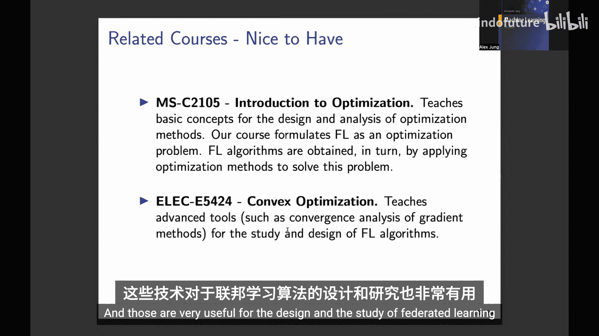

课程内容包括讲座、作业和项目。阿尔托大学的学生可以通过常规系统注册。来自北欧科技大学（如KTH斯德哥尔摩、查尔姆斯理工大学）的学生可以通过本地管理部门注册。其他所有人可以通过一个简单的谷歌表单订阅本课程，表单链接由二维码提供。

## 先修要求与学习目标

在介绍课程内容之前，我们先来看看学习本课程需要具备哪些基础知识，以及完成课程后能达到什么目标。

### 先修要求
本课程假设你已经具备以下知识：
*   **线性代数**：了解实值向量、矩阵的性质与运算、向量和矩阵的范数。
*   **微积分基础**：熟悉微分或梯度的概念。
*   **机器学习入门**：熟悉经验风险最小化的概念。
*   **Python编程**：具备Python基础，并了解NumPy、Scikit-learn等库，或者有能力在课程期间独立掌握这些技能。

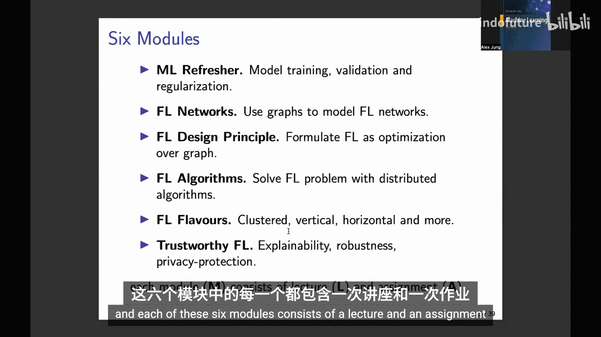

### 学习目标
完成本课程后，你将能够：
*   使用**网络模型**对联邦学习应用进行建模。
*   将联邦学习表述为一个**优化问题**。
*   使用优化方法构建**联邦学习算法**。
*   掌握一些用于设计和诊断联邦学习系统的工具与知识。

## 课程定位

上一节我们介绍了本课程的基础和目标，本节中我们来看看这门课在更广泛的机器学习课程体系中的位置。以下是一些相关的课程示例：

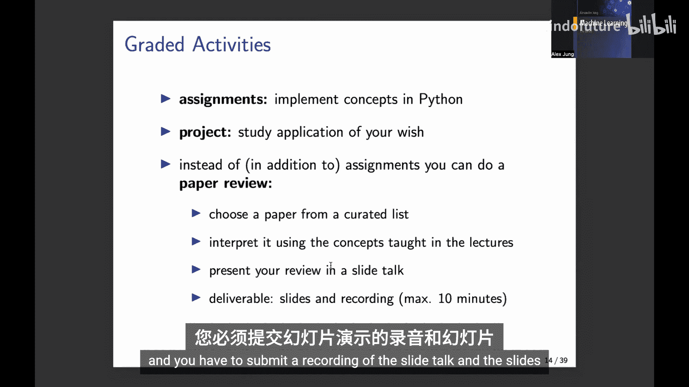

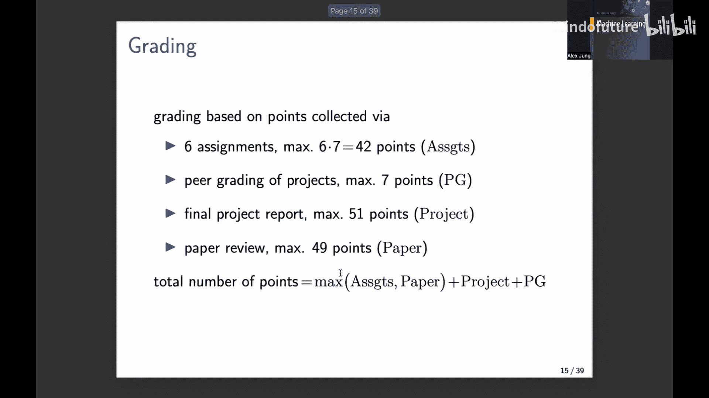

*   **先修课程**：矩阵代数/线性代数课程、机器学习入门课程、使用Python的应用机器学习或数据分析课程。
*   **有益课程（非必需）**：优化入门课程（有助于理解优化问题的构建模块）、凸优化课程（有助于研究梯度方法的收敛速度）。
*   **后续课程**：无线系统课程（涉及联邦学习算法的硬件实现）、分布式智能自动化系统课程（物联网是联邦学习的重要应用领域）。

## 课程内容与安排

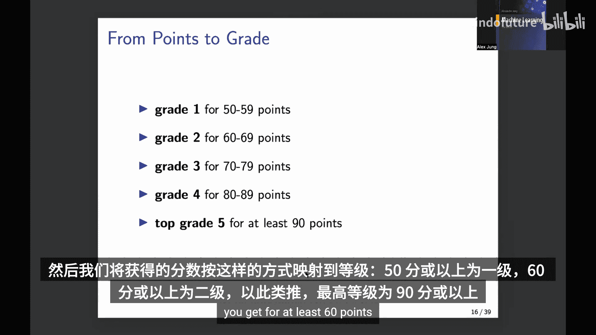

了解了课程的定位后，我们正式进入课程本身。本课程大致分为六个模块，每个模块包含一次讲座和一项作业。

以下是六个模块的主要内容：
1.  **模块一：机器学习基础回顾**：快速回顾模型训练、验证和正则化等基本技术。
2.  **模块二：网络模型**：引入无向图来表示联邦学习网络。
3.  **模块三：优化问题**：基于联邦学习网络，构建其上的优化问题。
4.  **模块四：联邦学习算法**：通过应用优化方法求解联邦学习的底层优化问题，从而系统性地获得联邦学习算法。
5.  **模块五：联邦学习变体**：学习聚类联邦学习、纵向联邦学习、横向联邦学习，它们都是模块三中讨论的优化问题的特例。
6.  **模块六：可信联邦学习**：学习如何衡量或确保联邦学习方法的可解释性、研究其对抗数据投毒攻击的鲁棒性，以及确保隐私保护的不同措施与方法。

## 评分方式

课程评分基于以下活动，我们将按以下方案计算总分：

*   **作业**：共6次，每次最高7分，总计最高42分。
*   **项目**：最终项目报告最高51分。
*   **论文评审**（可选/替代作业）：最高49分。
*   **同行评审**：对他人项目报告进行评审，最高7分。

**总分计算公式**：
`总分数 = max(作业总分， 论文评审分数) + 项目报告分数 + 同行评审分数`

分数与等级的对应关系如下：
*   50分以上：等级1
*   60分以上：等级2
*   70分以上：等级3
*   80分以上：等级4
*   90分以上：等级5

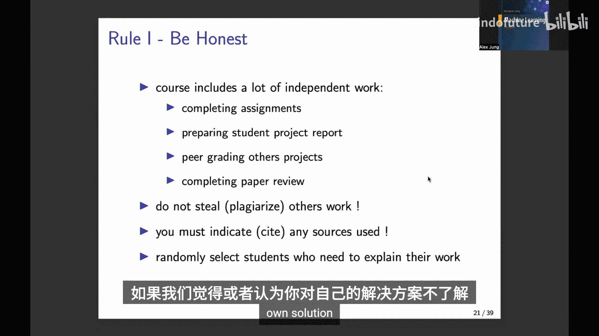

## 作业与项目详情

现在，我们来详细了解评分项中的作业和项目具体是什么。

### 作业详情
共有六次作业，每次作业都需要使用Python实现对应模块的概念：
1.  实现基本的机器学习方法（复习）。
2.  使用`networkx`包实现联邦学习网络。
3.  在Python中实现联邦学习的底层优化问题。
4.  使用联邦学习算法在Python中求解该优化问题。
5.  实现聚类和纵向联邦学习方法。
6.  研究并实现隐私攻击（尝试从联邦学习算法传递的信息中推断敏感数据），并实现提高联邦学习方法可解释性的方法。

### 学生项目
学生需要自选一个应用方向，应用课程中讨论的联邦学习算法。项目要求包括：
1.  撰写项目报告（会提供模板），报告需包含背景介绍、方法描述、数值实验与结果分析。
2.  在四月底提交初版报告。
3.  随后进入约两周的同行评审期，每位学生需评审3-5份其他同学的报告。
4.  在五月底前，根据收到的评审反馈，提交最终修订版报告及一份回应信，说明如何采纳反馈。

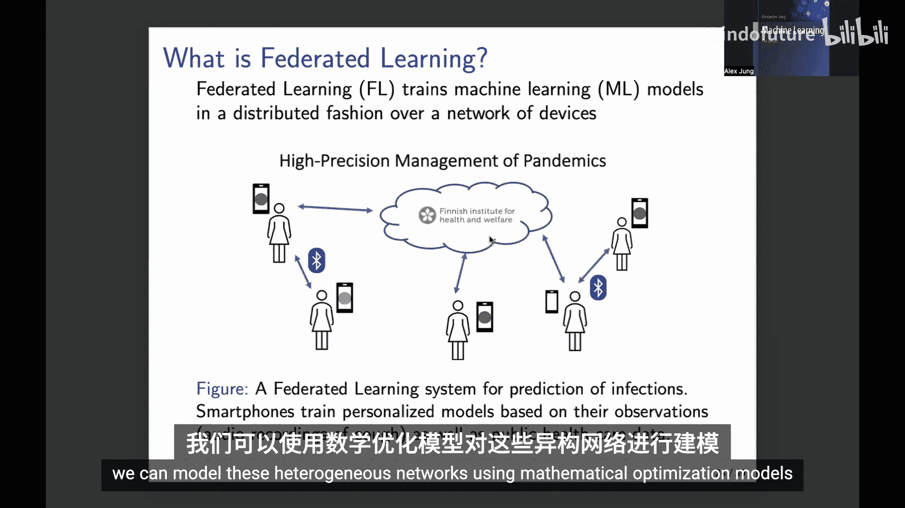

## 课程规则与时间表

在开始学习之前，了解课程的基本规则和时间安排非常重要。

### 基本规则
1.  **诚实守信**：所有作业、项目和论文评审都必须是独立完成。引用他人成果必须注明来源。课程可能会随机抽查学生，要求解释其提交的内容。若发现抄袭或无法解释自己的成果，将面临纪律处分。
2.  **相互尊重**：本课程旨在为所有人提供一个安全、愉快的学习空间。任何形式的不尊重行为，包括在课程相关交流平台上的不当言行，都将受到严肃处理，并可能上报学校当局。

### 时间表概览
*   **讲座**：每周一16:15开始，共6次，从2月24日开始。
*   **作业讲解**：每周三16:15开始，在对应讲座之后进行，从2月26日开始。
*   **作业提交截止日期**：
    *   作业1&2：3月17日
    *   作业3&4：3月31日
    *   作业5&6：4月14日
*   **项目时间点**：
    *   初版报告提交：4月底
    *   同行评审期：至5月15日
    *   最终报告与回应信提交：5月底

## 什么是联邦学习？🤔

现在，让我们开始接触课程的核心主题——联邦学习。

联邦学习是一种**在设备网络上以分布式方式训练机器学习模型**的技术。例如，在疫情精准管理应用中，每个人的智能手机上运行一个联邦学习算法，用于预测外出是否安全。每个设备训练自己的个性化模型，并通过相互协作来改进各自的模型，而无需将原始数据集中到一处。

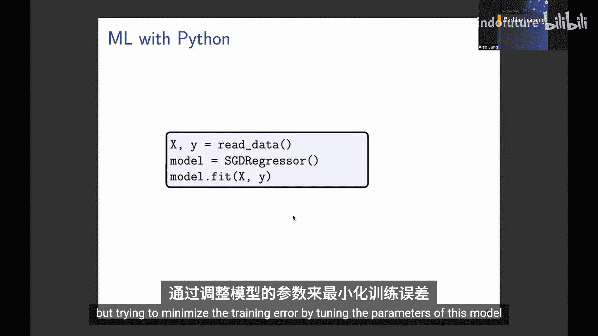

### 关键特性
联邦学习具有以下几个关键特性：
*   **去中心化**：无需集中式数据收集，系统更健壮。
*   **个性化**：每个设备训练针对自身的个性化模型，预测更精准。
*   **协作性**：设备间共享信息和计算能力，共同解决更大的问题。
*   **可扩展性**：能够解决单设备无法处理的大规模机器学习问题。
*   **隐私友好**：通常不共享原始数据，只交换模型参数更新等概要信息，减少了隐私泄露风险。

### 应用领域
联邦学习在多个领域有广泛应用前景：
*   **医疗健康**：在严格遵守隐私法规的前提下，利用分散的医疗数据训练更好的疾病预测模型。
*   **金融**：用于改进欺诈检测和风险评估。
*   **智能电网**：预测可再生能源（如太阳能）的供应情况，优化用电决策。

## 从机器学习到联邦学习

为了理解联邦学习，我们将其与传统的机器学习进行对比。

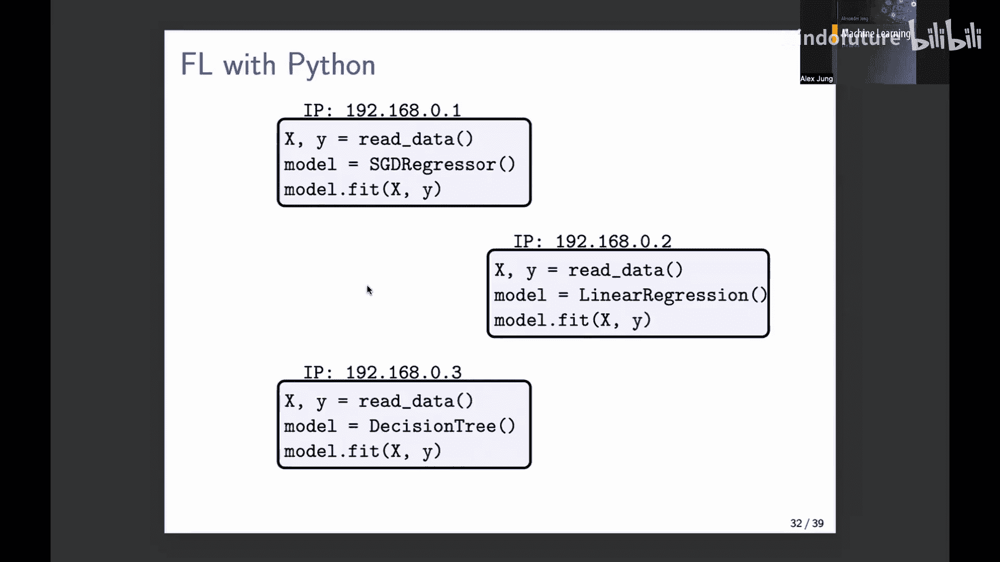

在传统机器学习中，我们使用一个数据集 `(X, y)` 训练一个单一的模型 `model`，核心是**最小化经验风险**：
`minimize (1/N) * Σ L(y_i, h(x_i))`
其中 `L` 是损失函数（如平方误差损失），`h` 是假设函数。

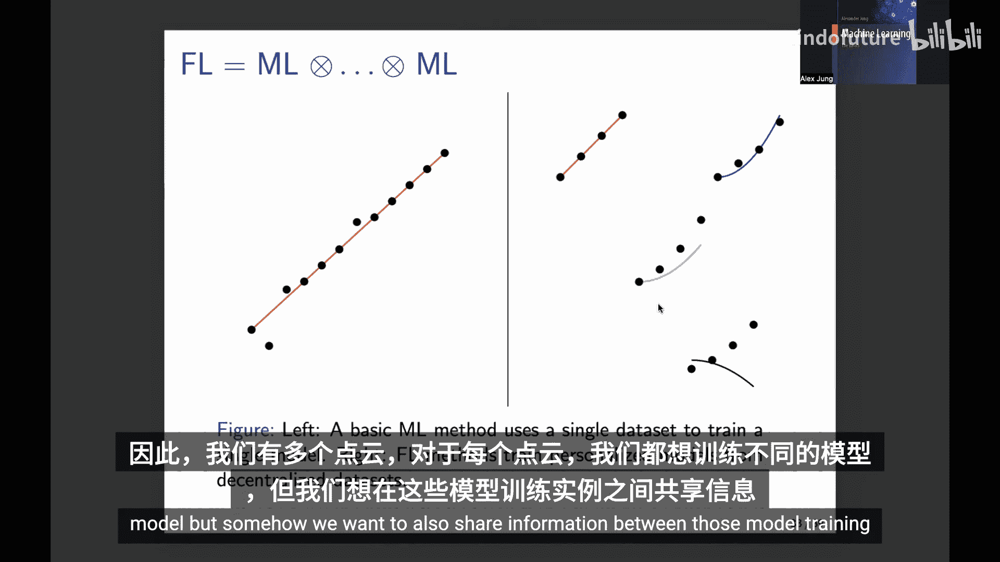

在联邦学习中，我们有多台设备（节点），每台设备 `i` 拥有自己的本地数据 `(X_i, y_i)` 和（可能不同的）本地模型 `model_i`。它们通过协作来优化各自的模型。这种协作可以看作是在每个本地经验风险最小化问题的基础上，通过**正则化**或**约束**引入设备间的耦合，从而形成一个全局的优化问题。

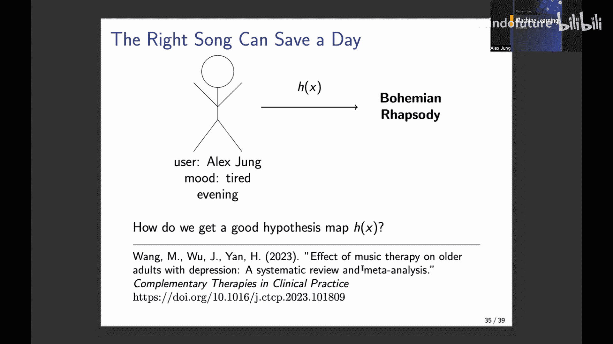

用Python代码类比：
*   **传统ML**：`model.fit(X, y)`
*   **联邦学习**：多个设备上运行类似的流程，但 `model_i.fit()` 函数中的部分数据可能通过 `read_data()` 函数从其他设备获取，而获取的不是原始数据，而是模型参数更新等信息。

## 机器学习基础回顾 🔄

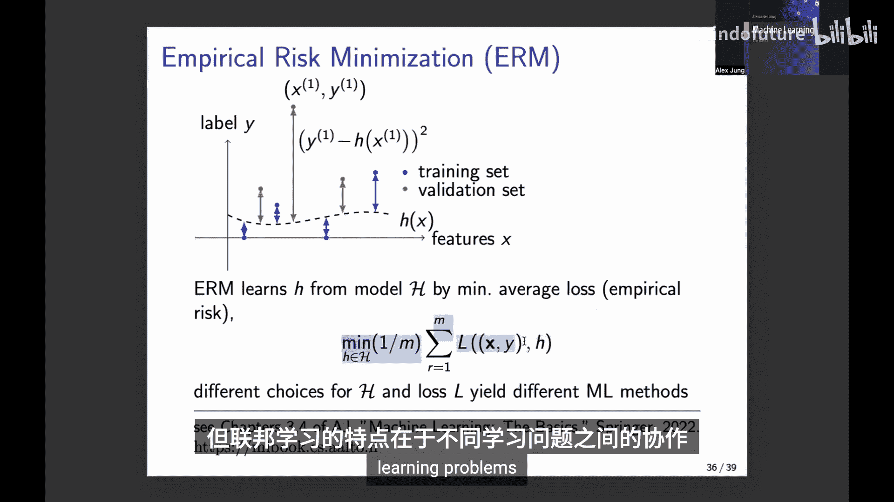

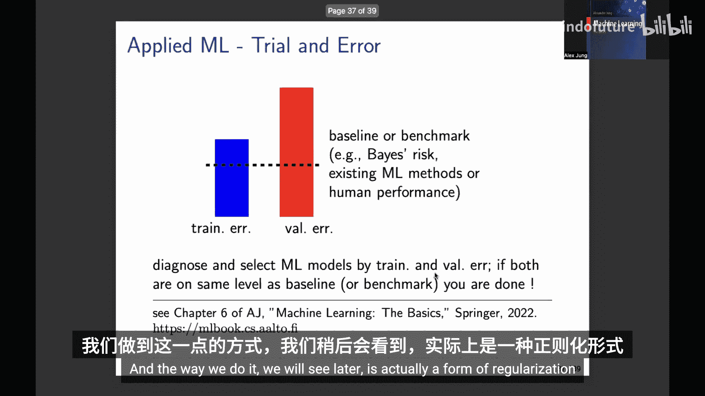

作为联邦学习的基石，我们快速回顾几个核心的机器学习概念。

1.  **模型训练与验证**：
    *   **训练**：在训练集上通过优化算法（如梯度下降）最小化损失函数，得到模型参数。
    *   **验证**：在未参与训练的验证集上评估模型性能（计算验证误差）。**比较训练误差和验证误差**是诊断模型（如是否过拟合、欠拟合）的关键。

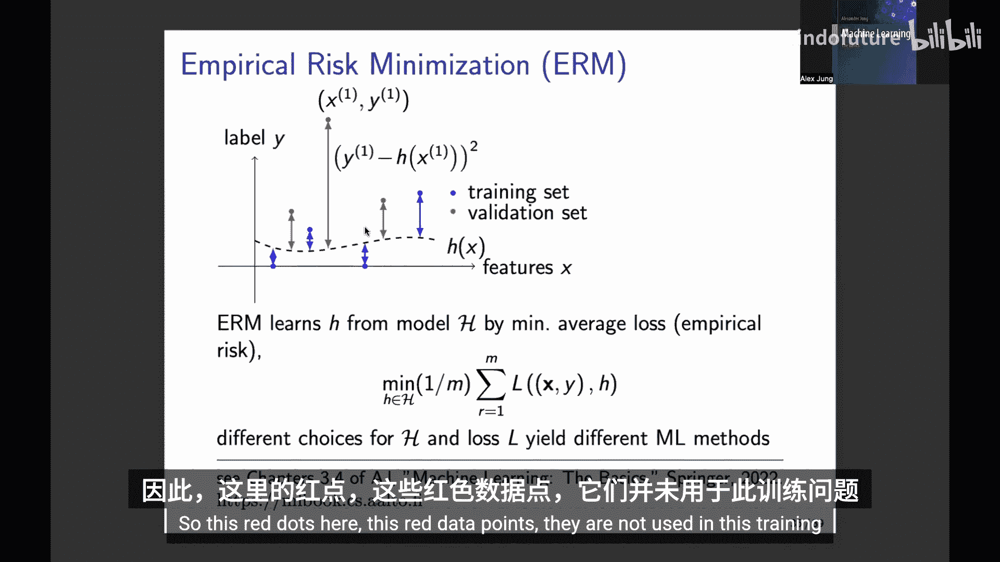

2.  **正则化**：一种防止过拟合的技术，通过在损失函数中添加惩罚项来约束模型复杂度。例如，岭回归（Ridge Regression）在平方误差损失基础上添加L2范数惩罚：
    `minimize (1/N) * Σ (y_i - h(x_i))^2 + λ * ||w||^2`
    其中 `λ` 是正则化强度参数，`w` 是模型参数。

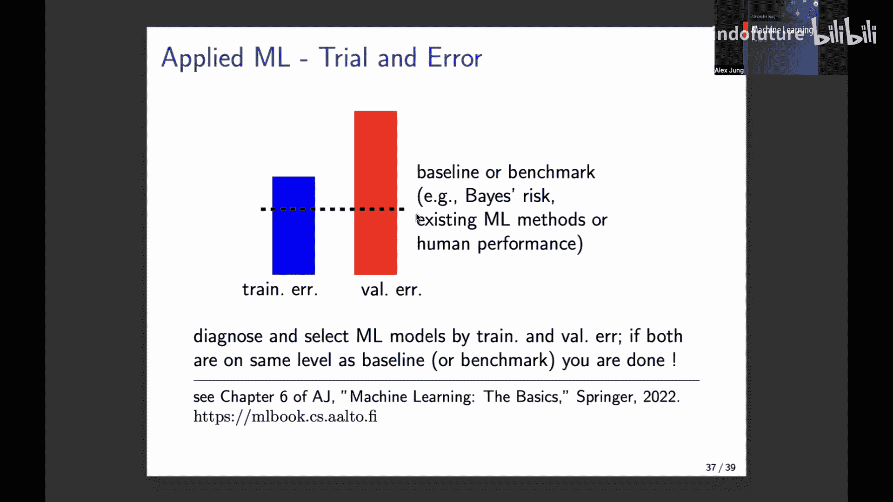

3.  **数据增强**：通过对原始训练数据进行一系列随机变换（如旋转图像、添加噪声）来人工扩展数据集，从而提高模型的泛化能力。

---

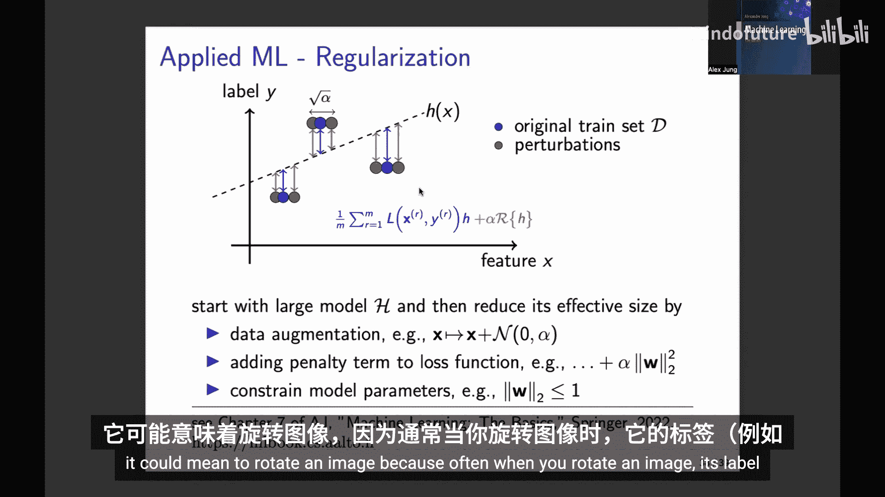

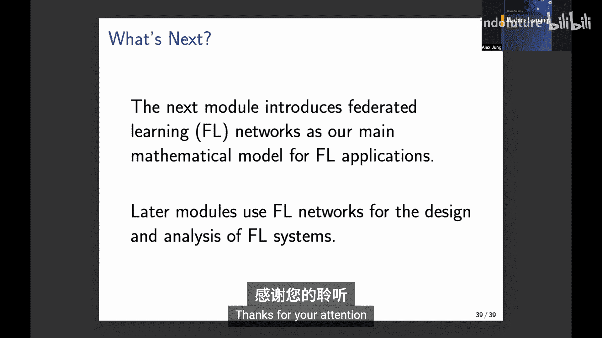

本节课中我们一起学习了联邦学习课程的概览，包括课程信息、目标、结构、评分方式，并初步了解了联邦学习的概念、特性及其与传统机器学习的区别。在下一个模块，我们将深入探讨如何用**网络模型**来为联邦学习应用建模，这是构建联邦学习系统的第一步。